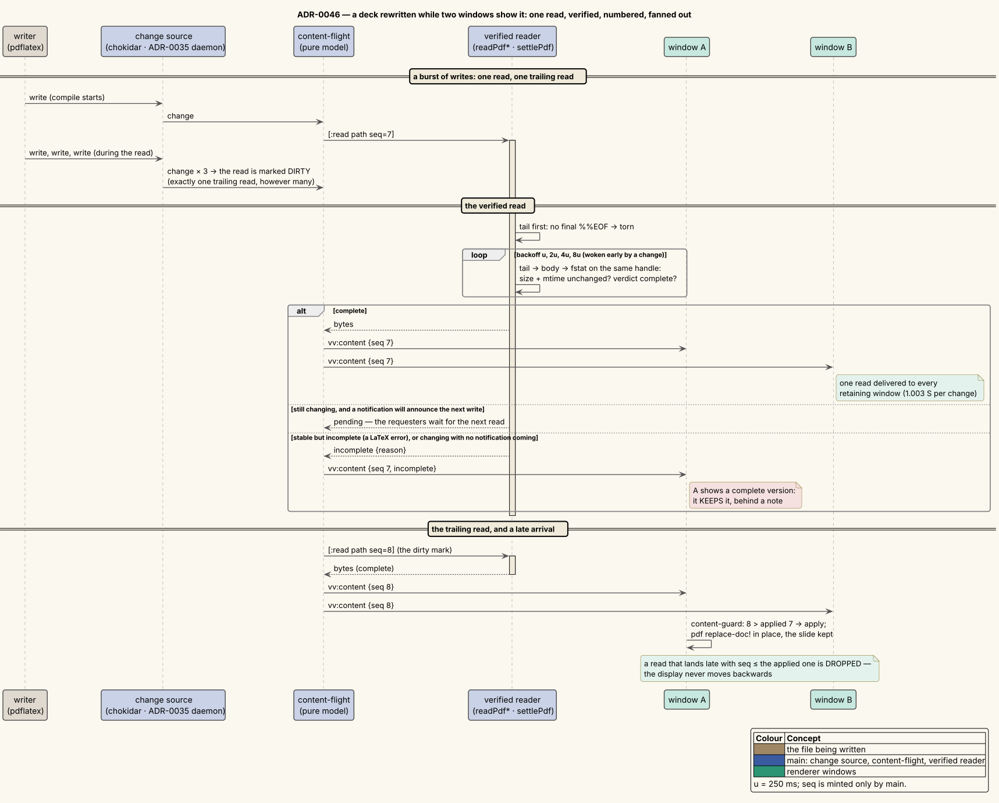

# 0046 — Reload-safe, pipelined remote reads

- **Status:** Accepted. Amends [ADR-0006](0006-multi-watcher-live-refresh.md), and adds dated notes to
  [ADR-0027](0027-remote-files-over-ssh.md) and [ADR-0035](0035-authenticated-remote-daemon-events.md).
- **Date:** 2026-10-17
- **Deciders:** vinary-viewer maintainers

## Context

The slide-deck work of ADR-0045 made one workflow central: a deck being written by LaTeX is open in the viewer,
often over SFTP, refreshed live by the ADR-0035 target daemon while the author edits or presents
(`vv sftp://host/talk.pdf`). That workflow exposed six problems, each confirmed in code before this decision.

| # | Problem | Why it happened |
|---|---|---|
| 1 | **Slow remote reads.** A whole-file read cost about one network round trip per 64 KiB against OpenSSH, and about three per 64 KiB against servers with a smaller read cap. A 32 MiB file at 50 ms took 26.3 s. | ssh2's read stream issues **one** request at a time; its read cap depends on the server's identity string (260 096 B for OpenSSH, 31 952 B otherwise). |
| 2 | **One full read per window per change.** | `send-open-content!` read the file once for each window that retained it. |
| 3 | **Out-of-order reloads.** An older read could land after a newer one and overwrite it. | Nothing ordered the payloads. The stamps could not: the renderer substitutes its own clock when a stamp is missing, web PDFs are stamped when the download ends, and two reads in the same millisecond collide. |
| 4 | **Torn reads.** A PDF read while pdflatex rewrites it in place is a fragment. | `awaitWriteFinish` waits for 80 ms of size stability, but a compile pauses mid-write for longer than that. Naive reads during real compile loops were torn 83–90 % of the time (docs/scientific/11 §9.7). |
| 5 | **A failed reload replaced the document with an error page.** | `vv:error` always became `:doc/error`, which remounts the view. |
| 6 | **Hangs and lost reads on a dropped connection.** | ssh2 silently drops writes on a dead channel, so a request issued after a drop could hang; and the idle reaper could close a connection in the middle of a read it did not know about. |

The measurements behind this ADR, with every hypothesis, prediction and refutation, are in
[docs/scientific/11 — Remote read and reload-safety experiments](../scientific/11-remote-read-and-reload-safety-experiments.md).

## Decision

### Reload safety — one read per path, ordered, fanned out

**One read per path.** A pure state machine, [`vinary.main.content-flight`](../../src/vinary/main/content_flight.cljs),
tracks each path's read: `{:seq :requesters :fanout? :dirty? :next}`. Its rules:

- An open **joins** the read already running for the path.
- A change notification during a read marks it **dirty**, which allows exactly **one** trailing read, however
  many notifications arrive.
- A `:pending` read (a PDF still being written, §Settling) carries its requesters over to the next read.
- Read numbers, `seq`, strictly increase across the process.

The machine emits its effects as data (`[:read path seq]`, `[:deliver path {…}]`), and the service driver
interprets them. It is unit-tested against four invariants:

1. at most one read is in flight per path;
2. a burst of notifications costs at most two reads;
3. `seq` strictly increases;
4. each requester receives each read it joined exactly once.

**Delivery.** The send functions became producers that return a payload (`local-payload`, `parsed-payload`,
`remote-payload`, `pdf-payload`). `deliver!` decorates a payload once, with its `seq` and a strictly increasing
stamp, `max(now, last + 1)`. It then sends it to every requester still alive and to every window retaining the
path, deduplicated.

**A read always completes, and every effect runs.** *(Amended 2026-10-17.)* The model trusts its driver to finish
every read it starts, so the driver never lets one go unfinished. A producer that throws, or a read whose Promise
rejects, completes with that error. The driver also interprets the effects one by one (`content-flight/run-effects!`),
so one that throws is logged and the next still runs. Each window's send stands alone too. Before this, a window
destroyed between its liveness check and its send made `deliver!` throw. The `[:read …]` that `complete` had emitted
after that delivery was then skipped, and the path's read stayed marked in flight with none running. Every later
request joined it, and the document stopped refreshing in every window until its last tab closed.

Explicit requesters are needed because `vv:open` can reach main before the window has told main it retains the
path. Local synchronous reads still deliver synchronously, so a document's `vv:content` still precedes its
`vv:tree`.

**Ordering in the renderer.** [`vinary.app.content-guard`](../../src/vinary/app/content_guard.cljs)`/stale?` drops
a payload whose `seq` is not newer than the `:doc/seq` the document applied. Both `:content/received` and
`:content/error` use it, so an older read's success or failure can never replace a newer one. A payload without
`seq` — a web-linked PDF, a test stub — is never stale. Only main mints `seq`.

**Keep the last good version.** A failure main reports for a document the window already shows writes a
`:doc/refresh-note`, never `:doc/error`. Such a failure carries a `seq`; renderer render failures do not. The
document stays on screen and `ui/refresh-note` floats a banner with Retry and dismiss over it. The next applied
read clears the note.

The wire format gained fields, not channels: `vv:error {path message seq refresh}` and
`vv:content {… seq incomplete incompleteReason}`. This changes behaviour on purpose: a deleted or unreadable file
keeps its last version behind a note, where it used to show an error page.



*Diagram source: [`../diagrams/seq-reload-safe-refresh.puml`](../diagrams/seq-reload-safe-refresh.puml).*

### Torn reads — a PDF is read verified

[`pdf_integrity.js`](../../src/vinary/main/pdf_integrity.js)`/verdict` accepts a buffer as a complete PDF only if
all three hold:

1. `%PDF-` appears in the first KiB;
2. the **last** `%%EOF` lies within the final KiB, which accepts incremental updates and trailing padding;
3. the `startxref` before it parses, points inside the file, and lands on `xref` or on an xref-stream object.

**The reads.**

- **Remote** (`readPdfRemote`):
  1. Reuse the stat and open a handle.
  2. Read only the **tail** first. `tailVerdict` judges the final KiB plus 64 bytes of slack, so a `startxref`
     line straddling the window edge still parses. A file still being written is refused there, after
     1 088 bytes and three round trips.
  3. Otherwise read the body, then `fstat` the **same handle**, compare size and mtime, and judge the whole buffer.
- **Local** (`readPdfLocal`): the same sequence on one file descriptor. Size, mtime and inode are compared.

### Settling

`settlePdf` retries a torn PDF on a backoff of u, 2u, 4u, 8u (u = 250 ms, overridable with `VV_PDF_SETTLE_MS`
for tests). A change notification wakes it early. It ends in one of three outcomes:

| What the attempts see | Outcome |
|---|---|
| A complete PDF | delivered |
| The file stable but still incomplete: the same size and mtime across attempts at least 6u apart (a LaTeX error, say) | delivered with `incomplete: true` and the verdict's reason |
| The file still changing, and a notification will announce the next write | `pending`: nothing is delivered, and the requesters wait for that read |
| The file still changing, and no notification will come (the CLI; a remote file without a daemon) | delivered with `incomplete: true`, reason `changing` |

A remote file counts as notified only once its ADR-0035 subscription is **live**
([`vinary.main.remote-subs`](../../src/vinary/main/remote_subs.cljs)).

A window that shows a complete version keeps it when an `incomplete` payload arrives: only the note and
`:doc/seq` are written, and the byte cache is untouched. An incomplete PDF with nothing to keep is shown as far
as pdf.js can recover it, flagged `:partial?`. If pdf.js cannot open it at all, the error page says it will appear
once the file is finished.

### Faster remote loading — a pipelined handle

[`ssh_transport.js`](../../src/vinary/main/ssh_transport.js)`/remoteOpenFile` returns a file **handle**,
`{readAt, readRange, readAll, fstat, close}`. It is registered with its connection, so a dropped connection rejects
it within a second, and the idle reaper spares a connection with a read in flight.

**The whole-file reader.**

- **Pipelining.** It keeps up to $`D`$ requests of $`C`$ bytes in flight, where $`C`$ is at most the server's
  read cap and $`D = \lceil 2\,\mathrm{MiB} / C \rceil`$, clamped to [4, 64]. The depth was chosen by experiment
  (docs/scientific/11 §9.5).
- **Out-of-order replies.** The server may answer outstanding requests in any order [SFTP-02 §7]. Each reply lands
  at its own offset in the buffer, so the order does not matter.
- **Memory.** It preallocates the file, refuses a file over the cap before any READ, and never returns
  uninitialised bytes. Peak memory is one copy of the file (H6), not two.
- **Edges.** It overlaps the end-of-file probe with the body. It adapts to a server that caps reads by re-requesting
  the remainder and shrinking $`C`$. After the first error it stops issuing requests, and if $`D > 1`$ it retries
  once at $`D = 1`$. It always closes the handle.

**Four further changes measured with it:**

| Id | Change | Why |
|---|---|---|
| E0 | `setNoDelay(true)` on every pooled SSH connection | Nagle's algorithm delayed small requests behind unacknowledged ones (docs/scientific/11 §9.1). |
| E2 | A remote open stats the document group's sibling candidates concurrently, overlapped with the read, and stats the opened file only once | A `.tex`/`.pdf` group needs its siblings at first paint, so they cannot be deferred — but they need not be sequential. |
| E4 | The SFTP channel's window is granted **eagerly**, as OpenSSH's client does: whenever more than 3 packets (3 × 32 KiB) are owed, up to 2 MiB | ssh2's policy left about 1 MiB in flight per round trip. H2's model holds again only with this (§9.4). |
| S7 | The streaming and paging source (`remoteCreateReadStream`) is a pipelined, backpressured `Readable` through the same handle: $`D`$ requests in flight, delivered in file order, no new request while the consumer is not reading, and an optional stat'ed `size` bounding the requests | Without it, a streamed read still cost one round trip per chunk. The end of the file costs no extra round trip (`73e40ed`). |

**Result.** OpenSSH 32 MiB at 50 ms: 26.3 s before, 991.8 ms after. H2's model,

```math
\hat t = 2R + R\cdot\max\!\left(\left\lceil \frac{S}{D\,C}\right\rceil,\ \frac{S}{W}\right) + t_{R=0},
```

holds within 16 % in every measured cell. Here $`R`$ is the round-trip time, $`S`$ the file size, $`W`$ the
2 MiB channel window, and $`t_{R=0}`$ the same read at zero latency.

**The connection pool.** A connection's own error, close or connect-failure now removes it from the pool **only if
the pool still maps its key to it** (`unpool`). Before, a stale connection's late `close` deleted its successor's
pool entry, leaving a live connection that `closeAll` never closed (found during E4; docs/scientific/11 §9.4).

### Re-validation — Back/Forward to a remote document

History navigation to a remote document the window still holds sends a **conditional** open:
`vv:open path {ifUnchanged: {size, mtime}}`, with the size and mtime of the version shown (`:doc/meta`).

- Main stats the file and reads it only when either value differs
  ([`vinary.main.revalidate`](../../src/vinary/main/revalidate.cljs)`/same-version?`). An unchanged document costs
  one stat instead of a download.
- A read already running for the path is joined, so the window still gets the newest version.

**Why history may show the earlier copy.** HTTP's caching specification states the principle: "a history mechanism
can display a previous representation even if it has expired" [RFC 9111 §6]. Re-validating on Back is therefore a
courtesy, not a duty.

**Blind spot.** SFTP times have one-second resolution, so a rewrite that keeps the size within the same second is
not detected. The live-refresh path (the daemon, the poller), which is independent of history, still delivers
that change.

## Consequences

**Measured.**

- A change to a remote deck that three windows retain costs $`1.003\,S`$ bytes (one read plus a 1 088-byte tail
  probe), down from $`3S`$ (H4, `remote-pdf-e2e`).
- No torn PDF is delivered as complete: 0 of 27 311 local and 0 of 926 remote complete deliveries during real
  pdfLaTeX, LuaLaTeX and XeLaTeX compile loops (H5).

**What the user sees.**

- A refresh never shows a half-written deck, never moves the display backwards, and never replaces the document
  with an error page. The slide stays (ADR-0045 §Live refresh).
- A deleted or unreadable file keeps its last version behind a note, where it used to show an error page.

**Seams and tooling.**

- `vv --cli` and `vv --tui` read PDFs with the same verified readers. A PDF caught mid-write gets about 4 s
  (15u) to finish, then renders as it stands, flagged.
- New pure namespaces — `content-flight`, `content-guard`, `revalidate`, `remote-subs` and `pdf_integrity.js` —
  carry the logic, so it is unit-tested without Electron or a network.
- The benchmark `npm run bench:remote` and the torn-read instrument `scripts/exp-torn-pdf-reads.cjs` remain as
  instruments.

## Alternatives considered

- **Order payloads by their stamp.** Rejected: stamps come from several clocks, and two reads in one millisecond
  collide. Only a number main mints can order reads.
- **ssh2's `fastGet` for whole files.** Rejected: it writes to a local file. Its in-memory variant would still
  have needed the handle's registration with its connection, the cap, the preallocation and the EOF handling,
  which together are the reader.
- **Wait a fixed delay after every change before reading a PDF.** Rejected: any fixed delay is either too short
  for a long compile or too long for a short one. The verified read costs nothing when the file is complete.
- **Retry a failed refresh silently, forever.** Rejected: retries are bounded (four, about 4 s in all), and the
  user sees a note with Retry rather than a frozen document.
- **Stream PDFs instead of reading them whole.** Rejected: pdf.js needs the cross-reference table at the end of
  the file, so a PDF cannot be rendered before it is complete.

## Verification

| Area | Tests |
|---|---|
| Pure models | unit tests: `content_flight_test` (the four invariants above), `content_guard_test`, `revalidate_test`, `remote_subs_test`, `reopen_test` |
| Integrity, settling and group stats | `content-service-smoke`: integrity vectors (complete, truncated, junk after `%%EOF`, incremental, linearized-like, bad `startxref`, xref stream); the tail read first; a torn file delivered only as one version or the other; complete / pending / incomplete outcomes; the group-stat concurrency guard with three negative controls |
| Transport | `ssh-transport-smoke`: `testNoDelay`, `testPipelinedReader`, `testEagerWindow`, `testStaleCloseKeepsSuccessor`, `testPipelinedStream` |
| The real app over SFTP | `remote-pdf-e2e` (bytes per change, ordering under a delayed read, torn and refused reads, a drop while presenting, the conditional re-open); `watch-e2e` (a burst of six local writes costs five reads, and both windows end on the same read number) |
| Measurements | [docs/scientific/11](../scientific/11-remote-read-and-reload-safety-experiments.md), with the regression guards of its §10 |

## References

- [docs/scientific/11 — Remote read and reload-safety experiments](../scientific/11-remote-read-and-reload-safety-experiments.md)
- [ADR-0006 — Multi-watcher live refresh](0006-multi-watcher-live-refresh.md),
  [ADR-0027 — Remote files over SSH](0027-remote-files-over-ssh.md),
  [ADR-0035 — Authenticated remote daemon events](0035-authenticated-remote-daemon-events.md)
- **[RFC 9111]** R. Fielding, M. Nottingham, J. Reschke (eds.), *HTTP Caching*, RFC 9111, 2022, §6 "Relationship to
  Applications and Other Caches". [doi:10.17487/RFC9111](https://doi.org/10.17487/RFC9111)
- **[SFTP-02]** T. Ylonen, S. Lehtinen, *SSH File Transfer Protocol*, draft-ietf-secsh-filexfer-02, October 2001 (the
  version ssh2 speaks). §7: "the server is allowed to send responses to them in a different order from the order in
  which the requests were sent", while requests "relating to the same file" MUST be processed in the order received.
  <https://datatracker.ietf.org/doc/html/draft-ietf-secsh-filexfer-02>
- **[ISO-32000]** ISO 32000-1:2008, §7.5.5 *File Trailer* (`startxref`, `%%EOF`) and §7.5.6 *Incremental Updates*.
  Adobe's public copy: <https://opensource.adobe.com/dc-acrobat-sdk-docs/pdfstandards/PDF32000_2008.pdf>
