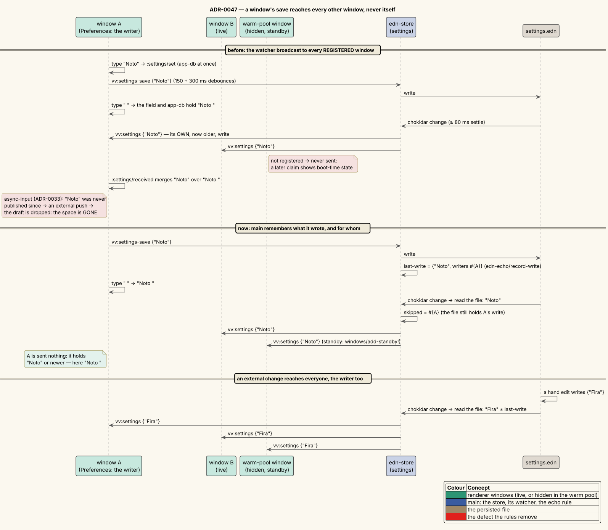

# 0047 — Persisted-state stores: one implementation, no self-echo, warm-pool windows kept current

- **Status:** Accepted. Builds on [ADR-0033](0033-asynchronous-text-input.md) (a text field owns its DOM value; an
  unpublished model value is an external push) and on the `awaitWriteFinish` watcher recipe of
  [ADR-0006](0006-multi-watcher-live-refresh.md).
- **Date:** 2026-10-17
- **Deciders:** vinary-viewer maintainers

## Context

Five files under `~/.config/vinary-viewer/` hold state that every window shares: `settings.edn` (theme, fonts),
`keybindings.edn` (the keymap registry), `recent.edn` (the directory trail and the recent-files MRU),
`connections.edn` (non-secret SSH host entries) and `extensions.edn` (ad-block and extension prefs). The renderer
owns the state and writes it back as EDN text; main persists it and watches the file, so a hand edit or another
window's change reaches every window. Five namespaces — `vinary.main.settings`, `.config`, `.recent`, `.connections`
and `.ext-config` — each implemented that loop as its own copy of the same forty lines: read the file, write it on
`<channel>-save`, push it on `<channel>-request`, and broadcast it from a chokidar watcher to every registered
window.

Re-measuring the input-latency benchmark in a window that actually paints (docs/scientific/10 §12) exposed two
defects in that loop, both confirmed by experiment before this decision:

| # | Defect | Why it happened |
|---|---|---|
| 1 | **A Preferences font field lost characters** typed across its own save: typed `Noto Sans` held ` Sans`, `ans` or `Noto Sns` (4 of 4 fast-cadence rows in two ladder runs). | The watcher broadcast the file to **every** window, the writer included. The writer's save is debounced (150 ms apply + 300 ms save) and the watcher waits 80 ms for the write to settle, so the echo arrives about 0.5 s after the save began — by then the user may have typed more. `:settings/received` merged the older text over app-db; ADR-0033's field, correctly, treated an unpublished value as an external push, dropped its draft and showed the older value. |
| 2 | **A window claimed from the warm pool showed state from its own boot.** After a settings save, the live window held the new font and `settings.edn` held it; the pool window still held the old one. | Broadcasts went to registered windows only, and pool windows are deliberately unregistered (no global action may target a hidden window). A claim showed the pool window as it was. |

Defect 1 had been invisible: the benchmark had measured a hidden window whose renders came about once a second,
so the stale value was overwritten before it was ever rendered (docs/scientific/10 §12).

## Decision

**One implementation.** [`vinary.main.edn-store`](../../src/vinary/main/edn_store.cljs) implements the loop once; each
of the five namespaces now holds one store (`edn-store/store {:file :channel :request :save :unlink-text}`) and
keeps its public `init!`/`push!` (and `ext-config/load-config`). The three channel names of a store are spelled out
where it is defined, so each literal stays greppable and visible to the IPC reference's lint gate.

**Rule 1 — a window never receives its own write back.** A save is written verbatim, and main remembers the text
and the window it wrote it for ([`vinary.main.edn-echo`](../../src/vinary/main/edn_echo.cljs) `record-write`; a second
window saving the identical text joins the record). When the watcher fires, main reads the file and broadcasts it to
every window **except** the windows it last wrote exactly that text for (`edn-echo/skipped`).

- *Why it is safe for the writer.* The writer's app-db produced that text, and only moves forward from it (its own
  later edits, or an external change that main *does* deliver). So it already holds the echoed state or a newer one.
- *Why it is complete for everyone else.* Any other text — a hand edit, another window's later save, a deleted
  keymap's `""` — is news to every window, the last writer included.
- *Why it compares the text at broadcast time.* The handler reads the file when it runs, after any save that landed
  meanwhile, so the comparison is with what the windows will actually receive.
- *The one interleaving it cannot order.* A hand edit that lands while a window's save of OLDER state is still in
  flight: the window receives and merges the hand edit, then main writes the in-flight save over it, and that window
  and the file disagree until the window's next save writes its merged state back. Whole-file, last-writer-wins
  persistence has this race whichever side applies the rule (the alternative below has it in the same interleaving);
  it needs a hand edit and a save within about half a second of each other.

*Diagram source: [`../diagrams/seq-edn-store-echo.puml`](../diagrams/seq-edn-store-echo.puml).*

**Rule 2 — the warm-pool windows receive the broadcasts.** A pool window becomes a STANDBY window when it lands in
the pool (`windows/add-standby!`, in the same `did-finish-load` handler as the stores' initial pushes, so no change
can fall between them) and stops being one when it is claimed or closed. `windows/broadcast!` sends to the live
windows and the standby windows; actions (`windows/active`, `windows/send!`) still never target a hidden window.

## Consequences

**Measured** (docs/scientific/10 §13).

- Typing `Noto Sans` into a Preferences font field across its own save keeps every character at 150, 40 and 25 ms
  per character, where 4 of 4 fast-cadence rows lost characters before. A harness that only DROPPED the echo
  (`VV_BENCH_DIAG_SWALLOW=vv:settings`) on the old build removed the loss as well — the causal check.
- A warm-pool window holds a change made while it waits (before: its boot-time value), and a claim shows the pool
  window as it is — so the window a claim opens is current.

**What the user sees.** A font name typed with a pause between words keeps its characters; a new window opens with
the current theme, fonts, keymap, recent files and connections.

**Side effect removed.** A keymap save no longer re-runs `:keymap/config-received` in the saving window, which
re-installed the keymap and reset its input mode.

**Seams.** The echo rule is pure and unit-tested (`edn_echo_test`); `watch-e2e` asserts both rules against the real
main (a save reaches the other live window and the pool window, never its writer; a hand edit reaches all); and
`find-e2e`'s T7 types into Preferences across a save, timed off the file main writes so the race is armed every run.

## Alternatives considered

- **The renderer ignores texts it saved itself.** Each window would keep a bounded list of the texts it saved and
  drop a broadcast that matches one (ADR-0033's echo test, applied to stores). It gives the same outcomes, including
  the one race above. Rejected as the more complex place for the rule: five `:*/received` handlers and a per-window
  list, against one record in main — and main then need not send the writer anything at all.
- **Stop broadcasting changes main wrote itself.** Rejected: the other windows need them (cross-window sync is the
  point of the watcher); only the writer must be skipped.
- **Re-push every store when a pool window is claimed.** Rejected: the claim shows the window at once, so the old
  theme could paint for a frame before the push is applied; keeping the pool window current costs nothing and has no
  such window.
- **Patch the five copies in place.** Rejected: the defect lived in the shared shape, not in any one store, and five
  copies of one rule drift.

## Verification

| Area | Tests |
|---|---|
| The echo rule | unit: `vinary.main.edn-echo-test` — the writer skipped; identical saves from two windows; a hand edit, another window's later save and a deleted file reach everyone; a burst of saves from one window |
| The real main | `watch-e2e`: a settings save reaches the second live window and the warm-pool window, never its writer; a hand edit reaches all three |
| The symptom | `find-e2e` T7: `Noto`, then ` Sans` started the moment main has written `Noto` — every character survives, no programmatic write takes one back; it fails on the pre-fix build |
| Measurement | `npm run bench:input` (prefs rows intact at 150 / 40 / 25 ms) and docs/scientific/10 §13 |

## References

- [docs/scientific/10 — The text-input latency experiments](../scientific/10-input-latency-experiments.md), §12–§13
- [ADR-0033 — Asynchronous text input](0033-asynchronous-text-input.md),
  [ADR-0006 — Multi-watcher live refresh](0006-multi-watcher-live-refresh.md)
- chokidar `awaitWriteFinish` — <https://github.com/paulmillr/chokidar#performance>
