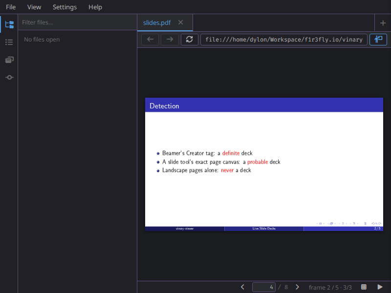
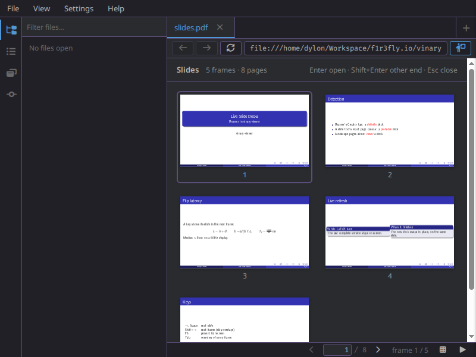
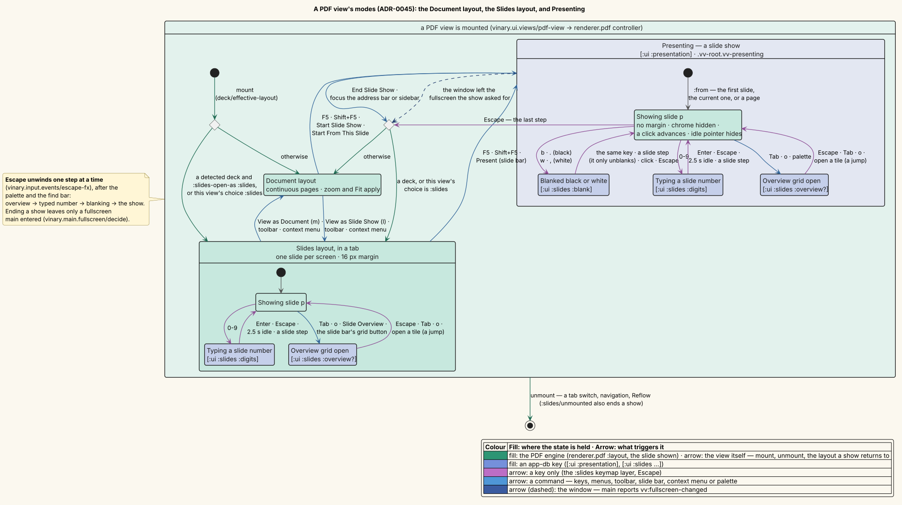
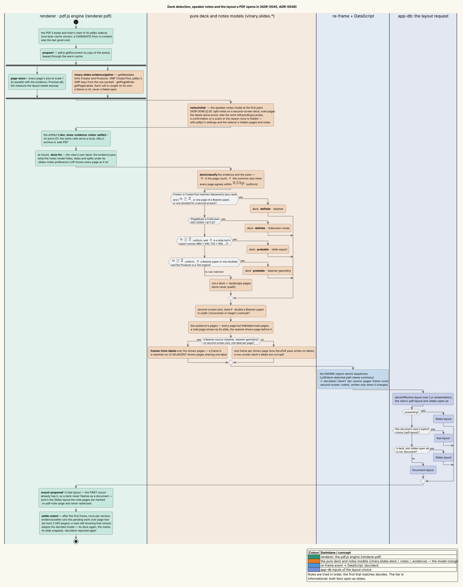
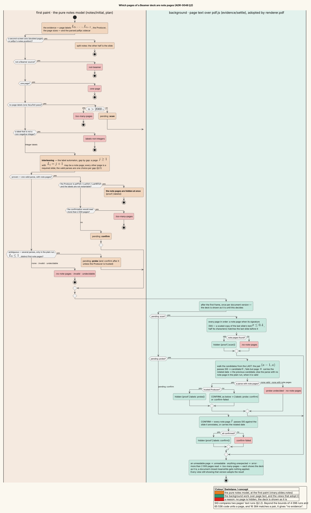
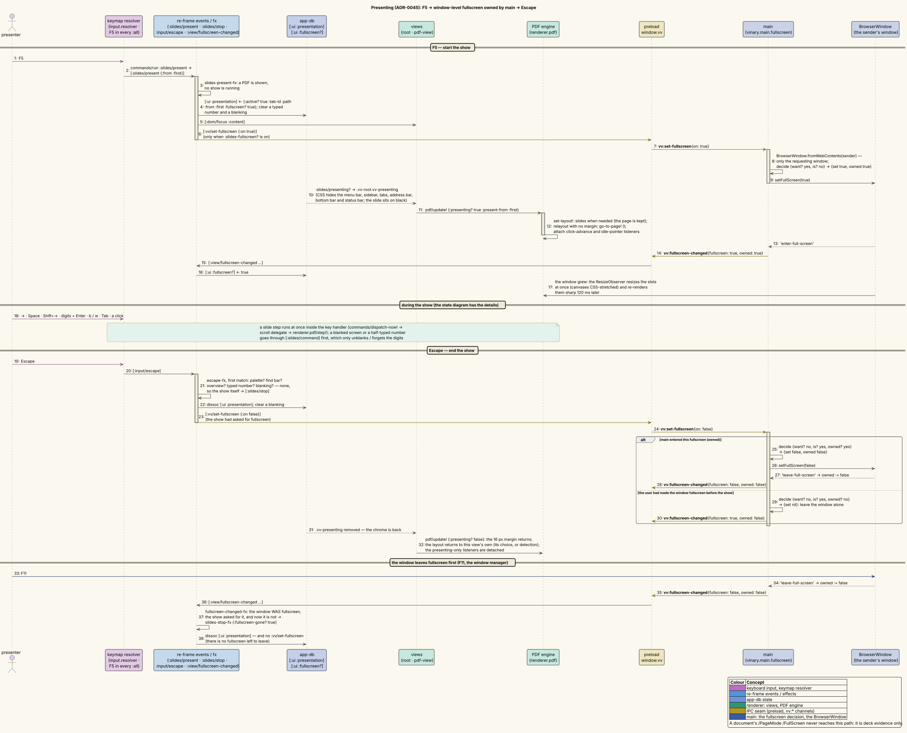
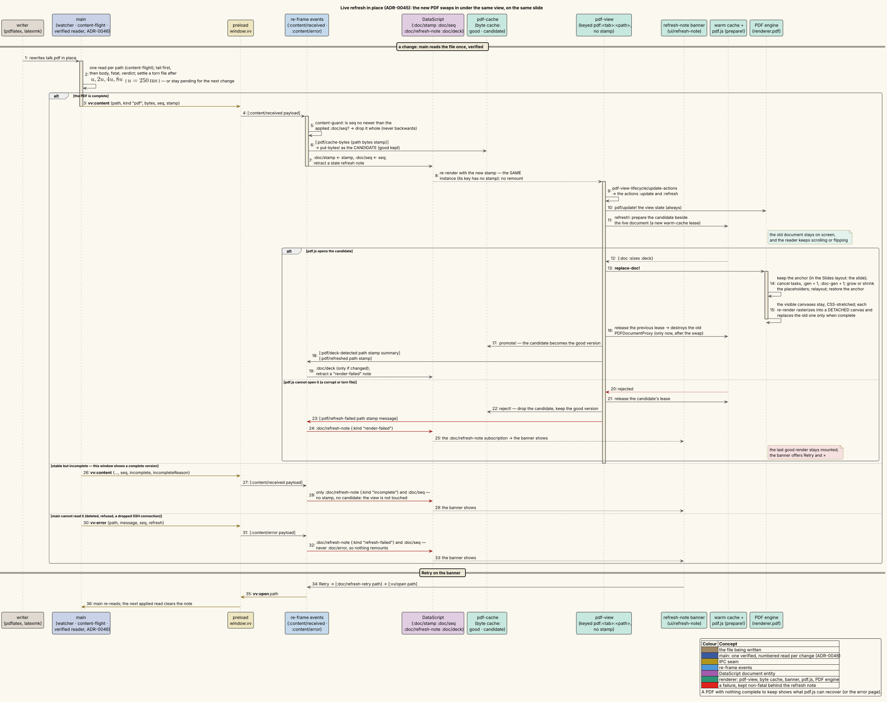

# Slide shows — Beamer and slide-tool decks, one slide per screen

**Status: Available now.**

---

## 1 · What it is

A PDF that is a **slide deck** — a Beamer deck from pdfLaTeX, LuaLaTeX or XeLaTeX, or a PowerPoint, Google Slides,
LibreOffice Impress or Keynote export — opens in the **Slides layout**: one slide per screen, fitted and centred,
with no scrollbar. The keys you already scroll with flip slides instead, in every keymap set; Shift skips a Beamer
frame's remaining overlays; typing a number and Enter goes to the slide that carries that number. **F5** starts a
**slide show**: the app's chrome disappears, the slide fills the window on black, and the window goes fullscreen until
you press Escape. **Tab** opens an **overview** grid of every frame. While you edit the deck — locally, or over
`ssh://` / `sftp://` — each recompile swaps in place, on the slide you are on, and a half-written PDF is never shown.

Any PDF can be shown this way: **View ▸ View as Slide Show** switches a paper into the Slides layout, and F5 presents
any PDF. The design is recorded in [ADR-0045](../design-decisions/0045-slide-deck-presentation.md); the detection
corpus and the flip-latency measurements are [experiment 12](../scientific/12-slide-deck-detection-and-flip-latency.md).

| Term | Meaning |
|---|---|
| deck | A PDF the viewer classifies as slides (§2, *Which PDFs open as slides*). |
| frame | Beamer's unit, one `\begin{frame}`. A frame with overlays (`\pause`, `<2->`) compiles to several pages — its **overlays** — that share the frame's number as their page label. |
| Slides layout · Document layout | One slide per screen · the continuous, scrolling pages of [feature 11](11-native-pdf.md). |
| slide show (presenting) | The Slides layout full-window, chrome hidden, usually fullscreen. |
| overview | A grid with one tile per frame, over the slides. |



*A LuaLaTeX Beamer deck ([`samples/slides.tex`](../screenshots/samples/slides.tex)) in the Slides layout: page 4 of
8, frame 2 of 5, its third and last overlay. The address bar's slides button is pressed; the slide bar replaces the
zoom control.*

---

## 2 · How to use it

### Which PDFs open as slides

A PDF opens as slides when the detector recognizes it as a deck. The rules are tried in order, and the first that
matches decides ($`n`$ is the page count; two sizes count as equal when both dimensions agree within
$`0.5\,\mathrm{bp}`$, where $`1\,\mathrm{bp} = \tfrac{1}{72}\,\mathrm{in}`$ is a PDF point):

| Recognized as | Because |
|---|---|
| **definite · Beamer** | Its `Creator` (or XMP `CreatorTool`) names Beamer — `beamer.cls` writes "LaTeX with Beamer class" — and it has $`n \ge 2`$ pages, or one page of Beamer paper. |
| **definite · full-screen mode** | It asks to open in full-screen mode (`/PageMode /FullScreen`). The viewer reads that as evidence only; it never goes fullscreen by itself. |
| **probable · slide export** | $`n \ge 2`$ pages, all one size, and that size is a slide tool's exact export canvas: 960 × 540, 720 × 540, 720 × 405, 720 × 450, Impress's 793.7 × 595.3, 793.7 × 446.5 and 793.7 × 496.1, or Keynote's 1024 × 768 and 1920 × 1080 (provenance in the ADR). |
| **probable · Beamer geometry** | $`n \ge 2`$ pages, all one Beamer paper size, from a TeX engine — a Beamer deck whose `\hypersetup{pdfcreator=…}` was overridden. |
| not a deck | Everything else. **Landscape pages alone never make a deck**: landscape figures, Letter-landscape print-outs and forms are documents. |

A recognized deck opens as slides unless Preferences ▸ Slides ▸ *Open detected slide decks as* is *Document*. Either
way, the choice per PDF is yours:

- **View ▸ View as Slide Show** (Alt+V, L), the address bar's slides button, or right-click a page ▸ *View as Slide
  Show* switches the shown PDF to the Slides layout; the same places offer **View as Document** (Alt+V, M) to switch
  back.
- The choice belongs to that **document view**: Back and Forward bring it back with the page, and the next PDF you open
  in the tab starts from detection again.

### Keys

Nothing needs rebinding: every scroll key of every keymap set flips slides in the Slides layout, and a small set of
slide keys is added on top.

| Action | Standard | Vim (normal mode) | Emacs |
|---|---|---|---|
| Next slide — one overlay | → ↓ PgDn, Space, Enter | → ↓ PgDn, `j` `l` `C-d` `C-f`, Enter | → ↓ PgDn, `C-n` `C-v`, Space, Enter |
| Previous slide | ← ↑ PgUp, Shift+Space, Backspace | ← ↑ PgUp, `k` `h` `C-u` `C-b`, Shift+Space, Backspace | ← ↑ PgUp, `C-p` `M-v`, Shift+Space, Backspace |
| Next **frame** — skip this frame's remaining overlays | Shift+→ Shift+↓ Shift+PgDn | the same | the same |
| Previous frame — shown fully built | Shift+← Shift+↑ Shift+PgUp | the same | the same |
| First / last slide | Home / End | Home / End, `g g` / `G` | Home / End |
| Go to slide *n* | digits, then Enter | the same | the same |
| Delete the last typed digit | Backspace | the same | the same |
| Overview grid | Tab, `o` | the same | the same |
| Start a show from the first / the current slide | F5 / Shift+F5 | the same | the same |
| Present in New Window: the notes here, the slides in a second window | `S` (Shift+s) | the same | the same |
| During a show: black / white screen | `b` `.` / `w` `,` | the same | the same |
| Speaker notes: the presenter view on / off | `s` | the same | the same |
| During a show: this window's fullscreen on / off | `F` (Shift+f) | the same | the same |
| Cancel, one step at a time | Escape, Ctrl+G | Escape | Escape, `C-g` |

- **The mouse and touch.** The mouse wheel and a trackpad flip slides one at a time: one notch of a mouse wheel is
  one slide at any window zoom (about 90 device-independent pixels of scrolling flip one, as in pdf.js's
  presentation mode), and after each flip the wheel rests for 50 ms, so one fling cannot skip several slides. During a show a click advances and Shift+click goes back — not on a link, not when it ends a text selection or a drag. On a touch
  screen or with a pen, a quick, mostly horizontal swipe of at least 48 px flips a slide (leftward forward); a mouse
  drag selects text instead.
- **Typing a number.** A "Go to 12" chip shows what you typed. The number names the label printed on a Beamer slide
  — its frame number — first, and otherwise the page number; Enter goes there, Backspace deletes a digit, and Escape,
  any slide step or 2.5 s of quiet forgets it.
- **Escape unwinds one step at a time**, after the palette and the find bar: the overview, a typed number, a blanked
  screen, then the show itself.
- **When the slide keys apply.** Space, Shift+Space, Backspace, Enter, the Shift+arrows, `b` `.` `w` `,`, `s`, `F`, Tab,
  `o` and the digits form a `:slides` layer that is active only while a PDF shows in the Slides layout **and** the keyboard is
  on the document — not in a text field, the sidebar, the address bar, or an open menu, dialog or prompt. The layer
  sits below the current mode, so in Vim's normal mode Space stays the leader (use →, `j` or PgDn there; Space flips
  in insert mode). It is identical in every set and can be overridden like a mode, under `:keymaps {:slides {…}}` in
  `keybindings.edn` ([feature 15](15-custom-keybindings.md)). F5, Shift+F5 and `S` work in any mode, wherever the
  keyboard is, as the View menu's items do.

### Presenting

1. **Start.** F5 presents the shown PDF from its first slide; Shift+F5, the slide bar's Present button or **View ▸
   Start from Current Slide** from the slide you are on; right-click a page ▸ **Start From This Slide** from that page. Any PDF
   can be presented, deck or not. F5 again during a show goes back to the first slide.
2. **What changes.** The menu bar, sidebar, tabs, address bar, bottom bar and status bar hide; the slide fills the
   window on black with no margin; the window goes fullscreen (Preferences ▸ Slides ▸ *Present full screen*, on by
   default). Only the window you started in goes fullscreen. The pointer hides after 2.5 s without moving. The SSH
   password prompt, the palette, the context menu and the find bar still appear over the show, and a refresh note
   stays visible but compact.
3. **During the show.** Every key above works. `b` or `.` blanks the screen to black and `w` or `,` to white; the same
   key again, a slide step, a click or Escape brings the slide back — a slide step only unblanks, so the audience sees
   the slide they left.
4. **End.** Press Escape (once per open step), choose **End Slide Show** from the right-click menu or the palette, or
   leave fullscreen yourself (F11, your window manager). Switching tabs, navigating, or focusing the address bar or
   the sidebar also ends the show. A window you had made fullscreen before the show stays fullscreen afterwards; the
   app leaves only a fullscreen it entered.

### The overview

Tab or `o` (also **View ▸ Slide Overview**, the slide bar's grid button, or the palette's *Slide overview* / *Go to
slide…*) opens a grid with **one tile per frame**, each showing the frame fully built (Preferences can show each
frame's first overlay instead). The current frame's label is highlighted.

| Key or gesture | In the overview |
|---|---|
| ← → | the previous / next tile, in reading order |
| ↑ ↓ | the tile above / below, in the same column |
| PgUp / PgDn | a screenful of rows up / down |
| Home / End | the first / last tile |
| digits | select the frame with that label (the number on its slide) |
| Enter · click | open the tile's page |
| Shift+Enter · Shift+click | open the frame's other end (its first overlay, by default) |
| Escape · Tab · `o` | close the overview |

Opening a slide from the overview is a **jump**, so Back (the palette's *Back to the slide before the last jump*, or
the deck's own back link) returns. Thumbnails render lazily near the visible part of the grid, and far ones are
released, so a 150-slide deck stays light.



### Without the keyboard

- **View menu** (PDF only): *View as Slide Show* (L) ↔ *View as Document* (M); *Start Slide Show* (H, F5); *Start
  from Current Slide* (U, Shift+F5); and, in the Slides layout, *Slide Overview* (E, Tab). *Fit* is shown only in the
  Document layout, because slides fit themselves; *Reflow Text* now uses W.
- **Right-click a page:** *Start Slide Show*, *Start From This Slide* and *View as Slide Show* / *View as Document*;
  during a show, *End Slide Show*.
- **The address bar's slides button** (a person at a chalkboard), shown for any PDF, switches the layout and shows
  pressed in the Slides layout.
- **The slide bar** replaces the zoom control at the bottom in the Slides layout: ◀ · the page field (a physical page
  number: type it and press Enter, or Escape to cancel) · "/ N" · ▶ · "frame f / F · o/O" (for a deck with overlays)
  · the overview button · the present button (from this slide). The arrows, the page field and the address bar's
  button hand the keyboard back to the slides afterwards, so the next Space or Enter flips a slide instead of pressing
  the button again.
- **The palette** (Ctrl+Shift+P) offers a *Slides* category while a PDF is in the Slides layout — next / previous
  slide and frame, first and last, back and forward through the jump history, the overview and *Go to slide…*, the
  black and white screens and *End slide show* during a show, *Start slide show* (from the first or the current
  slide) for any PDF — and *View as slide show / document* under *View*.

### Links inside the deck

A link to another page is a **jump**: it records where you came from, and Beamer's back link (or the palette) returns
there, in both layouts. Beamer's navigation symbols work: the next / previous slide arrows are ordinary links, and the
back–find–forward symbol's *GoBack*, *Find* (opens the find bar) and *GoForward* are honoured, as are *NextPage*,
*PrevPage*, *FirstPage* and *LastPage* links. Every other PDF named action — *Print*, *SaveAs*, *Quit*,
*FullScreen*, … — stays inert, so a document cannot print, save, quit or make the window fullscreen.

### Decks with speaker notes

Beamer writes speaker notes into the PDF in one of two ways, and the Slides layout shows only the audience's slides
in both ([ADR-0048](../design-decisions/0048-speaker-notes-and-linked-presenter-windows.md) §1–§5):

- **`\setbeameroption{show notes}`** puts a **note page** after the slide it annotates: a small copy of the slide at
  the top, then the notes. In the Slides layout the note pages leave the sequence. → and ← step over them, a typed
  number counts only the audience's frames, the overview has no tile for them, find does not stop on them and Tab
  does not reach their links. A note page is never even drawn there. A show started from a note page (right-click ▸
  **Start From This Slide** in the Document layout) starts on its slide. **View as Document** shows every page, notes
  included and searchable.
- **`\setbeameroption{show notes on second screen=<side>}`** doubles every page: the slide on one half, its notes on
  the other. The Slides layout shows the slide half (*Notes on a second screen* under Preferences, below).

**How note pages are recognized.** pdfLaTeX and LuaLaTeX write page labels in which a note page carries its own page
number, so the labels alone usually prove which pages are note pages, before the first slide is drawn. When the
labels leave a choice, or the deck has none (a single XeLaTeX pass, §4 *Limitations*), the viewer compares page text
in the background: the top of a note page holds a scaled-down copy of its slide's text. As soon as that is decided
the deck changes and the slide you are on stays on screen. A deck whose note pages cannot be told apart from its slides
is shown as it is, every page a slide. `vv --cli --deck-info` (below) shows what was decided, and how.

**pdfpc files.** A `talk.pdfpc` file beside `talk.pdf` — the sidecar [pdfpc](https://pdfpc.github.io/) writes, in
its JSON format or its older text format — is read with the PDF. The pages it marks hidden are skipped, as pdfpc skips
them, and its notes and settings (duration, end slide, notes position) are kept with the deck. pdfpc.sty's settings in
the PDF's own metadata win over the sidecar's, as they do in pdfpc. Saving the sidecar refreshes the open deck. Over
`sftp://` the sidecar is read with every read of the PDF, so an edit to it alone shows at the PDF's next change.

**Where the notes are shown: the presenter view.** Press `s` (or **Slides: Speaker notes** in the palette) in the
Slides layout, windowed or during a show, and the window splits. The slide keeps the left 58 % and a pane takes the
right 42 %:

- a counter, "Slide 7 / 12 · overlay 2 / 3", that counts the audience's frames (up to pdfpc's end slide);
- the notes of the slide you are on: its note pages (`show notes`), its notes half (`show notes on second screen`), and
  its text notes (pdfpc notes, and sticky-note annotations from a PDF reader);
- the next slide, small.

Every slide key still works, and flips stay instant. `s` again goes back to the audience view. A show that starts in
the audience view gives the choice back when it ends. The first time a deck with notes is presented, a hint names `s`
for a few seconds, once per installation. pdfpc notes are Markdown, as in pdfpc, unless the deck turns Markdown off;
they pass through the same sanitizer as a Markdown document. Any other note is plain text.

### Notes in one window, slides in another

**Present in New Window** (`S`, that is Shift+s; **View ▸ Present in New Window**; the palette) keeps the speaker notes
in the window you are in and shows the slides in a second window, the **audience window**
([ADR-0048](../design-decisions/0048-speaker-notes-and-linked-presenter-windows.md) §8). It is offered for every PDF,
notes or not: the counter and the next slide help without them.

1. **Start.** Press `S` in the window that shows the deck. That window starts the show from the slide you are on and
   switches to the presenter view (the counter, the notes, the next slide). The audience window opens with the
   slides, without taking the focus:
   - with a second display, it opens there; with Preferences ▸ Slides ▸ *Present full screen* on, both windows go
     fullscreen, each on its own display;
   - with one display, it opens beside the first, windowed: share it in a video call;
   - on Wayland, the compositor places it: move it to the other screen and press `F` in it.

   The presenter view's status strip says which of these happened, and says *Waiting for the audience window…* until
   the audience window's slides show.
2. **Either window drives.** A flip, a typed number, an overview pick, a link, a click or a blank (`b`, `w`) in either
   window is shown at once in the other. While the notes are shown, a blank leaves your screen as it is and shows a
   badge, *Audience: black* or *Audience: white*, over your slide.
3. **Swap screens.** When the audience window went to the wrong display, press **Swap screens** in the status strip
   (or *Swap the presenter and audience screens* in the palette): each window moves to the other's display and keeps
   its fullscreen. It is offered only when the two windows were placed on separate displays.
4. **End.** Escape, or *End Slide Show*, in either window ends the show in both and closes the audience window. Closing
   the audience window yourself ends only the link: your window keeps presenting, and `S` opens a new audience window.
   `S` while linked brings the audience window to the front instead of opening another. A window takes part in one
   linked show at a time.

SSH prompts for the audience window (a host key, a password) appear in your window, never on the projector, and the
audience window's size and position are never saved.

### Preferences

**Settings ▸ Preferences… ▸ Slides**, stored in `settings.edn` ([configuration](../usage/05-configuration.md)):

| Preference | Alt key | Choices — default first | `settings.edn` key |
|---|---|---|---|
| Open detected slide decks as | O | Slides (one per screen) · Document (continuous pages) | `:slides-open-as` `:slides` / `:document` |
| Overview shows each frame | W | Fully built (its last overlay) · At its first overlay | `:slides-overview-page` `:last` / `:first` |
| Slide transition | R | None (instant) · Fade · Push | `:slides-transition` `:none` / `:fade` / `:push` |
| Notes on a second screen | N | Auto (notes on the right, or below) · Notes on the right · on the left · below · above · Show whole pages | `:slides-notes` `:auto` / `:right` / `:left` / `:bottom` / `:top` / `:off` |
| Present full screen | U | on · off | `:slides-fullscreen?` |
| Click advances the slide show | K | on · off | `:slides-click-advance?` |

*Show whole pages* also shows a `show notes` deck's note pages, as slides of their own (*Decks with speaker notes*,
above); any other choice takes them out of the slides again.

*Fade* (220 ms) dissolves the outgoing slide and *Push* (260 ms) slides it off while the next one slides in from the
side the deck moves toward. Only the flips you ask for animate — keys, the wheel, clicks, swipes, the slide bar, links
and the overview — while find and the Contents outline jump instantly; a flip during a transition ends it at once, and
the system's *reduce motion* setting turns transitions off.

### Why a PDF is (or is not) a deck: `--deck-info`

`vv --cli --deck-info` prints, for each PDF, the evidence the detector reads and the verdict it reaches — the GUI's
own code, run headless ([terminal preview](30-terminal-preview.md)). For the two sample PDFs in
`docs/screenshots/samples/` — the deck in the screenshots and a six-page US-Letter article:

```console
$ cd docs/screenshots/samples && vv --cli --deck-info slides.pdf fuzzy-rho.pdf
{"path":"slides.pdf","pages":8,"sizes":[[453.54,255.12]],"distinctSizes":1,"creator":"LaTeX with Beamer class","producer":"LuaTeX-1.24.0","creatorTool":null,"pageMode":"UseOutlines","labels":{"count":8,"distinct":5},"deck":true,"tier":"definite","source":"beamer","frames":5,"secondScreen":null,"notes":"none","notePages":0,"notesProof":null,"notesReason":"no-note-pages","notesSide":null,"pdfpc":null,"sidecar":null,"textNotes":0}
{"path":"fuzzy-rho.pdf","pages":6,"sizes":[[612,792]],"distinctSizes":1,"creator":"LaTeX with hyperref","producer":"pdfTeX-1.40.27","creatorTool":null,"pageMode":"UseOutlines","labels":null,"deck":false,"tier":null,"source":null,"frames":6,"secondScreen":null,"notes":"none","notePages":0,"notesProof":null,"notesReason":"not-beamer","notesSide":null,"pdfpc":null,"sidecar":null,"textNotes":0}
```

`sizes` lists up to five distinct page sizes in bp; `labels` counts the page labels without listing them (they are
document content). Eight pages with five distinct labels are five frames; the paper is one frame per page.

A deck compiled with `show notes` — the test fixture [`beamer-shownotes.tex`](../../test/fixtures/beamer-shownotes.tex),
once with LuaLaTeX and once with a single XeLaTeX pass:

```console
$ cd test/fixtures && vv --cli --deck-info beamer-shownotes.pdf beamer-shownotes-xelatex.pdf
{"path":"beamer-shownotes.pdf","pages":10,"sizes":[[362.84,272.13]],"distinctSizes":1,"creator":"LaTeX with Beamer class","producer":"LuaTeX-1.24.0","creatorTool":null,"pageMode":"UseOutlines","labels":{"count":10,"distinct":6},"deck":true,"tier":"definite","source":"beamer","frames":4,"secondScreen":null,"notes":"interleaved","notePages":4,"notesProof":["labels"],"notesReason":null,"notesSide":null,"pdfpc":null,"sidecar":null,"textNotes":0}
{"path":"beamer-shownotes-xelatex.pdf","pages":10,"sizes":[[362.83,272.13]],"distinctSizes":1,"creator":"LaTeX with Beamer class","producer":"xdvipdfmx (20260113)","creatorTool":null,"pageMode":"UseOutlines","labels":null,"deck":true,"tier":"definite","source":"beamer","frames":6,"secondScreen":null,"notes":"interleaved","notePages":4,"notesProof":["scan"],"notesReason":null,"notesSide":null,"pdfpc":null,"sidecar":null,"textNotes":0}
```

Both have the same four note pages: LuaLaTeX's labels prove them, and the XeLaTeX pass, which has no labels, is
decided by comparing page text. Without labels the XeLaTeX deck cannot group overlays, so its six shown pages are six
frames. `--deck-info` waits for that background work, so it prints the GUI's final decision. The speaker-notes fields:

| Field | Meaning |
|---|---|
| `notes` | Where the deck keeps its notes: `interleaved` (note pages between the slides), `split` (each page holds a slide and its notes, side by side or one above the other) or `none`. |
| `notePages` | How many note pages leave the audience's sequence. |
| `notesProof` | How they were found: `labels` (the page labels alone), `probe` (page text chose between the parses the labels allow), `confirm` (page text confirmed a parse whose labels an untrusted producer wrote, or that a restarted frame counter would also explain) and `scan` (no labels: page text compared page by page). |
| `notesReason` | Why no page is hidden, when one applies: `no-note-pages`, `not-beamer`, `one-page`, `labels-not-integers`, `invalid` (no reading of the labels fits a `show notes` deck), `undecidable` (several readings fit, and the first label is 2 or more), `probe-undecided`, `confirm-failed`, `too-many-pages` (the text comparison would need more than 2 000 page reads), `unreadable` or `error`. In every one of these cases the deck is shown as it is. A reason names what the evidence found, not what the PDF holds: `no-note-pages` says that the reading without note pages stood, or that the scan found none, so a deck whose note pages the evidence cannot see reports it too — a notes handout, a `compressed` note page of an empty slide, a `compressed` deck whose probe stopped, or a `plain` or `lined` deck without labels ([experiment 13](../scientific/13-speaker-note-detection.md) §9.2). |
| `notesSide` | A `split` deck's notes half: `right`, `left`, `bottom` or `top` — Beamer's default unless pdfpc's notes position says otherwise. |
| `pdfpc` | pdfpc's settings, from pdfpc.sty's metadata first and the sidecar second: `notesPosition`, `durationMin`, `startTime`, `endTime`, `lastMinutes`, `endFrame` (0-based) and `markdown` (whether text notes are Markdown). `null` without either. |
| `sidecar` | The `.pdfpc` file beside the PDF: `{"status": "read", "format": 0, 1, 2 or "legacy"}`, or `{"status": "ignored", "why": …}` — `too-large` (over 4 MiB), `unreadable`, `format` (newer than pdfpc format 2), `not-an-object` or `unrecognized`. `null` when there is none. |
| `textNotes` | How many pages carry a text note: a note annotation (pdfpc.sty's `\pdfpcnote`, a PDF Text annotation, …) or a sidecar note. `null` for a deck over 2 000 pages. |

### Example

Compile [`docs/screenshots/samples/slides.tex`](../screenshots/samples/slides.tex) with `lualatex` and open
`slides.pdf`: it opens on slide 1 in the Slides layout. Press → twice to build the *Detection* frame's bullets one at a
time, Shift+→ to skip to *Flip latency*, `4` then Enter to jump to frame 4, and Tab to see all five frames. Press F5
to present from the start, `b` to blank the screen and `b` again to bring it back, then Escape to end the show. Run
`latexmk -pvc -lualatex slides.tex` in a terminal and edit a frame: every recompile swaps in on the slide you are
looking at.

---

## 3 · How it works internally

```text
bytes + pdfpc sidecar read (vv:content → byte cache, as a CANDIDATE version)
  └─ renderer.pdf/prepare!        pdf.js getDocument; page-sizes ∥ slides.evidence/gather
       └─ slides.notes/initial     the first paint's notes model: labels → note pages, or work left :pending
            └─ {:doc :sizes :evidence :notes :settle}   leased through the warm cache
                 └─ mount-prepared!   deck = slides.deck/deck(evidence + the view's notes under :slides-notes)
                      │               layout = deck/effective-layout(presenting?, the view's choice, deck?, preference)
                      ├─ report-deck! :pdf/deck-detected → :doc/deck (again when the notes settle or the preference moves)
                      ├─ settle-notes!  after the first frame: slides.evidence/settle (probe | confirm | scan) → adopt
                      ├─ Document layout  (feature 11: continuous pages, zoom, Fit)
                      └─ Slides layout    slots W × H, one sheet per page at its own fit, ±1 render band
                           ├─ keys      key-scroll! / keymap → scroll delegate or :slides layer → step! → command!
                           ├─ report!   :slides/changed → [:ui :slides] → slide bar, menus, chip, tests
                           ├─ F5        :slides/present → [:ui :presentation] → .vv-presenting + vv:set-fullscreen
                           ├─ Tab       :slides/overview → ui/slides-overview + renderer.pdf-thumbs (borrowed doc)
                           └─ refresh   new stamp → refresh! → replace-doc! (same view, same slide) | refresh note
```

**Speaker notes.** The deck a view navigates is its own: the document's evidence plus a notes model, derived under
the view's *Notes on a second screen* preference (`deck-for`). The model starts from what the first paint already
knows — the page labels, the pdfpc metadata and the sidecar read that came with the bytes — and leaves whatever page
text must decide as pending work, which runs in the background once per document version (`settle-notes!`) and is
adopted by every view still showing that version. In the Slides layout the note pages' placeholders stay in the DOM,
marked `.vv-pdf-note-page`: CSS hides their text and link layers, and the engine never rasterizes them. A note page
shows as its slide (the nearest shown page before it), and the pages a flip shows next — two slots away when a note page
lies between — are kept rendered (the *keep-set*), so that flip is as instant as any other
([ADR-0048 §2–§3](../design-decisions/0048-speaker-notes-and-linked-presenter-windows.md)).

**Detection on prepare.** `renderer.pdf/prepare!` reads the evidence — the `/Info` Creator and Producer, the XMP
CreatorTool, the `/PageMode`, the page labels — in parallel with the page measure the layout needs anyway, so a deck
is known before its first mount: no flash, no extra I/O, and the same result for a local, remote, archived or
web-linked PDF. The pure model `vinary.slides.deck` classifies it and groups Beamer's overlays into frames from their
shared page labels; the result rides the artifact the warm cache leases, and its summary becomes `:doc/deck` for the
menus and the toolbar ([ADR-0045 §1–§2](../design-decisions/0045-slide-deck-presentation.md#1-detection--evidence-tiers-and-the-rule-table)).

**The Slides layout is the same engine.** Each page's placeholder becomes a slot exactly one viewport tall and the
page sits in it at its own fit, so every page stays in the DOM: find, selection, copy, links and the Contents outline
work unchanged. A flip writes the scroller's position to the slot's top at once; anything that scrolls smoothly is
snapped to the nearest slot when it ends. Half a viewport of render overscan keeps exactly the previous and next
slides rendered, so a flip never waits for pdf.js, and at most three page canvases are alive (§3 of the ADR).

**Keys reach the slides through one delegate.** Every keymap's scroll command arrives at one effect as the same
options map; in the Slides layout a registered *scroll delegate* turns it into a slide step. The slide keys proper
form the `:slides` layer under the mode. A key's slide step runs inside the key handler itself, so the slide shows in
the next frame: a median of 7.9 ms from key to frame on a 60 Hz display, down from 24.3 ms when the step waited for
re-frame's queue ([experiment 12 §8](../scientific/12-slide-deck-detection-and-flip-latency.md#8--flip-latency)).

**Presenting is window-level.** The show asks main to make *its* window fullscreen; main decides, remembers that it
did, and leaves only a fullscreen it entered. CSS hides the chrome, so nothing unmounts and the app's own prompts stay
on top ([ADR-0045 §5](../design-decisions/0045-slide-deck-presentation.md#5-presenting)).

**The overview borrows the document.** It is an overlay beside the slides, not a layout of them, so it opens and
closes instantly; its thumbnails are drawn lazily from the mounted view's own `PDFDocumentProxy`
([ADR-0045 §6](../design-decisions/0045-slide-deck-presentation.md#6-overview--a-separate-overlay-d12)).

**A refresh swaps in place.** The PDF view is keyed by tab and path, not by the content stamp, so a recompile arrives
as a new stamp on the same view. The new bytes are a *candidate*: they are prepared beside the live document and swapped
in only once pdf.js opens them, keeping the slide and the old pixels until each new raster is ready. A candidate that
does not open is dropped and the last good version stays, behind the refresh note
([ADR-0045 §7](../design-decisions/0045-slide-deck-presentation.md#7-live-refresh-in-place-d11)); main delivers one
verified read per change to every window ([ADR-0046](../design-decisions/0046-reload-safe-pipelined-remote-reads.md)).

**Namespaces.**

| Namespace | Role |
|---|---|
| `vinary.slides.deck` · `vinary.slides.evidence` · `vinary.slides.notes` | the pure deck model: detection, frames, navigation, input mappings; the evidence reader and the background notes work; the speaker-notes model (note pages, pdfpc metadata and sidecar, text notes) |
| `vinary.renderer.pdf` · `.pdf-layout` · `.pdf-cache` · `.pdf-thumbs` | the engine's two layouts, slide steps, presenting listeners, transitions, swipes, named actions, the view's deck and its note pages; pure geometry; the byte cache (each version with its sidecar read) and the slides hook; the overview's thumbnails |
| `vinary.main.content_service.js` · `vinary.main.service` | the PDF's pdfpc sidecar: read beside the PDF (local and SFTP, bounded) and watched with it |
| `vinary.renderer.scroll` | the scroll delegate |
| `vinary.app.slides` · the `:slides/*` and `:pdf/*` events in `vinary.app.events` | the app-db side: preferences, the effective layout, the position mirror, presenting, the overview, typed numbers, blanking |
| `vinary.app.commands` · `vinary.input.resolver` · `resources/keymaps/*.edn` | the Slides commands, the immediate view moves, the `:slides` layer |
| `vinary.ui.slides-bar` · `.slides-hud` · `.slides-overview` · `.refresh-note` · `.pdf-view-lifecycle` | the slide bar and toolbar button; the chip and blank screen; the overview; the refresh banner; the refresh-in-place decisions |
| `vinary.main.fullscreen` | main's fullscreen decision, per window |
| `vinary.cli.core` (`--deck-info`) | the headless diagnostic |

Every event, effect and subscription is catalogued in [events-effects-subs](../reference/events-effects-subs.md), the
three fullscreen channels in [ipc-channels](../reference/ipc-channels.md), and the `[:ui :slides]`,
`[:ui :presentation]`, `:doc/deck` and `:doc/refresh-note` shapes in the
[state schema](../architecture/04-state-schema-reference.md).

---

## 4 · Design notes / trade-offs

- **Why inside the existing engine, not a separate slide viewer?** Every feature of the PDF view — find, links,
  selection, the Contents outline, dark-invert, live refresh — keeps working in the Slides layout because it is the
  same view with different geometry ([ADR-0045 §3](../design-decisions/0045-slide-deck-presentation.md#3-the-slides-layout-inside-the-existing-engine)).
- **Why exact canvases and never "landscape"?** In a survey of 2 456 local PDFs, landscape pages were figures and
  print-outs far more often than slides; slide tools export at exact sizes
  ([experiment 12 §6](../scientific/12-slide-deck-detection-and-flip-latency.md#6--the-natural-corpus)).
- **Why window-level fullscreen?** The HTML Fullscreen API's top layer would hide the SSH prompt, the palette and the
  context menu, and the browser would own Escape.
- **Why is the layout choice per document view?** So that switching one deck to slides does not force the next paper
  opened in the tab into slides — and Back still brings the choice back.

### Limitations and troubleshooting

- **A Beamer deck from a single XeLaTeX pass steps one page at a time.** hyperref writes XeLaTeX's page labels from
  the ones the previous run left in the `.aux` file, so the first pass has none (its log says *Rerun to get
  /PageLabels entry*). Overlays then cannot be grouped into frames: Shift+→ moves one page, the overview shows every
  page, and typed numbers are page numbers. Compile a second time and the deck steps by frame. pdfLaTeX and LuaLaTeX
  write the labels in the same run.
- **After an edit, one XeLaTeX pass carries the previous version's labels**, and logs no warning. Frames are then
  grouped as they were before the edit: an inserted frame's pages join the next frame's first page. Compile until
  the auxiliary files settle, as latexmk does, and the labels match the deck. A watch loop that runs one pass per save
  is always one version behind. The dvipdfmx and dvips drivers write labels the same way; pdfLaTeX and LuaLaTeX do
  not ([experiment 12](../scientific/12-slide-deck-detection-and-flip-latency.md) §5.1).
- **A paper opens as slides.** Either it asks for full-screen mode, or it is typeset on Beamer paper by a TeX engine —
  the documented false positive of the *Beamer geometry* rule. Choose View as Document (remembered for that view), or
  set *Open detected slide decks as* to *Document*.
- **A deck opens as a document.** Landscape pages are not decks by design, and an export at a canvas the detector does
  not know is not recognized. Choose **View ▸ View as Slide Show**; `vv --cli --deck-info` shows what the detector saw.
- **A two-screen deck shows its notes, or half a slide.** Decks built with `\setbeameroption{show notes on second
  screen=<side>}` have every page twice the paper wide (or tall); the Slides layout shows the slide half, assuming
  Beamer's default (notes on the right, or below). If you wrote another side, pick it under *Notes on a second screen*
  — or *Show whole pages*. Such a deck steps one page at a time and is numbered by page, because pgfpages corrupts its
  page labels undetectably ([measurements](../scientific/data/12/second-screen-2026-10-16.txt)). View as Document
  always shows whole pages, notes included and searchable. Plain `show notes` puts note pages between the slides
  instead; see *Decks with speaker notes* (§2).
- **Zoom does nothing in the Slides layout**, and *Fit* is hidden: slides fit themselves. Use View as Document to zoom.
- **Tab opens the overview** in the Slides layout instead of moving the focus, and **Space is a slide key** — both
  rebindable under `:keymaps {:slides …}`. In Vim's normal mode Space stays the leader.
- **The show does not go fullscreen** when *Present full screen* is off — it then fills the window — and **leaving
  fullscreen ends the show**, by design.
- **The middle of Beamer's slide-navigation symbol does nothing.** It asks the viewer for Acrobat's *GoToPage* dialog,
  which is not on the allow-list. Type the slide's number and Enter, or press Tab.
- **The jump history** (Beamer's back link, *Back to the slide before the last jump*) belongs to the view and ends with
  it, when you switch tabs or navigate. The app's own Back/Forward is separate and still returns to the slide.
- **A refresh note appears over the deck.** The new version could not be displayed — pdf.js could not open it, main
  could not re-read the file, or the file on disk is still incomplete — so the last good version stays on screen.
  *Retry* re-reads the file, *×* dismisses the note, and the next good version clears it.
- **Remote decks** behave the same: `vv sftp://host/talk.pdf` opens as slides, each change is read once and swapped in
  on the same slide, and a connection dropped while presenting keeps the slide until *Retry* reconnects.
- **A deck's note pages show as slides.** The viewer hides note pages only when it can prove which they are
  (*Decks with speaker notes*, §2). `vv --cli --deck-info` names the reason it could not (`notesReason`): a producer
  other than pdfLaTeX or LuaLaTeX whose labels page text did not confirm (`confirm-failed`), labels that allow no
  `show notes` reading (`invalid`), a decision that would read more than 2 000 pages (`too-many-pages`), or note pages
  that the page text cannot tell from slides (`no-note-pages`, for instance a `plain` or `lined` deck without labels).
  Compiling with pdfLaTeX or LuaLaTeX, or letting XeLaTeX run twice, gives the viewer labels it can use.
- **A page pdfpc hides is still reachable.** The hidden pages of a pdfpc sidecar are skipped by → and ← and the
  frame steps, as in pdfpc, but Home, End, a typed number and the overview still show them.
- **Not available yet:** the presenter view (the current slide's notes with the next slide, in this window or a second
  one, ADR-0048 §6–§8) and slide navigation in `vv --tui`; both are filed feature requests.

---

## 5 · Diagrams

- **State — the modes of a PDF view:** the Document layout, the Slides layout and presenting, with typing, blanking
  and the overview as sub-states, and what triggers every transition.



*Diagram source: [`../diagrams/state-slides-modes.puml`](../diagrams/state-slides-modes.puml).*

- **Activity — detection:** evidence and page sizes in parallel, the speaker-notes model's first decision, the rules
  in order, the audience's pages and their frames, the layout a PDF opens in, and the background settle the view
  adopts.



*Diagram source: [`../diagrams/activity-pdf-deck-detection.puml`](../diagrams/activity-pdf-deck-detection.puml).*

- **Activity — note pages:** which pages of a Beamer deck are note pages: the first paint's decision table in its
  order, the work it leaves for the background (the scan, the probe, the confirmation), and every reason a deck is shown
  as it is (ADR-0048 §2).



*Diagram source: [`../diagrams/activity-note-page-decision.puml`](../diagrams/activity-note-page-decision.puml).*

- **Sequence — presenting:** F5, the fullscreen request to main, the chrome hidden; Escape, and main leaving only a
  fullscreen it entered.



*Diagram source: [`../diagrams/sequence-slides-present.puml`](../diagrams/sequence-slides-present.puml).*

- **Sequence — live refresh in place:** a changed PDF swapped in under the same view, and every failure kept behind the
  refresh note.



*Diagram source: [`../diagrams/sequence-pdf-refresh-in-place.puml`](../diagrams/sequence-pdf-refresh-in-place.puml).*

See also: [ADR-0045](../design-decisions/0045-slide-deck-presentation.md) ·
[ADR-0046](../design-decisions/0046-reload-safe-pipelined-remote-reads.md) ·
[experiment 12](../scientific/12-slide-deck-detection-and-flip-latency.md) ·
[experiment 11](../scientific/11-remote-read-and-reload-safety-experiments.md) ·
[keyboard shortcuts](../usage/04-keyboard-shortcuts.md) · [configuration](../usage/05-configuration.md) ·
[PDF preview](11-native-pdf.md) · [remote files](29-remote-files-over-ssh.md) · [glossary](../GLOSSARY.md).
