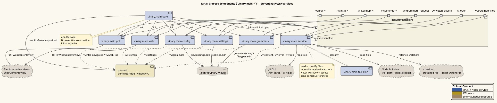
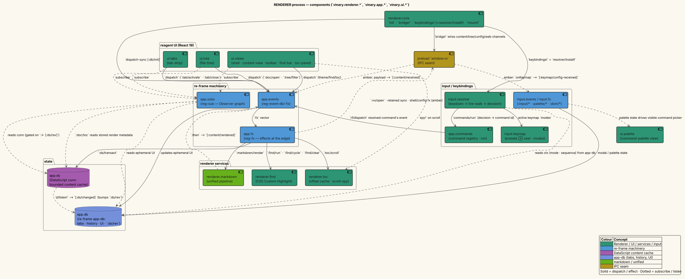

# Reference · Namespaces

This is a current map of the vinary-viewer source tree — every ClojureScript
namespace (and the handful of Node-side `.js` / macro `.clj` helpers that sit
inside a layer) and its role. Architecture overview:
[../architecture/01-overview.md](../architecture/01-overview.md).

The tree splits into two processes joined by the preload IPC seam, plus a set of
process-agnostic libraries (the common document **IR**, **streaming**, and the
terminal **CLI/TUI** renderers) that both the GUI renderer and the headless
tools build on:

| Layer | Prefix | Process | Count |
|-------|--------|---------|-------|
| Main process | `vinary.main.*` | Electron main | 24 cljs + 4 js |
| App / re-frame | `vinary.app.*` | renderer | 10 |
| Input / keybindings | `vinary.input.*` | renderer | 7 cljs + 1 clj |
| Renderer services | `vinary.renderer.*` | renderer | 20 |
| UI components | `vinary.ui.*` | renderer | 22 |
| Common document IR | `vinary.ir.*` | shared | 25 |
| Document streaming | `vinary.stream.*` | shared | 5 |
| Terminal renderer | `vinary.terminal.*` | Node (vv-cli/vv-tui) | 5 |
| Terminal UI | `vinary.tui.*` | Node (vv-tui) | 7 |
| Headless CLI | `vinary.cli.*` | Node (vv-cli) | 2 |
| Top-level libraries | `vinary.*` | shared | 2 |

---

## 1. Main process (`vinary.main.*`)

The Electron main process: all filesystem, `child_process`, network, and native
window/view work. Renderer code never imports these namespaces.

| Namespace | Responsibility |
|-----------|----------------|
| `vinary.main.core` | Electron app/window lifecycle: creates the sandboxed renderer window + contextBridge preload, wires the menu, and opens the initial argv file. |
| `vinary.main.service` | Main-process IO service: reads/content pushes, retained-document and asset watchers, git/synthetic trees, expansion-scoped shallow tree-watcher ownership, and sibling-PDF/source detection. Registers the file/stream/tree refresh/retention `vv:*` handlers. Every Files-tree listing goes through one `vinary.main.tree-listing` runner, asynchronously; watcher refreshes due together are delivered at once (`deliver-watched!`), and a listing begun before its root was removed from Files is not delivered (`removed-since?`). |
| `vinary.main.service-util` | Pure, electron/DOM-free routing helpers for the IO service (so the node `:test` build can assert routing without Electron), and the projection of one repository listing onto expanded scopes: `prefix-files`, `maximal-scopes` (the outermost of a set of scopes) and `bucket-files` (every scope's files in one pass). |
| `vinary.main.listing-flight` | PURE. The Files tree's listing flights (docs/scientific/10 §11): per key — a git root or a synthetic root — at most one listing runs at a time, and a request NEVER joins the running listing (it may predate the change that prompted the request); a burst of requests during one shares ONE trailing listing. The contrast with `vinary.main.content-flight`, where an open joins the running read, is deliberate. Effects are data (`[:schedule k]`, `[:list k s requesters]`, `[:deliver k s requesters]`). |
| `vinary.main.tree-listing` | Electron-free effects for the Files tree's listings: the asynchronous `git-stdout` (argv array, no shell, stdin/stderr ignored, 64 MiB / 120 s bounds), `toplevel`, `repo-files`, `list-key` (a repository, or a synthetic root's per-directory walks), and the RUNNER that interprets `vinary.main.listing-flight`'s effects — calls resolve Promises, a round's watcher refreshes reach one callback together. Every listing's number becomes the `:listing {:epoch :n}` stamp of the entries built from it. `stats` (exported) is the census find-e2e's diagnostics print. |
| `vinary.main.content-flight` | PURE. One read per path at a time, delivered to everyone who asked (ADR-0046 §Reload safety): an open JOINS the running read, a change notification during it marks it dirty (exactly one trailing read, however many arrived), a `:pending` read (a PDF still being written) carries its requesters to the next read, and read numbers (`seq`) strictly increase so the renderer can drop an older read that lands late. Effects are data (`[:read path seq]`, `[:deliver path {…}]`) the service driver interprets through `run-effects!`, which runs every effect even when one throws (a skipped trailing read would strand the path in flight). |
| `vinary.main.revalidate` | PURE. A conditional re-open's verdict (ADR-0046 §Re-validation): `same-version?` — does a fresh stat show the version (`{:size :mtime}`, the delivered `:doc/meta`) the window holds? Back/Forward to a remote document then costs one stat instead of a download when it did not change. Documents the validator's one blind spot (a same-size rewrite within the same second — SFTP times are whole seconds) and why history navigation may show the earlier copy (RFC 9111 §6). |
| `vinary.main.remote-subs` | PURE. The source side's remote content subscriptions (ADR-0035) as `{uri {:active? bool}}`: held from subscribe to unsubscribe, LIVE once the target reports them active (ADR-0046 §Settling — a live subscription announces the next write, so the PDF settle loop may leave a still-changing remote PDF pending for it). Liveness is a field of the record, so unsubscribing drops it (the transport reports no inactive state), and a report for a subscription no longer held is ignored. |
| `vinary.main.retention` | Pure ownership model for main-process document retention, `{wc-id {:wc :paths}}`: a window replaces only its own path set, and a path stays retained until its last owner goes — the multi-window invariant, testable without Electron. |
| `vinary.main.dir-walk` | The synthetic (non-git) project root: lists a directory the way `git ls-files` lists a repository, so a file outside any repository still gets a Files-tab tree. Split out of `vinary.main.service` so the node `:test` build exercises the real walk. Asynchronous (`walk-dir`, `synthetic-root` and `dir-tree` return Promises): a level's directories are read one at a time, and a level stops being read once the entry cap is reached. |
| `vinary.main.diff-source` | Local resolution of the files a diff references (the ancestor walk + optional UTF-8 read behind the side-by-side view, ADR-0026); Electron-free, so the node `:test` build exercises the production implementation against real files. |
| `vinary.main.content_service.js` | *(JS)* Electron-free content engine: bounded paged reads for large logs / delimited tables, office (docx via mammoth, ODF) + workbook parsing, log sniffing, byte/line **streaming sessions** (`streamOpen`/`Pull`/`Close`), remote SFTP reads, diff-source + remote-asset resolution, and **verified PDF reads** (ADR-0046 §Torn reads: `readPdfLocal` / `readPdfRemote` — the tail judged first by `pdf_integrity.js`, then the body, then size + mtime again on the same handle; a torn file is retried on a u, 2u, 4u, 8u backoff, u = 250 ms or `VV_PDF_SETTLE_MS`, woken early by a change notification, and settles as complete, `pending` or flagged `incomplete` — `settlePdf`). Reused verbatim by vv-cli/vv-tui. |
| `vinary.main.file-kind` | Pure file-kind classifier (extension → `kind`) shared by the service and tests; also `remote-uri?` / `archive-uri?` / `git-graph-uri?`, `stem` + `group-candidate-paths` (the collocated document group's candidate siblings) and `well-known-kind` (grammar-independent repo filetypes, ADR-0026). |
| `vinary.main.doc-overrides` | Main-side per-document type overrides (ADR-0036): an explicit type (CLI `-t`, Settings ▸ File Type) keyed by the exact path/uri and consulted on EVERY send, so a live refresh never re-classifies it away; also a piped-stdin document's virtual-source facts (`:stdin?`, `:cwd`). Pure atom bookkeeping, cleared when retention drops the path. |
| `vinary.main.config` | `keybindings.edn` load/save/watch; pushes raw EDN **text** over `vv:keymap` (clj→js would flatten keyword command-ids). |
| `vinary.main.settings` | `settings.edn` load/save/watch: theme + fonts + view prefs. |
| `vinary.main.recent` | `recent.edn` load/save/watch: the dir→last-child `:trail`, the `:recent-files` MRU (File ▸ Open Recent), and the `:web-history` URL MRU. |
| `vinary.main.connections` | Persisted **non-secret** SSH connection metadata (`connections.edn`): host entries for URI/host hints. Secrets never land here (see `ssh.cljs`). |
| `vinary.main.paths` | Canonical per-user data paths for the main process, computed in one place (new code such as the crash reporter resolves the config directory here). |
| `vinary.main.window` | Persisted main-window geometry (`window.edn`): position, size, maximized state, clamped to a visible display; never saved while the window is fullscreen (`persistable-bounds`, ADR-0045). Main-only. |
| `vinary.main.windows` | The live app-window registry and the shared resolver for which window a global or session action targets (`active` / `active-wc`), so multi-window services serve the window on screen; hidden pool windows are never registered. A leaf namespace — requirable from anywhere without a cycle. |
| `vinary.main.fullscreen` | Window-level fullscreen for slide shows (ADR-0045): `vv:set-fullscreen` / `vv:fullscreen-request` routed to the SENDER's window, the pure `decide` table (main only ever leaves a fullscreen it entered), and enter/leave reporting on `vv:fullscreen-changed`. |
| `vinary.main.grammars` | Grammar registry (main side): decides which files are `source` (→ the read-only CodeMirror view) and pushes the user grammar + filetype registry. |
| `vinary.main.git` | Async, strictly read-only git data layer (ADR-0039): the `vv:git-log`/`vv:git-branches`/`vv:git-open-diff` handlers, the ownership-scoped `.git` watcher behind `vv:git-watch` → `vv:git-changed`, commit-diff spills (stdin-style lifecycle + dedupe), and the boot sweep. Electron-free — the service binds its channels; argv/parsing live lower in `vinary.git.log`. |
| `vinary.main.shell` | Menu-bar shell actions: the multi-file Open dialog, clipboard writes, reveal/open-path, open-external, app-info, quit, devtools, and app-window zoom. |
| `vinary.main.startup` | Pure, electron-free startup configuration (so the node `:test` build can assert it): the Chromium switches, the GPU-mode predicates, and the command-line grammar — `user-args` (the arguments after the switches Electron consumes before the app path, and the app path itself, so `electron --no-sandbox <script>` opens nothing), `help-request?`, `doc-uris`, `doc-specs`, `socket-specs`, `instance-id`. |
| `vinary.main.daemon` | The resident-server IPC socket, independent of systemd: a single-instance primary listens on a per-user Unix domain socket, and `vv <file>` (`scripts/vv-open.mjs`) sends its arguments — v2 adds `types`, `stdinIndex` and `cwd` (ADR-0036) — so the warm process opens them in a new window without a second cold start. **Ownership:** `listen!` probes first — a primary that finds another instance answering runs without the socket; only a stale socket (nobody answers) is replaced, and only its probed inode — and `release!` withdraws the socket at `will-quit` and exit while the path still names this process's inode ([IPC §6](../architecture/03-ipc-protocol.md#6-the-daemon-socket-process--process)). |
| `vinary.main.profile` | Cold-start profiling marks for the main process, gated on `VV_PROFILE=1` (zero cost otherwise): `[vv-profile] main <name> <ms>` lines on the same wall-clock origin as the renderer's marks, parsed by `scripts/profile-cold-start.mjs`. |
| `vinary.main.web` | In-app HTTP browsing: a main-owned `WebContentsView` (http/https) with bounds, navigation relay, page zoom, snapshot cache, TOC bridge, and the page-key/scroll relay to the web preload. |
| `vinary.main.web-policy` | Pure policy for web-view popup requests (ADR-0044): which targets become app tabs (`tab-worthy-url?` — http(s) only) and whether the tab opens in the background (`open-mode`, from Chromium's disposition). No Electron requires, so it is unit-tested in the node build. |
| `vinary.main.pdf` | *RETIRED* — the native PDF `WebContentsView` superseded by the in-renderer pdf.js view (ADR-0013). `init!` is commented out in `core.cljs`, so the `vv:pdf-*` channels have **no live listener**; the namespace is kept for recoverability. |
| `vinary.main.adblock` | Native ad/tracker blocking (`@ghostery/adblocker-electron`, MPL) on `persist:vinary-web`: engine build/enable/refresh/schedule + cache (ADR-0014). |
| `vinary.main.extensions` | Scoped Chrome-extension runtime: Web-Store install/load/reconcile, manifest→toolbar model, popup open, state push (ADR-0015). |
| `vinary.main.ext-popup` | Browser-action popup host (origin-locked, content-sized `WebContentsView` on the web session). |
| `vinary.main.ext-config` | `extensions.edn` load/save/watch + synchronous main-side `load-config` (ad-block + extension prefs). |
| `vinary.main.ext-util` | Pure, electron-free helpers: Web-Store id parse, config merge, enable/disable reconcile, manifest action model, popup geometry, ad-block cache/list. |
| `vinary.main.passwords` | Native password-manager bridge: provider CLIs run only in the trusted main process; the renderer sees sanitized metadata and the web preload receives fills directly. Secrets never enter renderer app-db (ADR-0016). |
| `vinary.main.password-adapters` | Provider adapters (e.g. CLI-backed vaults). All provider execution stays in main. |
| `vinary.main.password-config` | Main-side, non-secret bridge config: provider ordering and enablement. |
| `vinary.main.password-util` | Pure helpers for the password bridge (no IO, no secrets) — node-testable. |
| `vinary.main.ssh` | Electron/IPC wiring for the SSH/SFTP transport: injects the host-key trust prompt + the secret prompt + error/status sinks, and owns the `vv:ssh-*` channels. Secrets stay main-side (ADR-0027). |
| `vinary.main.ssh_transport.js` | *(JS)* SFTP transport over `ssh2`: a connection pool keyed by `user@host:port`, the auth chain (agent → identity files → password → keyboard-interactive/MFA), and host-key TOFU against `known_hosts`; whole-file and ranged reads through a file HANDLE (`remoteOpenFile` — `readAt` / `readRange` / `readAll` / `fstat` / `close`) that keeps up to D requests of C ≤ ssh2's read cap in flight, preallocates the file, overlaps the end-of-file probe with the body, adapts to servers that cap reads, and is registered with its connection so a drop rejects it and the idle reaper spares it (ADR-0046 §Faster remote loading; docs/scientific/11). The SFTP channel's window is granted eagerly, as OpenSSH's client does (`eagerWindow`; ssh2 alone keeps only half its 2 MiB window in flight — docs/scientific/11 §9.4). `remoteCreateReadStream` (the streaming and paging engines' source) is a pipelined Readable through the same handle (`pipelinedReadStream`: D requests in flight, delivered in file order, no new request while the consumer is not reading, an optional stat'ed `size` bounding the requests). Electron-free (prompts/sinks injected via `configure()`). |
| `vinary.main.pdf_integrity.js` | *(JS)* PURE. Is a byte buffer a COMPLETE PDF or one caught mid-write (ADR-0046 §Torn reads)? `verdict(buf)`: `%PDF-` in the first KiB, the LAST `%%EOF` in the final KiB (incremental updates, padding), and a `startxref` pointing inside the file at `xref` or an xref-stream object; `tailVerdict(tail, size)` judges from the final KiB alone, so a remote reader refuses an unfinished file before downloading it. |
| `vinary.main.ssh_agent.js` | *(JS)* ssh-agent client implementing `SSH_AGENTC_ADD_IDENTITY` (the `AddKeysToAgent` directive), which `ssh2`'s agent classes do not expose. |
| `vinary.main.ssh_config.js` | *(JS)* Pure, dependency-light `~/.ssh/config` + `known_hosts` parsing and host-key crypto helpers (no `fs`/`net`/`electron`) — node-testable in isolation. |
| `vinary.main.daemon_events.js` | *(JS)* The authenticated daemon event transport (ADR-0035): a target daemon advertises an ephemeral loopback TCP listener in an owner-readable descriptor; a source daemon reads it over the authenticated SFTP connection, reaches it by SSH `direct-tcpip` forwarding, and proves the endpoint with a challenge/response (`vv-events/2`) before trusting its tree / content events. |

*Source: [`../diagrams/component-main-service.puml`](../diagrams/component-main-service.puml).*

---

## 2. IPC seam

| File | Responsibility |
|------|----------------|
| `resources/preload.js` | Exposes `window.vv` via `contextBridge`; all renderer↔main IPC crosses here (95 `vv:*` channels). |
| `resources/web-preload.js` | Runs inside the HTTP web view (isolated): reports the heading outline + active heading, scrolls on TOC jumps and forwarded page keys, and runs the native password-form observer + self-contained link hints. |

See [ipc-channels.md](ipc-channels.md).

---

## 3. App layer (`vinary.app.*`)

The re-frame loop and its state stores. `db`/`ds` hold state; `events`/`fx`/`subs`
are the loop; `nav`/`uri`/`zoom`/`link` are pure transforms.

| Namespace | Responsibility |
|-----------|----------------|
| `vinary.app.db` | Default app-db: UI/navigation/settings/keybinding state. Tabs/history and ephemeral UI live here; DataScript owns content. |
| `vinary.app.ds` | DataScript content cache keyed by `:doc/path`, the `:ds/rev` bridge, and content-cache helpers (`snapshot`, `eid-for-path`, `doc-attr`, `active-doc`, retention). |
| `vinary.app.nav` | Pure browser-tab + per-tab-history transforms over app-db. A tab is a view `{:id :uri :hist … :facet :facet-mru :diff-view :diff-collapsed …}` (see the [state schema §5](../architecture/04-state-schema-reference.md#5-tab-shape)). |
| `vinary.app.uri` | URI/path normalization and local-vs-HTTP-vs-remote predicates (`file-path`, `http?`, `remote?`, `dirname`, `segments`). |
| `vinary.app.facet` | The document-FACET model: a facet is `{:path :type}` (`:preview` or `:source`) over a document's collocated group (`:doc/siblings` — an authored source plus its compiled PDF). The single source of truth for the toolbar's `[Preview ▾ \| Source ▾]` combo: which files each button offers, in what order, which is active, what a click activates. Pure core + thin DataScript/app-db glue. |
| `vinary.app.zoom` | Pure context-aware zoom helpers (`context` → `:pdf`/`:web`/`:window`, `percent`, `presets`) shared by the zoom events and the `:view/zoom-percent` sub. |
| `vinary.app.content-guard` | PURE. The renderer's ordering guard (ADR-0046): `stale?` — is a payload's read number not newer than the one its document applied (`:doc/seq`)? Unnumbered payloads and documents that applied none always pass. Used by `:content/received` and `:content/error` (via `events/read-stale?`). |
| `vinary.app.slides` | Pure app-db helpers for slide decks (ADR-0045): the `:slides-open-as` / fullscreen / click-advance / overview-page / transition / notes (a two-screen deck's notes side) preferences, the document view's explicit layout, the running presentation, the EFFECTIVE layout (the engine's own rule fed the `:doc/deck` summary), and the `[:ui :slides]` mirror's UI-owned keys (`merge-report`, typed digits, blank, overview; `command-needs-db?` — whether a slide step must go through `:slides/command` first). |
| `vinary.app.overlay` | The ONE pure answer to "which layer owns the keyboard / covers the document?": `modal-dialog-open?` (Preferences, About, Extensions, Passwords + save prompt, key-binding editor, SSH prompt), `menu-open?`, `palette-open?`, `hints-active?`, and the composites `blocking?` (any — the resolver's `key-scroll!` gate, the menubar's access-key gate minus its own menu, the slides key layer) and `paints-over-content?` (what the native web view hides for — `:ui/overlay-open?`). Replaced six drifted hand-written copies; the SSH prompt was in none of the first four. |
| `vinary.app.link` | One source of truth for "what does following this rendered-document link do" — classify + route a preview/link activation. |
| `vinary.app.commits` | Pure model for the Commits surfaces (ADR-0039): panel repo derivation, the `A..B`/`A...B`/single-ref range grammar, the shared selection reducers (cursor/anchor/selected), and refresh-survival pruning of hash-keyed UI state. |
| `vinary.app.events` | re-frame events for content, streaming, tabs, history, representation/diff switches, settings, menu, tree, TOC, find, hints, SSH, passwords, extensions, and shell commands. |
| `vinary.app.fx` | re-frame effects — the only place async/IO/DataScript-mutation touches the world (effects at the edge). |
| `vinary.app.subs` | Subscriptions over app-db and DataScript snapshots. |
| `vinary.app.commands` | Command registry used by keybindings and the palette. `immediate-commands` — the commands that only move the view (scrolling, slide steps, the typed slide number, the blank screens) — run at once when a KEY invokes them (`run` with `{:now? true}`, from the keymap resolver; `dispatch-now!` = `rf/dispatch-sync`, falling back to `rf/dispatch` inside a re-frame handler): after a discrete input event Chromium renders the next frame before re-frame's queued task, so a queued view move showed a frame late (docs/scientific/12 §Flip latency). |
| `vinary.app.tree-model` | Pure model behind the file tree: fold flat repo-relative paths into a nested structure, and narrow it by a filter (ADR-0033). |
| `vinary.app.tree-state` | Pure controlled-disclosure model: known/ancestor/effective expansion scopes, pruning, active-file reveal scopes, and remembered open roots (ADR-0034). A project's directory scopes are derived by scanning for separators and memoized on the project's identity (and the projects vector's), so only a project whose listing changed pays again (docs/scientific/10 §11). |
| `vinary.app.projects` | The Files tab's project list (`[{:root :files :synthetic? :listings?} …]`): a git root is authoritative; a SYNTHETIC root (the directory of a file in no repository) yields to containment and absorbs the narrower synthetic roots it covers, so opening several files under one directory never stacks overlapping trees. Entries are applied in LISTING order whatever order they arrive in: `:listings {scope → [epoch n]}` records which listing last wrote each scope, and an older entry never overwrites a newer one (`write-scope`). Pure, DOM-free. |
| `vinary.app.palette` | Pure candidate model for the command palette — ranks raw strings and materialises an item only for survivors. |
| `vinary.async.scheduler` | The one cancellable, budgeted job runner: `debounce!` (one live timer per key), `coalesce!` (one response per painted frame), `slice!` (step under a frame budget), `cancel!`, and the two paces — `ric` (display) and `yield!` (input queue). |
| `vinary.async.budget` | The substitutable clock behind the frame budget, so the budgeting arithmetic is testable without sleeping. |
| `vinary.search.query` | Case folding and query normalisation. Two strategies with names: `:strict` (length-preserving, required wherever an index maps back to a source position) and `:simple`. |
| `vinary.search.scan` | Non-overlapping substring scanning and the match predicates — the loop that previously existed verbatim in the GUI and terminal finders. |
| `vinary.search.match` | The configurable matcher: five modes (`:substring` `:subsequence` `:prefix` `:word-prefix` `:regex`), one result shape `{:score :spans}`, optional relevance ranking. |
| `vinary.search.cursor` | The wrapping match cursor shared by both finders. |
| `vinary.search.config` | Which matching mode each search surface uses — the single place that choice is made. |

*Source: [`../diagrams/component-renderer.puml`](../diagrams/component-renderer.puml).*

---

## 4. Input layer (`vinary.input.*`)

| Namespace | Responsibility |
|-----------|----------------|
| `vinary.input.keys` | Normalize a DOM `KeyboardEvent` into a canonical chord token (modifiers folded cross-platform). |
| `vinary.input.keymap` | Keymap registry: the bundled presets (embedded at compile time via `shadow.resource/inline`), key normalization, and the active-keymap atom + user-delta merge. |
| `vinary.input.keymaps-registry` | app-db registry of keymap **sets** — the three read-only built-ins (Standard/Vim/Emacs) plus user sets — and the persistence envelope. |
| `vinary.input.resolver` | Modal/chord resolver (Interpreter): normalize → resolution context → `step` decision (`:prefix`/`:dispatch`/`:consume`/`:pass`/`:retry`); pending sequence + chord timer in resolver-local atoms; global keydown handling — it runs commands with `{:now? true}`, so a view move runs inside the keydown handler (`vinary.app.commands/immediate-commands`). |
| `vinary.input.events` | Input mode, pending sequence, command palette, keymap config/selection, and the keybinding-editor events. |
| `vinary.input.fx` | Input-related effects: active-keymap installation, debounced persistence, chord-timeout, and the smooth `:dom/scroll` / `:dom/focus`. |
| `vinary.input.scroll-math` | Pure arithmetic of the eased scroll chase `vinary.input.fx` drives, extracted so its termination is PROVEN by unit test (docs/scientific/09; ADR-0032): the target is re-clamped to the live maximum every frame, a step is floored at 1 px (the scroll quantum is 0 — a sub-pixel write moves nothing) with a settle threshold no smaller than that floor, and a frame whose write moved nothing bails out. |
| `vinary.input.kbedit-history` | Reversible editor commands (the Command pattern as data) for keybinding undo/redo. |
| `vinary.input.presets` | *(macro `.clj`)* SUPERSEDED — a compile-time preset-EDN slurp kept for reference; presets are now inlined by `vinary.input.keymap` via `shadow.resource/inline` (which tracks the EDN as a recompile dependency). |

---

## 5. Renderer services (`vinary.renderer.*`)

Renderer-side, DOM-touching helpers behind the UI: parsing, rendering, layout,
find, scroll, and the pdf.js / CodeMirror engines.

| Namespace | Responsibility |
|-----------|----------------|
| `vinary.renderer.core` | Renderer boot: re-frame loop, DataScript→re-frame reactivity bridge, IPC bridge (the `on*` handlers), keybinding-resolver install, React root mount, dev hooks. |
| `vinary.renderer.markdown` | Markdown → `{html, toc, assets}` via the common IR (`render-ir`), plus the office / org / latex IR render entry points. |
| `vinary.renderer.markdown-pipeline` | The DOM-free remark → rehype parse+transform pipeline (through metadata collection), extracted from `markdown` so streaming and the IR frontend share one spine. |
| `vinary.renderer.math` | MathJax TeX-to-SVG rendering and cached Markdown math postprocessing. |
| `vinary.renderer.math-engine` | The heavy MathJax TeX→SVG engine (`@mathjax/src` + the MathJax Modern font, ~3–5 MB) in its own lazily-loaded build module `:math-engine`, off the boot bundle and out of the terminal builds; reached only through `vinary.renderer.mathjax-lazy` (`:node-test` requires it directly). |
| `vinary.renderer.mathjax-lazy` | Thin `shadow.lazy` facade over the `:math-engine` chunk: `ensure!` loads it on demand and passes calls through; renderer.core preloads it — and installs its stylesheet — just after first paint, so warm windows render math at once. |
| `vinary.renderer.mathjax-version-shim` | OBSOLETE after the MathJax 4 migration — retained (not deleted) as a record of why it existed. |
| `vinary.renderer.mermaid` | Mermaid source-to-SVG rendering for Markdown fences and direct Mermaid files; pre-DOM sizing + refit. |
| `vinary.renderer.figures` | Measure and size embedded local SVG/image figures (pre-DOM, no flash) + refit on font change. |
| `vinary.renderer.latex` | LaTeX → HTML string, the reusable front-end shared by standalone `.tex` documents and embedded-in-Org LaTeX (ADR-0025). |
| `vinary.renderer.latex-structure` | The LaTeX document-structure engine for standalone `.tex`: cross-references, citations, the bibliography, section / theorem / equation numbering and the `\maketitle` / `abstract` / `\tableofcontents` front matter, rewritten in unified-latex's AST BEFORE math freezes to strings (`restructure!` — a no-op without a top-level `document` environment). |
| `vinary.renderer.heavy-registry` | Runtime registry (atoms) that decouples the heavyweight engines — unified-latex and uniorg — from the shared DOM-free Markdown/Org/LaTeX pipeline, so they code-split out of the renderer boot bundle while the Node targets (`:cli` / `:tui` / `:node-test`), which cannot use `shadow.lazy`, fill the same registry eagerly. |
| `vinary.renderer.heavy-engine` | The heavy document engines (unified-latex via `renderer.latex` + `renderer.latex-structure`, and uniorg) collected into their own lazily-loaded build module `:heavy-engine`; its `install!` fills `renderer.heavy-registry`. |
| `vinary.renderer.heavy-lazy` | Thin `shadow.lazy` facade over the `:heavy-engine` chunk: `ensure!` loads it and installs the engines into the registry; idle-preloaded after first paint, like `mathjax-lazy` and `cm`. |
| `vinary.renderer.heavy-node` | Eager registry population for the Node targets: requires `renderer.heavy-engine` statically and re-exposes its `install!` (called by `cli.core` / `tui.core` at startup and by the Org tests). No renderer-build namespace requires it. |
| `vinary.renderer.toc` | Content-agnostic heading-offset cache + binary-search scroll-spy + TOC jump helpers (Markdown, PDF, HTML …). |
| `vinary.renderer.scroll` | Content-pane scroll ownership (ADR-0032): per-navigation restore (`want!`/`apply!`), confined scrolling (`confined-top`, `scroll-rect-to!`), and the **scroll delegate** (`set-delegate!`/`delegate!`) through which the slides layout takes every keymap's scroll commands (ADR-0045). |
| `vinary.renderer.source-nav` | Bidirectional source⇄preview jump helpers — content-agnostic (any format that stamps `data-vv-source-*`). |
| `vinary.renderer.diff-view` | The diff view's collapse applier (ADR-0037): projects the per-tab collapsed-file set (nav `:diff-collapsed`, the single source of truth) onto whatever innerHTML-rendered `
` DOM is mounted — before paint and on every change; also the renderer-only tree-sitter token enhancement of the pure diff model and the main-resolved file targets on header anchors. |
| `vinary.renderer.pdf` | In-renderer pdf.js engine: worker bootstrap, canvas/text/link layers, virtualization, zoom, outline, and the `:pdf/reflow` effect (ADR-0013); the slides layout of ADR-0045 (slots, slide navigation, presenting, named actions, swipes, slide transitions — a snapshot of the outgoing slide faded or pushed off over the instant flip — and second-screen decks, whose slide half alone is fitted, rasterized through a shifted viewport, and searchable). A slide step from an input — a key through the scroll delegate, the wheel, a swipe — runs on the engine at once (`step!`) unless `:slides/command` would first change app-db (a blanked screen, a typed slide number; `vinary.app.slides/command-needs-db?`), when it goes through that event — so the wheel, like the keys, only ends a blanking. |
| `vinary.renderer.pdf-layout` | Pure, DOM-free PDF geometry/zoom/outline helpers (unit-tested), incl. the slides layout's slots and per-page fits, the overview grid, the per-canvas pixel budget, and `run-percent` — where a pdf.js text run starts, read from its inline style without layout. |
| `vinary.renderer.pdf-cache` | PDF byte cache (keyed by `:doc/path`, not DataScript) with keep-last-good candidate/promote/reject versions, the in-page-find text-materialization hook, and the slides hook (`slides-active?`, `slides-command!`, `slides-snapshot` — what the scroll delegate, effects and the overview borrow); deliberately free of any `pdfjs-dist` require. |
| `vinary.renderer.pdf-thumbs` | Lazy, bounded thumbnails for the slide overview grid: an IntersectionObserver band (±½ viewport), a 2-at-a-time render queue into detached canvases, a per-thumbnail pixel budget, far canvases released, generation fencing — on the BORROWED document; a second-screen deck's thumbnails are its slide halves, rasterized alone like the engine's. |
| `vinary.renderer.warm-cache` | Bounded cache of expensive, DOM-free preparation artifacts (a prepared PDF, a parse): mounted views hold leases; a released artifact stays warm, only the two most-recent inactive entries survive, and an in-flight promise is an entry too, so leaving and revisiting a tab reuses the work. |
| `vinary.renderer.virtual-layout` | Pure, DOM-free vertical-stack geometry shared by the in-renderer PDF view and the streaming preview body (pre-estimated sibling spacer). |
| `vinary.renderer.find` | CSS Custom Highlight API in-page search (`search!`/`cycle!`/`clear!`). Asynchronous and sliced: flattening and matching run under separate scheduler keys, and the flattened buffer is reused while the DOM is unchanged (ADR-0033). |
| `vinary.renderer.find-scan` | Pure, DOM-free core of in-page find: flatten a token stream into ONE searchable buffer — so a match may cross element boundaries (pdf.js emits a span per text run) and wrapped whitespace is normalized — scan it, and map a buffer index back to its text node and offset. |
| `vinary.renderer.find-flex` | The `file://`-safe worker client for the pinned Vinary Tree search runtime: loads `find-worker.js` + `find-wasm.wasm` into a module worker through a Blob URL, indexes one immutable document snapshot per key, and resolves searches (a superseded request resolves nil; `cancel!`). |
| `vinary.renderer.find_worker.js` | *(JS)* The flexible-find worker: one libdictenstein dictionary shared by the liblevenshtein transducer and the FZF-style WFST, with document-position postings — spelling-tolerant and phonetic in-page search off the UI thread. |
| `vinary.renderer.input-trace` | DEV-only text-input latency tracer (`window.__vvinputtrace`): keystroke queue delay, programmatic `.value` writes that discard typed characters, and long tasks. `goog.DEBUG`-gated. |
| `vinary.renderer.scroll-trace` | DEV-only scroll-write tracer (`window.__vvscrolltrace`): patches `Element.prototype`'s scroll setters and methods to record every write to a watched scroller — the writer's stack, the requested value and the value that stuck — in a bounded ring buffer. Gated on `goog.DEBUG`; the release smoke asserts it is absent (ADR-0032). |
| `vinary.renderer.profile` | Cold-start profiling marks for the renderer, gated on the `?profile=1` parameter main adds under `VV_PROFILE=1`: `[vv-profile] renderer <name> <ms>` on the main process's wall-clock origin; `mark-first-content!` fires `rendered` on the first content paint. |
| `vinary.renderer.media` | Local media URL cache-busting and source helpers for Markdown previews. |
| `vinary.renderer.syntax` | Read-only source view: a CodeMirror 6 editor highlighted by web-tree-sitter grammars; grammar registry, source selection, and source⇄line scroll helpers. |
| `vinary.renderer.source-view` | The read-only CodeMirror 6 source view — the sole entry of the lazily-loaded `:source-view` module (~1 MB of `@codemirror`): turns `renderer.syntax`'s web-tree-sitter highlight spans into decorations; re-created on live refresh. |
| `vinary.renderer.cm` | Thin `shadow.lazy` facade over the `:source-view` chunk: `ensure!` loads it on demand (preloaded after first paint); view-bound calls deref the module directly, boot-reachable calls degrade to a no-op before it loads, and a preview→source jump requested early is buffered and flushed on load. |
| `vinary.renderer.hints` | Vimium-style link hints for the content pane: collect visible targets, assign labels, follow a chosen target. |
| `vinary.renderer.history-input` | Coalescing for browser-style history commands that can arrive through multiple native input channels. |
| `vinary.renderer.text-edit` | Cut / Copy / Paste / Select All for the app's own text inputs, invoked by the themed context menu: `execCommand` on the focused field (native input events keep a React-controlled field in sync); Paste reads the system clipboard over IPC (`window.vv.readText`) and inserts with `insertText`. |
| `vinary.renderer.tree-reveal` | Coalesced post-render Files-tree scroll: reveal the active row after declarative ancestor expansion has committed. |

---

## 6. UI layer (`vinary.ui.*`)

Reagent view components and their pure view-helpers.

| Namespace | Responsibility |
|-----------|----------------|
| `vinary.ui.views` | Main shell, content strategy (per-kind view selection), Markdown body lifecycle, toolbar, status/modeline; hosts the in-pane directory browser (`:doc/kind = "directory"`) and the Ctrl-hover breadcrumb URI bar. |
| `vinary.ui.content-route` | PURE renderer selection for the content pane: which view a document gets, with explicit user-selected facets outranking rendering policies such as large-document streaming, so a new policy branch can never make an existing view unreachable. |
| `vinary.ui.pdf-view-lifecycle` | PURE. The pdf-view's lifecycle decisions (ADR-0045 §Live refresh): what a re-render does — remount another path, mount, refresh a newer stamp in place, and ALWAYS apply the view state once mounted (a refresh lands without re-rendering) — and whether a version that raced the first mount is refreshed to when that mount lands. |
| `vinary.ui.tabs` | The tab strip + the shared tab-item used by the horizontal strip and the sidebar's vertical Tabs list. |
| `vinary.ui.sidebar` | The left sidebar shell: a vertical icon rail (ADR-0041) beside one full-height panel — the multi-project Files tree, the Contents (TOC) outline, open Tabs, or the Commits panel. Collapsed, the rail alone remains; clicking the active icon collapses, any icon expands into its panel. |
| `vinary.ui.tree` | The Files tree view: controlled refresh-before-open `
`, automatic watcher-scope sync, and file navigation. Narrowing/folding and expansion arithmetic live in pure app models (ADRs 0033/0034). |
| `vinary.ui.commits` | The Commits sidebar tab (ADR-0039): paged list + mini lane rail (self-contained per-row SVG cells), branch combo, ref-range input, selection, lazy GFM bodies. Reducers live in `vinary.app.commits`; lanes in `vinary.git.graph`. |
| `vinary.ui.combo-select` | The reusable filterable dropdown (combo-button shell + ADR-0033 async-input + `search.match` under the `:branch-combo` surface): grouped keyboard-navigable rows, current-pick check, row cap with a type-to-filter hint. |
| `vinary.ui.error-boundary` | A small reusable React error boundary: a descendant render throw logs to the console and paints a labeled `.vv-error-strip` in place, instead of unmounting the React root (a blank window). Wraps the sidebar body (keyed by tab — switching tabs is the recovery path). |
| `vinary.ui.git-graph` | The Commit Graph document (ADR-0040): a full-pane windowed view over the same `[:ui :commits]` store as the sidebar panel — lanes/refs/author/date columns, its own keyboard model (`[data-vv-keynav]`), shared selection. Geometry lives in `vinary.git.graph-geometry`. |
| `vinary.ui.text-input` | The one text `<input>` whose DOM value is owned locally, so a re-render can never take a typed character back out of it. Used by the find bar, tree filter, palette, and Preferences fields. |
| `vinary.ui.context-menu` | The themed right-click context menu: targets and actions. |
| `vinary.ui.menubar` | The custom, theme-matched menu bar (File / View / Settings / Help), incl. the `View ▸ Fit` radio submenu and the PDF slide items (the flipping View as Slide Show ↔ Document, Start Slide Show, Start from Current Slide, Slide Overview); `realized-menu` is the pure filter/realize seam the tests use. |
| `vinary.ui.menu-focus` | Pure helpers for keyboard focus inside custom menus (skipping separators/disabled rows). |
| `vinary.ui.zoombar` | The always-visible bottom zoom bar: − / editable % field / preset dropdown / +, dispatching the context-aware `[:view/zoom …]`; in the slides layout it shows the slide bar instead (slides fit themselves). |
| `vinary.ui.slides-bar` | The slide controls outside the slide (ADR-0045): the bottom bar's ◀ page / N ▶ · frame · Overview · Present (the page field takes physical page numbers) and the address bar's View as Slide Show ↔ Document toggle — both hand the keyboard back to the slides. |
| `vinary.ui.palette` | Command palette / fuzzy finder: one overlay, three sources (`:command`/`:file`/`:theme`). The overlay only — candidate assembly lives in `vinary.app.palette` behind the `:palette/candidates` sub. |
| `vinary.ui.settings` | The Preferences dialog: variable + fixed-width fonts, sizes, and view prefs (theme lives here too). |
| `vinary.ui.extensions` | Settings ▸ Extensions dialog: ad-blocking controls + the Chrome-extension manager. |
| `vinary.ui.ext-toolbar` | Browser-action toolbar (extension icons in the address-bar row; click → open popup). |
| `vinary.ui.keybindings-editor` | Visual keybinding editor (Settings ▸ Key Bindings ▸ Customize…): a two-pane modal with undoable edits. |
| `vinary.ui.about` | The Help ▸ About dialog: app name + version + repo link. |
| `vinary.ui.modal` | Shared modal-dialog shell: the scrim overlay + bordered/elevated panel with a title bar. |
| `vinary.ui.icons` | Font Awesome (Free Solid, self-hosted) icon set. |
| `vinary.ui.access-keys` | Shared helpers for desktop-style Alt access keys in custom renderer UI. |
| `vinary.ui.platform` | Tiny renderer-side OS detection (`single-click-open?`): single-click opens on Linux, double-click on Windows/macOS. |
| `vinary.ui.preview-context` | Pure helpers for Markdown preview context menus: term extraction and source-location formatting. |
| `vinary.ui.preview-navigation` | Navigation events for links activated from preview surfaces (classify link/target → the right open event). |
| `vinary.ui.passwords` | Renderer UI for the native password-manager bridge: provider status + login picker + save prompt — **status/metadata only, never a secret**. |
| `vinary.ui.ssh` | Renderer UI for SSH/SFTP remote files: the auth prompt (password / key passphrase / multi-prompt MFA) and the connection-error surface. The typed secret stays in the modal's local state. |
| `vinary.ui.refresh-note` | The non-fatal live-refresh banner (ADR-0045 / ADR-0046): the last good version stays on screen; Retry / dismiss. |
| `vinary.ui.slides-hud` | What floats over the slides layout in `.vv-content-wrap`: the "Go to 12" chip while a slide number is typed, and the black / white screen of a running show. |
| `vinary.ui.slides-overview` | The slide overview grid (ADR-0045): a focused `[data-vv-keynav]` overlay of one tile per frame — grid keys, label digits, Enter / Shift+Enter, click — drawn by `vinary.renderer.pdf-thumbs` from the mounted view's borrowed document; tiles take the shape of the page as SHOWN (a second-screen deck's slide half — the snapshot's `:side`). |

---

## 7. Common document IR (`vinary.ir.*`)

One weighted-transducer intermediate representation that every format front-end
targets and every back-end lowers from (ADR-0017). The design lineage is the
`lling-llang` weighted-automata toolkit: **front-ends** parse a format into the
IR, **layers/transducers** transform it, **back-ends** lower it to HTML or ANSI,
and **capabilities** derive views (e.g. a TOC) from it. Markdown, office, org,
latex, diff, source, tables, logs, PDF-reflow, and archives all render through
this one tree.

### 7.1 Core algebra + parsing machinery

| Namespace | Responsibility |
|-----------|----------------|
| `vinary.ir.node` | The common document IR node — one uniform tagged tree (constructors, `children`, walkers). |
| `vinary.ir.meta` | Per-node metadata accessors + stable anchor identity (metadata rides in the node). |
| `vinary.ir.semiring` | Semiring-generic weights: the algebra `(K, ⊕, ⊗, 0̄, 1̄)` that lets one parser/transducer work over many weight domains. |
| `vinary.ir.transducer` | Weighted top-down tree transducer over the IR (blueprint: `lling-llang` tree_transducers). |
| `vinary.ir.lattice` | A token lattice — a weighted DAG of alternative token hypotheses consumed by the Earley parser. |
| `vinary.ir.wpda` | Weighted pushdown automaton (blueprint: `lling-llang` pushdown). |
| `vinary.ir.decode` | Streaming/incremental WPDA decoder (blueprint: `lling-llang` PdaDecoder). |
| `vinary.ir.earley` | Earley recognizer over a token lattice (predict/scan/complete). |
| `vinary.ir.forest` | Packed parse-forest extraction from an Earley chart. |
| `vinary.ir.layer` | A composable IR→IR transform pipeline (blueprint: `lling-llang` LayerPipeline). |
| `vinary.ir.flag` | RETIRED (ADR-0017) — the `:vv/ir` migration flag that gated the common-IR render path during rollout. |

### 7.2 Back-ends + capabilities

| Namespace | Responsibility |
|-----------|----------------|
| `vinary.ir.backend.html` | IR → HTML: lower the IR to a HAST tree and serialize it through the shared sanitizer. |
| `vinary.ir.backend.ansi` | IR → terminal ANSI — the terminal analog of the HTML back-end (used by vv-cli/vv-tui). |
| `vinary.ir.backend.sanitize` | The single HTML sanitize schema (GitHub's allowlist) for the IR back-end and the Markdown pipeline. |
| `vinary.ir.capability.toc` | Table-of-contents capability over the IR: walk for heading-role nodes and emit the outline. |

### 7.3 Front-ends (format → IR)

| Namespace | Responsibility |
|-----------|----------------|
| `vinary.ir.frontend.markdown` | rehype HAST (from the app's unified pipeline) → IR. |
| `vinary.ir.frontend.office` | Office HTML (docx via mammoth, or the ODF block HTML) → IR. |
| `vinary.ir.frontend.source` | A web-tree-sitter parse tree → IR (the source-view code outline). |
| `vinary.ir.frontend.pdf` | pdf.js text-content items → IR (the hybrid, lossless PDF reflow). |
| `vinary.ir.frontend.table` | A content-service table envelope (workbook sheets, or one page of rows) → IR. |
| `vinary.ir.frontend.log` | A content-service log envelope (full text, or one page of lines) → IR. |
| `vinary.ir.frontend.log-stream` | Streaming log front-end: line batches → `:record` IR blocks, emitted incrementally with bounded memory. |
| `vinary.ir.frontend.diff` | `.diff`/`.patch` text (via `vinary.diff`) → IR for the unified colored view + per-file outline. |
| `vinary.ir.frontend.archive` | An archive/directory listing envelope → IR (directory-browser-compatible entries). |

### 7.4 Grammar

| Namespace | Responsibility |
|-----------|----------------|
| `vinary.ir.grammar.log` | WPDA for streaming log-record segmentation (the pushdown stack tracks brace nesting so a multi-line record is one block). |

---

## 8. Document streaming (`vinary.stream.*`)

Bounded-memory incremental rendering (ADR-0019): trade total throughput for
latency + bounded memory on large documents. Default-on for the streamable kinds.

| Namespace | Responsibility |
|-----------|----------------|
| `vinary.stream.protocol` | The `StreamParser` contract: a document that arrives as a sequence of batches → incremental IR blocks. |
| `vinary.stream.scheduler` | Drives a stream into the DOM: open a transport session, then on each idle tick pull one batch, parse it, and commit its blocks. Its tick (`ric`) now lives in `vinary.async.scheduler` and is shared with the chunked find. |
| `vinary.stream.sink` | Append-mode render sink: lower IR blocks to HTML and append them to the stream body. |
| `vinary.stream.transport` | Renderer-side pull client for the main-process stream sessions (`window.vv.stream{Open,Pull,Close}`). |
| `vinary.stream.flag` | The document-streaming feature gate (which kinds stream, and the size threshold). |

---

## 9. Terminal renderer (`vinary.terminal.*`)

The headless second renderer over the shared IR/streaming spine (ADR-0019): the
GUI is untouched; these lower the same IR to ANSI for `vv-cli`/`vv-tui`.

| Namespace | Responsibility |
|-----------|----------------|
| `vinary.terminal.caps` | Terminal capability detection: width, colour, truecolor, OSC-8 hyperlinks, inline graphics. |
| `vinary.terminal.graphics` | Headless terminal image graphics (the terminal analog of ``): kitty/sixel raster + vector decode. |
| `vinary.terminal.pdf` | Headless PDF text extraction: the pdf.js **legacy** build (pure JS, no DOM/canvas) → reflowed text; `open-document` (the one loader) and `page-sizes` (scale-1 page sizes, rotation applied — the measure the GUI engine gives the deck detector). pdf.js runs at `verbosity 0` (errors only): its warnings are `console.log`s, and stdout carries the document (`vv --cli`) or the screen (`vv --tui`). |
| `vinary.terminal.stream` | The sink-agnostic, cancellable terminal streaming engine (line stream via `content_service`). |
| `vinary.terminal.stdin` | Piped-stdin intake shared by `vv-cli`, `vv-tui` and the main daemon (ADR-0036): stdin drained to EOF (binary-safe) is an immutable snapshot — zero bytes means no stdin document — spilled to a private per-invocation directory only where a real path is needed, and stale spills are age-swept at daemon boot. |
| `vinary.terminal.syntax` | Headless tree-sitter → ANSI syntax highlighter (the terminal analog of the CodeMirror-coupled highlighter). |

---

## 10. Terminal UI (`vinary.tui.*`)

`vv-tui` — the interactive full-screen terminal viewer. A pure core (`state`,
`viewport`, `keys`, `find`, `toc`) with one impure Node-coupled driver (`term`).

| Namespace | Responsibility |
|-----------|----------------|
| `vinary.tui.core` | Wires the raw-terminal driver → key events → the pure reducer → the viewport paint (with a `--drive` test seam). |
| `vinary.tui.term` | The raw-terminal driver — the ONLY impure module: alternate screen, raw mode, cursor. |
| `vinary.tui.keys` | Raw-stdin bytes → key events (pure, incremental — unit-testable without a terminal). |
| `vinary.tui.state` | The pure key→command reducer (`step`) across three modes (`:normal` scroll, find, toc). |
| `vinary.tui.viewport` | A pure windowed line buffer: only a `:h`-row window is painted, so per-frame cost is bounded. |
| `vinary.tui.find` | Pure in-buffer search over rendered ANSI lines (matching on ANSI-stripped visible text). |
| `vinary.tui.toc` | The pure table-of-contents overlay (resolves the document's toc entries to a navigable list). |

---

## 11. Headless CLI (`vinary.cli.*`)

| Namespace | Responsibility |
|-----------|----------------|
| `vinary.cli.core` | `vv-cli` — a headless terminal document renderer; reads a file with the Electron-free `content_service` and prints. `--deck-info` prints a PDF's slide-deck evidence and classification as JSON instead (`deck-info`: `slides.evidence` + `terminal.pdf/page-sizes` → `slides.deck`, the GUI's own pipeline; docs/scientific/12's instrument). |
| `vinary.cli.render` | Turn a `content_service` payload into terminal ANSI, reusing the GUI's IR front-ends verbatim and lowering through `ir.backend.ansi`. |

---

## 12. Top-level libraries (`vinary.*`)

| Namespace | Responsibility |
|-----------|----------------|
| `vinary.diff` | Pure unified/git diff model + the side-by-side (split) renderer — DOM-free and fs-free, so it is fully unit-testable (ADR-0026). |
| `vinary.file-type` | Explicit file types — the ONE resolver and pairing core every interface shares (ADR-0036): `-t` / `--type` (GUI `vv`, `vv --cli`, `vv --tui`) and Settings ▸ File Type take a MIME type, a short alias or a tree-sitter grammar language; types pair with files positionally (piped stdin is file 0), and kind tokens beat grammar names. |
| `vinary.git.log` | Pure git-log plumbing (ADR-0039): the exact argv builders (`log`/`for-each-ref`/`rev-parse --verify`/`diff`) and the `%x1f`/`%x00` record parsers. Electron/fs-free; `vinary.main.git` executes what this builds. |
| `vinary.git.graph` | Deterministic, incremental lane assignment for commit graphs — the single shared row shape (`{:hash :lane :edges :active}`) behind the sidebar mini-rail and the Commit Graph document. |
| `vinary.git.blame` | Pure `git blame --line-porcelain` parsing (ADR-0040): per-line records coalesced into hunks with cached per-commit metadata, the binary-search line lookup, and the gutter's relative-date buckets. |
| `vinary.git.graph-geometry` | Pure SVG geometry for the Commit Graph document (ADR-0040): per-kind edge paths, self-contained row cells with incoming top-half ink, lane clamping + overflow, ref-badge normalization, keyboard cursor math, and the shared history-chip label. |
| `vinary.grammar-catalog` | Compile-time catalog of bundled tree-sitter grammars. |
| `vinary.slides.deck` | Pure, DOM-free slide-deck model (ADR-0045): deck **detection** (`classify` — Beamer Creator/XMP, `/PageMode /FullScreen`, exact slide-export canvases, Beamer paper + TeX producer; landscape alone never qualifies), **frames** from Beamer's shared overlay page labels, the navigation reducer `step` (page/frame steps, jumps with a bounded GoBack/GoForward history), typed-number goto (label first, then page number), and the pure input mappings (scroll command → slide op, the wheel normalized as pdf.js does — after undoing the window zoom, so a notch is one slide at any zoom (`wheel-notches`) — and accumulated (`wheel-step`), touch / pen swipes, overview tiles + grid movement, effective layout), plus `transition-plan` — whether and how a flip animates (fade / push, its direction and duration; never under reduced motion) — and the SECOND-SCREEN model (Beamer's `show notes on second screen`): `second-screen-axis` (a page doubling a Beamer paper), `slide-side` (which half is the slide under the `:slides-notes` preference), `half-rect` / `display-size` / `on-slide-half?`; such a deck gets one frame per page and no labels, which pgfpages corrupts undetectably. |
| `vinary.slides.evidence` | Reads slide-deck evidence from a pdf.js document proxy — `/Info` Creator + Producer, XMP `xmp:CreatorTool`, `/PageMode`, page labels — with every call isolated (a failure yields nil, never a rejected open). Browser and Node legacy pdf.js builds alike, so GUI, CLI and a future terminal slide mode share it. |

---

## 13. Dependency direction

Renderer code does not import `vinary.main.*`. Main code does not import renderer
UI namespaces. The preload IPC seam (`resources/preload.js`) is the process
boundary. The `vinary.ir.*`, `vinary.stream.*`, `vinary.slides.*`, and `vinary.diff` libraries are
DOM-free and process-agnostic, so both the renderer and the headless
`vinary.cli.*` / `vinary.tui.*` tools depend on them — never the reverse.
