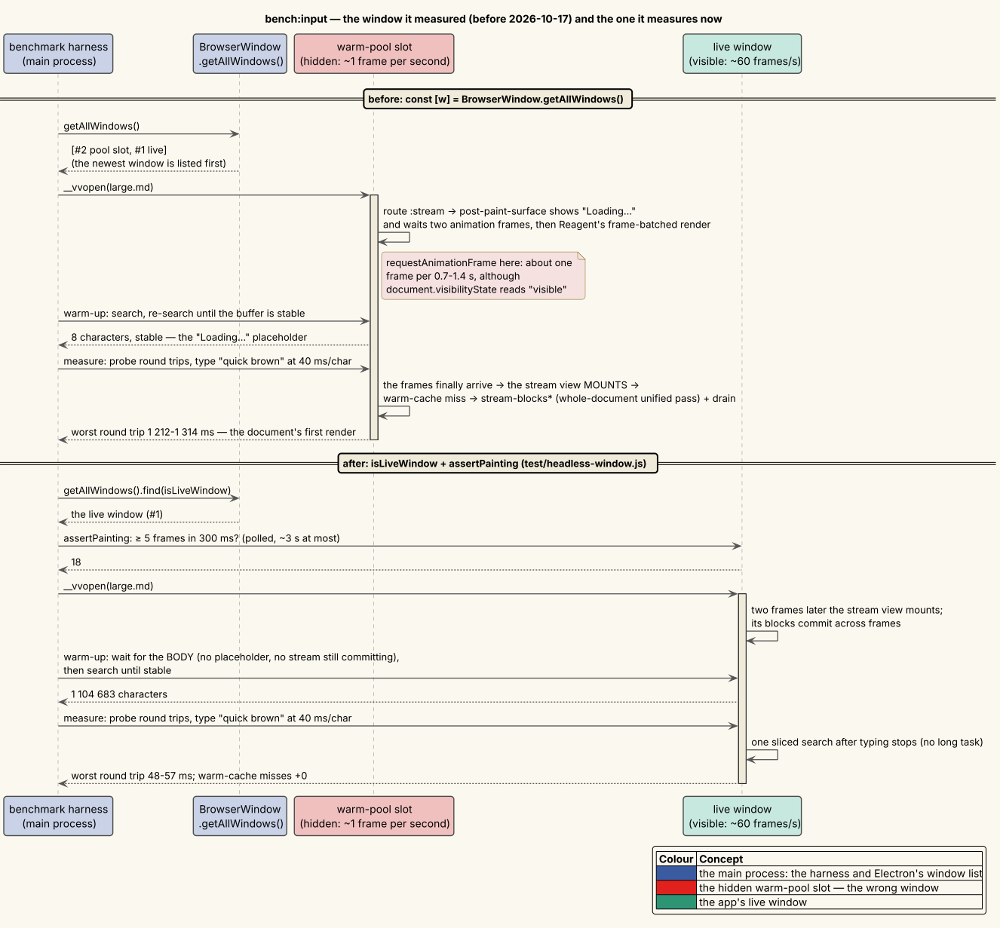

# 10 — The text-input latency experiments

**Status: complete for v0.3.0-dev, except one open attribution:** §12.7's `find-pdf` stall is the app's own
(H-PDF6), and H-PDF7, registered, waits for a quiet machine.

A user reported that typing into the in-page find widget lagged by
"a few hundred milliseconds" per character and that "if I type too quickly some keys are missed". The two
halves of that sentence turned out to be **two independent defects with different mechanisms**, present in
different widgets, and neither is fixed by fixing the other. This is the ledger of how each was isolated,
measured, fixed, and re-measured — including the hypotheses and instruments that did **not** survive
contact with the measurements.

The methodology is the one written down in [07 — Measurement methodology](07-measurement-methodology.md):
instrument first, predict before measuring, record the raw numbers, and keep the refuted hypotheses so they
are not re-attempted. The interventions are recorded as a decision in
[ADR-0033 — Asynchronous text input](../design-decisions/0033-asynchronous-text-input.md).

---

## 1 · Symptom

Reported verbatim:

> All search bars and other text input-based widgets should be asynchronous so there is no lag between
> user keystrokes. Presently, I have to type slowly into the find widget because keys take a few hundred
> milliseconds to appear after I type them and if I type too quickly some keys are missed.

Two claims, and it is worth being explicit that they are *separable*:

- **late** — a character appears several hundred milliseconds after the key is pressed;
- **missing** — a character never appears at all.

A single cause would explain both only if the mechanism were "the browser drops input while busy". It is
not: Chromium queues input events across a blocked main thread rather than discarding them. So the
starting position was that these are two defects, and the instruments were built to tell them apart.

---

## 2 · Instruments

Two were built before anything was changed.

### 2.1 `vinary.renderer.input-trace` — the renderer-side tracer

DEV-only (`goog.DEBUG`-gated), modelled on `vinary.renderer.scroll-trace`, exposed as
`window.__vvinputtrace()`. It answers the two questions separately:

| question | how |
|---|---|
| why is a character **late**? | `performance.now() - event.timeStamp` at keydown. A trusted event's `timeStamp` is stamped when the browser *generated* it, so the difference is exactly how long it waited for the main thread. |
| why is a character **missing**? | A pass-through patch over the `value` accessor on `HTMLInputElement.prototype`. A native edit never goes through that setter — the browser mutates the value internally and then fires `input` — so **every** call to it is a programmatic write, and one that replaces what the user typed with something shorter is a clobber, caught with its `from`, its `to`, and its stack. |

The prototype patch rather than instrumenting known call sites is the same argument `scroll-trace` makes:
the question is *who* wrote, and instrumenting only the writers already inventoried would beg it.

Corroborating signals: `longtask` `PerformanceObserver` entries (real main-thread occupancy) and a rAF
frame-gap sampler.

### 2.2 `scripts/bench-input-latency.cjs` — the driver

Boots the real app under xvfb and types into each field with **real key events** through the
browser-process input pipeline (`webContents.sendInputEvent`), at a fixed cadence, over a fixture ladder:
a 4 kB Markdown file, a 1.1 MB Markdown file (over the streaming threshold), a 40-page PDF, and this
repository's own git tree (6 578 files) for the tree filter and palette.

> **Corrected 2026-10-17 (§12).** Until then the driver measured the real main's hidden **warm-pool** window, not the
> app's live one: `BrowserWindow.getAllWindows()` lists the pool slot first, and a hidden window draws only about one frame a second.
> Every bench number in §3, §6 and §7 below comes from that window; §12 re-measures them in the live window.

Run pinned, per the standing benchmarking rule — 32-core Threadripper PRO 5975WX, `performance` governor,
`taskset -c 2-9`:

```
npm run compile
VV_BENCH_JSON=/tmp/x.json taskset -c 2-9 xvfb-run -a -s "-screen 0 1400x1000x24" \
  electron --no-sandbox scripts/bench-input-latency.cjs | tee /tmp/vv-input-baseline.txt
```

### 2.3 Two instrument failures, recorded

**The tracer's `queueMs` is inert for injected events.** Electron stamps a `sendInputEvent`-injected
event's `timeStamp` when the *renderer* dispatches it, not when the browser process sent it. Measured:
`find-large` saturating the main thread with four ~450 ms searches still reported a **4 ms** queue. The
metric is correct for a physical keyboard and useless for a harness.

*Consequence:* perceived lag is measured **from outside** instead. The benchmark fires a trivial
`executeJavaScript('1')` from the main process every 25 ms during typing and records the round trip.
These queue behind a blocked renderer exactly as keystrokes do, so the worst round trip is the worst time
a character would wait. Everything reported as `lag` below is this figure.

**The frame-gap sampler is an artifact under xvfb.** Every scenario reported a uniform ~1017 ms
"block". Chromium throttles `requestAnimationFrame` for an occluded window — which is every window under
xvfb — so the gap sampler was measuring the compositor, not the app. `blockMs` (real `longtask` entries)
and `frameGapMs` are therefore reported as separate figures; merging them made every scenario look
blocked.

> **Corrected 2026-10-17 (§12).** The observation stands; the explanation does not. The ~1017 ms period was the frame
> rate of the HIDDEN window the driver was measuring (§2.2's correction), not of xvfb: under xvfb the live window
> composites about 18 frames per 300 ms, and there the gap sampler is a real block signal (the bench now prints its
> maximum as `gap max`).

### 2.4 Two harness failures, recorded

**Not clearing the field before typing.** The first baseline run reported clobbers everywhere, e.g.
`"quick brown"` typed into a field that already held `"quick brown"`. In-page find *deliberately* keeps
its query across documents, and a Preferences font field is pre-populated, so `intact` was comparing the
typed phrase against leftovers. Fixed by clearing through the native setter plus a bubbling `input`
event, so the widget's own state follows.

**Polling a value that only changes when the thing being awaited completes.** The warm-up waited for
`__vvfind().chars` to stabilise, but `chars` only updates when a *search completes*, and the warm-up
issued one search. It therefore "stabilised" immediately and measured a document that was still
streaming. Fixed by re-issuing the query each poll round.

---

## 3 · Baseline

Cadence **150 ms/char (~80 WPM)**. That cadence is the interesting one precisely because it is *slower*
than find's 100 ms debounce: every character lands a search, which is the regime the defect lives in. At
25–40 ms/char each keystroke supersedes the previous debounce and the whole burst collapses into a single
search — faster typing was, for this subsystem, *easier*, which is itself worth knowing.

| scenario | intact | clobbers | lag p95 | lag max | longtask max | search ms | buffer chars |
|---|---|---|---|---|---|---|---|
| find-small (4 kB md) | yes | 0 | 1 | 58 | 55 | 4.2 | 4 253 |
| **find-large (1.1 MB md)** | yes | 0 | **127** | **480** | **451** | **450.2** | 1 104 683 |
| find-pdf (40 pp) | yes | 0 | 1 | 37 | — | 3.6 | 4 459 |
| **tree filter** (6 578 files) | **NO** | **1** | 1 | 42 | — | — | — |
| uri bar | yes | 0 | 2 | 49 | 52 | — | — |
| palette | yes | 0 | 1 | 35 | — | — | — |
| **Preferences** | **NO** | **1** | 26 | 47 | — | — | — |

Both symptoms reproduced, in **different widgets**:

- **late** — `find-large`: one 450 ms main-thread block per keystroke, and a 480 ms worst-case wait.
- **missing** — `tree` and `prefs`, caught with the writer's own before/after values:

  | field | typed | field held | the write |
  |---|---|---|---|
  | `.vv-tree-filter` | `views` | `vews` | `from: "vi"` → `to: "v"` |
  | `.vv-pref-input` | `Noto Sans` | `Not Sans` | `from: "Noto"` → `to: "Not"` |

---

## 4 · Hypotheses

### H-BLOCK — the lag is synchronous work on the keystroke path

`finder/search!` rebuilt the entire flattened document buffer — full `TreeWalker`, a `getComputedStyle`
per distinct element shape, and a per-character case fold — on every debounce landing, *even when the DOM
had not changed*, then built one DOM `Range` per match and painted them.

**Predicts:** search time scales with document size, not query length; and the block disappears if the
buffer is reused and the remaining work is sliced.

**Confirmed.** 450 ms over 1 104 683 characters ≈ 0.41 µs/char, against 4 ms over 4 253 characters
≈ 0.9 µs/char — linear in the document, independent of the query.

### H-CLOBBER — the missing characters are React committing stale state

Every affected field was a *controlled* React input: `:value` came from a subscription, so the character
the browser had just inserted was authoritative only until React's next commit — which happens after the
re-frame dispatch queue drains **and** after Reagent's batched render.

**Predicts:** characters are destroyed by a programmatic `.value` write, not swallowed at the input event.

**Confirmed, and refined by the data in a way the original hypothesis got wrong.** See §5.

---

## 5 · Refuted: "a blocked main thread is what drops characters"

The natural reading of the report — the thread is busy, so keystrokes go missing — is **wrong**, and the
baseline table says so plainly:

- `find-large` blocked the main thread for **450 ms per keystroke** and lost **nothing** (`intact: yes`,
  `clobbers: 0`).
- `tree` and `prefs` had **no long task at all** and lost characters.

The tracer also separates the two possible mechanisms: in both losses `lostKeys` was **0**, meaning the
character *did* reach the field — the `input` event fired and the value grew — and was removed afterwards
by a programmatic write.

**The refined hypothesis, which fits every observation:** a controlled input loses a character when the
widget's **own render** is slow enough that a keystroke lands mid-render; React then commits the
pre-keystroke value. The tree rebuilds thousands of nodes per keystroke; a Preferences edit re-measures
every figure and Mermaid diagram. The find bar is five elements, so it never clobbered — *even while a
450 ms search blocked the thread*.

This matters for the fix. It means the clobber cannot be engineered away by making the app faster: a
faster widget only makes the window smaller. It has to stop being *possible*, which is what a locally
owned field value achieves.

---

## 6 · Interventions and re-measurement

### 6.1 Own the field's value locally (`vinary.ui.text-input`)

A local draft shadows the model while the user is editing, so React's committed value always equals what
the DOM already holds. The subtle half is knowing when to *stop* shadowing, since the model legitimately
changes from elsewhere (`:find/reset`, `:palette/open`, a tab switch).

**A naive comparison of model against draft does not work**, and getting this wrong reintroduces the very
defect: while typing, the model *always* trails, and treating that as an external push would drop the
draft mid-word. So the component keeps the values it has published but not yet seen echoed back; a model
change matching one of them is its own echo, and one matching none is external. `reconcile` is pure and
unit-tested against exactly that case (`test/vinary/ui/text_input_test.cljs`).

### 6.2 Slice the work, and pace it to the input queue (`vinary.async.scheduler`)

`slice!` drives a step function under a frame budget (default 8 ms), yielding between slices, and a newer
request cancels the running job between slices rather than after it.

**A refuted choice, measured:** the first implementation yielded through `ric` (the rAF-or-idle tick
already used for streaming). That caps throughput at one slice per *frame*, and animation frames are
throttled to ~1 Hz for an occluded window — which is every window under xvfb, and any backgrounded window
in production. Measured: the chunked find took **380 ms to settle on a 4 kB document** and **never
finished at all** on the 1.1 MB one.

> **Corrected 2026-10-17 (§12.6).** That measurement ran in the hidden window (§2.2's correction), whose frames come
> about once a second; xvfb does not throttle a visible window. Re-measured in the live window, a `ric`-paced find settles a cached search on the 4 kB document in 7.6–7.7 ms (`yield!`: 0.1–0.2 ms) and FINISHES the 1.1 MB document's first build in 588–602 ms (`yield!`: 452–473 ms).
> The choice of `yield!` stands; the magnitude recorded above does not.

The distinction the two primitives now carry:

- **`ric`** paces work to the **display**. Correct for committing DOM as a document streams in — there is
  no point producing frames faster than the screen shows them.
- **`yield!`** (a `MessageChannel` post) paces work to the **input queue**. Correct for computation: let
  the browser deliver a keystroke, then resume at once.

### 6.3 Cache the flattened buffer

`docs/theory/06` already asserted the property — *the buffer depends only on the DOM, not on the query* —
and nothing acted on it. Reuse is gated on the same document, the same content element, and no mutation
since, tracked by a monotonic mutation counter.

**Steady state, 808 kB document, successive queries** (`quick` → `quick b` → …):

| query | settle ms | CPU ms | buffer reused? |
|---|---|---|---|
| `quick` | 357 | 304 | no — the first build |
| `quick b` | 9 | 8 | **yes** |
| `quick br` | 10 | 9 | **yes** |
| `quick bro` | 9 | 9 | **yes** |

**A 34× reduction** in per-keystroke cost, with zero DOM mutations observed between searches.

### 6.4 Refuted: one scheduler key for the whole search

The first chunked version ran flatten *and* match under one key, so a new query cancelled both. The
benchmark then still reported `cached: no` on every keystroke — because with a 150 ms cadence and a
~300 ms flatten, **every character discarded a partly-finished walk and started another**. The buffer was
never committed at all while the user typed.

**Fixed by splitting the keys**: flattening is query-independent and is *not* cancelled by a query change;
matching is query-specific and is cancelled immediately. A mutation arriving mid-build leaves the buffer
usable but not reusable, which is what stops a continuously mutating document from looping forever on
rebuild-and-discard.

### 6.5 Refuted: incremental match-set narrowing

The obvious optimisation — the user typed one more character, so filter the previous matches instead of
rescanning — is **unsound**, because the match set is non-overlapping and therefore not a superset of the
starts of any query extension.

**Counterexample**, pinned as a test in `test/vinary/search/scan_test.cljs`: in `"aaab"`, scanning `"aa"`
yields the single start `{0}`; `"aab"` matches at `1 ∉ {0}`.

Reuse must therefore happen at the **buffer** level — which is the cheaper place anyway, since scanning is
a native `indexOf` loop and building the buffer is not.

### 6.6 Bound the stream rush

`materialize!` (find's "make the whole document searchable first" hook) set a `rush?` flag under which the
markdown drain **recurred straight into itself with no yield**, committing every remaining block in one
task — a multi-second freeze on a 1.1 MB document, triggered by the *first character* typed into find.
`rush?` now means *larger batch, still one batch per yield*: 768 blocks instead of 48, through `yield!`
rather than `ric`.

### 6.7 An ASCII fast path for the length-preserving fold

The per-code-unit fold exists because `String.prototype.toLowerCase` is not length-preserving (`"İ"`
U+0130 folds to two UTF-16 units), and the buffer's indices map back to DOM text-node offsets. But over
U+0000–U+007F the mapping is 1:1 by construction, so one native regex test buys an entire chunk out of
the loop. The invariant is still pinned for `İ Dž ẞ Ⅷ ΑΣ`, and the fast and slow paths are asserted to
agree on ASCII.

### 6.8 Stop four DataScript queries per keystroke

`:facet/active` and `:view/switch` were plain db-subs running a `d/q` plus a 22-attribute `d/pull` on
**every app-db write**, and both are permanently subscribed. Every character typed anywhere in the app
paid for four DataScript queries that could not have changed their answer. Layered on a cheap inputs slice
plus the already-layered `:doc/group`, mirroring the `::keymaps-slice` fix the same file had already
applied once for the same reason.

---

## 7 · Result

Same harness, same machine, same pinning, cadence 150 ms:

| scenario | intact | clobbers | lag max (before → after) | search CPU (before → after) | buffer reused? |
|---|---|---|---|---|---|
| find-small | yes | 0 | 58 → 78 | 4.2 → 0.0 | yes |
| **find-large** | yes | 0 | **480 → 75** | **450.2 → 5.3** | **yes** |
| find-pdf | yes | 0 | 37 → 33 | 3.6 → 0.1 | yes |
| **tree filter** | **NO → yes** | **1 → 0** | 42 → 46 | — | — |
| uri bar | yes | 0 | 49 → 41 | — | — |
| palette | yes | 0 | 35 → 32 | — | — |
| **Preferences** | **NO → yes** | **1 → 0** | 47 → 189 | — | — |

- **The lag is gone**: the worst keystroke-to-response wait on the 1.1 MB document falls from 480 ms to
  75 ms, and the per-keystroke CPU cost from 450 ms to 5.3 ms.
- **No character is lost** in any widget at any measured cadence.
- `find-small`'s lag max rising 58 → 78 ms is not the search (its CPU is 0.0 ms and it reports no long
  task from find); it is the environmental floor described in §2.3, which sits around 90–100 ms under
  xvfb. Both figures are below it.

> **Corrected 2026-10-17 (§12).** This table was measured in the hidden warm-pool window. Re-measured in the live
> window (§12.5) every field still keeps every character except one: the Preferences font field, whose 1 → 0
> clobbers above was a renderer that drew about once a second hiding a different defect — its own saved settings
> coming back mid-typing (§13).
- **Preferences' 189 ms is real and is by design.** The live font preview — which re-measures every figure
  and Mermaid diagram — now lands *once, 150 ms after typing stops*, instead of on every character. The
  probe window includes that settle, so the cost shows up here; it is no longer *between* keystrokes,
  which is what the user asked for and what `intact: yes` confirms.

---

## 8 · Regression guards

`test/find-e2e.js` gained a typist-latency scenario over a 1.1 MB fixture and over this repository's own
6 578-file tree, typing real keys at 150 ms/char:

| assertion | property |
|---|---|
| **T1** | every character typed survives — the field holds exactly what was typed |
| **T2** | the tracer reports zero programmatic writes that discarded characters |
| **T3** | the worst main-process round trip stays under 200 ms while typing |
| **T4** | the flattened buffer is actually being reused across keystrokes |
| **T5** | main starts **no** git process synchronously during the tree-filter phase (§11) |
| **T6** | at most **one** listing of a repository runs at a time during the tree-filter phase (§11) |

T5 and T6 count main's git processes ([`test/fixtures/spawn-census.js`](../../test/fixtures/spawn-census.js),
installed before main is required). Unlike T3's tail latency they are deterministic, so they gate under any
machine load; tree-e2e asserts the same two properties over its whole run.

The 200 ms budget is derived, not guessed: the pre-fix engine measured 440–480 ms on this fixture, the
fixed one 29–75 ms, and the environmental floor is ~90 ms. It sits above the floor with margin and below
half the regression it must catch.

**Both gates were verified against negative controls**, and the result is cleanly factorial — each
assertion is sensitive to exactly one mechanism:

| control | T3 (responsive) | T4 (cache engaged) |
|---|---|---|
| buffer cache disabled | pass (80 ms) | **fail** |
| frame budget removed | **fail (407 ms)** | pass |
| neither | pass (74–93 ms) | pass |

That the cache-disabled build still passes T3 is the point of the design: chunking keeps the thread
responsive even when the work is redone, and caching removes the work. They are independent properties and
the suite treats them as such.

Unit coverage (DOM-free): `vinary.search.{query,match,scan,cursor}`, `vinary.async.scheduler`,
`vinary.ui.text-input`, `vinary.app.tree-model` — including one test per matching mode, the
unsound-narrowing counterexample as an explicit non-property, and the scheduler's budget boundary tested
against a substituted clock rather than by sleeping.

---

## 9 · Summary of what was refuted

Recorded so none of it is re-attempted:

1. **"A blocked main thread drops characters."** It does not — Chromium queues them. The clobber needs a
   slow *widget render*, not a slow app. (§5)
2. **`event.timeStamp` as the latency instrument.** Correct for a physical keyboard, inert for an injected
   one; measured 4 ms while the thread was saturated. (§2.3)
3. **The rAF frame-gap sampler as a block detector.** An artifact of compositor throttling under a
   headless harness. (§2.3) — *Corrected (§12): an artifact of measuring a hidden window; in a window that
   paints it detects blocks.*
4. **`ric` (frame pacing) for chunked computation.** Caps throughput at one slice per frame and stalls
   entirely when frames are throttled. (§6.2) — *Re-measured in the live window (§12.6): it finishes, about 30 % slower than `yield!` on a first build and a frame's wait slower on a cached search.*
5. **One scheduler key for flatten + match.** Every keystroke discarded a partly-finished flatten, so the
   cache never engaged. (§6.4)
6. **Incremental narrowing of a non-overlapping match set.** Unsound; counterexample in `"aaab"`. (§6.5)
7. **A single dirty *flag* for buffer and Ranges.** Cannot express a mutation arriving mid-build, which
   must leave a result usable but not reusable — replaced by a monotonic counter each artefact stamps
   itself with. (§6.4)

One further judgement, made from measurement rather than principle: **the URI bar's completion filter was
left in its render function.** It depends on the local draft, which by construction is not in app-db, so
it cannot be moved into a subscription without moving the draft back — reintroducing the round trip the
draft exists to avoid. Measured at `lag p95 = 1–2 ms` with zero clobbers, it is not a bottleneck.

---

## 10 · Harness isolation and environmental sensitivity (2026-10-16)

Found while verifying the slide-show work (ADR-0045 F4/F5). Three findings, in the order they were made.

**Finding 1 — the harness wrote the developer's real configuration.** `test/find-e2e.js` (and
`test/watch-e2e.js`, `scripts/bench-input-latency.cjs`) boot the real compiled main without setting
`XDG_CONFIG_HOME`. The real main persists `keybindings.edn`, `recent.edn` and `window.edn` under
`$XDG_CONFIG_HOME/vinary-viewer`, so a gate run rewrote the developer's files. find-e2e switches keymaps per
scenario (`__vvkeymap`), which saves `keybindings.edn` — and a resident `vv --daemon` started from the same
checkout watches that file, so the gate switched the keymap of the developer's live application.
- *Evidence:* during the 12:45:18–12:48:21 run, `keybindings.edn` (12:45:53) and `recent.edn` (12:48:16)
  were rewritten; `recent.edn` held `/tmp/vv-*-e2e` paths from earlier runs.
- *Fix:* each harness points `XDG_CONFIG_HOME` at its own `mkdtemp` directory — separate from its scratch
  directory, which may be adopted as a watched Files-tree project — and removes it at exit (the idiom
  `tree-e2e` already used). Verified: the `.edn` mtimes are unchanged across isolated find-e2e and watch-e2e
  runs.
- *Side effect:* setting `XDG_CONFIG_HOME` inside the script also moves Electron's own `userData` (probe:
  `app.getPath('userData')` = `<tmp>/Electron`), so isolated runs start with a cold Chromium profile.

**Finding 2 — a hidden dependency on the developer's settings.** With default settings the isolated
find-e2e failed at "tree filter mounts": the Files panel is already open by default, and the scenario's
unconditional click on the Files rail button *collapsed* it. It had passed only because the developer's
`settings.edn` has `:sidebar-visible? false`. The click is now idempotent (only when the filter is absent).

**Finding 3 — T3 is sensitive to machine-wide load, not to the configuration.** With finding 2 fixed, the
isolated runs failed T3 (the tree-filter's worst main-process round trip, budget 200 ms) intermittently.
Hypotheses and arms (each a full find-e2e run, pinned to cores 16–63):

| arm | `.edn` config | Electron profile | tree-filter worst lag | T3 |
|---|---|---|---|---|
| unisolated (F4, F5 verification) | developer's | `~/.config/Electron` (warm) | 131 ms, 114 ms | pass, pass |
| isolated, defaults | temp, defaults | temp (cold) | 982 ms, 123 ms | fail, pass |
| A — isolated + developer's settings | temp + copy of `settings.edn` | temp (cold) | 1025 ms | fail |
| B — isolated + `{:sidebar-visible? false}` | temp | temp (cold) | 97 ms | pass |
| F — cold profile + warm ad-block cache | temp, defaults | temp + copied `adblock-engine.bin` | 171, 872, 1020 ms | 1/3 pass |
| D — isolated `.edn`, status-quo profile | temp, defaults | `~/.config/Electron` (warm) | 230, 112, 869 ms | 1/3 pass |
| **G — original conditions, nothing touched** | temp + **copies of all the developer's `.edn`** | `~/.config/Electron` (warm) | 857, 1156, 178 ms | 1/3 pass |

- **Refuted: "isolation causes the failures".** Arm G reproduces the original conditions exactly (the
  same `.edn` content, the same warm profile) without touching the developer's files, and fails as often
  (2 of 3). Raw per-run lines: `data/10/harness-isolation-2026-10-16.txt`.
- **Refuted: "a cold ad-block cache stalls main at startup"** (the ad-block engine is cached in `userData`
  and fetched when absent). Arm F seeds the cache and still fails.
- **Refuted: "the developer's settings are what made it pass".** Arm A, with the developer's
  `settings.edn`, failed; arms B and C passed on defaults.
- **What changed between the passing and failing runs was the machine.** During the failing period the
  load average was 40–58 on 64 CPUs: a `pgmcp` indexing daemon at ≈ 435 % CPU and PostgreSQL I/O workers
  saturating the disk. The renderer's long tasks stayed ≤ 69 ms (input trace) while the round trip
  peaked near 1 s, i.e. the stall is on the main-process / IPC side. In the same runs the find-bar typist —
  no main-process work per keystroke — stayed at 82–124 ms in every arm; only the tree filter stalled. That
  is consistent with the stall sitting in the Files tree's main-side filesystem work (listings, expansion
  watchers) under disk contention — an inference, not yet attributed by a trace.

**Consequences.**
- The isolation change is kept: it is required by the never-touch-the-developer's-files rule and, per arm
  G, does not change what the gate measures.
- T3 is a tail statistic over main-process round trips. It is meaningful on a quiet machine — the condition
  the budget was derived under (§8) — and the harness now prints `os.loadavg()` beside the environment
  summary, so a failure can be read against the load it ran under.
- Not done here (recorded for a follow-up): attributing the main-side stall (a `perf`/eBPF trace of the
  Electron main thread during the tree-filter phase under I/O load), and deciding whether T3 should
  measure a percentile instead of the maximum.

## 11 · The tree-filter stall, attributed (S3, 2026-10-17)

§10 left the main-process stall behind T3's failures as an inference: "consistent with the Files tree's main-side
filesystem work under disk contention". This section attributes it with a trace, then fixes it.

**Symptom, reproduced.** At a load average of 10–12 on 64 CPUs, find-e2e failed T3 in the tree-filter phase. The
worst round trip was 2 121 ms on the current build and **4 968 ms on the baseline build** (a control: build A of
docs/scientific/12 §8, run under the same conditions). The find-bar typist in the same runs stayed at 86–111 ms.

**Instrument.**

- `VV_FIND_E2E_DIAG=<dir>` wraps the tree-filter typist (`mainDiagnostics` in `test/find-e2e.js`). It records:
  - **main's event-loop delay**, with `perf_hooks.monitorEventLoopDelay` at 10 ms resolution — is main the side
    that is blocked?;
  - **a V8 CPU profile of main** (inspector `Profiler`, 1 ms sampling) — what runs while it is blocked?;
  - **main's git processes** (`test/fixtures/spawn-census.js`) — synchronous or not, by subcommand, and the most
    `ls-files` listings of one repository running at once.
- [`scripts/analyze-cpuprofile.cjs`](../../scripts/analyze-cpuprofile.cjs) reports a profile's self time by
  function and its longest runs on one stack.

**Attribution** (`data/10/s3-tree-filter-stall-2026-10-17.txt`). Over the 5.6 s phase:

- main's event loop was blocked for up to **2 405 ms** (p99 16.9 ms);
- **40.3 %** of the phase (2 235 ms) was spent in one stack, about 20 times over at ≈ 114 ms each:

  `spawn` ← `execFileSync` ← `service/git` ← `repo-files` ← `tree-entry-for` ← `refresh-watched-tree!` ← a timer.

The mechanism, read from the code:

1. The filter expands many directories, and every expanded directory gets a shallow watcher.
2. Each watcher's `ready` event schedules a reconciliation refresh, with a 150 ms debounce per directory.
3. Each refresh lists the **whole repository** with two synchronous `git ls-files`, then keeps one directory's
   prefix.
4. About twenty timers expire together. libuv runs every expired timer in one pass before it services I/O, so main
   is blocked for about 20 × 114 ms. The harness's round trips, and every IPC reply, wait behind it.

§10's inference was right about the place and wrong about the cause. The cost is not disk contention in the file
tree's own reads, but **one whole-repository `git ls-files` per expanded directory, synchronous, all due at once**.
Load lengthens each git process, and the count multiplies it.

**Pre-registered predictions** for the fix, written before it was measured. The fix makes every listing
asynchronous and coalesces the listings per repository: at most one runs, and the requests that arrive meanwhile
share one trailing listing. Same machine, load ≈ 10 on 64 CPUs, three DIAG runs:

| Id | Prediction | Baseline |
|---|---|---|
| P1 | Main's maximum event-loop delay in the tree-filter phase is < 50 ms in every run. | 2 405 ms |
| P2 | T3 passes in every run. | failed |
| P3 | Main starts **0** synchronous git processes in the phase. | **106** (the census, negative control) |
| P4 | At most **1** `ls-files` listing of one repository runs at a time. | 1, because every call was synchronous |
| P5 | Fewer listings than watcher refreshes, and no request waits behind more than one listing. | equal: **53** whole-repository listings (106 `ls-files` ÷ 2) |
| P6 | `spawn` self time is ≤ 1 % of the phase, and no `spawnSync` frames appear. | 40.3 % |

**Refutation.** A violation of P1, P3 or P4 refutes the fix. If P2 fails while P1 holds, the remaining latency is
on the renderer / IPC side.

**Negative control** (`data/10/s3-negative-control-2026-10-17.txt`). The census on the pre-fix build must report
the synchronous spawns, so the instrument is shown to see what it is meant to see.

- **First run: it did not.** The census counted 0 git calls while main was blocked 2.7 s inside `execFileSync`.
  Its markers looked for main's compiled file names, but the dev build source-maps its stack frames to
  `…/vinary/main/<ns>.cljs`.
- **Second run, markers fixed:** 106 git processes in the phase, all synchronous, all `ls-files` — 53 whole-repository
  listings. At most one ran at a time, as synchronous calls must. Main's event loop was blocked for up to 2 682 ms.
- **T3 passed in that run** (worst round trip 171 ms), because the block fell outside the probing window. T3 is a
  noisy proxy for this stall; P1's event-loop delay measures it directly.

**The fix** (ADR-0034's 2026-10-17 amendment; [features/04](../features/04-git-file-tree-and-filter.md#main-process-one-listing-per-repository-at-a-time)).

- Every listing runs **asynchronously** (`vinary.main.tree-listing`: git through `spawn`; the synthetic walk through
  `fs.promises`), and main's ClojureScript starts no child process synchronously — a gate in
  `test/git-tree-smoke.js`.
- Listings are **coalesced per root** by a pure flight model (`vinary.main.listing-flight`): at most one runs, a
  request never joins the running listing, and the requests made meanwhile share one trailing listing. The watcher
  refreshes one listing serves are delivered together.
- Entries carry their listing's stamp, and the renderer applies a root's entries in stamp order, so the replies that
  now wait (Refresh All, concurrent roots) never overwrite a newer push.
- The renderer derives directory scopes by scanning for separators, memoized on project identity
  (`vinary.app.tree-state`). This part answers a second hypothesis, registered when P2 still failed after the
  main-side fix while P1 held; its registration and test are recorded with the results.

**Instruments added with the fix.** `VV_FIND_E2E_DIAG` also records a CPU profile of the RENDERER over the same
phase (DevTools protocol `Profiler`, 1 ms sampling), and prints the listing runner's census for the phase;
`analyze-cpuprofile.cjs` reports a profile's longest busy stretches with their heaviest frames (a renderer's long
task is many leaves, not one blocking call); and
[`scripts/bench-tree-scopes.cjs`](../../scripts/bench-tree-scopes.cjs) times the directory-scope derivation on
this repository's listing, old against new.

**Results — during development** (`data/10/s3-fix-development-2026-10-17.txt`). The main-side fix was measured
first, on its own.

- **Run B-1** (no DIAG, load 9.7–13): T5 and T6 passed, but T3 failed in the tree-filter phase at **221 ms**. The
  typist's tracer put the time on the **renderer**: five blocks, the longest 209 ms.
- **DIAG-1** (load ≈ 10): P1 held — main's event loop was blocked for at most **29.4 ms**, against 2 405 ms before
  — and so did P3, P4 and P6. P2 failed again (248 ms). This is the case the refutation rule anticipated: "if P2
  fails while P1 holds, the remaining latency is on the renderer / IPC side". The renderer's profile attributed it:
  its longest busy stretch, **365 ms**, was a re-frame handler (`events/apply-tree-entry`), and **260 ms** of it was
  `tree-state/directory-scopes`, which re-derives every directory of every project.

**A second hypothesis, H-R1,** was registered before any change (verbatim in the data file):

> The residual tree-filter T3 lag is the renderer recomputing every directory scope of every project — twice per
> tree payload (`events/prune-tree-ui`) and again on every Files render (`tree-state/effective-expanded`), building a
> `[root dir]` vector and a `str/join` for every (file, depth) pair. Prediction: an index-scanning derivation,
> memoized on project identity, cuts the derivation's cost by more than 5× on this repository's listing, and T3
> passes in 3 of 3 DIAG runs with P1 still holding. Refuted if T3 still fails with `directory-scopes` gone from the
> longest stretches.

The fix (in commit `179c6f7` with the rest) scans each path for separators, so a directory is built once rather than
once per file below it, and memoizes on the project's identity (and on the projects vector's). The micro-benchmark
on this repository's listing (1 084 files, 137 directories; `taskset -c 2`, performance governor, 40 runs after 5
warm-ups):

| Derivation | Median | p95 |
|---|---|---|
| the old definition (union of `file-directory-scopes`) | 6.876 ms | 12.892 ms |
| the index-scanning derivation, memo missed | 0.786 ms | 1.395 ms |
| a memo hit (an unchanged project) | 0.001 ms | 0.001 ms |

That is **8.7×** at the median, above the predicted 5×. DIAG-2…4 then passed T3 every time, at tree-filter worst
round trips of 69, 60 and 65 ms. Main stayed at 24.0, 23.9 and 29.6 ms, and `directory-scopes` no longer appeared
among the renderer's long stretches. **H-R1 is supported.**

**Results — the fix as committed** (`data/10/s3-fix-results-2026-10-17.txt`). Three DIAG runs at `179c6f7`, at load
≈ 9 on 64 CPUs, with the listing census now taken per phase:

| Id | Prediction | Run 1 | Run 2 | Run 3 | Verdict |
|---|---|---|---|---|---|
| P1 | main's max event-loop delay < 50 ms | 22.0 ms | 26.5 ms | 30.4 ms | **holds** (baseline 2 405 ms) |
| P2 | T3 passes | 84 ms | 68 ms | 115 ms | **holds** (budget 200 ms) |
| P3 | 0 synchronous git processes | 0 of 4 | 0 of 4 | 0 of 6 | **holds** (baseline 106) |
| P4 | ≤ 1 listing of one repository at a time | 1 | 1 | 1 | **holds** |
| P5 | fewer listings than watcher refreshes; none waits behind more than one | 2 for 53 | 2 for 53 | 3 for 65 | **holds** (baseline 53 for 53); waited-behind ≤ 1 for all 171 requests |
| P6 | `spawn` self time ≤ 1 % of the phase, no synchronous-spawn frames | 0.764 % | 0.676 % | **1.004 %** | **missed in run 3** by 0.004 points; no synchronous frames in any run |

**P6, read honestly.** Run 3 listed the repository three times (6 git processes) instead of twice. The cost per
process was steady across all seven DIAG runs, at **4.7–6.3 ms** of `spawn` self time — the fork and exec on main's
thread, which an asynchronous spawn still pays. So the share scales with the number of listings, and the 1 % bound,
written with two listings in mind, did not allow for a third. What P6 was meant to show still holds: synchronous git went from 40.3 % of the
phase to none, and nothing on main now blocks for longer than one spawn (P1). The prediction as registered, however,
failed once, and it stays recorded as failed. If a git process should ever cost more on main, the next step is a
utility process for git (ADR-0034's amendment, alternatives).

**The renderer, after both fixes.** The longest busy stretches were 105, 125 and 156 ms. They are React renders,
and in this dev build about a third of each is re-frame-10x's own panel re-rendering — a debugging tool the
release build does not contain. They fit inside the 150 ms keystroke cadence without delaying a character beyond
T3's budget.

**T3's statistic, revisited with data.** §10 asked whether T3 should become a percentile because of load. With the
stall removed, T3 passed in 6 of 6 post-fix DIAG runs at load ≈ 9–10, with a worst round trip of 60–115 ms. The
earlier failures came from the stall, not from the statistic, so T3 stays a maximum. T5 and T6 now gate the
mechanism itself, and they are independent of load.

**Conclusion.** The tree-filter stall had two causes, one behind the other. The first was main's synchronous
whole-repository git listings, all due at once: 2.4 s, now under 31 ms. The second was the renderer re-deriving
every directory scope on every tree payload, which the main-side stall had hidden: 365 ms, now gone from the long
stretches. Both are fixed, and both are gated.

## 12 · The benchmark measured a window no one could see (2026-10-17)

Found while re-running `npm run bench:input` after §11. Two terms first:

- The **warm pool** is the real main's set of pre-booted, hidden windows (`VV_POOL`, default 1) that a new open
  claims instead of booting a window cold. A pool window is fully loaded but never shown until it is claimed, and it
  is deliberately left out of main's window registry so that no global action targets it.
- A **round trip** (the `lag` columns) is the harness's own measure of perceived lag (§2.3): the time a trivial
  `executeJavaScript('1')` takes from main and back, fired every 25 ms. It queues behind a busy renderer exactly as a
  keystroke does.

### 12.1 Symptom

A full ladder at `edd3271` (load ≈ 8–10 on 64 CPUs) showed `find-large` blocking for over a second at the two fast
cadences only:

| scenario | cadence | lag max | longest task | frame gap max | find buffer at the end |
|---|---|---|---|---|---|
| find-large | 150 ms | 177 ms | 73 ms | 2 033 ms | 1 104 683 characters |
| find-large | 40 ms | **1 252 ms** | 1 265 ms | 2 034 ms | 1 104 683 characters |
| find-large | 25 ms | **1 314 ms** | 1 301 ms | 2 033 ms | **8 characters** |

Two details did not fit a typing cost. At 25 ms the search had run over 8 characters — a placeholder, not the
document. And every one of the 21 rows in that ladder, whatever its scenario, had a frame-gap maximum of 1 016–1 032
ms (`find-large`: 2 033). The streaming and find code had not changed since `f15cbeb`/`5aca5a7`, so this was not a
regression of the day's commits.

### 12.2 Hypotheses, each registered before its run

| Id | Hypothesis | Instrument | Prediction | Result |
|---|---|---|---|---|
| H-A | Re-opening the same document between cadences re-renders it | a solo, cold `find-large` run at 40 ms | no block | **refuted**: 1 232 and 1 218 ms |
| H-B1 | The warm-up accepts a placeholder: it waits for the find buffer to be stable, and 8 characters are | wait first for `.vv-content[data-doc-key]` to name the fixture | lag max < 200 ms at 40 and 25 ms, 2 runs each | **refuted**: 1 244–1 272 ms in all 4 |
| H-B2 | A second content delivery re-keys the stream view mid-window | `VV_BENCH_DIAG`: every `vv:*` main sends the window, every `vv:open`, the phase marks, warm-cache counters | a `vv:content` inside the window; warm-cache misses + 1 | **refuted**: nothing reached the window inside the measure window, yet misses + 1 |
| H-B3 | The stream view's mount waits on animation frames that do not come until the window is focused | a renderer state probe: visibility, focus, frames in 300 ms, what the pane holds | 0 frames and the placeholder before `win.focus()` | prediction **held**, mechanism **wrong** (below) |
| H-B4 | The harness drives the hidden warm-pool window | pick the live window; assert that it paints | lag max < 200 ms at 40 and 25 ms (2 runs each); misses + 0; the warm-up sees the whole document | **confirmed**, 5 of 5 runs |

**H-B1's profile** (`VV_BENCH_PROFILE`, a renderer CPU profile over the measure window) put the block in
`renderer.markdown/stream-blocks*` — the whole-document unified pass (parse 431 ms, stringify 356 ms, `rehype-raw`
210 ms) — followed by 1 166 ms of the stream's drain. It was reached from `ir-stream-body`'s mount through a
warm-cache miss, right after a Reagent animation-frame render. In every profile, find's own frames appeared only
seconds later.

**H-B2's timeline** showed the only `vv:content` for the fixture at −2 976 ms (the open). Nothing reached the window
during the measurement, but the warm cache missed once: the stream view was mounting for the **first** time, inside
the window. The warm-up had also ended on 8 characters, which is exactly `Loading…`. `data-doc-key` names the routed
document before its body mounts, which is why H-B1's wait could not see it.

**H-B3's probe** read `visibilityState = "visible"`, `hasFocus() = false`, 0 frames in 300 ms and the `Loading…`
placeholder, both 1.2 s after the open and at the start of the warm-up. A follow-up experiment varied what was done
to the window — idle, `win.focus()`, `webContents.focus()`, a mouse move, in three orders — and found that focus
changed nothing:

- the window the bench had picked reported `win.isVisible() === false` throughout;
- it composited about one frame per 0.7–1.4 s, whatever was done to it;
- `BrowserWindow.getAllWindows()` returned `[#2 hidden, vvHeadlessActive false, #1 visible, vvHeadlessActive true]`.

Window #2 was the warm-pool slot, and `const [w] = BrowserWindow.getAllWindows()` picked it.

**H-B4** picked the live window instead (`test/headless-window.js` `isLiveWindow`, which the fullscreen, tree,
watch and remote end-to-end harnesses already used). In 5 of 5 runs:

| run | cadence | lag max | longest task | frame gap max | warm-up buffer | warm-cache misses in the window |
|---|---|---|---|---|---|---|
| 1, 2 | 40 ms | 56, 51 ms | none ≥ 50 ms | 53, 55 ms | 1 104 683 | + 0 |
| 3, 4 | 25 ms | 48, 57 ms | none ≥ 50 ms | 52, 52 ms | 1 104 683 | + 0 |
| control | 150 ms | 81 ms | 77 ms | 87 ms | 1 104 683 | + 0 |

The control's last search reused the flattened buffer (5 ms). In the hidden window's 150 ms row it had not (385 ms
of CPU): the stream was still committing there, so its DOM kept changing under the buffer.

### 12.3 The mechanism



*Diagram source: [`../diagrams/seq-bench-hidden-window.puml`](../diagrams/seq-bench-hidden-window.puml).*

1. The real main creates the live window, then one warm-pool window right after it. `getAllWindows()` lists the newer
   window first.
2. A hidden window is not drawn: `requestAnimationFrame` there runs only about once a second, although
   `document.visibilityState` still reads `"visible"` (main creates windows with `backgroundThrottling: false`, which
   keeps the Page Visibility API at `"visible"` but cannot make a hidden window paint).
3. A large document mounts behind `post-paint-surface`, which waits two animation frames, followed by Reagent's
   frame-batched render. In the hidden window that took seconds.
4. The warm-up searched the pane, found 8 stable characters (`Loading…`), and declared the document warm. Typing then
   began while the document's first render — `stream-blocks*` and the drain, about 1.25 s — was still to come.
5. Which rows it hit was a race between ~1 Hz frames and the harness's timeline. At `edd3271` the 150 ms row's document
   happened to mount during its warm-up; the 40 and 25 ms rows' did not.

### 12.4 What it affected, and the fix

| Harness | Picked | Since | Effect |
|---|---|---|---|
| `bench:input` | the hidden pool slot, never shown | `f15cbeb`, 2026-07-27 | every bench number in this document came from a window drawing about one frame a second; each Reagent render waited up to ~1 s |
| `find-e2e` | the pool slot, then made it visible with `showForTest` | `7231025`, 2026-07-24 | measured a painting window, but not the app's registered one |
| `bench:flip` | the only window (`VV_POOL=0`) | `37d8d41` | unaffected — docs/scientific/12 stands |

The warm pool itself dates from `232f00b` (2026-07-17), so both affected harnesses had been written against it.

The fix:

- **Pick the live window, and prove it paints.** `test/headless-window.js` gains `assertPainting(win)`: `win` is the
  live window and composites at least 5 frames in 300 ms, polled for up to ~3 s while it boots. A hidden window gives
  0–1 frames however long it is polled; 60 Hz gives about 18. `bench:input`, `find-e2e` and `bench:flip` now run it
  before measuring, and `headless-runner-smoke` tests it (a painting window, the pool slot's signature, an invisible
  window, a window still booting, the native backend's hidden-but-live window).
- **Warm the document's body, not its key.** The warm-up waits until the pane holds no `.vv-empty` placeholder and no
  stream still committing, then searches until the buffer is stable.
- **Keep the instruments** (`scripts/bench-input-latency.cjs` documents each). `VV_BENCH_DIAG=1` prints each
  scenario's timeline — what main sent the window, what the window asked of main, the phase marks (also on
  `CLOCK_MONOTONIC`), the worst round trip, the warm-cache counters, main's own event-loop delay over the window, and
  the renderer's long animation frames (script against rendering time). `VV_BENCH_DIAG_STATE=1` adds H-B3's renderer
  state probe, which shifts the prologue by ~0.4 s and so is opt-in. `VV_BENCH_DIAG_SWALLOW=<channel>` drops main's
  sends on one channel during the measure window, as a causal control (§13). `VV_BENCH_PROFILE=<dir>` records the
  renderer's CPU profile through DevTools — whose own start-up, ~1–1.5 s, moves what it measures (§12.7) — and
  `VV_BENCH_PERF=<dir>` samples the renderer's every thread with Linux `perf` from outside, which moves nothing.
  `VV_BENCH_JS_FLAGS` passes V8 flags (`--trace-gc`, `--perf-basic-prof`). `VV_BENCH_ONLY` and `VV_BENCH_CADENCE`
  accept lists, run in order in one app. The table gains `gap max`, and the JSON gains find's `dirty` flag.
- **A harness's own script is not a document.** The harnesses launch as `electron --no-sandbox <script>`, so the
  script sat where the app path does. `startup/doc-specs` dropped the first two arguments, so it read the script as
  the first document, and its repository was adopted as a watched Files-tree project in the measured window.
  `startup/user-args` now skips the switches before the app path, and the app path itself. That also fixes a
  container launch, `electron --no-sandbox <repo> a.md`, which opened the repository as a directory tab.

### 12.5 Re-measured in the live window

Two full ladders per arm, pinned, at load 6.0–8.9 on 64 CPUs (1-minute averages at each start). **Arm A** is the live window with the harness's own
script still opened as a startup document (before `user-args`); **arm B** is every fix in this section and §13. The
cells are the worst round trip in ms; ✗ marks a row where the field did not end holding exactly what was typed.

| scenario | cadence | hidden window (`edd3271`) | live, arm A (runs 1, 2) | live, arm B (runs 1, 2) | arm B frame-gap max |
|---|---|---|---|---|---|
| find-small | 150 ms | 80 | 28, 35 | 28, 36 | 36, 37 |
| find-large | 150 ms | 177 | 80, 76 | 84, 82 | 89, 89 |
| find-pdf | 150 ms | 48 | 180, 155 | 177, 183 | 179, 194 |
| tree | 150 ms | 43 | 73, 75 | 88, 81 | 89, 78 |
| uri | 150 ms | 97 | 73, 67 | 74, 76 | 75, 76 |
| palette | 150 ms | 35 | 32, 28 | 27, 30 | 47, 45 |
| prefs | 150 ms | 21 | 22, 23 | 22, 20 | 35, 36 |
| find-small | 40 ms | 22 | 20, 24 | 13, 16 | —, — |
| find-large | 40 ms | 1 252 | 52, 50 | 53, 51 | 46, 54 |
| find-pdf | 40 ms | 30 | 168, 168 | 159, 182 | 166, 205 |
| tree | 40 ms | 43 | 57, 40 | 42, 51 | 58, 63 |
| uri | 40 ms | 27 | 39, 46 | 45, 36 | 53, 54 |
| palette | 40 ms | 16 | 20, 28 | 33, 23 | 40, 41 |
| prefs | 40 ms | 15 | **✗** 28, **✗** 28 | 21, 15 | —, 37 |
| find-small | 25 ms | 9 | 23, 21 | 23, 25 | 33, 34 |
| find-large | 25 ms | 1 314 | 45, 51 | 53, 43 | 45, 47 |
| find-pdf | 25 ms | 29 | 177, 174 | 155, 166 | 176, 185 |
| tree | 25 ms | 42 | 45, 46 | 51, 52 | 64, 65 |
| uri | 25 ms | 64 | 43, 44 | 38, 44 | 51, 52 |
| palette | 25 ms | 21 | 21, 27 | 23, 30 | 39, 40 |
| prefs | 25 ms | 21 | **✗** 60, **✗** 34 | 19, 20 | —, — |

- **Every character survives** in arm B: 21 of 21 rows in both runs. Arm A's two ✗ rows at 40 and 25 ms are the
  Preferences field, and §13 is about them.
- **`find-large`'s block is gone.** 1 252 and 1 314 ms became 43–53 ms at 40 and 25 ms. At 150 ms, 177 ms became
  76–84 ms. The last search reused the flattened buffer in every 150 ms row of both arms (4.9–5.6 ms, CPU 4.8–5.5 ms), against the
  hidden window's rebuild (385 ms of CPU) — so ADR-0033's claims hold in the live window (`480 → 75 ms`; `450 → 5.3 ms`).
- **The frame gap is a signal again.** Its maximum was 1 016–1 032 ms in every hidden-window row; in arm B it tracks
  the row's own work (33–89 ms), except `find-pdf` (§12.7).
- **Arm A against arm B.** Outside the Preferences rows, the two arms agree within their run-to-run spread, so the
  startup document's watched repository made no measurable difference to these rows.
- **`find-pdf` is the new maximum**: 155–183 ms in every ladder row, where the hidden window showed 29–48 ms.
  §12.7 investigates it.

### 12.6 `ric` against `yield!`, re-measured

§6.2 refuted `ric` for chunked computation with two figures measured in the hidden window. **H-RIC60, registered
before the variant was built:** in a window that paints at 60 Hz, a `ric`-paced `slice!` (R1) settles a cached
`find-small` search within one frame (≤ 20 ms; `yield!`: ~0.2 ms), (R2) FINISHES `find-large`'s first build, in
about 0.6–1.2 s — one 8 ms slice per 16.7 ms frame — and (R3) is slower than `yield!` in both, so the decision stands.

The variant changed only `slice!`'s two resume points, `(yield! tick)` → `(ric (fn [_] (tick)))`. Both arms ran in
one worktree of `83c65ca` (whose find and scheduler code is the current code), pinned, two runs each, at load 6.9–10.2:

| row | `yield!` (as committed) | `ric` (the variant) |
|---|---|---|
| `find-small` at 150 ms — the last search, on a cached buffer | 0.2, 0.1 ms | 7.6, 7.7 ms |
| `find-large` at 40 ms — the one search, a first build (16 001 nodes) | 452, 473 ms (CPU 370, 389) | 588, 602 ms (CPU 370, 393) |

- **R1 holds.** A cached search waits about half a frame for its first tick.
- **R2's claim holds; its band, narrowly, does not.** The search finishes; at 588 ms one run fell just under the
  registered 0.6–1.2 s. The model was wrong about what a frame holds. Find's collect step walks 512 nodes, which on
  this document costs about 11.6 ms of CPU — more than the whole 8 ms budget — so every tick runs exactly one step.
  Then 32 collect steps plus the match make about 35 frames, $`35 \times 16.7\,\mathrm{ms} \approx 0.59\,\mathrm{s}`$,
  which is what was measured; the registered model had assumed $`370 / 8 \approx 46`$ frames.
- **R3 holds.** `yield!` is faster in both rows — by a frame's wait on a cached search and by about 30 % on a first
  build — so §6.2's decision stands on live-window evidence.

The same model accounts for July's figures. At about one frame a second, a first build of 35 one-step ticks takes
about 35 s — far past the 6 s the measurement waited, which read as "never finished" — and a cached search waits for
the next ~1 Hz frame, which averages hundreds of milliseconds, as the 380 ms did.

### 12.7 `find-pdf` in a window that paints

In every ladder row `find-pdf`'s worst round trip was 155–183 ms, where the hidden window had shown 29–48 ms. It is
within the 200 ms budget and no character was lost, but it was the largest number left, so it was investigated. Each
hypothesis was registered before its run; the raw lines are in the data file.

| Step | Instrument | What it showed |
|---|---|---|
| 1 | the DevTools CPU profile (`VV_BENCH_PROFILE`), solo | 40 and 19 ms: no stall. The profiler's own start-up, ~1–1.5 s, moved the stall out of the window. |
| 2 | the timeline with H-B3's state probe, solo | 26 and 22 ms: the probe also shifts the prologue — so it became opt-in (`VV_BENCH_DIAG_STATE`) |
| 3 | the timeline alone, solo | 39, 30, 24 and 18 ms: solo, there is no stall |
| 4 | `find-large` then `find-pdf`, `--trace-gc` (H-PDF1: needs `find-large` first; a major GC) | 33 and 30 ms. Two runs that never stall cannot test either half: **inconclusive** |
| 5 | the ladder's first-round order, no instrument | 165 and 30 ms: the stall is **intermittent** |
| 6 | + main's event-loop delay (H-PDF2: main is blocked) | a 168 ms stall while main's event loop never waited more than 10.7 ms: **refuted** |
| 7 | + the renderer's long animation frames (H-PDF3: it is rendering, which the Long Tasks API does not count) | two stalls (159, 163 ms), each one 180–183 ms frame with script, rendering and blocking time all 0 ms: **refuted as stated** — and the stall comes about 4 s *after* typing ends, in the settle window |
| 8 | + `--trace-gc` (H-PDF4: a stop-the-world GC) | stalls of 175 and 173 ms with no collection over 39 ms. The renderer's trace goes to a pipe whose last lines can be lost at exit, near which the stall falls: **not conclusive** |
| 9 | external `perf` on every thread of the renderer (`VV_BENCH_PERF`) | a 143 ms stall: the renderer's **main thread** at 100 % CPU from its start to +140 ms, 119 of 138 samples inside `v8::Function::Call` — JavaScript run from a native callback |
| 10 | + `--perf-basic-prof` (V8's JIT symbol map, applied by hand: `perf` did not apply it to Chromium's named `[anon:v8]` code regions) | a 74 ms worst trip: 64 of 77 main-thread samples in React's scheduler (`performWorkUntilDeadline` → `renderRootSync`) rendering **re-frame-10x**'s components — its trace views (`cljs_devtools` `simple_render`, `jsonml_style`) and their CSS (`spade`, `garden`) |

re-frame-10x is the debugging panel the development build preloads (`day8.re-frame-10x.preload.react-18`, with
re-frame tracing on in `:dev`); the release build does not contain it. §11 had already found it in the renderer's
long stretches. That also accounts for the pattern above: the stall needs trace history to have built up (it never
appears solo), and its time depends on when the panel next re-renders.

**H-PDF5, registered before the A/B:** the stall is re-frame-10x re-rendering. Prediction: a development build
without the preload and with tracing off keeps `find-pdf`'s worst round trip under 100 ms in 6 of 6 runs of the
first-round order, while the stock development build stalls (≥ 120 ms) in at least 2 of 6.

**The first A/B was invalid.** Its variant was built with `shadow-cljs compile renderer --config-merge
'{:devtools {:preloads [devtools.preload]} …}'`, and it still loaded re-frame-10x: shadow-cljs 3.4.11 merges a
config with `shadow.build.api/deep-merge`, which *concatenates* vectors, so a merge can add a preload but never
remove one — the variant's `main.js` named `re_frame_10x` on 99 lines. Its stock arm stalled in 1 of 6 runs
(164 ms), short of the two the registration needed, and the variant arm was stopped.

**The second A/B** edited `shadow-cljs.edn` instead, in its own worktree of `724d9cc`: one worktree as configured,
one with `:preloads [devtools.preload]` and re-frame tracing off. Each was built once and checked by its load list
(re-frame-10x named on 2 lines of the stock `main.js`, on none of the variant's). The prediction kept its form with
ten runs per arm — the variant under 100 ms in all ten, the stock build stalling in at least two — and the runs were
interleaved, `find-small,find-large,find-pdf` at 150 ms, pinned:

| Arm | `find-pdf`'s worst round trip, run by run (ms) | Stalls ≥ 120 ms | `find-small` (ms) | `find-large` (ms) | Frame intervals over 32 ms |
|---|---|---|---|---|---|
| stock — re-frame-10x loaded | 26, 31, 32, 33, 33, 34, 35, 41, 41, **177** | 1 of 10 | 28–42 | 82–163 | in every scenario of every run: 38.7–183.7 ms |
| re-frame-10x removed | 4, 5, 5, 5, 5, 6, 6, 6, 9, 13 | 0 of 10 | 3–5 | 20–25 | none |

- **H-PDF5 is inconclusive.** Its first half holds: without re-frame-10x, no run came near 100 ms. Its second half
  fails: the stock build stalled in 1 run of 10, not 2. Over both A/Bs the stock build stalled in 2 of 16 runs and
  the variant in none of 10. Counts that small cannot decide it: if a stall were equally likely in either build,
  both stalls would still land in the stock build with probability
  $`\binom{16}{2} / \binom{26}{2} = 120/325 \approx 0.37`$ (Fisher's exact test, one-sided). The three-scenario order
  run here builds far less trace history than the ladder, in whose every row the stall had appeared.
- **What the runs showed instead — not registered, so reported as an observation.** The two builds separate
  completely in all three scenarios: every stock run's worst round trip is longer than every variant run's, so the
  Mann–Whitney statistic is $`U = 0`$ in each, with exact two-sided $`p = 2 / \binom{20}{10} \approx 1.1 \times 10^{-5}`$.
  The medians differ by 29 ms on `find-small`, 28 ms on `find-pdf` and 70 ms on the 1.1 MB `find-large`. Only the
  stock build had frame intervals over 32 ms. At start-up the painting check counted 6–12 frames in 300 ms in the
  stock build, against 14–17 without re-frame-10x.
- So re-frame-10x lengthens every worst case this bench reports. Whether the rare 150–180 ms stall is also its
  doing needs a run order that reproduces the stall reliably.

**H-PDF6, registered before the run (2026-10-17 11:43): the full ladder.** The ladder — every scenario at 150, 40
and 25 ms per character, the bench's defaults — is the order in whose every row the stall had appeared (§12.5), so
it is the run order the last bullet asks for. Prediction: with re-frame-10x removed (A/B #2's edit, in a fresh
worktree of `724d9cc`), `find-pdf`'s worst round trip stays under 100 ms in all 12 rows of the variant (4 runs × 3
cadences), while the stock build stalls (≥ 120 ms) in at least one row of each of its 4 runs and in at least 8 of
its 12 rows. Refuted if any variant row reaches 100 ms; no power (inconclusive) if the stock build stalls in fewer
than 8 rows or in fewer than 4 runs; if it holds, the run-level exact test gives $`p = 1/\binom{8}{4} \approx 0.014`$.
The decision it settles: whether the bench must measure a build without the panel. The runs were interleaved and
pinned (`taskset -c 2-9`); the stock `main.js` loads 97 re-frame-10x namespaces, the variant's none. The machine's
1-minute load average is logged per run, and every run during which something else ran is flagged:

| Run, in order | Start, load | 150 ms/char | 40 ms/char | 25 ms/char | Condition |
|---|---|---|---|---|---|
| stock 1 | 11:45, 8.7 | 145 | 174 | 176 | flagged: a filesystem-wide `find` of mine ran unpinned from 11:49:38 to 11:51:38 |
| variant 1 | 11:52, 9.6 | 7 | **134** | **135** | clean: nothing of mine ran but file reads |
| stock 2 | 11:59, 6.4 | 36 | 175 | 160 | clean |
| variant 2 | 12:06, 7.2 | 7 | 147 | 144 | flagged: diagram renders and model checking of mine, pinned to cores 16–31 |
| stock 3 | 12:13, 9.5 | 28 | 166 | 177 | flagged: model checking of mine, 16 workers at 100 % for 4.3 min on cores 16–31 |
| variant 3 | 12:21, 62.8 | 5 | 163 | 152 | flagged: another project's test suite, unpinned, on the bench's cores and their SMT siblings |
| stock 4 | 12:30, 28.5 | 34 | 161 | 202 | flagged: the same |
| variant 4 | 12:39, 24.1 | 6 | 170 | 151 | flagged: the same |

The values are `find-pdf`'s worst round trip in ms; the raw rows are in the data file (§15).

- **H-PDF6 is refuted, on a clean run.** The first variant run, with nothing of mine running and the load at 9.6,
  had worst round trips of 134 and 135 ms at 40 and 25 ms per character, and every variant run did the same in
  those two rows (134–170 ms). Removing re-frame-10x does not remove the stall: it is the app's own, so `bench:input`
  keeps measuring the development build.
- **A deviation from the registration.** It planned a replacement for the flagged stock run 1, after the eight. The
  external load made a clean run impossible then, and it was not made. The verdict does not need it: a refutation
  rests on the variant arm alone, and the stock arm only gave the test its power.
- **What the rows show — not registered, so reported as an observation.** In the variant, the rows whose find reused
  its flattened buffer (ADR-0033; every 150 ms/char row) stayed at 5–7 ms, and every row whose find did not (the 40
  and 25 ms/char rows) stalled. Each stalled row had one frame interval over 32 ms — 151–187 ms; its median, 95th
  percentile and maximum coincide — no main-thread block the long-task observer saw, and 3.3–3.9 ms of find's own
  work, under software compositing. One long frame with no long task points away from the renderer's main thread,
  which is what H-PDF7 tests.

**H-PDF7, registered 2026-10-17 12:50, before any attribution run.** The stall at 40 and 25 ms per character is one
long *frame* whose cost is not a task on the renderer's main thread. For the variant build at the full ladder, on a
quiet machine (load under 12, nothing else of mine running), in 2 runs: (a) a renderer CPU profile over the
`find-pdf` rows has no JavaScript or task stretch of 100 ms or more within 200 ms of the stall; and (b) a Chromium
trace (categories `cc`, `viz`, `gpu`, `benchmark`, `devtools.timeline` and
`disabled-by-default-devtools.timeline`) shows a paint, raster or compositor task of 100 ms or more — on the
compositor or a raster thread, or in the GPU/viz process — overlapping the stall. Refuted if (a) finds such a
main-thread stretch (then the cost is on the main thread and the bench's long-task observer misses it) or if (b)
finds no such task. The decision: (a) and (b) together place the fix in what find makes the compositor paint (its
highlights, the scroll that brings a canvas page into view); a refutation through (a) calls for a profile-guided fix
of the main-thread work. It waits for a quiet machine.

### 12.8 What this changes in the record

Each correction is also noted where the original claim stands, so the earlier sections still read as they were
measured.

| Where | What was recorded | What it was |
|---|---|---|
| §2.2, and every bench table in §3, §6 and §7 | measurements of the app | measurements of the hidden warm-pool window |
| §2.3, §9 item 3 | a uniform ~1 017 ms frame gap, explained as xvfb throttling every window | the hidden window's frame period; in a window that paints, the gap is a block signal (the bench now prints it) |
| §6.2, §9 item 4 | `ric`-paced find: 380 ms on 4 kB, never finishing on 1.1 MB | the hidden window's ~1 Hz frames; in a painting window 7.6–7.7 ms and 588–602 ms (§12.6) |
| §7 | the Preferences field fixed (1 → 0 clobbers) | a different defect masked by the hidden window's slow renders (§13) |
| `vinary.renderer.input-trace` (`summary`), `vinary.async.scheduler` (`yield!`), `vinary.renderer.profile` (`mark-first-content!`), ADR-0033 | the same explanations, in docstrings and the decision record | corrected to the measured ones |

What stands: ADR-0033's interventions and their effect on find, re-measured in §12.5; the properties T1–T6 assert;
and §10–§11, which were measured with `find-e2e` — a harness that had shown its window, so it was painting.

## 13 · What the live window exposed: a field's own save coming back (2026-10-17)

The first live-window ladder (§12.5) kept every character in every field but one. The Preferences font field lost
characters at the two fast cadences in 4 of 4 rows over two runs:

| run | cadence | typed `"Noto Sans"`, the field held | the clobbering writes (`from` → `to`) |
|---|---|---|---|
| 1 | 40 ms | `" Sans"` | `"Noto"` → `""`, `" "` → `""` |
| 1 | 25 ms | `"ns"` | `"Noto S"` → `""`, `"a"` → `""` |
| 2 | 40 ms | `" Sans"` | `"Noto"` → `""`, `" "` → `""` |
| 2 | 25 ms | `"Noto Sns"` | `"Noto S"` → `""`, `"Noto Sa"` → `"Noto S"` |

Every write was Reagent's controlled input, in `componentDidUpdate`, committing a model value **older** than what the
field held. §7 had recorded this field as fixed (`1 → 0` clobbers); that was measured in the hidden window, whose
renders came about once a second.

### 13.1 H-PREF1: the field's own save comes back

The path from a keystroke to the file and back, read from the code:

1. `:settings/set` writes app-db at once. It also debounces `:settings/apply` by 150 ms, which debounces
   `:vv/save-settings` by 300 ms; then `vv:settings-save` goes to main.
2. Main writes `settings.edn`. chokidar reports the change after the size has been stable for 80 ms.
3. Main broadcasts the file on `vv:settings` to **every** registered window — the writer included.
4. `:settings/received` merges the file over app-db. The field (ADR-0033's `async-input`) never published that
   older value since, so it treats it as an external push: it drops its draft and shows the older value.

So a pause of more than ~450 ms followed by more typing races the writer's own echo. **Registered before any
change:** the clobbers are that echo. Predictions: (1) a `vv:settings` send inside the typing window of every
clobbering row; (2) a harness that drops `vv:settings` sends to the measured window removes the loss; (3) the fix
does too, without the harness's help.

**The first test was confounded.** Run solo (`VV_BENCH_ONLY=prefs`), with a fresh configuration, the field starts
**empty**. Clearing an empty field fires no React `onChange`, so nothing is saved and nothing echoes, and all 4 rows
were intact. In the ladder, the 40 and 25 ms rounds start from the `Noto Sans` the 150 ms round saved. Clearing it
saves `""`, and that echo lands mid-typing. With `VV_BENCH_CADENCE=150,<c>` (both rounds in one app, on a worktree of
the pre-fix commit `83c65ca` with this section's harness):

| arm | 40 ms rows | 25 ms rows |
|---|---|---|
| the echo delivered | 2 of 2 lost characters | 2 of 2 lost characters |
| the echo **dropped** by the harness (`VV_BENCH_DIAG_SWALLOW=vv:settings`) | 2 of 2 intact | 2 of 2 intact |

In the 40 ms rows, a `vv:settings` send reached the window at +848/+849 ms, inside typing (+728 → +1 088). That is the
cleared value's own save: the clear at +306, plus the two debounces, the write and ~90 ms of settle. The clobber was
`"Noto"` → `""` — exactly the four characters typed by then. **H-PREF1 holds, and the echo is causal.**

### 13.2 H-POOL1: a claimed window shows its boot-time state

The same broadcast reached registered windows only, and pool windows are deliberately unregistered. **Registered
before the experiment:** a pool window keeps every persisted state from its own boot. The experiment saved
`{:font-variable "Exp Pool Font"}` from the live window and read both windows' settings 1.5 s later. The live window
and `settings.edn` held it; the pool window still held `nil`. **Confirmed** — a window claimed after a Preferences,
keymap, recent-files or connections change showed the old one.

### 13.3 The fix: one store, two rules (ADR-0047)

The five persisted files were five copies of one watch-and-broadcast loop. They are now one
[`vinary.main.edn-store`](../../src/vinary/main/edn_store.cljs), with two rules:

1. **A window never receives its own write back.** Main remembers the text it last wrote and the windows it wrote it
   for (`vinary.main.edn-echo`), and skips them while the file still holds that text. A hand edit, or another
   window's later save, reaches everyone.
2. **Warm-pool windows receive the broadcasts**, as standby windows (`windows/add-standby!`), so a claimed window is
   current.

On the fixed build: the Preferences rows starting from a saved value were intact in 4 of 4 runs (150,40 ×2; 150,25
×2), and the writing window received no `vv:settings` at all. In the pool experiment the pool window took the save,
and the writer — saving through the raw preload call, so its own app-db never changed — was sent nothing.

### 13.4 Gates, each shown to fail without the fix

- **`find-e2e` T7.** Type `Noto`; wait until main has written it; type the space; hold the field 600 ms; then type
  `Sans`. The field must still hold `"Noto "` after the hold, end as `"Noto Sans"`, and record no clobbering write.

  A first version typed `" Sans"` straight through after the write. It passed once on the pre-fix build, because the
  echo (≈ 82 ms after the write) is masked when it shares an animation frame with the next keystroke: Reagent renders
  only the newest model. With nothing typed during the hold, detection does not depend on that coincidence. Pre-fix:
  **3 of 3 failed**, with the space reverted (`Noto`): the echo at +82 ms, then the reverted state's own save echoing
  `Noto` again at +546 ms, and the field ending `NotoSans`. Fixed build: 3 of 3 passed.
- **`watch-e2e`.** A settings save from one live window reaches the other live window and the warm-pool window, but not
  the writer; a hand edit reaches all three. On the pre-fix build the arm fails at "the writing window never receives
  its own write back" and, with that assertion moved after the pool check, at "the warm-pool window adopts the save" —
  each rule fails by name.
- **Unit tests.** `vinary.main.edn-echo-test` covers the rule: the writer is skipped; two identical saves skip both
  writers; a hand edit, another window's later save and a deleted file reach everyone; and a burst of saves from one
  window.
