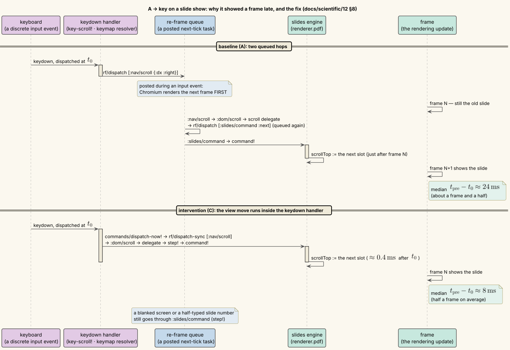
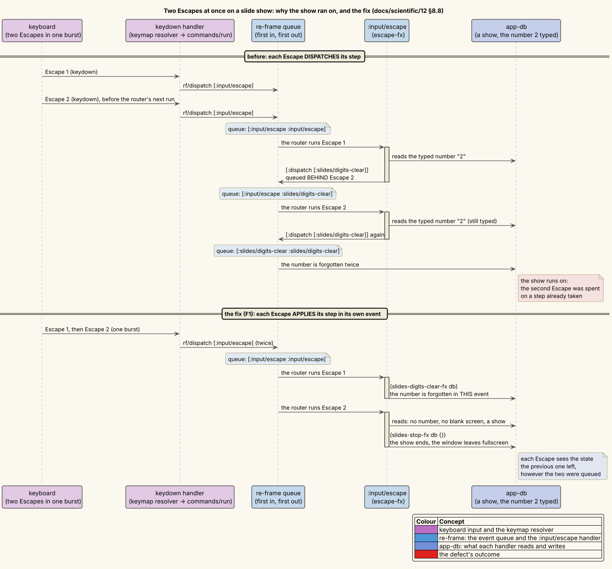

# 12 — Slide-deck detection and flip latency

**Status: complete.** Every hypothesis has been measured.

- **Detection.** The detector was tested in four ways:
  - Beamer's two-screen pages were measured before they were relied on (§4).
  - On a controlled corpus of 42 real Beamer PDFs from three TeX engines, all 42 verdicts were as predicted (§5).
  - A natural corpus of 2456 local PDFs was surveyed, counts only (§6).
  - The detector then learned LibreOffice Impress's and Keynote's export canvases, a change predicted and checked
    both on a controlled Impress corpus and on the natural corpus (§7).
- **Flip latency.** The first measurement missed its model by a whole frame. The cause was found (H-sched): after a
  key, Chromium renders the next frame before ordinary posted tasks. One intervention was refuted (H-sync); a second
  held (H-sync2). The median key → frame time fell from 24.3 ms to 7.9 ms, and every guard holds (§8).
- **Two Escapes at once.** Two Escapes that reached the renderer together took one step of Escape's chain twice, so a
  show could not be ended that way (H-ESC). Each Escape now applies its step in its own event; a unit experiment on
  re-frame's real queue and an end-to-end check, both shown to fail first, confirm the fix (§8.8).

These experiments support [ADR-0045 — Slide-deck presentation](../design-decisions/0045-slide-deck-presentation.md).
Under ADR-0045, a PDF the detector recognizes as a slide deck opens in a one-slide-per-screen *Slides layout*, and keys
flip slides. The methodology is that of [07 — Measurement methodology](07-measurement-methodology.md):

1. Instrument first.
2. Predict before measuring, and write the prediction down (`data/12/*-prediction.txt`).
3. Record the raw numbers (`data/12/`, indexed in [`data/12/README.md`](data/12/README.md)).
4. Keep the refuted hypotheses (§9).

---

## 1 · The questions

1. **Detection.** Does the detector call a slide deck a deck — by the rule and with the confidence its design
   prescribes — and leave everything else alone? That is asked of three kinds of PDF:
   - what the TeX engines actually produce from Beamer;
   - what slide tools export;
   - a natural collection of PDFs that nobody made for this experiment.
2. **Two-screen decks.** What do Beamer's two-screen options (`show notes on second screen`) put in the PDF, and can
   the viewer trust that deck's page labels?
3. **Flip latency.** In the Slides layout, how long does a key take to put the next slide on screen? What does a jump
   to a slide nothing has rendered yet cost? Does the engine keep the number of live page canvases bounded however
   far the presenter walks?
4. **Queued keys.** Do two Escapes that arrive together take two steps of Escape's chain, as two Escapes pressed
   apart do?

## 2 · Definitions — the detector

**Terms.**

| Term | Meaning |
|---|---|
| bp | A PDF point, $`1\,\mathrm{bp} = \tfrac{1}{72}\,\mathrm{in}`$. Page sizes are width × height in bp, as pdf.js reports them at scale 1. |
| page / slide | One PDF page. In the Slides layout, one page fills one screen. |
| frame | Beamer's unit: one `\begin{frame}`. A frame with overlays (`\pause`, `<2->`) becomes several pages that share the frame's number as their **page label**. |
| deck | A PDF the detector classifies as slides. |
| tier | How sure the detector is: `definite` (the PDF says so) or `probable` (its geometry and producer say so). |
| source | Which rule fired (below). |
| canvas | The exact page size a slide tool exports for every slide. |
| $`\tau`$ | The size tolerance, $`\tau = 0.5\,\mathrm{bp}`$. TeX rounds `\paperwidth` to the scaled point; exporters round to whole points. |

Two sizes are equal when both dimensions agree within the tolerance:

```math
(w_1, h_1) \simeq (w_2, h_2) \iff |w_1 - w_2| \le \tau \;\wedge\; |h_1 - h_2| \le \tau .
```

A document is **uniform** when every page has one size $`s`$ (up to $`\simeq`$).

**Evidence.** `vinary.slides.evidence/gather` reads the following through pdf.js, catching each call on its own:

- the `/Info` `Creator` and `Producer`;
- the XMP `xmp:CreatorTool`;
- the catalog's `/PageMode`;
- the page labels.

The page sizes come from the same measure the renderer lays the document out with.

**The rules** (`vinary.slides.deck/classify`). The first match wins:

| Tier | Source | Rule |
|---|---|---|
| definite | `beamer` | `Creator` or `CreatorTool` names Beamer (`beamer.cls` sets `pdfcreator={LaTeX with Beamer class}`), and either there are $`\ge 2`$ pages, or there is one page whose size is a Beamer paper or a doubled one. The one-page clause keeps a `beamerposter`, which carries the same Creator, out. |
| definite | `fullscreen-mode` | The catalog asks to open in full screen: `/PageMode /FullScreen` (ISO 32000-1:2008 §7.7.2). |
| probable | `slide-export` | $`\ge 2`$ pages, uniform, and the size is a slide tool's export canvas (below). |
| probable | `beamer-geometry` | $`\ge 2`$ pages, uniform, at a Beamer paper size (or one doubled for a second screen, §4), and a TeX-engine `Producer`. This catches a Beamer deck whose `\hypersetup{pdfcreator=…}` was overridden. |
| — | not a deck | Everything else. In particular, **landscape pages alone never qualify**. |

**Beamer's papers** (`beamer.cls`, the `aspectratio` class option, in cm and bp):

| Option | Paper (cm) | Paper (bp) |
|---|---|---|
| 43 (default) | 12.80 × 9.60 | 362.835 × 272.126 |
| 169 | 16.00 × 9.00 | 453.543 × 255.118 |
| 1610 | 16.00 × 10.00 | 453.543 × 283.465 |
| 149 | 14.00 × 9.00 | 396.850 × 255.118 |
| 141 | 14.85 × 10.50 | 420.945 × 297.638 |
| 54 | 12.50 × 10.00 | 354.331 × 283.465 |
| 32 | 13.50 × 9.00 | 382.677 × 255.118 |
| 2013 | 14.00 × 9.10 | 396.850 × 257.953 |

**Slide-tool canvases.** The table as it stands after §7, with each entry's provenance:

| Canvas (bp) | Tools | Provenance |
|---|---|---|
| 960 × 540 | PowerPoint Widescreen (13.333 × 7.5 in); Impress Widescreen | Impress **measured** (§7) |
| 720 × 540 | PowerPoint / Impress On-screen Show (4:3), 10 × 7.5 in | Impress **measured** |
| 720 × 405 | Google Slides 16:9; Impress On-screen Show (16:9) | Impress **measured** |
| 720 × 450 | Impress On-screen Show (16:10); PowerPoint On-screen Show (16:10), 10 × 6.25 in | Impress **measured**; PowerPoint **documented** [MS-SLIDES] |
| 793.7 × 595.3 | Impress Screen 4:3, 28 × 21 cm | **measured** (793.7 × 595.28); **observed** at 794 × 595 from an older Impress |
| 793.7 × 446.5 | Impress Screen 16:9, 28 × 15.75 cm — Impress's default | **measured** |
| 793.7 × 496.1 | Impress Screen 16:10, 28 × 17.5 cm | **measured** |
| 1024 × 768 | Keynote Standard (4:3) | **observed** (§6) |
| 1920 × 1080 | Keynote Wide (16:9) | **reported**: one third-party source [KN-1920]. Apple's documentation names the preset without its size [KN-APPLE], and no Keynote sample could be produced here. |

**Frames.** Pages are grouped into frames for Beamer sources only. A frame is a maximal run of adjacent pages that
share one non-blank label (`frames-from-labels`). Every other deck gets one frame per page. So does a Beamer deck
with no labels (a single XeLaTeX pass writes none, §5.1) or with two-screen pages (§4).

## 3 · Instruments

| Instrument | Question | Output |
|---|---|---|
| `vv --cli --deck-info` (`src/vinary/cli/core.cljs`) | The GUI's evidence, page measure and classifier, as one JSON line per PDF. This is the instrument of §5–§7: the experiments run the product's own code, not a copy of it. | stdout |
| [`scripts/exp-deck-corpus.cjs`](../../scripts/exp-deck-corpus.cjs) | Real Beamer output: 14 variants × pdfLaTeX / LuaLaTeX / XeLaTeX, and from 2026-10-17 XeLaTeX run twice (§5.1), each with its expected verdict written into the script before the run | `positive-corpus.*`, `positive-corpus-2026-10-17.*` |
| [`scripts/exp-deck-local-corpus.cjs`](../../scripts/exp-deck-local-corpus.cjs) | A natural corpus, classified in batches; counts by generic category only (privacy: below). `--from-raw` re-summarizes an earlier run. | `local-corpus-summary*.*` |
| [`scripts/exp-deck-export-corpus.cjs`](../../scripts/exp-deck-export-corpus.cjs) | LibreOffice Impress at each of its seven slide-size presets, exported headless under a throwaway profile | `export-corpus-*.*` |
| [`scripts/bench-slide-flip.cjs`](../../scripts/bench-slide-flip.cjs) (`npm run bench:flip`) | Key → frame latency in the real app, with attribution probes and a canvas count every frame (§8.2) | `flip-*.{txt,json}` |
| [`scripts/analyze-flip-runs.cjs`](../../scripts/analyze-flip-runs.cjs) | Pools flip runs per build: quantiles, per-run medians, a seeded bootstrap interval for a difference of medians | `flip-ABC-analysis.txt` |

**The natural corpus's privacy protocol.** The corpus is the developer's own files, so it is never described by name,
path, title or content.

- The raw per-file output carries paths, so it goes only to a `--raw` file that must lie outside the repository; the
  script refuses a path inside it.
- The repository receives counts by generic category: the verdict, a producer family from a fixed list, a page-size
  class, and, for the candidate misses of §6.4, the producer family and the page size.
- An unreadable file's reason is reduced to a class from a fixed list. Its message names the path, so the path is
  masked before any pattern is tried; a file *name* such as `password-reset.pdf` can never decide the class. That
  reduction was checked on synthetic failures — truncated, not a PDF, missing, encrypted — before it ran on the corpus.

## 4 · Beamer's two-screen pages (measured 2026-10-16)

`\setbeameroption{show notes on second screen=<side>}` (pgfpages) and `previous slide on second screen` change the
PDF in ways a viewer must not guess at. Small sources were compiled once with LuaLaTeX 1.24.0 (`beamer.cls` v3.77).
Pages, labels and sizes were read with pdf.js; word positions with `pdftotext -bbox`. Raw data:
[`data/12/second-screen-2026-10-16.txt`](data/12/second-screen-2026-10-16.txt).

| # | Finding |
|---|---|
| 1 | **Geometry.** Every page doubles the paper: 4:3's 362.835 × 272.126 becomes 725.669 × 272.126 for `right`/`left` and 362.835 × 544.252 for `top`/`bottom`. The side names where the *notes* go; the slide is the other half. |
| 2 | **The notes half repeats the slide's words.** The default note template draws a thumbnail of the slide, so a search over whole pages finds every word twice. |
| 3 | **Page labels are corrupted, undetectably.** The same five-frame source is labelled `1 1 2 3 3 3 4 5 5` without notes (true) and `1 1 1 2 2 3 3 4 3` with them. Two more sources show wrong sequences that are nevertheless *well-formed* — they start at 1 and step by 0 or +1 — so no consistency check can tell them from real labels. |
| 4 | `previous slide on second screen` doubles the page the same way, but keeps correct labels. Geometry cannot tell it from a notes deck. |
| 5 | Plain `show notes` interleaves note pages at the slide's own size. It gives no geometric signal and is out of scope. |

**Decisions taken from these data:**

- A uniform page size that doubles one Beamer paper, in width or in height, is a two-screen page (finding 1).
- The Slides layout shows the half opposite the notes, per the `:slides-notes` preference.
- The other half's text is hidden from find (finding 2).
- A two-screen deck gets one frame per page and no labels (findings 3 and 4).

## 5 · The controlled Beamer corpus

**Method.** `scripts/exp-deck-corpus.cjs` compiles 14 variants with each of pdfLaTeX 1.40.29, LuaHBTeX 1.24.0 and
XeTeX 0.999998 (TeX Live 2026), 42 cases in all. Each variant's expected verdict `{deck, tier, source, frames,
secondScreen}` is written in the script before the run, from the rules of §2 and Beamer's sources. The frame count
depends on the engine:

- pdfLaTeX and LuaLaTeX write Beamer's page labels, so a variant of five 3-overlay frames plus a title frame is
  6 frames over 16 pages;
- XeLaTeX goes through xdvipdfmx, which writes no `/PageLabels`, so the same variant is expected to be 16 one-page
  frames. *Corrected on 2026-10-17: that holds for the single pass this corpus ran. A second pass writes the labels
  (§5.1).*

| Variant | What it exercises | Expected verdict |
|---|---|---|
| `aspect43`, `aspect169`, `aspect1610`, `aspect141`, `aspect32` | five paper sizes, with overlays | definite / beamer; 6 frames (16 under one XeLaTeX pass) |
| `handout` | one page per frame | definite / beamer; 6 frames |
| `notes-right`, `notes-bottom` | two-screen pages, horizontal and vertical | definite / beamer; 16 frames; the second-screen axis |
| `creator-override` | `\hypersetup{pdfcreator=…}` at 16:9 | probable / beamer-geometry |
| `fullscreen-override` | `pdfpagemode=FullScreen`, Creator overridden | definite / fullscreen-mode |
| `fullscreen-beamer` | `pdfpagemode=FullScreen` with Beamer's own Creator | definite / beamer (the first rule wins) |
| `poster` | a one-page A0 `beamerposter` | not a deck |
| `article-landscape` | a three-page landscape article | not a deck |
| `article-on-beamer-paper` | an article on 16 × 9 cm paper | probable / beamer-geometry — the **documented false positive** of that rule |

**Result.** 42 of 42 cases reached their expected verdict, with **0 field mismatches** across all five fields
([`data/12/positive-corpus.txt`](data/12/positive-corpus.txt)). The last row is a deliberate negative result. An
article on Beamer paper from a TeX engine is indistinguishable, by this evidence, from a Beamer deck whose Creator was
overridden. The rule accepts that false positive in exchange for the deck it recovers, and the document can always be
switched to the Document layout.

### 5.1 · Correction: XeLaTeX writes labels from its second pass (2026-10-17)

**What was wrong.** §2 and §5 said that xdvipdfmx writes no `/PageLabels`, so that every XeLaTeX deck gets one frame
per page. The corpus compiled each variant **once**, and its XeLaTeX rows are right for one pass. The explanation was
not. hyperref's xdvipdfmx driver (`hxetex.def`) writes the labels at `\begin{document}` from the `\HyPL@Entry` lines
that the **previous** run left in the `.aux` file. With no such lines, the driver warns *Rerun to get /PageLabels
entry* and writes none. pdfLaTeX and LuaLaTeX write the labels in the run itself. ADR-0048 §2.4 found this while
designing note-page detection.

**A related measurement: one pass over an edited deck (H-XSTALE).** If the labels come from the previous run, then one
XeLaTeX pass over an **edited** deck carries the previous version's labels. The hypothesis, with the labels expected at
every step, was written to a file before the first compile, and the data file reproduces it verbatim
([`data/12/xelatex-labels-2026-10-17.txt`](data/12/xelatex-labels-2026-10-17.txt)). The procedure:

1. compile a 16-page deck (a title frame and five 3-overlay frames) twice;
2. insert a 2-overlay frame after the title, giving 18 pages;
3. compile once, then once more.

LuaLaTeX ran the same steps as the control.

| Step | XeLaTeX labels | LuaLaTeX labels (control) |
|---|---|---|
| 1. v1, first pass | none; *Rerun to get /PageLabels entry* | `1 2 2 2 3 3 3 4 4 4 5 5 5 6 6 6` |
| 2. v1, second pass | `1 2 2 2 3 3 3 4 4 4 5 5 5 6 6 6` | the same |
| 3. v2, one pass over v1's `.aux` | `1 2 2 2 3 3 3 4 4 4 5 5 5 6 6 6 6 6` — **v1's labels**, and no warning at all | `1 2 2 3 3 3 4 4 4 5 5 5 6 6 6 7 7 7` |
| 4. v2, second pass | `1 2 2 3 3 3 4 4 4 5 5 5 6 6 6 7 7 7` | the same |

**Verdict.** The staleness is **confirmed**, and the stale pass is **silent**: its log has no warning. One detail of the
registration was refuted. It expected the two pages past v1's end to read `7 8`, a decimal range continued. They
read `6 6`. hyperref writes each frame number as a range with a fixed prefix (`/P (6)`, with no numbering style `/S`),
one range per frame, so every later page repeats the last prefix (the ranges are in the data file).

A deck in that state is inconsistent with itself, and the detector groups it by the labels it carries: at step 3, the
inserted frame's two pages and the next frame's first page would form one frame. A build that compiles until the
auxiliary files settle avoids it. Latexmk 4.87 ran XeLaTeX twice for the fresh deck and twice again after the edit,
and gave both PDFs their own labels. That check was made after the verdict and was not registered.

**The re-run (H-X2), registered here before it ran.** The corpus gains a fourth engine, `xelatex2`: XeLaTeX run twice
in the same directory. Its expected verdicts were written into `scripts/exp-deck-corpus.cjs` before the run. For every
variant, they are pdfLaTeX's: `labelled` is false only for a single `xelatex` pass. So the six variants with overlays
and Beamer's page labels (`aspect*`, `creator-override`, `fullscreen-beamer`) are expected to have **6** frames under
`xelatex2`, not 16, and every other field to match.

The 42 cases of the three original engines run again unchanged, as a replication, for 56 cases in all. **H-X2 is
refuted** if any `xelatex2` case differs from its expectation, or if any of the 42 original cases differs from its
2026-10-16 verdict. The 2026-10-16 data stay in `positive-corpus.*`, and the re-run writes `positive-corpus-2026-10-17.*`.

**Result (H-X2).** **Confirmed.** All 56 of 56 cases reached their expected verdict, with **0 field mismatches**
([`data/12/positive-corpus-2026-10-17.txt`](data/12/positive-corpus-2026-10-17.txt); TeX Live 2026, the engine
versions of §5). Under `xelatex2`, the six labelled variants have 6 frames, as under pdfLaTeX and LuaLaTeX. The 42
cases of the three original engines replicate the 2026-10-16 verdicts exactly.

**Which drivers lag.** The drivers of hyperref 7.01p fall into three groups:

- four write the labels the previous run recorded, as `hxetex.def` does: `hxetex.def` (XeLaTeX), `hdvipdfm.def`
  (dvipdfm(x)), `pdfmark.def` (loaded for dvips, whose PostScript Ghostscript turns into PDF) and `hdviwind.def`;
- three write them in the run itself: `hpdftex.def`, `hluatex.def` and VTeX's `hvtex.def`;
- the rest write none.

So a deck from a DVI or PostScript route lags a pass, as XeLaTeX's does. This was found by reading the drivers, and
only XeLaTeX was compiled. `Rerun to get /PageLabels entry` and the `.aux` entries occur in exactly those four.

## 6 · The natural corpus

### 6.1 · Method and coverage

**Listing.** The corpus is every `*.pdf` under the developer's home directory, outside `node_modules` and `.git`, as
of 2026-10-17. It was listed with
`fd -t f -e pdf --no-ignore --exclude node_modules --exclude .git . ~`, minus this repository's own files, for
**2456 files**.

**Classification.** `vv --cli --deck-info` ran in batches of 25; a batch that failed was re-run one file at a time.

**Coverage.** 2333 files were classified (95.0 %) and 123 could not be read:

| Unreadable, by reason | Files |
|---|---|
| not a PDF: no `%PDF-` in its first KiB | 120 |
| encrypted: a password is required | 1 |
| refused by the file system | 1 |
| another pdf.js error | 1 |

### 6.2 · Verdicts (before §7's change)

| Verdict | Files |
|---|---|
| not a deck | 2316 |
| deck — probable / slide-export | 9 |
| deck — definite / beamer | 8 |

**By page-size class:**

| Size class | Verdicts |
|---|---|
| A4 / Letter portrait | not a deck 1381 |
| other landscape | not a deck 451 |
| other portrait | not a deck 311 |
| A4 / Letter landscape | not a deck 100 |
| mixed sizes | not a deck 73 |
| a slide-export canvas | deck 9 |
| a Beamer paper | deck 8 |

**By producer family:**

| Producer family | Verdicts |
|---|---|
| TeX engine (other than Beamer) | not a deck 1271 |
| Adobe | not a deck 292 |
| other | not a deck 265, slide-export 1 |
| Apple (Quartz / Pages / macOS) | not a deck 226 |
| Ghostscript | not a deck 100 |
| Cairo | not a deck 48 |
| Microsoft Office (other) | not a deck 42 |
| no Creator / Producer | not a deck 29, slide-export 2 |
| Chromium / Skia print | not a deck 26 |
| Beamer (Creator tag) | definite / beamer 8 |
| LibreOffice / OpenOffice (other) | not a deck 8 |
| Microsoft PowerPoint | slide-export 4, not a deck 2 |
| Google (Slides / Docs) | slide-export 1, not a deck 3 |
| LibreOffice / OpenOffice Impress | slide-export 1, not a deck 2 |
| Apple Keynote | not a deck 1 |
| Typst | not a deck 1 |

Raw counts: [`data/12/local-corpus-summary.txt`](data/12/local-corpus-summary.txt).

### 6.3 · The cases detection must get right

- **Landscape is not a deck.** 527 single-page uniform-landscape files and 24 multi-page ones were all *not a deck*.
  Their sizes ([§6.4](#64--candidate-misses)) are figures, Letter- and A4-landscape print-outs, and a few drawings;
  the rule that landscape alone never qualifies held throughout.
- **Exports at a known canvas are found.** Every PowerPoint (4), Google (1) and Impress (1) export at a known canvas
  was called a probable slide export.
- **Presentation-tool producers that were not called decks**, by page size:
  - Google at Letter portrait (2), and once at mixed sizes: Google Docs documents, correctly not decks;
  - PowerPoint at Letter portrait (1): a printed handout or notes page;
  - PowerPoint at 836 × 1289 (1 page): a poster;
  - **Impress at 794 × 595 (2)** and **Keynote at 1024 × 768 (1)**: real slide exports at canvases the detector
    did not know — the misses of §6.4.

### 6.4 · Candidate misses

The multi-page uniform-landscape files the detector left alone, by producer family and page size:

| Producer family @ page size (bp) | Files | Reading |
|---|---|---|
| other / Chromium-Skia / Adobe / MS Office / TeX @ 792 × 612 | 12 | **Letter landscape**: web print-outs, forms, reports, and possibly printed slides. This is the ambiguous class the rules deliberately leave as documents. |
| Apple Quartz @ 756 × 553 | 3 | not a slide-tool canvas |
| Apple Quartz @ 1224 × 792 | 2 | Tabloid / Ledger landscape |
| **LibreOffice Impress @ 794 × 595** | **2** | **Impress "Screen 4:3" (28 × 21 cm), rounded to whole points: a MISS** |
| MS Office @ 841.9 × 595.3; other @ 842 × 595 | 2 | A4 landscape |
| **Apple Keynote @ 1024 × 768** | **1** | **Keynote Standard: a MISS** |
| other @ 1500 × 1150; Adobe @ 1008 × 720 | 2 | not a slide-tool canvas |

**What these data can and cannot say.** The corpus has no ground-truth labels: deciding whether a personal file *is*
a presentation would mean opening it. So precision and recall over the whole corpus cannot be computed, and none is
claimed. What the data do show is narrower:

- every classified file at a known canvas or carrying Beamer's Creator was called a deck;
- no file was called a deck for being landscape;
- among the files left alone, three are certainly presentations, because their producer is a slide tool and their
  page is that tool's export canvas.

Those three became experiment §7.

## 7 · Slide-tool export canvases

**Pre-registration** ([`data/12/export-canvas-prediction.txt`](data/12/export-canvas-prediction.txt)), written
before the instrument ran:

- **P1** — Impress 26.8 exports each of its seven slide-size presets at $`(w, h)_{\mathrm{cm}} \times \tfrac{72}{2.54}`$,
  within $`\tau`$.
- **P2** — today's verdicts: the three presets that share PowerPoint's or Google's canvas are decks, and the other
  four are not.
- **P3** — after the change: all seven are decks, and on the natural corpus exactly the three files of §6.4 change
  verdict. P3 is a *deduction*: §6.4 already lists every candidate on a new canvas.

**Instrument failure, kept on record.** The first version wrote a minimal flat-XML presentation per preset, and
Impress silently ignored its page layout. All seven exports came out at Impress's default, 793.7 × 446.5 (28 × 15.75
cm), whatever they declared. Editing Impress's *own* serialization of the same deck to 28 × 21 cm exported at
793.7 × 595.28 as predicted. The instrument now round-trips a seed presentation through `soffice` once, then resizes
the page layout its master page references. The failed attempt's output is not part of the record.

**Results** ([`data/12/export-corpus-before.txt`](data/12/export-corpus-before.txt),
[`-after.txt`](data/12/export-corpus-after.txt)):

| Preset | Predicted (bp) | Exported (bp) | Before | After |
|---|---|---|---|---|
| Screen 4:3 | 793.7 × 595.3 | 793.7 × 595.3 | not a deck | slide-export |
| Screen 16:9 (Impress's default) | 793.7 × 446.5 | 793.7 × 446.5 | not a deck | slide-export |
| Screen 16:10 | 793.7 × 496.1 | 793.7 × 496.1 | not a deck | slide-export |
| Widescreen | 960.0 × 540.0 | 960.0 × 540.0 | slide-export | slide-export |
| On-screen Show (4:3) | 720.0 × 540.0 | 720.0 × 540.0 | slide-export | slide-export |
| On-screen Show (16:9) | 720.0 × 405.0 | 720.0 × 405.0 | slide-export | slide-export |
| On-screen Show (16:10) | 720.0 × 450.0 | 720.0 × 450.0 | not a deck | slide-export |

- **P1 held** (7 of 7).
- **P2 held** (7 of 7). Impress's *default* slide size was not recognized: most Impress decks had been missed.
- **P3 held.** All seven presets are decks after the change. The natural corpus was then re-classified **in full**,
  not re-summarized: 2456 files compared, **2453 kept their verdict**, and exactly the 3 predicted files changed to
  *deck — probable / slide-export*. Data:
  [`data/12/local-corpus-summary-after.txt`](data/12/local-corpus-summary-after.txt).

**Provenance, corrected.** The pre-registration called Keynote Wide (1920 × 1080) "Apple's documented preset". That
overstated it. Apple's documentation names the Keynote presets without their sizes [KN-APPLE], and the size rests on
one third-party source [KN-1920]. The entry is kept because no paper size is 1920 × 1080 bp, and it is labelled
*reported*. A dated correction is appended to the pre-registration rather than edited into it. PowerPoint's
720 × 450 is in Microsoft's own documentation [MS-SLIDES].

## 8 · Flip latency

### 8.1 · Question, model and pre-registration

**Setup.**

| Aspect | Setting |
|---|---|
| App | the real app, as `npm run bench:flip` runs it |
| Deck | a generated 50-slide Beamer deck: 16:9 paper, a coloured page with text per slide |
| Layout | the Slides layout, at 1280 × 860 CSS px, DPR 1 |
| Rendering | GPU off (software compositing, as the input benchmark) |
| Display | Xvfb, which drives frames at 60 Hz |
| Pinning | `taskset -c 2-9` |

The runs are 49 → flips from rest, 150 ms apart, then 10 Home / End jumps of 49 slots each.

**Model.** Let $`T_f = 1000/60 \approx 16.7\,\mathrm{ms}`$ be the frame period, $`h`$ the handler's work, and
$`U \sim \mathcal{U}[0, T_f)`$ the wait from the key to the next frame boundary (keys arrive at a random phase).
If the key moves the view before the next frame, the slide shows in that frame:

```math
L = h + U, \qquad \operatorname{median}(L) \approx h + \tfrac{T_f}{2} \approx 10\,\mathrm{ms},
\qquad P_{95}(L) \approx h + 0.95\,T_f \approx 20\,\mathrm{ms}.
```

**Pre-registered** ([`data/12/flip-prediction.txt`](data/12/flip-prediction.txt), before any run):

| Id | Claim |
|---|---|
| H-flip-1 | Neighbour flips: key → frame median ≤ 33 ms (2 frames) and p95 ≤ 50 ms. |
| H-flip-2 | Every neighbour target has its canvas when its key is sent (the ±1-slot render band). |
| H-flip-3 | No jump target has its canvas at the key, and the jump median is ≤ 150 ms. |
| H-flip-4 | At most 3 page canvases are attached to the document in **any** frame of a run. |

### 8.2 · The instrument

All stamps are `performance.now()`-based, in ms. Every sample records these quantities:

| Quantity | Definition |
|---|---|
| $`t_0`$ | The key's `event.timeStamp`. For a key injected with `webContents.sendInputEvent`, Electron stamps the moment the renderer dispatches it, before any listener — so $`t_0`$ is the start of the app's work. (The input benchmark notes that this stamp cannot measure *queueing*; here the dispatch is exactly what is wanted.) |
| $`t_{\mathrm{pre}}`$ | The rAF timestamp of the first frame whose callback finds the target slot at the scroller's top (±1 px) with its page canvas present. |
| $`t_{\mathrm{post}}`$ | The same check, run in a task posted from that rAF callback, i.e. after the frame's main-thread rendering work. |
| $`t_{\mathrm{send}}`$ | The key's send, in the main process. It is compared with the renderer's clock through an NTP-style offset from the tightest of 25 round trips (offset error ≤ ±0.05 ms in every run). |
| probe 1 | When the probe's own capture listener ran: checks that $`t_0`$ precedes the app's handling. |
| probe 2 | When the engine wrote the scroller's `scrollTop`: an accessor on that one element, recording the first write after arming and passing every write through. |
| probe 3 | When a task posted at the key's dispatch ran — the way `goog.async.nextTick`, re-frame's queue, posts one — and whether it ran before or after the next frame began. |
| canvases | The count of `.vv-pdf-doc canvas.vv-pdf-canvas`, taken in every frame and after every move. |

The reported latency is $`L = t_{\mathrm{pre}} - t_0`$, "key → the frame that shows it".

**Frame ambiguity.** $`t_{\mathrm{pre}}`$ and $`t_{\mathrm{post}}`$ attribute a sample to different frames only when the
target changes *between* them: either during that frame's own rAF callbacks, or in a task that runs after its
rendering but before the posted check. Such samples are counted as *frame-ambiguous*.

- When the change comes from a task, $`t_{\mathrm{pre}}`$ names the frame that really renders it.
- When it comes from a rAF callback, $`t_{\mathrm{post}}`$ does.
- The changes measured here (the re-frame task; pdf.js's render completing) come from tasks, so $`t_{\mathrm{pre}}`$
  is the reported measure.
- A key handled *inside* the frame that renders it — Chromium dispatches input at the start of a frame — gives
  $`L`$ slightly **below zero**: that frame's timestamp is its start, a little before the dispatch.

### 8.3 · The baseline missed the model by a frame — H-sched

The instrument's validation runs (12 slides; not measurements) put the neighbour median near 25 ms, not 10. The
attribution probes located the gap:

| Probe | Reading |
|---|---|
| dispatch → `scrollTop` write | ≈ 9–11 ms, although the handler's own work is < 1 ms |
| `scrollTop` write → the frame that shows it | ≈ 15 ms, a whole frame |
| a task posted at the key's dispatch | ran **after the next frame began** in 11 of 11 flips |

**H-sched.** After a discrete input event, Chromium renders the next frame before ordinary posted tasks. re-frame's
queue drains in such a task, so a key handled through `rf/dispatch` makes its change just after a frame, and the
change shows one frame later:

```math
L_{\text{queued}} = U + T_f + \epsilon \;\Rightarrow\; \operatorname{median} \approx 25\,\mathrm{ms}\ \text{(measured: 24.3 ms)},
```

where $`\epsilon`$ is the time from the frame's start to the queued task's write. H-sched predicts both probe readings,
dispatch → write $`\approx U + \epsilon`$ and write → frame $`\approx T_f - \epsilon`$; the replication (§8.5) gives
9.4 ms and 15.1 ms.



*Diagram source: [`../diagrams/seq-key-to-frame.puml`](../diagrams/seq-key-to-frame.puml).*

### 8.4 · Two interventions

Each intervention was pre-registered as a dated addendum to `flip-prediction.txt` before its runs. Each was judged on
formal runs with the builds **alternated**, A B A B A B and A C A C A C, so that drift in the machine's background load
falls on both builds alike. Each build was compiled from source in its own copy of the tree.

**H-sync, refuted.** Build B processes `key-scroll!`'s command synchronously (`rf/dispatch-sync`). Predicted:
dispatch → write < 2 ms, and a median improvement ≥ 10 ms.

| Neighbour flips, per run | A | B |
|---|---|---|
| key → frame median (ms) | 21.9 / 24.4 / 23.8 | 24.7 / 24.7 / 19.5 |
| dispatch → `scrollTop` write (ms) | 7.2 / 8.6 / 9.6 | 10.5 / 9.7 / 4.6 |

Nothing improved. The cause, found in the code: the slides layout's scroll delegate does not move the slide itself.
It dispatches a **second** event, `[:slides/command op]`, from inside the first event's effects, where re-frame
forbids `dispatch-sync` [RF-SYNC]. That second hop is still queued, runs after the next frame, and the slide still
shows a frame late. (B is frame-ambiguous in every flip: the queued task now runs just before the post-frame check,
which therefore sees the target a frame early. $`t_{\mathrm{pre}}`$ attributes A and B to the same frame.)

**H-sync2, held.** Build C additionally lets the delegate, the wheel and swipes run a slide step on the engine at
once (`renderer.pdf/step!`), whenever `:slides/command` would change nothing in app-db. It would change app-db only
for a blanked screen or a half-typed slide number (`vinary.app.slides/command-needs-db?`), and those still go through
the event. A unit invariant ties the shortcut to `slides-command-fx`: it is taken exactly when the event's whole
effect would be the one engine call. Predicted for C: dispatch → write < 2 ms; key → frame median ≤ 12 ms and
p95 ≤ 20 ms.

| Neighbour flips, per run | A | C |
|---|---|---|
| key → frame median (ms) | 24.7 / 23.0 / 24.8 | 7.1 / 9.0 / 7.5 |
| key → frame p95 (ms) | 29.2 / 28.9 / 32.0 | 12.9 / 15.5 / 15.3 |

In those runs C's write delay was not recorded. Probe 2 then started recording only after the probe's own listener had
run, and C writes `scrollTop` inside the app's earlier listener; the probe's listener itself ran 0.7 ms after
dispatch instead of A's 0.3 ms. The probe was fixed to record from arming, and all three builds were run again.

### 8.5 · Replication with the final instrument

All three builds were run alternated, A B C × 3: 147 neighbour flips and 30 jumps per build
([`data/12/flip-ABC-analysis.txt`](data/12/flip-ABC-analysis.txt)). The intervals are percentile bootstrap intervals
for the difference of the pooled medians [EFRON], with B = 10 000 resamples and a fixed seed.

| Neighbour flips | A (baseline) | B (H-sync) | C (H-sync2) |
|---|---|---|---|
| key → frame: median / p95 / max (ms) | 24.3 / 29.5 / 32.8 | 24.7 / 28.8 / 32.7 | **7.9 / 15.1 / 16.0** |
| per-run medians (ms) | 24.1 / 24.3 / 22.7 | 19.9 / 24.7 / 25.5 | 8.2 / 6.8 / 8.2 |
| A − build, median (ms), 95 % interval | — | −0.4 [−5.0, 3.9] | **16.4 [12.7, 20.0]** |
| dispatch → `scrollTop` write, median (ms) | 9.4 | 10.3 | **0.4** |
| frame-ambiguous | 0 / 147 | 147 / 147 | 0 / 147 |

| Jumps (Home / End) | A | B | C |
|---|---|---|---|
| key → frame: median / p95 (ms) | 61.3 / 66.0 | 55.3 / 65.2 | **38.8 / 48.6** |
| A − build, median (ms), 95 % interval | — | 6.0 [−0.6, 7.5] | **22.5 [11.1, 24.6]** |

**Reading.**

- C matches the model of §8.1 that the baseline missed: $`h + T_f/2 \approx 8.7\,\mathrm{ms}`$ against 7.9 ms
  measured; $`h + 0.95\,T_f \approx 16.3\,\mathrm{ms}`$ against a p95 of 15.1 ms.
- The improvement is one frame period, as H-sched predicts: $`\Delta \approx T_f`$, 16.4 ms measured.
- B's interval contains zero, which replicates H-sync's refutation.
- Jumps are frame-ambiguous in every build. A jump's canvas arrives from pdf.js's render completing, a task, so
  $`t_{\mathrm{pre}}`$ is the right measure (§8.2).

**Guards** (all builds, all runs):

| Guard | Result |
|---|---|
| H-flip-1 | **holds** (A 24.3 / 29.5 ms; C 7.9 / 15.1 ms) |
| H-flip-2 | **holds** (147 / 147 pre-rendered) |
| H-flip-3 | **holds** (0 / 30 pre-rendered; medians 38.8–61.3 ms) |
| H-flip-4 | **holds** (at most 3 canvases in any frame) |

### 8.6 · Threats to validity

- **One machine:** an AMD Ryzen Threadripper PRO 5975WX, with the `performance` governor and EPP.
- **The frame clock is Xvfb's 60 Hz.** On a 120 Hz display the deferral costs half as much, because it is one frame
  period.
- **GPU off.** A hardware-composited frame may be scheduled differently.
- **Background load.** The developer's own processes (an indexing daemon, PostgreSQL, a browser) shared the machine,
  including the pinned cores, at load averages of 6–12 on 64 CPUs. The environment files record them. Alternating the
  builds keeps the load from favouring one of them.
- **Simple pages.** The generated deck's slides are simple, so jump latencies are lower bounds for heavy slides.
- **Lost per-sample data.** The A runs of the A/B sequence lost their per-sample JSON to a file-name collision in the
  next sequence. Their summaries were restored verbatim from the instrument's printed output, and the replication
  (§8.5) re-measures A in full.

### 8.7 · The wheel: what a notch is, measured (2026-10-17)

**Question.** The wheel flips a slide the way pdf.js's presentation mode does: each event's delta is normalized,
accumulated, and one slide flips when the sum reaches $`\theta = 0.1`$ (§2's wheel rule; `deck/wheel-step`). How
many notches of a real mouse wheel does a flip take?

**A defect, found in review.** The normalization divided a pixel delta by 1 200 — "30 px per line × 40 lines" — while
citing pdf.js. pdf.js's own `normalizeWheelEventDelta` (pdfjs-dist 5.4.149, `web/pdf_viewer.mjs`) divides by
`MOUSE_PIXELS_PER_LINE × MOUSE_LINES_PER_PAGE` = 30 × 30 = **900**.

**Instrument.** [`scripts/probe-wheel-notch.cjs`](../../scripts/probe-wheel-notch.cjs) opens a bare Electron window on
the headless runner's Xvfb display and presses the wheel buttons with `xdotool` — the X server's own wheel events —
recording every `WheelEvent`, at four window zoom factors (`setZoomFactor`). Raw data:
[`data/12/wheel-notch-2026-10-17.txt`](data/12/wheel-notch-2026-10-17.txt).

| Zoom | `deltaY` per notch (CSS px) | `deltaMode` | `devicePixelRatio` |
|---|---|---|---|
| 1 | 120 | 0 (pixels) | 1 |
| 1.25 | 96 | 0 | 1.25 |
| 1.5 | 80 | 0 | 1.5 |
| 0.8 | 150 | 0 | 0.8 |

One notch is one event of **120 device-independent pixels**, reported in CSS pixels, $`120 / z`$ at zoom $`z`$
(Electron 42.5.0, Chrome 148, X11).

**Consequence, by arithmetic.** With the old divisor, a notch at 100 % gave exactly $`120/1200 = \theta`$ — a flip by
floating-point equality — and at 125 % or 150 % zoom ($`0.08`$, $`0.067`$) **two notches per slide**. pdf.js's
divisor alone would fix 125 % ($`96/900 \approx 0.107`$) but not 150 % ($`80/900 \approx 0.089`$).

**Change.** `deck/wheel-notches` normalizes as pdf.js does, and first scales a pixel delta back to device-independent
pixels by the window zoom (`[:ui :window-zoom]`):

```math
n = \frac{\pm\sqrt{\Delta x^2 + \Delta y^2}\cdot z}{900}\ \text{(pixels)},\qquad
n = \frac{\pm\sqrt{\Delta x^2 + \Delta y^2}}{30}\ \text{(lines)},
```

positive towards the next slide. Every measured notch is then $`n = 120/900 \approx 0.133 \ge \theta`$ at every zoom:
one flip per notch, and the cooldown keeps it to one. A trackpad still accumulates: twelve-pixel steps flip on the
eighth.

**Guards and negative control.** `deck_test`'s `one-wheel-notch-flips-one-slide` runs five notches at each measured
zoom, plus a 100-pixel notch, and requires five flips each. On the same cases the old formula flips only every
other notch at 125 % and 150 % and for the 100-pixel notch: three of the five fail. `wheel-notches-normalizes-as-pdf-js-and-undoes-the-zoom`
pins the units, the sign and the zoom-independence.

**Threats.** Only X11 was measured. Wayland, macOS and Windows deliver their own notch sizes, which the normalization
handles alike as long as a notch is at least 90 device-independent pixels; a smaller notch takes two.

### 8.8 · Two Escapes at once — H-ESC (2026-10-18)

**Observation.** A smoke step written for the presenter view
([ADR-0048](../design-decisions/0048-speaker-notes-and-linked-presenter-windows.md)) typed a slide number during a
show, then sent two Escapes back to back with no wait between them. The first Escape forgot the number, as it
should; the show ran on.

**Escape's chain.** [ADR-0045 §4](../design-decisions/0045-slide-deck-presentation.md) gives Escape a fixed
precedence, and one Escape takes the first step that applies:

| Order | Condition | Step |
|---|---|---|
| 1 | the palette is open | close it |
| 2 | the find bar is visible | close it |
| 3 | the overview is open | close it |
| 4 | a slide number is being typed | forget it |
| 5 | the show is blanked | unblank |
| 6 | a show is running | end the show |
| 7 | the mode is not `:normal` | switch to `:normal` |
| 8 | otherwise | clear the pending key sequence |

Until this fix, `vinary.input.events/escape-fx` took steps 1–6 by **dispatching** them as events of their own —
`[:dispatch [:slides/digits-clear]]` and so on. Steps 7 and 8 were always applied in Escape's own event.

**The queue.** re-frame keeps one first-in, first-out queue of dispatched events [RF-ROUTER]. A run of its router
handles the events queued when the run starts; an event dispatched during the run waits for the next run, a tick
later. A key reaches `:input/escape` through `rf/dispatch`: Escape is not one of §8.4's immediate commands, because it
moves no view.

**H-ESC.** Let $`c(d)`$ be the step the chain chooses in app-db $`d`$, and $`d \cdot s`$ the app-db after step
$`s`$. Escapes handled one at a time compute

```math
d_{k+1} = d_k \cdot c(d_k), \qquad k = 0, 1, \dots, n - 1 .
```

But when $`n`$ Escapes reach the renderer before the router's next run, all $`n`$ are queued first. Each dispatched
step then lands **behind the Escapes still waiting** (first in, first out), so every Escape reads the same $`d_0`$,
chooses the same $`c(d_0)`$, and the keys after the first are spent repeating a step already taken. With a number
typed during a show: two Escapes forget the number twice, and the show is never ended.



*Diagram source: [`../diagrams/seq-escape-queue.puml`](../diagrams/seq-escape-queue.puml).*

**Experiment E1** (registered before the run, reproduced with its results in
[`data/12/escape-queue-2026-10-18.txt`](data/12/escape-queue-2026-10-18.txt)). The unit build's real re-frame router,
in Node:

- app-db holds a running show — not fullscreen, so no window effect — with the number `2` typed;
- `(rf/dispatch [:input/escape])` is called twice in the same tick;
- app-db is read once the queue has drained (50 ms), and a post-event callback records the order the router ran the
  events in.

E1 ran first on the presenter view's tree, then on this fix's own base, 7b141ad, with the same results:

| Case | Events the router ran | The show afterwards | Prediction |
|---|---|---|---|
| two Escapes queued together, before the fix | `:input/escape :input/escape :slides/digits-clear :slides/digits-clear` | still running | P-E1a (H-ESC) **holds** |
| control: one Escape, drained, then the second | `:input/escape :slides/digits-clear`, then `:input/escape :slides/stop` | ended | P-E1b **holds** |
| two Escapes queued together, with F1 | `:input/escape :input/escape` | ended | P-F1a **holds** |

**The fix (F1).** Each step is **applied in Escape's own event**. `escape-fx` returns the step's `{:db :fx}`,
computed by the same function the step's own event uses:

| Step | Applied with | Its own event |
|---|---|---|
| 1 | `input-events/palette-close-fx` | `:palette/close` |
| 2 | `events/find-close-fx` | `:find/close` |
| 3 | `events/slides-overview-close-fx` | `:slides/overview-close` |
| 4 | `events/slides-digits-clear-fx` | `:slides/digits-clear` |
| 5 | `slides/clear-blank` | `:slides/unblank` |
| 6 | `events/slides-stop-fx` | `:slides/stop` |

The step events remain, for their other senders: the palette's and the find bar's own controls, the overview's own
keys, and the typed number's 2.5 s timeout. Each is now that function and nothing else, so the two paths cannot
drift; the unit tests pin `escape-fx` to the functions step by step. Every Escape now reads the state the previous
one left, so queued Escapes compute the recurrence above however they were queued.

**End to end.** The smoke's "PDF presenting" block sends the burst through the real app: Shift+F5, `2`, then two
`sendChord` calls in a row. Those are four `webContents.sendInputEvent` calls in one task of the main process. The
block then waits — 4 s at most each — for the number to go and then for the show to end, and checks that the slide
is unchanged. Both trees are 7b141ad plus the new check:

| Tree | Run 1 | Run 2 (the wait split in two, so a failure names its half) |
|---|---|---|
| without F1 — the negative control | **fails** at that wait | passes the first wait, then **fails** at the second: the number is forgotten and the show runs on |
| with F1 and its unit tests | passes, and so does the whole smoke | passes, and so does the whole smoke |

The presenter view's own smoke step failed the same way before F1 and passed after it.

**Scope.** F1 covers Escapes that reach `:input/escape`. Two neighbours were found by reading the code, and **not**
measured:

- **Overlays that handle Escape themselves.** The overview grid and the palette's input handle Escape in their own
  keydown handlers, which dispatch `:slides/overview-close` and `:palette/close`. A second Escape that arrives before
  the overlay has gone is caught by the same handler and spent closing it again. The overview's Tab and `o` behave
  alike.
- **The same shape elsewhere.** Six handlers that keys reach compute an absolute target from app-db and dispatch it.
  Two of them queued together therefore make one step, where two keys handled apart make two:

  | Handler | Reached from | Two queued together |
  |---|---|---|
  | `:tab/close-active` | Close Tab (Ctrl+W) | close one tab, not two |
  | `:tab/toggle-source` | Ctrl+Shift+S | show the source twice, not source and then preview |
  | `:tab/toggle-diff-view` | Ctrl+Shift+B | the same, for the unified and split diff |
  | `:pdf/layout-toggle` | View as Slide Show / Document | the same, for the two layouts |
  | `:theme/cycle` | Vim's `SPC t t` | advance one theme, not two |
  | `:git-graph/cursor-move` | ↑ ↓ PgUp PgDn Home End in the commit graph | move the cursor one step, not two |

  These are recorded for a separate change; F1's pattern — apply the step in the key's own event — fixes each.

**Threats to validity.**

- **The burst is synthetic.** A person's two Escapes arrive tens of milliseconds apart. They queue together only
  when the renderer is busy for that long, for example while a heavy slide renders. Keys are not dropped while it is
  busy ([ADR-0033](../design-decisions/0033-asynchronous-text-input.md)), so they then arrive
  together. That case follows from the mechanism; it was **not measured**.
- **One router version.** The mechanism is re-frame 1.4.3's (its tagged source is byte-identical to the jar in use).
  E1 runs that router itself, so a re-frame upgrade that changed the queue's order would show in E1.

## 9 · Refuted (kept)

- **The flip model's baseline estimate** (median ≈ 10 ms): the baseline measured 24.3 ms. The model was right about
  the frame but blind to the deferral (H-sched, §8.3).
- **H-sync:** a synchronous first hop changes nothing while a second queued hop remains (§8.4).
- **The minimal `.fodp` instrument:** Impress ignores a page layout outside its own serialization (§7).
- **"Apple documents Keynote Wide at 1920 × 1080":** it does not, as far as could be found (§7).

## 10 · Regression guards

| Guard | Where |
|---|---|
| every detection rule and its negatives, the new canvases, the A4-landscape vs 28 × 21 cm distinction | `test/vinary/slides/deck_test.cljs` |
| the view-moving commands are all immediate, `run` routes them, `dispatch-now!` falls back inside a handler, and the shortcut is sound | `test/vinary/app/slides_keys_test.cljs` |
| `--deck-info` evidence and verdicts on a real Beamer deck, a PowerPoint-shaped export and an ordinary PDF; a missing file reported without stopping the rest | `test/cli-smoke.js` |
| the flip bounds H-flip-1…4 (a manual, pinned run) | `npm run bench:flip` |
| one wheel notch flips one slide at every measured zoom (§8.7) | `test/vinary/slides/deck_test.cljs` |
| two Escapes queued together take two steps through re-frame's real queue, with the one-at-a-time control (§8.8) | `test/vinary/input/escape_queue_test.cljs` |
| each Escape step is the step's own event function, in the chain's order (§8.8) | `test/vinary/app/slides_present_test.cljs`, `slides_keys_test.cljs`, `slides_overview_test.cljs` |
| two Escapes sent together during a show forget the typed number, then end the show (§8.8) | `test/electron-smoke.js`, "PDF presenting" |

## 11 · Reproduction

```bash
npm run compile:cli:test
node scripts/exp-deck-corpus.cjs --json=positive.json | tee positive.txt                 # needs TeX Live + Beamer
node scripts/exp-deck-export-corpus.cjs --expect=after --json=export.json | tee export.txt # needs LibreOffice
fd -t f -e pdf --no-ignore --exclude node_modules --exclude .git . ~ > /tmp/pdfs.txt
node scripts/exp-deck-local-corpus.cjs --list=/tmp/pdfs.txt --raw=/tmp/deck-info.jsonl --json=summary.json < /dev/null
npm run compile
taskset -c 2-9 env VV_BENCH_JSON=flip.json npm run bench:flip | tee flip.txt
node scripts/run-electron-headless.mjs --backend=x11 electron --no-sandbox scripts/probe-wheel-notch.cjs | tee wheel.txt
node scripts/analyze-flip-runs.cjs --ref=A flip-ABC-*.json | tee analysis.txt
npx shadow-cljs compile test && node dist/test/test.js | tee unit.txt   # E1: the "[H-ESC E1]" lines (§8.8)
npm run test:electron | tee smoke.txt                                     # the "PDF presenting" burst (§8.8)
```

## 12 · References

- **[EFRON]** B. Efron and R. J. Tibshirani, *An Introduction to the Bootstrap*. Chapman and Hall/CRC, 1994.
  [doi:10.1201/9780429246593](https://doi.org/10.1201/9780429246593)
- **[ISO-32000]** ISO 32000-1:2008, *Document management — Portable document format — Part 1: PDF 1.7*, first
  edition 2008-07-01, §7.7.2 *Document Catalog*: `/PageMode /FullScreen`, "Full-screen mode, with no menu bar, window
  controls, or any other window visible". Adobe's public copy:
  <https://opensource.adobe.com/dc-acrobat-sdk-docs/pdfstandards/PDF32000_2008.pdf>
- **[BEAMER]** T. Tantau, V. Miletić, J. Wright and samcarter (maintainers), *The beamer class*, CTAN package
  `beamer`. <https://ctan.org/pkg/beamer>
- **[MS-SLIDES]** Microsoft, "Change the size of your slides" (PowerPoint's On-screen Show (16:10), 10 × 6.25 in).
  <https://support.microsoft.com/en-us/powerpoint/change-the-size-of-your-powerpoint-slides>
- **[KN-APPLE]** Apple, "Optimize Keynote for Mac presentations for iOS devices" — the 4:3 (Standard) and 16:9
  (Widescreen) slide sizes, named without dimensions (archived). <https://support.apple.com/en-ca/101426>
- **[KN-1920]** "Presentation App Default Page Size", *The PowerPoint Blog*, 2026-01-13 — "Apple Keynote: 1920 x 1080px
  (~96ppi), 26.67 x 15in" (26.67 × 15 in is 1920 × 1080 bp). <https://thepowerpointblog.com/2026/01/13/>
- **[RF-ROUTER]** re-frame 1.4.3, `src/re_frame/router.cljc`, the router loop's design notes: "maintain a FIFO queue
  of `dispatched` events", and "if any new events are dispatched during this cycle of processing, don't do them
  immediately. Leave them queued." <https://github.com/day8/re-frame/blob/v1.4.3/src/re_frame/router.cljc>
- **[RF-SYNC]** re-frame API, `dispatch-sync`: "It is an error to use `dispatch-sync` within an event handler."
  <https://day8.github.io/re-frame/api-re-frame.core/>
- **[HTML-EL]** WHATWG HTML Living Standard, §8.1.7.3 *Processing model* (the event loop and its "update the
  rendering" step). <https://html.spec.whatwg.org/multipage/webappapis.html#event-loop-processing-model>
- **[ELECTRON-INPUT]** Electron, `webContents.sendInputEvent`.
  <https://www.electronjs.org/docs/latest/api/web-contents#contentssendinputeventinputevent>
- **[PDFJS]** Mozilla, *PDF.js* (pdfjs-dist 5.4.149). <https://mozilla.github.io/pdf.js/>
