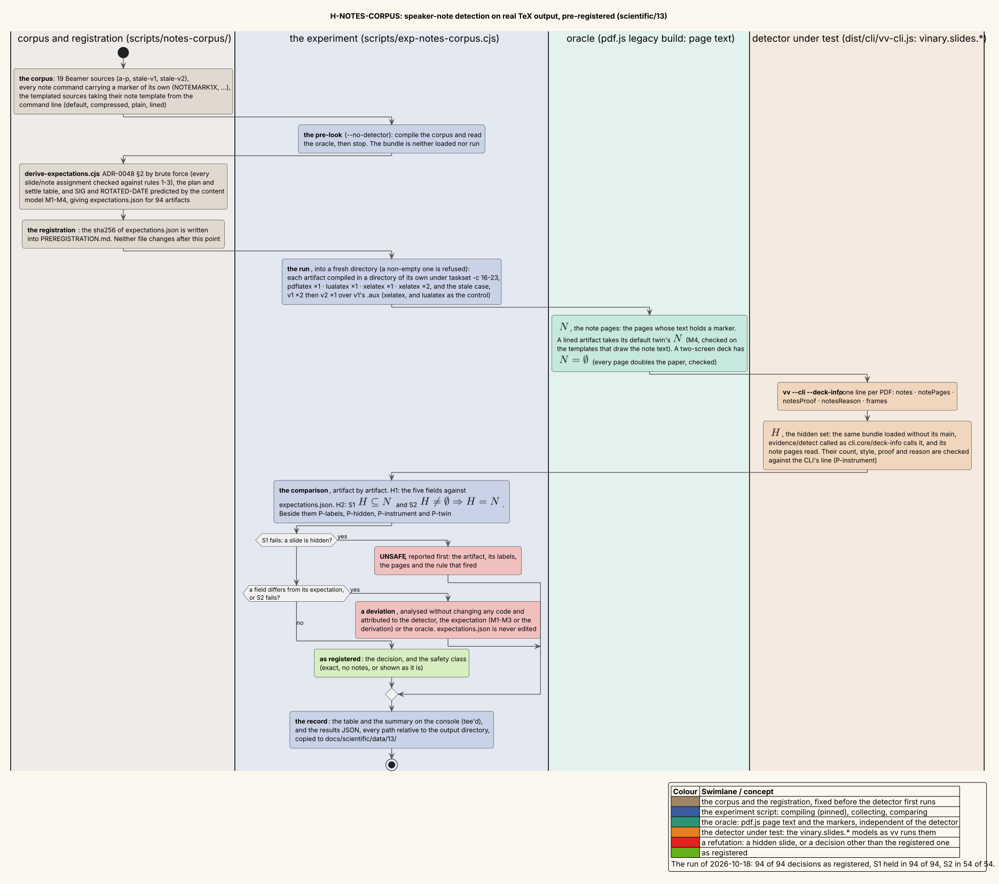

# 13 — Speaker-note detection on real TeX output

**Status: complete.** This page records one pre-registered experiment, *H-NOTES-CORPUS*, run once, on 2026-10-18.
Its expectations were written and hashed before the detector first ran on the corpus. The corpus has 94 *artifacts*:
each is one small Beamer deck compiled by one TeX engine run (§1, §3).

- **No slide was hidden.** In every one of the 94 artifacts, each page the detector hid was a note page (S1: 94 of
  94). Every artifact that hid pages hid all of its note pages (S2: 54 of 54).
- **Every decision was the registered one.** All five fields of the decision matched in 94 of 94 artifacts: 0 of the
  470 compared fields differed. Three more things matched in 94 of 94 artifacts each:
  - the hidden sets;
  - the page labels;
  - the two readings of the detector, which are the CLI's line and the hidden set read from the same compiled code
    (§6.2).
- **What the safety costs.** 28 artifacts that contain note pages were shown as they are, and all 28 were predicted.
  For 15 of them, the one-pass XeLaTeX build of the same variant has no labels. It was scanned, and the scan found
  exactly its note pages (§9.1).
- **No detector bug was found.** Two refinements are put forward for a later, separately registered experiment
  (§9.1). Neither is a defect against ADR-0048.

The experiment tests
[ADR-0048 §2 — Finding interleaved note pages](../design-decisions/0048-speaker-notes-and-linked-presenter-windows.md#2-finding-interleaved-note-pages-n2).
It follows the methodology of [07 — Measurement methodology](07-measurement-methodology.md) and the controlled-corpus
approach of [12 — Slide-deck detection and flip latency](12-slide-deck-detection-and-flip-latency.md) §5, which is
pre-registration in the sense of [PREREG]:

1. predict before measuring;
2. write the prediction down, and hash it;
3. record the raw data ([`data/13/notes-corpus-2026-10-18.json`](data/13/notes-corpus-2026-10-18.json));
4. keep whatever is refuted.

---

## 1 · The question and the terms

Beamer [BEAMER] is the LaTeX class for slides. Under `\setbeameroption{show notes}` it writes the speaker's notes into
the slide PDF itself: after a slide that has a `\note`, it inserts a whole page of notes. A presenter projects that PDF,
so the audience would see every one of those pages. The slide show hides them (ADR-0048 N2). It decides which pages
they are from the PDF's page labels and, where the labels do not suffice, from the text on the pages. The two possible
errors do not cost the same. ADR-0048 §2.5 puts it this way: "Showing a note page to the audience costs less than
hiding a slide from it."

**The question.** On what pdfLaTeX, LuaLaTeX and XeLaTeX really write:

1. does the detector reach, for every deck, the decision that ADR-0048 §2's rules predict?
2. is it safe? It must never hide a slide, and when it hides pages, it must hide exactly the note pages.

The terms used throughout follow. Pages are numbered from 0, as in the code.

| Term | Meaning |
|---|---|
| deck | A PDF of slides; in this experiment, the PDF of one artifact. |
| slide page, note page | A **slide page** is a page Beamer typesets from a frame, one per overlay. A **note page** is a page of speaker notes that `show notes` inserts. It follows an overlay with an in-frame `\note`, or comes at once for a `\note` written between frames (ADR-0048 §2.1). |
| page label $`L_i`$ | The label of page $`i`$ in the PDF's `/PageLabels` number tree ([ISO-32000] §12.4.2), as pdf.js's `getPageLabels` returns it. Beamer labels a slide page with its frame number. The hyperref package [HYPERREF] labels a note page with its physical page number, $`i + 1`$. A PDF without the tree has no labels. |
| bp | The PDF unit of length, the PostScript point: $`1\,\mathrm{bp} = 1/72`$ inch. Beamer's default 4:3 paper is $`362.83 \times 272.13`$ bp. |
| source, template, variant | A **source** is a `.tex` file of the corpus (§3). Beamer has four note-page **templates**: `default`, `compressed`, `plain` and `lined` (ADR-0048 §2.2). A source that reads the macro `\vvnotetemplate` is compiled once per template, and each of those builds is a **variant**, named `<source>-<template>`. Any other source is a single variant, built with the `default` template. |
| engine run | `pdflatex` (pdfLaTeX, one pass), `lualatex` (LuaLaTeX, one pass), `xelatex` (XeLaTeX, one pass) or `xelatex2` (XeLaTeX, two passes in the same directory). |
| artifact | One variant compiled by one engine run, named `<variant>.<engine run>`, for example `i-templates-lined.xelatex2`. The two artifacts of the stale-labels case, `stale.xelatex` and `stale.lualatex`, are artifacts too (§3). |
| producer, trusted | The PDF's Info `Producer`. It is **trusted** when it names pdfTeX, LuaTeX or LuaHBTeX, the engines that write the labels in the run itself (ADR-0048 §2.5). XeLaTeX's xdvipdfmx is not trusted. |
| the detector | `vinary.slides.notes` and `vinary.slides.evidence` ([`notes.cljs`](../../src/vinary/slides/notes.cljs), [`evidence.cljs`](../../src/vinary/slides/evidence.cljs)), with `vinary.slides.deck` for the frames, as `vv --cli --deck-info` runs them ([`cli/core.cljs`](../../src/vinary/cli/core.cljs)) from the development build `dist/cli/vv-cli.js`. |
| decision | The five fields `--deck-info` prints about notes and frames: `notes` (`interleaved`, `split` or `none`); `notePages`, how many pages are hidden; `notesProof`, the steps that found them; `notesReason`, why none are hidden; and `frames`, how many frames the audience steps through (ADR-0045). The proof steps are `labels`, `probe`, `confirm` and `scan`. |
| $`N`$ | The note pages of an artifact according to the oracle (§4). |
| $`H`$ | The pages the detector hides: its model's `:note-pages` (§6.2). |
| $`\mathrm{SIG}(s, j)`$ | The note-page signature: true when page $`j`$ carries a scaled copy of page $`s`$ (a thumbnail, at scale $`\sigma \le 0.4`$) that covers at least half of $`s`$'s characters (ADR-0048 §2.2). |
| $`\mathrm{ROTATED\text{-}DATE}(j)`$ | True when page $`j`$ has a text run turned by $`\pm 90^\circ`$ that reads as a date `YYYY-MM-DD`. Only the `default` template draws one (ADR-0048 §2.2). |
| parse, plain run, candidate, fallback | Defined with the label automaton in §5.1. |
| probe, confirmation, scan | The three checks over page text of ADR-0048 §2.3–§2.5, summarized in §5.2. |

## 2 · The hypotheses, as pre-registered

The registration is [`scripts/notes-corpus/PREREGISTRATION.md`](../../scripts/notes-corpus/PREREGISTRATION.md). It
fixes the expectations by their hash:

> **Registered `expectations.json` sha256: `e3f8ada158b242080db95791064e5bf5076666e72f82ae790f9a2dc3f332d8d2`**

- `expectations.json` was written at 2026-10-18 04:52:26 UTC, according to its `registered` field.
- The detector first ran on the corpus at 12:32:27 UTC. The run printed
  `expectations.json sha256 e3f8ada1… matches PREREGISTRATION.md`.
- Neither file has been edited since.

**H1 — decisions.** For every one of the 94 artifacts, `vv --cli --deck-info` prints the five fields of the decision
that [`expectations.json`](../../scripts/notes-corpus/expectations.json) gives it. A single differing field in a single
artifact refutes H1.

**H2 — safety.** For every artifact,

```math
\text{S1:}\quad H \subseteq N, \qquad\qquad \text{S2:}\quad H \neq \emptyset \;\Rightarrow\; H = N .
```

- **S1:** no slide is hidden.
- **S2:** a deck that hides note pages hides all of them.

A single artifact that violates either one refutes H2. H2 does not ask for completeness. A deck that has note pages
and is shown as it is ($`H = \emptyset \neq N`$) satisfies both. The registration predicted that outcome for 28
artifacts.

Every artifact falls into exactly one **safety class**:

```math
\operatorname{class}(H, N) =
\begin{cases}
\text{unsafe} & \text{if } H \not\subseteq N, \\
\text{no notes} & \text{if } H = N = \emptyset, \\
\text{shown as it is} & \text{if } H = \emptyset \neq N, \\
\text{exact} & \text{if } H = N \neq \emptyset, \\
\text{partial} & \text{if } \emptyset \neq H \subsetneq N .
\end{cases}
```

The five cases cover every pair, and no pair falls in two of them:

- either $`H \not\subseteq N`$, or $`H \subseteq N`$;
- in the second case, $`H`$ is empty or it is not;
- an empty $`H`$ is *no notes* or *shown as it is*, depending on $`N`$;
- a non-empty $`H \subseteq N`$ either equals $`N`$ or is a proper subset of it.

S1 fails exactly in the *unsafe* class. S2 fails in the *unsafe* and *partial* classes, because an unsafe $`H`$ is
non-empty and differs from $`N`$.

**Secondary predictions.** These were registered as well, and are reported beside H1 and H2:

- **P-labels:** every artifact's page labels equal the labels in `expectations.json`.
- **P-hidden:** every artifact's $`H`$ equals the registered `hidden` set.
- **P-instrument:** the hidden set read from the compiled namespaces (§6.2) agrees with the CLI's line. Its size, style,
  proof and reason equal `notePages`, `notes`, `notesProof` and `notesReason`.
- **P-twin:** the oracle's assumption M4 holds (§4).

## 3 · The corpus

The corpus is 19 synthetic Beamer sources in [`scripts/notes-corpus/`](../../scripts/notes-corpus/). Each one is small,
4 to 10 pages, and isolates one or two rules of ADR-0048 §2. They share these properties:

- every source uses `\documentclass{beamer}` with the default theme, 4:3 paper and `\title{Corpus deck}`;
- the slides hold plain words;
- every `\note` holds a marker token (`NOTEMARK1X`, `NOTEMARK2X`, …) that no other `\note` of the source uses.

| Source | What it exercises (sections of ADR-0048) | Variants | Engine runs | Pages |
|---|---|---|---|---|
| [`a-last-note`](../../scripts/notes-corpus/a-last-note.tex) | One page per frame, and a note on the last frame only. Covers the plain run and the probe from its last candidate (§2.1, §2.3). | 1 | all four | 5 |
| [`b-no-notes`](../../scripts/notes-corpus/b-no-notes.tex) | One page per frame, `show notes` on, and no `\note`. The probe reads two slides and keeps the parse without note pages (§2.3). | 1 | all four | 4 |
| [`c-overlays`](../../scripts/notes-corpus/c-overlays.tex) | Overlays (`\pause`, `<2->`) with a note per overlay: the labels prove the parse (§2.1). | 1 | all four | 8 |
| [`d-between`](../../scripts/notes-corpus/d-between.tex) | A `\note` between frames, right after a frame's own note: two note pages in a row (§2.1). | 1 | all four | 6 |
| [`e-againframe`](../../scripts/notes-corpus/e-againframe.tex) | `\againframe` of an overlay that has a note. The counter steps, and the note returns (§2.1 rule 2). | 1 | all four | 7 |
| [`f-noframenumbering`](../../scripts/notes-corpus/f-noframenumbering.tex) | A `noframenumbering` frame with a note: a slide that keeps the current frame number (§2.1 rule 2). | 1 | all four | 4 |
| [`f0-unnumbered-first`](../../scripts/notes-corpus/f0-unnumbered-first.tex) | The first frame is `noframenumbering`, so its label is 0, and it has a note. Such a deck is never ambiguous (§2.1). | 1 | all four | 4 |
| [`g-appendix-no-notes`](../../scripts/notes-corpus/g-appendix-no-notes.tex) | `appendixnumberbeamer` [APPENDIXNUMBERBEAMER] restarts the counter at `\appendix`, and there are no notes. The only valid parse would hide four slides, so it must go to the confirmation (`restartable?`, §2.1). | 1 | all four | 7 |
| [`h-appendix-notes`](../../scripts/notes-corpus/h-appendix-notes.tex) | The same restart, with notes. A label drops, and no parse is valid (§2.1). | 1 | all four | 7 |
| [`i-templates`](../../scripts/notes-corpus/i-templates.tex) | The four note templates on one deck: notes on both overlays of a frame, a note between frames, a note on a later overlay, and `\againframe` (§2.2, §2.4, §2.5). | 4 | all four | 10 |
| [`j-only-notes`](../../scripts/notes-corpus/j-only-notes.tex) | `show only notes`, the notes handout. Every page is a note page, and none is to be hidden: the PDF *is* the notes (ADR-0048 §1). | 1 | all four | 4 |
| [`k-counter-set`](../../scripts/notes-corpus/k-counter-set.tex) | `\setcounter{framenumber}{1}` makes the first label 2. Four parses are valid (§2.1). | 1 | all four | 6 |
| [`l-second-screen`](../../scripts/notes-corpus/l-second-screen.tex) | The control, `show notes on second screen=right`. The notes are split, and the automaton never runs (§1, §2.1). | 1 | all four | 4 |
| [`m-empty-slide`](../../scripts/notes-corpus/m-empty-slide.tex) | An empty last slide that has a note. The date decides, under §2.2's empty-slide clause. | 2 (`default`, `compressed`) | all four | 4 |
| [`n-trailing-notes`](../../scripts/notes-corpus/n-trailing-notes.tex) | Two note pages after the last slide, inside the plain run. The probe's walk needs the date (§2.3). | 2 (`default`, `compressed`) | all four | 5 |
| [`o-run-between`](../../scripts/notes-corpus/o-run-between.tex) | Two note pages in a row inside the plain run, and no valid parse without them. The walk reaches them over the date, or else the probe is undecided (§2.3). | 2 (`default`, `compressed`) | all four | 6 |
| [`p-roman-numbers`](../../scripts/notes-corpus/p-roman-numbers.tex) | Roman frame numbers, so not every label is an integer (§2.1's gate). | 1 | all four | 5 |
| [`stale-v1`](../../scripts/notes-corpus/stale-v1.tex), [`stale-v2`](../../scripts/notes-corpus/stale-v2.tex) | Stale labels (§2.5). v1 is compiled twice as `stale.tex`, then replaced by v2, which inserts the frame *Inserted* after the first frame, and compiled once more over v1's `.aux`. This is done by XeLaTeX, and by LuaLaTeX as the control. | 1 (`stale`) | `xelatex` and `lualatex`: v1 twice, then v2 once | 7, then 8 |

**How it is compiled.**

- Every variant is compiled by all four engine runs, so the 23 variants give $`23 \times 4 = 92`$ artifacts. The stale
  pair brings the total to 94, with 580 pages in all.
- A templated source receives its template on the command line, as
  [`test/fixtures/beamer-shownotes.tex`](../../test/fixtures/beamer-shownotes.tex) does:
  `<engine> -jobname=<variant> '\def\vvnotetemplate{<template>}\input{<source>}'`.
- Each artifact is compiled in a directory of its own, and every TeX run is pinned with `taskset -c 16-23`.

## 4 · The oracle

An *oracle* is the mechanism that decides the correct outcome of a test [ORACLE]. Here it decides $`N`$. It shares no
code with the detector. Apart from the page size, which both use to recognize a two-screen deck, it shares no evidence
with it either: the detector reads the labels and the geometry of the text runs, and the oracle reads the marker
tokens.

pdf.js [PDFJS], the legacy build of `pdfjs-dist`, reads every page's text with `getTextContent`. The item strings are
joined, and the marker tokens `NOTEMARK<k>X` are found in them. Three rules apply, in this order:

1. **Two-screen.** A `show notes on second screen` deck puts a slide half and a notes half on every page, so it has no
   note pages to hide: $`N = \emptyset`$. The rule applies only when every page doubles the Beamer paper in width, to
   $`725.67 \times 272.13`$ bp within 0.5 bp. The oracle reports an error otherwise. It applied to 4 artifacts, every
   page of which measured $`725.67 \times 272.13`$.
2. **Twin.** The `lined` template draws ruled lines and **no note text**, so a `lined` artifact has no marker to find.
   Its $`N`$ is the $`N`$ of its **twin**: the `default` artifact of the same source and engine run, which must have the
   same page count. It applied to 4 artifacts.
3. **Markers.** Otherwise, a page is a note page if and only if its text holds a marker. This covers the other 86
   artifacts.

**The twin rule's assumption, M4.** The template does not change which pages are note pages:
`beamerbasenotes.sty` decides where the note pages go, and the template only draws them. The experiment checks M4
wherever it can. For every templated source and engine run:

- the templates that draw the note text (`default`, `compressed`, `plain`) must mark the same pages;
- every template must give the same page count.

**M4 held in 16 of 16 groups** (§7.6). It cannot be checked on `lined` itself, whose pages carry no marker. There the
equal page counts are the evidence.

**Why the markers are sound here.**

- A marker occurs only inside a `\note`, and a note's text is drawn only on its note page.
- The thumbnail on a note page is a copy of a *slide*, which holds no marker.
- No page held more than one marker (0 of 580 pages).
- Under `show only notes` every page is a note page, so the oracle's $`N`$ for `j-only-notes` is every page. The
  correct outcome there is to hide nothing (ADR-0048 §1).

What the pages carry, as pdf.js reads them from the pdfLaTeX builds:

| Page | Text (pdf.js, joined) | Rotated date |
|---|---|---|
| a slide (`a-last-note`, page 3) | `Charlie Charlie words on the last slide` | no |
| its `default` note page (page 4) | `Charlie Charlie words on the last slide 2026-10-18 Corpus deck Charlie NOTEMARK1X Speaker notes for the last slide only`: the thumbnail, the date, the short title, the frame title and the note | yes |
| a `compressed` note page (`i-templates-compressed`, page 1) | `Intro Intro first point Intro NOTEMARK1X Notes for both overlays of the intro`: the thumbnail, the frame title and the note | no |
| a `plain` note page (`i-templates-plain`, page 1) | `NOTEMARK1X Notes for both overlays of the intro`: the note only | no |
| a `lined` note page (`i-templates-lined`, page 1) | nothing | no |
| an empty slide (`m-empty-slide-default`, page 2) | nothing | no |

## 5 · The decision rules

The expectations were derived by [`derive-expectations.cjs`](../../scripts/notes-corpus/derive-expectations.cjs). It
applies [ADR-0048 §2](../design-decisions/0048-speaker-notes-and-linked-presenter-windows.md#2-finding-interleaved-note-pages-n2)
to the labels, producers and oracle of the pre-look (§6.3). It loads nothing from `src/` or `dist/`: it is a second,
independent reading of the ADR, written for this experiment.

### 5.1 · The label automaton, by brute force

Let the labels be $`L_0, \dots, L_{n-1}`$, all non-negative integers. A **parse** is a set
$`S \subseteq \{1, \dots, n-1\}`$ of the pages it calls note pages; the other pages are slides. Write $`f_i`$ for the
current frame number after page $`i`$. ADR-0048 §2.1's three rules make a parse **valid** when

```math
\begin{aligned}
&\text{(1)}\quad 0 \notin S \text{ and } f_0 = L_0 ;\\
&\text{(2)}\quad i \notin S \;\Rightarrow\; L_i \in \{ f_{i-1},\, f_{i-1} + 1 \} \text{ and } f_i = L_i ;\\
&\text{(3)}\quad i \in S \;\Rightarrow\; L_i = i + 1 \text{ and } f_i = f_{i-1} .
\end{aligned}
```

The detector finds the valid parses by splitting the deck into gaps (`notes/interleaving`, ADR-0048 §2.1). The
derivation does not reuse that method. Instead it tries every assignment of roles, which is cheap for decks of at most
10 pages. An error in the gap method therefore could not be copied into the expectations. The procedures below are in
the literate style of [KNUTH-LP]: each step carries, in ⟨angle brackets⟩, the rule or the reason it implements.

```
procedure VALID-PARSES(L[0..n-1])          ⟨every slide/note assignment that obeys rules 1–3⟩
  WALK(1, L[0], ∅)                          ⟨rule 1: page 0 is a slide, and f starts at its label⟩

  procedure WALK(i, f, S)
    if i = n then emit S and return         ⟨every page has a role: S is a valid parse⟩
    if L[i] ∈ {f, f + 1} then WALK(i + 1, L[i], S)       ⟨rule 2: page i as a slide⟩
    if L[i] = i + 1      then WALK(i + 1, f, S ∪ {i})    ⟨rule 3: page i as a note page⟩
```

The **plain run** is the pages $`1, \dots, m`$, where $`m`$ is the largest index with $`L_j = j + 1`$ for every
$`1 \le j \le m`$. The valid parses are then classified by ADR-0048 §2.1's table:

```
procedure CLASSIFY(L[0..n-1])
  P ← VALID-PARSES(L)
  if P = ∅    then return INVALID                  ⟨no parse obeys the rules: shown as it is⟩
  if |P| = 1  then return NONE if P = {∅}, else PROVEN(the one parse)
  if L[0] ≥ 2 then return UNDECIDABLE              ⟨several parses that the probe cannot tell apart⟩
  m ← the end of the plain run
  if there is one set B of pages outside the run such that every parse is either B itself
     (the FALLBACK) or B ∪ {a, …, m} for a first note page a that no other parse shares
              then return AMBIGUOUS(candidates ← those a, base ← B, fallback ← whether B ∈ P)
  return UNDECIDABLE
```

So an `ambiguous` deck has two named parts:

- its **candidates** are the first note pages $`a`$ of its parses that have note pages in the plain run;
- its **fallback** is $`B`$, the parse with no note page in the run. Some decks admit it as a valid parse, and some do
  not.

`restartable?` holds when no label is two or more above the label before it:

```math
\operatorname{restartable}(L) \iff L_i \le L_{i-1} + 1 \quad \text{for every } 1 \le i \le n - 1 .
```

Such labels could also be read as all slides, with a frame counter that restarted at every drop. So ADR-0048 §2.1 sends
their proven parse to the confirmation (§5.2), even when the producer is trusted.

**A worked parse: `c-overlays.pdflatex`.**

1. The labels are `1 2 1 4 2 2 7 3`. Only pages 1, 3 and 6 satisfy $`L_j = j + 1`$, so only they can be note pages.
2. Page 1 must be a note page. As a slide it would set $`f = 2`$, and page 2's label 1 is neither 2 nor 3.
3. For the same reason, page 3 (label 4, after $`f = 1`$) and page 6 (label 7, after $`f = 2`$) must be note pages.
4. So exactly one parse is valid, $`S = \{1, 3, 6\}`$, and it is the oracle's $`N`$.
5. The label 4 at page 3 is three above the label before it, so the labels are not `restartable?`.
6. pdfTeX is a trusted producer, so the note pages are hidden at once, with the proof `[labels]`.

### 5.2 · The checks over page text

ADR-0048 [§2.3](../design-decisions/0048-speaker-notes-and-linked-presenter-windows.md#23-the-probe) to
[§2.5](../design-decisions/0048-speaker-notes-and-linked-presenter-windows.md#25-labels-that-lag-a-pass) define three
checks over the pages' text. Each is built on SIG and ROTATED-DATE.

- **The probe** chooses among an ambiguous deck's candidates, walking them from the last to the first:
  - if $`\mathrm{SIG}(a - 1, a)`$ holds, candidate $`a`$ is the parse;
  - if it fails but page $`a`$ is dated, the walk goes on to the previous candidate;
  - otherwise the walk stops. The fallback stands when it is valid, which is `no-note-pages` when it has no note pages.
    When the fallback is not valid, the probe is undecided (`probe-undecided`).
- **The confirmation** checks a parse that came from the labels, before its note pages are hidden. Take every note page
  $`j`$ of the parse, and let $`s`$ be the parse's last slide before $`j`$. The page passes when $`\mathrm{SIG}(s, j)`$ or
  $`\mathrm{ROTATED\text{-}DATE}(j)`$ holds. The confirmation stops at the first page that passes neither (`confirm-failed`).
- **The scan** handles a deck without labels. It walks the pages in order, and keeps page $`j`$ as a note page when SIG
  holds against the last page it kept as a slide.

### 5.3 · The plan and the settle table

The plan and the settle table are `notes/plan` and `evidence/settle`, in
[ADR-0048 §2.6](../design-decisions/0048-speaker-notes-and-linked-presenter-windows.md#26-what-the-first-paint-decides-and-the-reasons).
The first matching row decides.

| The deck | Work | Outcome → decision |
|---|---|---|
| every page doubles a Beamer paper | none | `split`, with no proof and no reason |
| no labels | the scan | note pages found → `interleaved`, `[scan]`; none found → `none`, `no-note-pages` |
| a label that is not a non-negative integer | none | `none`, `labels-not-integers` |
| `proven`, from a trusted producer, with labels that are not `restartable?` | none | `interleaved`, `[labels]` |
| `proven`, otherwise | the confirmation | it passes → `[labels, confirm]`; it fails → `none`, `confirm-failed` |
| `ambiguous` | the probe | no valid choice → `probe-undecided`; the fallback without note pages → `no-note-pages`; a candidate from a trusted producer → `[labels, probe]`; a candidate from another producer → the confirmation, giving `[labels, probe, confirm]` or `confirm-failed` |
| `none` · `invalid` · `undecidable` | none | `none`, with the reason `no-note-pages` · `invalid` · `undecidable` |

### 5.4 · Frames

Frames are counted as ADR-0045 and `deck/deck` count them:

- with no hidden page, a frame is a maximal run of adjacent pages that share a label;
- with hidden pages, the same rule is applied to the shown pages only;
- without labels, every shown page is a frame;
- on a two-screen deck, every page is a frame.

### 5.5 · The content model

The derivation does not compute SIG and ROTATED-DATE, because that would re-implement the detector's geometry. It
**predicts** them from what Beamer's note templates draw (`beamerouterthemedefault.sty`, `beamerbaseauxtemplates.sty`,
`beamerbasenotes.sty`; the table at the end of §4 shows the result). The prediction uses these rules, and the first
rule that applies decides:

| Id | Prediction | Reads |
|---|---|---|
| M1 | Under `default` and `compressed`, a note page $`j`$ shows a thumbnail of $`t(j)`$, the last slide page before it (`\beamer@frameboxcopy`). `plain` and `lined` draw none. | (used by M3a, M3b) |
| M2 | $`\mathrm{ROTATED\text{-}DATE}(j)`$ holds exactly on the note pages of the `default` template. | (with every read) |
| M3t | When $`s`$ has no text, $`\mathrm{SIG}(s, j)`$ equals $`\mathrm{ROTATED\text{-}DATE}(j)`$ if $`j`$ has text, and is `nil` (no evidence) if it has none. | 13 |
| M3c | $`\mathrm{SIG}(s, j)`$ fails when $`s`$ is a note page: its thumbnail appears on $`j`$ at $`\sigma = 1`$ or not at all, and only its short frame title can match below the bound. | 28 |
| M3d | $`\mathrm{SIG}(s, j)`$ fails when $`j`$ is a slide, which repeats $`s`$'s strings at $`\sigma = 1`$ or not at all. | 71 |
| M3a | $`\mathrm{SIG}(s, j)`$ holds when $`j`$ is a note page with a thumbnail of $`t(j) = s`$. | 65 |
| M3b | $`\mathrm{SIG}(s, j)`$ holds when $`j`$'s thumbnail is a later overlay of $`s`$'s own frame, which repeats $`s`$'s text. | 0 |
| M3e | $`\mathrm{SIG}(s, j)`$ fails when $`j`$ is a note page without a thumbnail, or with another frame's thumbnail. | 8 |

The `Reads` column counts how often each rule predicted a read: 185 reads in all.

- Every predicted read is stored in `expectations.json` with the rule that predicted it (`derivation.reads`), for
  example `{"step": "confirm", "pair": [5, 6], "sig": false, "model": "M3d", "dated": false}`.
- M2 was checked against the input before registration. On every page of every artifact that is not two-screen, the
  rotated date is present exactly when M2 says it is, and `contentModelM2Exceptions` is empty.
- M1 and M3 cannot be read off the input without re-implementing SIG. They are tested only through the decisions they
  lead to (§10).

### 5.6 · A worked derivation: the stale labels (`stale.xelatex`)

The deck has eight pages: One/1 and its note, One/2 and its note, then *Inserted*, *Two*, *Three* and Three's note. So
$`N = \{1, 3, 7\}`$. LuaLaTeX writes v2's own labels, `1 2 1 4 2 3 4 8`. XeLaTeX's one pass over v1's `.aux` writes
`1 2 1 4 2 3 7 8`, which is v1's seven labels plus an eighth that continues the decimal range of v1's last page.

1. **The automaton.**
   - The pages with $`L_j = j + 1`$ are 1, 3, 6 and 7.
   - Pages 1 and 3 must be note pages, as in §5.1. Pages 4 and 5 are then slides, with $`f = 2`$ and then $`3`$.
   - Page 6's label 7 is neither 3 nor 4, so page 6 must be a note page, and so must page 7.
   - Exactly one parse is valid, $`\{1, 3, 6, 7\}`$, so the labels **prove** it. But page 6 is the slide *Three*.
2. **The trust rule.** The producer is xdvipdfmx, which is not trusted, so the parse goes to the confirmation.
3. **The confirmation.**
   - Pages 1 and 3 pass: their thumbnails are of pages 0 and 2 (M3a), and they carry the date (M2).
   - Page 6's last slide in the parse is page 5 (*Two*). Page 6 is a slide, so $`\mathrm{SIG}(5, 6)`$ fails (M3d), and a slide
     carries no date (M2).
   - The confirmation fails.
4. **The decision.** `none`, `confirm-failed`, with every page shown. Each of the eight labels differs from its
   neighbours, so there are 8 frames.

The control, `stale.lualatex`, proves $`\{1, 3, 7\}`$ from its own labels. The producer is trusted and the labels are
not `restartable?`, so those pages are hidden at once (`[labels]`). The shown pages 0, 2, 4, 5 and 6 carry the labels
1 1 2 3 4, which make 4 frames.

## 6 · Method

### 6.1 · Procedure



*Diagram source: [`../diagrams/activity-notes-corpus-experiment.puml`](../diagrams/activity-notes-corpus-experiment.puml).*

1. **The corpus** (§3) was written, with a marker in every `\note`.
2. **The pre-look.** `scripts/exp-notes-corpus.cjs --no-detector` compiles the corpus and reads the oracle, then stops.
   In this mode the bundle is neither loaded nor run (§6.3).
3. **The derivation.** `derive-expectations.cjs` applied §5 to the pre-look and wrote `expectations.json`.
4. **The registration.** The file's sha256 went into `PREREGISTRATION.md`, and neither file has changed since.
5. **The run.** One run, into a fresh directory; the script refuses a non-empty one. Every artifact was compiled
   again from scratch, pinned with `taskset -c 16-23`. The run's console was written to a file with `tee`.
6. **The comparison.** The script prints a table per artifact and a summary, and writes the full results as JSON. Every
   path in the JSON is relative to the output directory, so it names no path of this machine.

The run took 99 s, from 12:32:27.5 to 12:34:06.6 UTC. It measured no time, so CPU frequency plays no part in it. The
pinning keeps the TeX runs off the cores that other work was using.

### 6.2 · The two readings of the detector

- **`vv --cli --deck-info`.** The script runs `node dist/cli/vv-cli.js --deck-info <pdf>…` with stdin closed, once
  for all 94 PDFs. This is the GUI's own pipeline, run headless (ADR-0048 N6), and it prints one JSON line per PDF.
- **The hidden set $`H`$.** `--deck-info` prints only how many pages are hidden, not which ones. A shadow-cljs
  development build defines its namespaces on `global`. So, in a child process, the script evaluates the same bundle
  with its last line, the call of `vinary.cli.core/main`, left out. It then calls the steps `cli.core/deck-info` calls:
  1. `terminal.pdf/open-document`;
  2. `evidence/gather` and `terminal.pdf/page-sizes`;
  3. `evidence/detect`, with an empty sidecar (`notes/sidecar-of nil`; the corpus has no `.pdfpc` file, which is
     checked).

  It reads the model's `:note-pages`. **P-instrument** checks the two readings against each other.

A release build (`:simple`) would not expose the namespaces, and the set would then be reported as unavailable. The
robust alternative is for `--deck-info` itself to print the hidden pages, as a `notePageList` field beside
`notePages`. That is a proposal, and it is not part of this experiment.

### 6.3 · What the registration was allowed to see

Only the input was seen before registration. The `--no-detector` mode compiles, reads the labels, the producer, the
page geometry and the page text, and applies the oracle. It never runs `--deck-info` and never loads the bundle. It ran
three times, and the full account is in `PREREGISTRATION.md` §8:

1. on a corpus of 82 artifacts;
2. on the same corpus again, with two more fields in its output, giving an identical table;
3. on the final corpus of 94 artifacts. Its 82 earlier rows were identical to the second pre-look's.

`derive-expectations.cjs` reads only that output. Re-running it on the third pre-look gives a file identical to the
registered one in everything but its `registered` timestamp. This was checked after the run, without touching the
registered file.

## 7 · Results

### 7.1 · Summary

| Measure | Registered | Observed |
|---|---|---|
| artifacts compiled | 94 | 94 of 94 |
| **S1**, $`H \subseteq N`$ (no slide hidden) | all 94 | **94 of 94**, unsafe: none |
| **S2**, $`H \neq \emptyset \Rightarrow H = N`$ | the 54 that hide pages | **54 of 54** |
| **H1**, decisions with all five fields as registered | 94 | **94 of 94**; 0 of 470 fields differ |
| safety classes | exact 54, no notes 12, shown as it is 28, partial 0, unsafe 0 | the same |
| P-labels | 94 | 94 of 94 |
| P-hidden | 94 | 94 of 94 |
| P-instrument | 94 | 94 of 94 |
| P-twin (M4) | 16 groups | 16 of 16 |

**Verdicts.**

- **H1 is confirmed**, and **H2 is confirmed**, on this corpus.
- Every secondary prediction held.
- `vv --cli` exited 0 and wrote nothing to stderr.

### 7.2 · By variant and engine run

How to read a cell:

- a set $`\{\ldots\}`$ is $`H`$, the hidden pages;
- the proof follows: `L` labels, `P` probe, `C` confirm, `S` scan;
- a code span is the reason when nothing is hidden;
- `f` and a number is the frame count (`f4`: four frames);
- the safety class closes the cell, with *shown* for *shown as it is*.

The labels are pdfLaTeX's. LuaLaTeX wrote the same labels for all 23 variants, and the second XeLaTeX pass did so for
22 of them. A single XeLaTeX pass wrote none, and neither did either pass of `j-only-notes.xelatex2` (§7.6). **Every
cell is exactly the decision registered for it**; nothing is marked as a mismatch because nothing mismatched.

| Variant | Labels | $`N`$ | pdflatex | lualatex | xelatex (one pass) | xelatex2 |
|---|---|---|---|---|---|---|
| `a-last-note` | 1 2 3 4 5 | $`\{4\}`$ | $`\{4\}`$ · L+P · f4 · *exact* | $`\{4\}`$ · L+P · f4 · *exact* | $`\{4\}`$ · S · f4 · *exact* | $`\{4\}`$ · L+P+C · f4 · *exact* |
| `b-no-notes` | 1 2 3 4 | $`\emptyset`$ | `no-note-pages` · f4 · *no notes* | `no-note-pages` · f4 · *no notes* | `no-note-pages` · f4 · *no notes* | `no-note-pages` · f4 · *no notes* |
| `c-overlays` | 1 2 1 4 2 2 7 3 | $`\{1,3,6\}`$ | $`\{1,3,6\}`$ · L · f3 · *exact* | $`\{1,3,6\}`$ · L · f3 · *exact* | $`\{1,3,6\}`$ · S · f5 · *exact* | $`\{1,3,6\}`$ · L+C · f3 · *exact* |
| `d-between` | 1 1 2 4 5 3 | $`\{3,4\}`$ | $`\{3,4\}`$ · L · f3 · *exact* | $`\{3,4\}`$ · L · f3 · *exact* | $`\{3,4\}`$ · S · f4 · *exact* | $`\{3,4\}`$ · L+C · f3 · *exact* |
| `e-againframe` | 1 1 3 2 3 6 4 | $`\{2,5\}`$ | $`\{2,5\}`$ · L · f4 · *exact* | $`\{2,5\}`$ · L · f4 · *exact* | $`\{2,5\}`$ · S · f5 · *exact* | $`\{2,5\}`$ · L+C · f4 · *exact* |
| `f-noframenumbering` | 1 1 3 2 | $`\{2\}`$ | $`\{2\}`$ · L · f2 · *exact* | $`\{2\}`$ · L · f2 · *exact* | $`\{2\}`$ · S · f3 · *exact* | $`\{2\}`$ · L+C · f2 · *exact* |
| `f0-unnumbered-first` | 0 2 1 2 | $`\{1\}`$ | $`\{1\}`$ · L · f3 · *exact* | $`\{1\}`$ · L · f3 · *exact* | $`\{1\}`$ · S · f3 · *exact* | $`\{1\}`$ · L+C · f3 · *exact* |
| `g-appendix-no-notes` | 1 2 3 4 5 1 2 | $`\emptyset`$ | `confirm-failed` · f7 · *no notes* | `confirm-failed` · f7 · *no notes* | `no-note-pages` · f7 · *no notes* | `confirm-failed` · f7 · *no notes* |
| `h-appendix-notes` | 1 2 3 3 1 6 2 | $`\{2,5\}`$ | `invalid` · f6 · *shown* | `invalid` · f6 · *shown* | $`\{2,5\}`$ · S · f5 · *exact* | `invalid` · f6 · *shown* |
| `i-templates-default` | 1 2 1 4 5 2 3 3 9 4 | $`\{1,3,4,8\}`$ | $`\{1,3,4,8\}`$ · L · f4 · *exact* | $`\{1,3,4,8\}`$ · L · f4 · *exact* | $`\{1,3,4,8\}`$ · S · f6 · *exact* | $`\{1,3,4,8\}`$ · L+C · f4 · *exact* |
| `i-templates-compressed` | 1 2 1 4 5 2 3 3 9 4 | $`\{1,3,4,8\}`$ | $`\{1,3,4,8\}`$ · L · f4 · *exact* | $`\{1,3,4,8\}`$ · L · f4 · *exact* | $`\{1,3,4,8\}`$ · S · f6 · *exact* | $`\{1,3,4,8\}`$ · L+C · f4 · *exact* |
| `i-templates-plain` | 1 2 1 4 5 2 3 3 9 4 | $`\{1,3,4,8\}`$ | $`\{1,3,4,8\}`$ · L · f4 · *exact* | $`\{1,3,4,8\}`$ · L · f4 · *exact* | `no-note-pages` · f10 · *shown* | `confirm-failed` · f9 · *shown* |
| `i-templates-lined` | 1 2 1 4 5 2 3 3 9 4 | $`\{1,3,4,8\}`$ | $`\{1,3,4,8\}`$ · L · f4 · *exact* | $`\{1,3,4,8\}`$ · L · f4 · *exact* | `no-note-pages` · f10 · *shown* | `confirm-failed` · f9 · *shown* |
| `j-only-notes` | 1 2 3 4 | $`\{0,1,2,3\}`$ | `no-note-pages` · f4 · *shown* | `no-note-pages` · f4 · *shown* | `no-note-pages` · f4 · *shown* | `no-note-pages` · f4 · *shown* |
| `k-counter-set` | 2 2 3 3 4 6 | $`\{2,5\}`$ | `undecidable` · f4 · *shown* | `undecidable` · f4 · *shown* | $`\{2,5\}`$ · S · f4 · *exact* | `undecidable` · f4 · *shown* |
| `l-second-screen` | 1 1 2 2 | $`\emptyset`$ | split · f4 · *no notes* | split · f4 · *no notes* | split · f4 · *no notes* | split · f4 · *no notes* |
| `m-empty-slide-default` | 1 2 3 4 | $`\{3\}`$ | $`\{3\}`$ · L+P · f3 · *exact* | $`\{3\}`$ · L+P · f3 · *exact* | $`\{3\}`$ · S · f3 · *exact* | $`\{3\}`$ · L+P+C · f3 · *exact* |
| `m-empty-slide-compressed` | 1 2 3 4 | $`\{3\}`$ | `no-note-pages` · f4 · *shown* | `no-note-pages` · f4 · *shown* | `no-note-pages` · f4 · *shown* | `no-note-pages` · f4 · *shown* |
| `n-trailing-notes-default` | 1 2 3 4 5 | $`\{3,4\}`$ | $`\{3,4\}`$ · L+P · f3 · *exact* | $`\{3,4\}`$ · L+P · f3 · *exact* | $`\{3,4\}`$ · S · f3 · *exact* | $`\{3,4\}`$ · L+P+C · f3 · *exact* |
| `n-trailing-notes-compressed` | 1 2 3 4 5 | $`\{3,4\}`$ | `no-note-pages` · f5 · *shown* | `no-note-pages` · f5 · *shown* | $`\{3,4\}`$ · S · f3 · *exact* | `no-note-pages` · f5 · *shown* |
| `o-run-between-default` | 1 2 3 2 2 3 | $`\{1,2\}`$ | $`\{1,2\}`$ · L+P · f3 · *exact* | $`\{1,2\}`$ · L+P · f3 · *exact* | $`\{1,2\}`$ · S · f4 · *exact* | $`\{1,2\}`$ · L+P+C · f3 · *exact* |
| `o-run-between-compressed` | 1 2 3 2 2 3 | $`\{1,2\}`$ | `probe-undecided` · f5 · *shown* | `probe-undecided` · f5 · *shown* | $`\{1,2\}`$ · S · f4 · *exact* | `probe-undecided` · f5 · *shown* |
| `p-roman-numbers` | I 2 II III 5 | $`\{1,4\}`$ | `labels-not-integers` · f5 · *shown* | `labels-not-integers` · f5 · *shown* | $`\{1,4\}`$ · S · f3 · *exact* | `labels-not-integers` · f5 · *shown* |

| Stale case | Labels (as written) | $`N`$ | Decision |
|---|---|---|---|
| `stale.xelatex` | 1 2 1 4 2 3 7 8 (v1's) | $`\{1,3,7\}`$ | `confirm-failed` · f8 · *shown* |
| `stale.lualatex` | 1 2 1 4 2 3 4 8 (v2's own) | $`\{1,3,7\}`$ | $`\{1,3,7\}`$ · L · f4 · *exact* |

How often each path of the settle table (§5.3) decided:

| Path | Artifacts | Path | Artifacts |
|---|---|---|---|
| `[labels]` | 19 | `no-note-pages` | 18 |
| `[labels, confirm]` | 7 | `confirm-failed` | 6 |
| `[labels, probe]` | 8 | `invalid` | 3 |
| `[labels, probe, confirm]` | 4 | `undecidable` | 3 |
| `[scan]` | 16 | `probe-undecided` | 3 |
| `split` | 4 | `labels-not-integers` | 3 |

The paths `too-many-pages`, `unreadable`, `error`, `not-beamer` and `one-page` were not exercised (§10).

### 7.3 · Every artifact, expected against observed

Each row is one artifact. A decision is written as `notes · notePages · proof · reason · frames`, with the proof
abbreviated as in §7.2 and `—` for an empty field. **Match** is `yes` when all five fields equal the registered ones.
$`N`$ is the oracle's note pages, $`H`$ the hidden pages, and the safety class is that of §2. The labels are the ones
the artifact itself carries; `none` means it has no `/PageLabels`.

| Artifact | Labels | Expected | Observed | Match | $`N`$ | $`H`$ | Safety |
|---|---|---|---|---|---|---|---|
| `a-last-note.pdflatex` | 1 2 3 4 5 | interleaved · 1 · L+P · — · f4 | interleaved · 1 · L+P · — · f4 | yes | $`\{4\}`$ | $`\{4\}`$ | *exact* |
| `a-last-note.lualatex` | 1 2 3 4 5 | interleaved · 1 · L+P · — · f4 | interleaved · 1 · L+P · — · f4 | yes | $`\{4\}`$ | $`\{4\}`$ | *exact* |
| `a-last-note.xelatex` | none | interleaved · 1 · S · — · f4 | interleaved · 1 · S · — · f4 | yes | $`\{4\}`$ | $`\{4\}`$ | *exact* |
| `a-last-note.xelatex2` | 1 2 3 4 5 | interleaved · 1 · L+P+C · — · f4 | interleaved · 1 · L+P+C · — · f4 | yes | $`\{4\}`$ | $`\{4\}`$ | *exact* |
| `b-no-notes.pdflatex` | 1 2 3 4 | none · 0 · — · `no-note-pages` · f4 | none · 0 · — · `no-note-pages` · f4 | yes | $`\emptyset`$ | $`\emptyset`$ | *no notes* |
| `b-no-notes.lualatex` | 1 2 3 4 | none · 0 · — · `no-note-pages` · f4 | none · 0 · — · `no-note-pages` · f4 | yes | $`\emptyset`$ | $`\emptyset`$ | *no notes* |
| `b-no-notes.xelatex` | none | none · 0 · — · `no-note-pages` · f4 | none · 0 · — · `no-note-pages` · f4 | yes | $`\emptyset`$ | $`\emptyset`$ | *no notes* |
| `b-no-notes.xelatex2` | 1 2 3 4 | none · 0 · — · `no-note-pages` · f4 | none · 0 · — · `no-note-pages` · f4 | yes | $`\emptyset`$ | $`\emptyset`$ | *no notes* |
| `c-overlays.pdflatex` | 1 2 1 4 2 2 7 3 | interleaved · 3 · L · — · f3 | interleaved · 3 · L · — · f3 | yes | $`\{1,3,6\}`$ | $`\{1,3,6\}`$ | *exact* |
| `c-overlays.lualatex` | 1 2 1 4 2 2 7 3 | interleaved · 3 · L · — · f3 | interleaved · 3 · L · — · f3 | yes | $`\{1,3,6\}`$ | $`\{1,3,6\}`$ | *exact* |
| `c-overlays.xelatex` | none | interleaved · 3 · S · — · f5 | interleaved · 3 · S · — · f5 | yes | $`\{1,3,6\}`$ | $`\{1,3,6\}`$ | *exact* |
| `c-overlays.xelatex2` | 1 2 1 4 2 2 7 3 | interleaved · 3 · L+C · — · f3 | interleaved · 3 · L+C · — · f3 | yes | $`\{1,3,6\}`$ | $`\{1,3,6\}`$ | *exact* |
| `d-between.pdflatex` | 1 1 2 4 5 3 | interleaved · 2 · L · — · f3 | interleaved · 2 · L · — · f3 | yes | $`\{3,4\}`$ | $`\{3,4\}`$ | *exact* |
| `d-between.lualatex` | 1 1 2 4 5 3 | interleaved · 2 · L · — · f3 | interleaved · 2 · L · — · f3 | yes | $`\{3,4\}`$ | $`\{3,4\}`$ | *exact* |
| `d-between.xelatex` | none | interleaved · 2 · S · — · f4 | interleaved · 2 · S · — · f4 | yes | $`\{3,4\}`$ | $`\{3,4\}`$ | *exact* |
| `d-between.xelatex2` | 1 1 2 4 5 3 | interleaved · 2 · L+C · — · f3 | interleaved · 2 · L+C · — · f3 | yes | $`\{3,4\}`$ | $`\{3,4\}`$ | *exact* |
| `e-againframe.pdflatex` | 1 1 3 2 3 6 4 | interleaved · 2 · L · — · f4 | interleaved · 2 · L · — · f4 | yes | $`\{2,5\}`$ | $`\{2,5\}`$ | *exact* |
| `e-againframe.lualatex` | 1 1 3 2 3 6 4 | interleaved · 2 · L · — · f4 | interleaved · 2 · L · — · f4 | yes | $`\{2,5\}`$ | $`\{2,5\}`$ | *exact* |
| `e-againframe.xelatex` | none | interleaved · 2 · S · — · f5 | interleaved · 2 · S · — · f5 | yes | $`\{2,5\}`$ | $`\{2,5\}`$ | *exact* |
| `e-againframe.xelatex2` | 1 1 3 2 3 6 4 | interleaved · 2 · L+C · — · f4 | interleaved · 2 · L+C · — · f4 | yes | $`\{2,5\}`$ | $`\{2,5\}`$ | *exact* |
| `f-noframenumbering.pdflatex` | 1 1 3 2 | interleaved · 1 · L · — · f2 | interleaved · 1 · L · — · f2 | yes | $`\{2\}`$ | $`\{2\}`$ | *exact* |
| `f-noframenumbering.lualatex` | 1 1 3 2 | interleaved · 1 · L · — · f2 | interleaved · 1 · L · — · f2 | yes | $`\{2\}`$ | $`\{2\}`$ | *exact* |
| `f-noframenumbering.xelatex` | none | interleaved · 1 · S · — · f3 | interleaved · 1 · S · — · f3 | yes | $`\{2\}`$ | $`\{2\}`$ | *exact* |
| `f-noframenumbering.xelatex2` | 1 1 3 2 | interleaved · 1 · L+C · — · f2 | interleaved · 1 · L+C · — · f2 | yes | $`\{2\}`$ | $`\{2\}`$ | *exact* |
| `f0-unnumbered-first.pdflatex` | 0 2 1 2 | interleaved · 1 · L · — · f3 | interleaved · 1 · L · — · f3 | yes | $`\{1\}`$ | $`\{1\}`$ | *exact* |
| `f0-unnumbered-first.lualatex` | 0 2 1 2 | interleaved · 1 · L · — · f3 | interleaved · 1 · L · — · f3 | yes | $`\{1\}`$ | $`\{1\}`$ | *exact* |
| `f0-unnumbered-first.xelatex` | none | interleaved · 1 · S · — · f3 | interleaved · 1 · S · — · f3 | yes | $`\{1\}`$ | $`\{1\}`$ | *exact* |
| `f0-unnumbered-first.xelatex2` | 0 2 1 2 | interleaved · 1 · L+C · — · f3 | interleaved · 1 · L+C · — · f3 | yes | $`\{1\}`$ | $`\{1\}`$ | *exact* |
| `g-appendix-no-notes.pdflatex` | 1 2 3 4 5 1 2 | none · 0 · — · `confirm-failed` · f7 | none · 0 · — · `confirm-failed` · f7 | yes | $`\emptyset`$ | $`\emptyset`$ | *no notes* |
| `g-appendix-no-notes.lualatex` | 1 2 3 4 5 1 2 | none · 0 · — · `confirm-failed` · f7 | none · 0 · — · `confirm-failed` · f7 | yes | $`\emptyset`$ | $`\emptyset`$ | *no notes* |
| `g-appendix-no-notes.xelatex` | none | none · 0 · — · `no-note-pages` · f7 | none · 0 · — · `no-note-pages` · f7 | yes | $`\emptyset`$ | $`\emptyset`$ | *no notes* |
| `g-appendix-no-notes.xelatex2` | 1 2 3 4 5 1 2 | none · 0 · — · `confirm-failed` · f7 | none · 0 · — · `confirm-failed` · f7 | yes | $`\emptyset`$ | $`\emptyset`$ | *no notes* |
| `h-appendix-notes.pdflatex` | 1 2 3 3 1 6 2 | none · 0 · — · `invalid` · f6 | none · 0 · — · `invalid` · f6 | yes | $`\{2,5\}`$ | $`\emptyset`$ | *shown* |
| `h-appendix-notes.lualatex` | 1 2 3 3 1 6 2 | none · 0 · — · `invalid` · f6 | none · 0 · — · `invalid` · f6 | yes | $`\{2,5\}`$ | $`\emptyset`$ | *shown* |
| `h-appendix-notes.xelatex` | none | interleaved · 2 · S · — · f5 | interleaved · 2 · S · — · f5 | yes | $`\{2,5\}`$ | $`\{2,5\}`$ | *exact* |
| `h-appendix-notes.xelatex2` | 1 2 3 3 1 6 2 | none · 0 · — · `invalid` · f6 | none · 0 · — · `invalid` · f6 | yes | $`\{2,5\}`$ | $`\emptyset`$ | *shown* |
| `i-templates-default.pdflatex` | 1 2 1 4 5 2 3 3 9 4 | interleaved · 4 · L · — · f4 | interleaved · 4 · L · — · f4 | yes | $`\{1,3,4,8\}`$ | $`\{1,3,4,8\}`$ | *exact* |
| `i-templates-default.lualatex` | 1 2 1 4 5 2 3 3 9 4 | interleaved · 4 · L · — · f4 | interleaved · 4 · L · — · f4 | yes | $`\{1,3,4,8\}`$ | $`\{1,3,4,8\}`$ | *exact* |
| `i-templates-default.xelatex` | none | interleaved · 4 · S · — · f6 | interleaved · 4 · S · — · f6 | yes | $`\{1,3,4,8\}`$ | $`\{1,3,4,8\}`$ | *exact* |
| `i-templates-default.xelatex2` | 1 2 1 4 5 2 3 3 9 4 | interleaved · 4 · L+C · — · f4 | interleaved · 4 · L+C · — · f4 | yes | $`\{1,3,4,8\}`$ | $`\{1,3,4,8\}`$ | *exact* |
| `i-templates-compressed.pdflatex` | 1 2 1 4 5 2 3 3 9 4 | interleaved · 4 · L · — · f4 | interleaved · 4 · L · — · f4 | yes | $`\{1,3,4,8\}`$ | $`\{1,3,4,8\}`$ | *exact* |
| `i-templates-compressed.lualatex` | 1 2 1 4 5 2 3 3 9 4 | interleaved · 4 · L · — · f4 | interleaved · 4 · L · — · f4 | yes | $`\{1,3,4,8\}`$ | $`\{1,3,4,8\}`$ | *exact* |
| `i-templates-compressed.xelatex` | none | interleaved · 4 · S · — · f6 | interleaved · 4 · S · — · f6 | yes | $`\{1,3,4,8\}`$ | $`\{1,3,4,8\}`$ | *exact* |
| `i-templates-compressed.xelatex2` | 1 2 1 4 5 2 3 3 9 4 | interleaved · 4 · L+C · — · f4 | interleaved · 4 · L+C · — · f4 | yes | $`\{1,3,4,8\}`$ | $`\{1,3,4,8\}`$ | *exact* |
| `i-templates-plain.pdflatex` | 1 2 1 4 5 2 3 3 9 4 | interleaved · 4 · L · — · f4 | interleaved · 4 · L · — · f4 | yes | $`\{1,3,4,8\}`$ | $`\{1,3,4,8\}`$ | *exact* |
| `i-templates-plain.lualatex` | 1 2 1 4 5 2 3 3 9 4 | interleaved · 4 · L · — · f4 | interleaved · 4 · L · — · f4 | yes | $`\{1,3,4,8\}`$ | $`\{1,3,4,8\}`$ | *exact* |
| `i-templates-plain.xelatex` | none | none · 0 · — · `no-note-pages` · f10 | none · 0 · — · `no-note-pages` · f10 | yes | $`\{1,3,4,8\}`$ | $`\emptyset`$ | *shown* |
| `i-templates-plain.xelatex2` | 1 2 1 4 5 2 3 3 9 4 | none · 0 · — · `confirm-failed` · f9 | none · 0 · — · `confirm-failed` · f9 | yes | $`\{1,3,4,8\}`$ | $`\emptyset`$ | *shown* |
| `i-templates-lined.pdflatex` | 1 2 1 4 5 2 3 3 9 4 | interleaved · 4 · L · — · f4 | interleaved · 4 · L · — · f4 | yes | $`\{1,3,4,8\}`$ | $`\{1,3,4,8\}`$ | *exact* |
| `i-templates-lined.lualatex` | 1 2 1 4 5 2 3 3 9 4 | interleaved · 4 · L · — · f4 | interleaved · 4 · L · — · f4 | yes | $`\{1,3,4,8\}`$ | $`\{1,3,4,8\}`$ | *exact* |
| `i-templates-lined.xelatex` | none | none · 0 · — · `no-note-pages` · f10 | none · 0 · — · `no-note-pages` · f10 | yes | $`\{1,3,4,8\}`$ | $`\emptyset`$ | *shown* |
| `i-templates-lined.xelatex2` | 1 2 1 4 5 2 3 3 9 4 | none · 0 · — · `confirm-failed` · f9 | none · 0 · — · `confirm-failed` · f9 | yes | $`\{1,3,4,8\}`$ | $`\emptyset`$ | *shown* |
| `j-only-notes.pdflatex` | 1 2 3 4 | none · 0 · — · `no-note-pages` · f4 | none · 0 · — · `no-note-pages` · f4 | yes | $`\{0,1,2,3\}`$ | $`\emptyset`$ | *shown* |
| `j-only-notes.lualatex` | 1 2 3 4 | none · 0 · — · `no-note-pages` · f4 | none · 0 · — · `no-note-pages` · f4 | yes | $`\{0,1,2,3\}`$ | $`\emptyset`$ | *shown* |
| `j-only-notes.xelatex` | none | none · 0 · — · `no-note-pages` · f4 | none · 0 · — · `no-note-pages` · f4 | yes | $`\{0,1,2,3\}`$ | $`\emptyset`$ | *shown* |
| `j-only-notes.xelatex2` | none | none · 0 · — · `no-note-pages` · f4 | none · 0 · — · `no-note-pages` · f4 | yes | $`\{0,1,2,3\}`$ | $`\emptyset`$ | *shown* |
| `k-counter-set.pdflatex` | 2 2 3 3 4 6 | none · 0 · — · `undecidable` · f4 | none · 0 · — · `undecidable` · f4 | yes | $`\{2,5\}`$ | $`\emptyset`$ | *shown* |
| `k-counter-set.lualatex` | 2 2 3 3 4 6 | none · 0 · — · `undecidable` · f4 | none · 0 · — · `undecidable` · f4 | yes | $`\{2,5\}`$ | $`\emptyset`$ | *shown* |
| `k-counter-set.xelatex` | none | interleaved · 2 · S · — · f4 | interleaved · 2 · S · — · f4 | yes | $`\{2,5\}`$ | $`\{2,5\}`$ | *exact* |
| `k-counter-set.xelatex2` | 2 2 3 3 4 6 | none · 0 · — · `undecidable` · f4 | none · 0 · — · `undecidable` · f4 | yes | $`\{2,5\}`$ | $`\emptyset`$ | *shown* |
| `l-second-screen.pdflatex` | 1 1 2 2 | split · 0 · — · — · f4 | split · 0 · — · — · f4 | yes | $`\emptyset`$ | $`\emptyset`$ | *no notes* |
| `l-second-screen.lualatex` | 1 1 2 2 | split · 0 · — · — · f4 | split · 0 · — · — · f4 | yes | $`\emptyset`$ | $`\emptyset`$ | *no notes* |
| `l-second-screen.xelatex` | none | split · 0 · — · — · f4 | split · 0 · — · — · f4 | yes | $`\emptyset`$ | $`\emptyset`$ | *no notes* |
| `l-second-screen.xelatex2` | 1 1 2 2 | split · 0 · — · — · f4 | split · 0 · — · — · f4 | yes | $`\emptyset`$ | $`\emptyset`$ | *no notes* |
| `m-empty-slide-default.pdflatex` | 1 2 3 4 | interleaved · 1 · L+P · — · f3 | interleaved · 1 · L+P · — · f3 | yes | $`\{3\}`$ | $`\{3\}`$ | *exact* |
| `m-empty-slide-default.lualatex` | 1 2 3 4 | interleaved · 1 · L+P · — · f3 | interleaved · 1 · L+P · — · f3 | yes | $`\{3\}`$ | $`\{3\}`$ | *exact* |
| `m-empty-slide-default.xelatex` | none | interleaved · 1 · S · — · f3 | interleaved · 1 · S · — · f3 | yes | $`\{3\}`$ | $`\{3\}`$ | *exact* |
| `m-empty-slide-default.xelatex2` | 1 2 3 4 | interleaved · 1 · L+P+C · — · f3 | interleaved · 1 · L+P+C · — · f3 | yes | $`\{3\}`$ | $`\{3\}`$ | *exact* |
| `m-empty-slide-compressed.pdflatex` | 1 2 3 4 | none · 0 · — · `no-note-pages` · f4 | none · 0 · — · `no-note-pages` · f4 | yes | $`\{3\}`$ | $`\emptyset`$ | *shown* |
| `m-empty-slide-compressed.lualatex` | 1 2 3 4 | none · 0 · — · `no-note-pages` · f4 | none · 0 · — · `no-note-pages` · f4 | yes | $`\{3\}`$ | $`\emptyset`$ | *shown* |
| `m-empty-slide-compressed.xelatex` | none | none · 0 · — · `no-note-pages` · f4 | none · 0 · — · `no-note-pages` · f4 | yes | $`\{3\}`$ | $`\emptyset`$ | *shown* |
| `m-empty-slide-compressed.xelatex2` | 1 2 3 4 | none · 0 · — · `no-note-pages` · f4 | none · 0 · — · `no-note-pages` · f4 | yes | $`\{3\}`$ | $`\emptyset`$ | *shown* |
| `n-trailing-notes-default.pdflatex` | 1 2 3 4 5 | interleaved · 2 · L+P · — · f3 | interleaved · 2 · L+P · — · f3 | yes | $`\{3,4\}`$ | $`\{3,4\}`$ | *exact* |
| `n-trailing-notes-default.lualatex` | 1 2 3 4 5 | interleaved · 2 · L+P · — · f3 | interleaved · 2 · L+P · — · f3 | yes | $`\{3,4\}`$ | $`\{3,4\}`$ | *exact* |
| `n-trailing-notes-default.xelatex` | none | interleaved · 2 · S · — · f3 | interleaved · 2 · S · — · f3 | yes | $`\{3,4\}`$ | $`\{3,4\}`$ | *exact* |
| `n-trailing-notes-default.xelatex2` | 1 2 3 4 5 | interleaved · 2 · L+P+C · — · f3 | interleaved · 2 · L+P+C · — · f3 | yes | $`\{3,4\}`$ | $`\{3,4\}`$ | *exact* |
| `n-trailing-notes-compressed.pdflatex` | 1 2 3 4 5 | none · 0 · — · `no-note-pages` · f5 | none · 0 · — · `no-note-pages` · f5 | yes | $`\{3,4\}`$ | $`\emptyset`$ | *shown* |
| `n-trailing-notes-compressed.lualatex` | 1 2 3 4 5 | none · 0 · — · `no-note-pages` · f5 | none · 0 · — · `no-note-pages` · f5 | yes | $`\{3,4\}`$ | $`\emptyset`$ | *shown* |
| `n-trailing-notes-compressed.xelatex` | none | interleaved · 2 · S · — · f3 | interleaved · 2 · S · — · f3 | yes | $`\{3,4\}`$ | $`\{3,4\}`$ | *exact* |
| `n-trailing-notes-compressed.xelatex2` | 1 2 3 4 5 | none · 0 · — · `no-note-pages` · f5 | none · 0 · — · `no-note-pages` · f5 | yes | $`\{3,4\}`$ | $`\emptyset`$ | *shown* |
| `o-run-between-default.pdflatex` | 1 2 3 2 2 3 | interleaved · 2 · L+P · — · f3 | interleaved · 2 · L+P · — · f3 | yes | $`\{1,2\}`$ | $`\{1,2\}`$ | *exact* |
| `o-run-between-default.lualatex` | 1 2 3 2 2 3 | interleaved · 2 · L+P · — · f3 | interleaved · 2 · L+P · — · f3 | yes | $`\{1,2\}`$ | $`\{1,2\}`$ | *exact* |
| `o-run-between-default.xelatex` | none | interleaved · 2 · S · — · f4 | interleaved · 2 · S · — · f4 | yes | $`\{1,2\}`$ | $`\{1,2\}`$ | *exact* |
| `o-run-between-default.xelatex2` | 1 2 3 2 2 3 | interleaved · 2 · L+P+C · — · f3 | interleaved · 2 · L+P+C · — · f3 | yes | $`\{1,2\}`$ | $`\{1,2\}`$ | *exact* |
| `o-run-between-compressed.pdflatex` | 1 2 3 2 2 3 | none · 0 · — · `probe-undecided` · f5 | none · 0 · — · `probe-undecided` · f5 | yes | $`\{1,2\}`$ | $`\emptyset`$ | *shown* |
| `o-run-between-compressed.lualatex` | 1 2 3 2 2 3 | none · 0 · — · `probe-undecided` · f5 | none · 0 · — · `probe-undecided` · f5 | yes | $`\{1,2\}`$ | $`\emptyset`$ | *shown* |
| `o-run-between-compressed.xelatex` | none | interleaved · 2 · S · — · f4 | interleaved · 2 · S · — · f4 | yes | $`\{1,2\}`$ | $`\{1,2\}`$ | *exact* |
| `o-run-between-compressed.xelatex2` | 1 2 3 2 2 3 | none · 0 · — · `probe-undecided` · f5 | none · 0 · — · `probe-undecided` · f5 | yes | $`\{1,2\}`$ | $`\emptyset`$ | *shown* |
| `p-roman-numbers.pdflatex` | I 2 II III 5 | none · 0 · — · `labels-not-integers` · f5 | none · 0 · — · `labels-not-integers` · f5 | yes | $`\{1,4\}`$ | $`\emptyset`$ | *shown* |
| `p-roman-numbers.lualatex` | I 2 II III 5 | none · 0 · — · `labels-not-integers` · f5 | none · 0 · — · `labels-not-integers` · f5 | yes | $`\{1,4\}`$ | $`\emptyset`$ | *shown* |
| `p-roman-numbers.xelatex` | none | interleaved · 2 · S · — · f3 | interleaved · 2 · S · — · f3 | yes | $`\{1,4\}`$ | $`\{1,4\}`$ | *exact* |
| `p-roman-numbers.xelatex2` | I 2 II III 5 | none · 0 · — · `labels-not-integers` · f5 | none · 0 · — · `labels-not-integers` · f5 | yes | $`\{1,4\}`$ | $`\emptyset`$ | *shown* |
| `stale.xelatex` | 1 2 1 4 2 3 7 8 | none · 0 · — · `confirm-failed` · f8 | none · 0 · — · `confirm-failed` · f8 | yes | $`\{1,3,7\}`$ | $`\emptyset`$ | *shown* |
| `stale.lualatex` | 1 2 1 4 2 3 4 8 | interleaved · 3 · L · — · f4 | interleaved · 3 · L · — · f4 | yes | $`\{1,3,7\}`$ | $`\{1,3,7\}`$ | *exact* |

### 7.4 · Safety against the oracle

Across the 94 artifacts, 580 pages in all, the oracle found 190 note pages.

- The detector hid 121 pages, and all 121 are note pages: no slide was hidden.
- The other 69 note pages were shown. All of them belong to the 28 artifacts that were shown as they are.

The classes by engine run:

| Engine run | exact | no notes | shown as it is | partial | unsafe |
|---|---|---|---|---|---|
| `pdflatex` (23) | 13 | 3 | 7 | 0 | 0 |
| `lualatex` (23) | 13 | 3 | 7 | 0 | 0 |
| `xelatex`, one pass (23) | 16 | 3 | 4 | 0 | 0 |
| `xelatex2` (23) | 11 | 3 | 9 | 0 | 0 |
| the stale pair (2) | 1 (`lualatex`) | 0 | 1 (`xelatex`) | 0 | 0 |
| **all (94)** | **54** | **12** | **28** | **0** | **0** |

Why each of the 28 was shown as it is. Every one of them was predicted:

| Artifacts | Reason | The cause (ADR-0048) |
|---|---|---|
| `j-only-notes` × 4 | `no-note-pages` | The notes handout: every page is a note page, and hiding nothing is the correct outcome (ADR-0048 §1). With labels, page 0 can never be a note page (rule 1), so no parse equals $`N`$, and the probe ends at the fallback. Without labels, the scan compares note pages with note pages (M3c). |
| `i-templates-plain`, `-lined` × `xelatex` | `no-note-pages` | No labels, and no thumbnail and no date for the scan to find (§2.4, "What is given up"). |
| `i-templates-plain`, `-lined` × `xelatex2` | `confirm-failed` | The labels are right, but the producer is not trusted, and neither template gives the confirmation anything to see (§2.5). |
| `m-empty-slide-compressed` × 4 | `no-note-pages` | An empty slide's thumbnail has no text, and `compressed` draws no date. The note page is unrecognizable (§2.2). |
| `h-appendix-notes` × 3 (with labels) | `invalid` | The restart at `\appendix` drops a label below the frame number (§2.1). |
| `k-counter-set` × 3 | `undecidable` | The first label is 2, and four parses are valid: $`\{5\}`$, $`\{2,5\}`$, $`\{1,5\}`$ and $`\{1,2,5\}`$ (§2.1). |
| `p-roman-numbers` × 3 | `labels-not-integers` | The automaton does not run (§2.1). |
| `n-trailing-notes-compressed` × 3 | `no-note-pages` | The probe's last pair $`(3, 4)`$ is two note pages of one slide (M3c). There is no date, so the walk stops and the fallback stands (§2.3). |
| `o-run-between-compressed` × 3 | `probe-undecided` | The last pair $`(1, 2)`$ is Alpha's note and the note written after Alpha (M3c). There is no date, so the walk stops, and the fallback is invalid (§2.3). |
| `stale.xelatex` | `confirm-failed` | Stale labels that prove a parse containing a slide (§5.6). |

### 7.5 · Where the labels alone were wrong

Of the 32 artifacts whose labels **prove** a parse, 28 prove the oracle's $`N`$. The other 4 prove a parse that would
hide slides:

| Artifact | Proven parse | $`N`$ | What it would have hidden | What stopped it |
|---|---|---|---|---|
| `g-appendix-no-notes.pdflatex` | $`\{1,2,3,4\}`$ | $`\emptyset`$ | four slides | `restartable?` → the confirmation fails at page 1 ($`\mathrm{SIG}(0, 1)`$ fails by M3d; no date) |
| `g-appendix-no-notes.lualatex` | $`\{1,2,3,4\}`$ | $`\emptyset`$ | four slides | the same |
| `g-appendix-no-notes.xelatex2` | $`\{1,2,3,4\}`$ | $`\emptyset`$ | four slides | untrusted producer → the same failure |
| `stale.xelatex` | $`\{1,3,6,7\}`$ | $`\{1,3,7\}`$ | the slide *Three* (page 6) | untrusted producer → the confirmation fails at page 6 (§5.6) |

In all 4, the confirmation of ADR-0048 §2.5 refused the parse, so the 13 slides these parses would have hidden were
shown. Each of the two guards the ADR adds on top of the automaton caught the cases meant for it:

- **`restartable?`** sends a trusted producer's proof to the confirmation when its labels could also be read as
  restarts. It caught `g-appendix-no-notes.pdflatex` and `.lualatex`.
- **The trust rule** sends every proof from an untrusted producer to the confirmation. It caught
  `g-appendix-no-notes.xelatex2` and `stale.xelatex`.

The probe also behaved as designed. 26 artifacts were `ambiguous`:

- In 12 of them the probe chose a candidate, and each time the candidate was the true first note page:
  `a-last-note`, `m-empty-slide-default`, `n-trailing-notes-default` and `o-run-between-default`, each × 3.
- In 3 (`b-no-notes` × 3) it correctly kept the fallback without note pages.
- The other 11 ended at the fallback or undecided, as predicted: `m-empty-slide-compressed` × 3,
  `n-trailing-notes-compressed` × 3, `o-run-between-compressed` × 3 and `j-only-notes` × 2.

The probe never chose a wrong candidate.

### 7.6 · The secondary predictions, and what the engines wrote

- **P-labels: 94 of 94.** The run compiled everything again from scratch. Its inputs repeated the pre-look's exactly:
  - all 94 artifacts had the same labels, producers, page counts and oracle sets;
  - all 580 pages had the same character counts, markers and rotated-date reading.
- **P-hidden: 94 of 94**, and **P-instrument: 94 of 94.** The hidden set from the compiled namespaces agreed with the CLI
  in count, style, proof and reason for every artifact.
- **P-twin: 16 of 16.** The groups are `i-templates`, `m-empty-slide`, `n-trailing-notes` and `o-run-between`, each × 4
  engine runs. In every group, the templates that draw text marked the same pages, and every template gave the same page
  count.
- **The engines agree where they should.** pdfLaTeX and LuaLaTeX gave the same decision and the same $`H`$ in 23 of 23
  variants. The producers were `pdfTeX-1.40.29`, `LuaTeX-1.24.0` and `xdvipdfmx (20260113)`.
- **XeLaTeX writes labels from the previous pass**, as ADR-0048 §2.4 and experiment 12 §5.1 describe:
  - all 23 one-pass builds have no labels, and each warned `Rerun to get /PageLabels entry`;
  - 22 of the 23 second passes wrote pdfLaTeX's labels;
  - the 23rd, `j-only-notes`, has none after two passes, and warned on both. `show only notes` sets `\nofiles`, so no
    `.aux` file is ever written.

The stale case, pass by pass:

| Pass | XeLaTeX | LuaLaTeX (the control) |
|---|---|---|
| v1, pass 1 (7 pages) | none, with *Rerun to get /PageLabels entry* | `1 2 1 4 2 3 7` |
| v1, pass 2 (7 pages) | `1 2 1 4 2 3 7` | `1 2 1 4 2 3 7` |
| v2, one pass (8 pages) | `1 2 1 4 2 3 7 8`: **v1's labels**, and no warning | `1 2 1 4 2 3 4 8` |

The stale pass is silent, as in experiment 12 §5.1 (H-XSTALE). One detail differs from that experiment, and it follows
from the same mechanism. There, the pages past v1's end repeated the last slide's label (`6 6`), because hyperref writes
a slide's label as a fixed prefix (`/P`). Here v1 ends with a **note page**, whose label is a decimal range
(`/S /D /St 7`), so the page past the end continues it as 8.

### 7.7 · How discriminating the comparison is

A test that every plausible output passes would confirm nothing. These expectations are specific:

- the 94 artifacts have 38 different registered decisions;
- in 19 of the 23 variants, the decision depends on the engine run;
- suppose the detector had answered, for some artifact, with the decision registered for a *different* artifact. The
  comparison would have caught it in 8444 of the 8742 such substitutions. The other 298 are artifacts whose
  registered decisions coincide, such as the pdfLaTeX and LuaLaTeX builds of one variant.

## 8 · Deviations

**From the expectations: none.** No field, hidden set or label differed from its registration. So there was no
disagreement between the detector, the expectations and the oracle to analyse.

**From the procedure:**

- **D1 — the corpus grew before registration.** This is disclosed in `PREREGISTRATION.md` §8.
  - The first derivation covered 82 artifacts. Its draft had sha256
    `820167bf64d348f3b52f5a81433dfa268df397fdcb9a24fe805ee1a7ff65c1dc` and was never registered.
  - Before anything was registered, the corpus gained `o-run-between` and `p-roman-numbers`, 12 artifacts, so that it
    would cover `probe-undecided` and `labels-not-integers`.
  - The 82 earlier expectations are unchanged in the registered file. The detector had not run, so the registered
    predictions are unaffected.
  - The corpus *was* shaped after its inputs were seen. That was deliberate: the aim was to cover the paths of the
    settle table.
- **D2 — one more file than planned.** `derive-expectations.cjs`, the instrument that wrote `expectations.json`, was not
  in the planned list of files. It is kept so that the derivation can be audited and re-run (§6.3).
- **D3 — a wrong section number in the registered files.** `expectations.json`'s `basis`, and the header of
  `derive-expectations.cjs`, cite "PREREGISTRATION.md §4" for the content model. M4 is in §4 there, but M1–M3 are in
  §5. The text is left as registered.
- **D4 — one entry of `environment.detectorDirty` lost its leading space.** `git status --porcelain` printed
  ` M src/vinary/cli/core.cljs` and ` M src/vinary/slides/notes.cljs`, which are unstaged changes. The script trims the
  whole output, which also removes the first line's leading status column, so the first entry reads `M …`. This is
  cosmetic. `environment.detectorSha256` identifies the files exactly.
- **D5 — math formatting in the registration.** `PREREGISTRATION.md` writes a predicate's name directly against its
  math span, as in `SIG` followed by the span for `(s, j)`, in nine places (§5 and its content-model table). The house
  rule for GitHub math is that no letter may touch an opening delimiter, because GitHub may then show the delimiters
  literally. The meaning is unaffected. The file is left as registered, and §5.5 of this record restates the model
  with the names inside the spans.

## 9 · Observations beyond the hypotheses (not registered)

Nothing in this section was predicted, and none of it is a conclusion. It records what the data suggest, for an
experiment that would register them first.

### 9.1 · Where the labels lose to the scan

In 15 of the 28 artifacts shown as they are, the labelled builds (`pdflatex`, `lualatex`, `xelatex2`) of a variant
showed the deck as it is. Yet the one-pass XeLaTeX build of the **same variant**, which has no labels and was therefore
scanned, hid exactly its note pages:

| Variant | The labelled builds | The scan of the label-less build |
|---|---|---|
| `h-appendix-notes` | `invalid` | $`\{2,5\}`$, exact |
| `k-counter-set` | `undecidable` | $`\{2,5\}`$, exact |
| `p-roman-numbers` | `labels-not-integers` | $`\{1,4\}`$, exact |
| `n-trailing-notes-compressed` | `no-note-pages` (the probe stopped) | $`\{3,4\}`$, exact |
| `o-run-between-compressed` | `probe-undecided` | $`\{1,2\}`$, exact |

The two kinds of build are different PDFs of the same source. The scan never ran on the labelled PDFs, so this table
does not show that it would succeed on them. Two refinements follow from it. Each would need a registered experiment of
its own, and neither is a defect against ADR-0048, which states both limitations (§2.1 for an invalid or undecidable
deck, §2.3 for a `compressed` deck).

- **R1 — fall back to the scan when the labels cannot decide.** This covers `invalid`, `undecidable`,
  `labels-not-integers` and `probe-undecided`. The content model predicts that R1 would make `h`, `k`, `p` and
  `o-run-between-compressed` exact, 12 artifacts, without hiding a slide anywhere in this corpus. The ADR shows such
  decks as they are on purpose. Labels that break the rules suggest a PDF the rules do not describe, such as a
  hand-set counter or an appendix, and the scan cannot see that. Weighing that risk is a design question, not a
  measurement.
- **R2 — let the probe walk past an undated page that is a thumbnail of an earlier slide.** At present, when
  $`\mathrm{SIG}(a - 1, a)`$ fails and page $`a`$ has no date, the walk stops. But under the previous candidate $`a'`$, page $`a`$
  would be a note page of slide $`a' - 1`$, so the probe could test $`\mathrm{SIG}(a' - 1, a)`$ and walk on when it holds.
  - In `n-trailing-notes-compressed`, $`\mathrm{SIG}(2, 4)`$ holds: page 4 shows Charlie's thumbnail. The walk would then reach
    candidate 3.
  - In `o-run-between-compressed`, $`\mathrm{SIG}(0, 2)`$ holds: the note written after Alpha shows Alpha's thumbnail. The walk
    would then reach candidate 1.
  - The content model predicts that R2 would make those 6 artifacts exact and change no other decision in this corpus.
  - A candidate would still be chosen only when its own pair passes.

### 9.2 · `no-note-pages` on decks that have note pages

13 artifacts report `notesReason: no-note-pages`, yet their $`N`$ is not empty:

- `j-only-notes` × 4;
- `m-empty-slide-compressed` × 4;
- `n-trailing-notes-compressed` × 3 (labelled);
- `i-templates-plain` and `i-templates-lined`, each `xelatex`.

ADR-0048 §2.3 and §2.6 define the reason that way. It names the outcome of the evidence: the parse without note pages
stood, or the scan found none. It does not say the PDF has no note pages. A reader of `--deck-info` could misread it,
so the reason's documentation should say this. That is a documentation suggestion; no code change is proposed.

## 10 · Threats to validity

- **The oracle (construct validity).**
  - $`N`$ rests on the markers, the twin rule and the two-screen rule. The markers are unambiguous by construction (§4).
  - The twin rule rests on M4. M4 was checked on the templates that draw text (16 of 16 groups), and only by equal page
    counts for `lined`.
  - The two-screen rule rests on ADR-0048 §1's reading of `pgfpages`. The geometry was checked on every page. All 16
    pages of the four two-screen artifacts also show both halves in their text: each has the date and its slide's
    title at least three times (the slide, the thumbnail and the notes half's frame title).
- **The expectations (internal validity).**
  - The experimenter who wrote `derive-expectations.cjs` had read the detector's source while learning the rules. A
    misreading shared by the ADR, the code and the derivation would therefore pass unnoticed.
  - The brute-force automaton is a guard against that. It shares no method with the gap decomposition.
  - The content model is the weak point. Its 185 predicted reads are observed only through the decisions they lead to,
    and some reads cannot be seen that way. In a `default`-template confirmation, for example, a wrong SIG would be
    masked by the date, which also passes the page.
  - M3b was never needed (0 reads).
- **The corpus (external validity).**
  - The sources are synthetic: 4 to 10 pages each, the default theme, 4:3 paper only, plain words.
  - Only one version of each tool was used: Beamer 3.77, hyperref 7.01p and TeX Live 2026.
  - There are no themes whose footline repeats the title, the author and the date on every slide. ADR-0048 §2.2 argues
    that a footline repeats at $`\sigma = 1`$ and cannot pass, but this corpus does not test it.
  - Some features are absent: `\note[item]`, pdfpc sidecars and pdfpc metadata.
  - Some routes are absent: dvips and dvipdfmx, other than XeLaTeX's xdvipdfmx.
  - The paths `too-many-pages`, `unreadable`, `error`, `not-beamer` and `one-page` were not exercised.
  - No PDF made outside this experiment was tested for note pages. Experiment 12 §6's natural corpus measured deck
    detection only.
- **The instrument.**
  - The hidden set depends on the development build exposing its namespaces. The cross-check with the CLI (94 of 94)
    is what makes it trustworthy.
  - The detector that was measured is identified by the sha256 of each of its source and compiled files, recorded in
    the data file's `environment.detectorSha256`.
    - At run time the checkout was at git `433af84`, with uncommitted changes to `notes.cljs` and `cli/core.cljs`.
    - Those changes were committed unchanged, 18 minutes after the run, as `7d75f8e`. In that commit, `notes.cljs`,
      `evidence.cljs`, `deck.cljs` and `cli/core.cljs` have exactly the recorded hashes. No other file under
      `src/vinary/slides/`, `src/vinary/cli/`, `src/vinary/terminal/` or `src/vinary/ir/` differs between the two
      commits.
    - The measured detector is therefore the detector of `7d75f8e`.
- **The conclusions.**
  - The outcomes are deterministic counts over a fixed corpus, not samples, so no statistical inference is drawn from
    them.
  - What holds is observed on these 94 artifacts, and nothing here is a proof.
  - The ADR argues why its rules are safe; this experiment checks, on real TeX output, that the implementation decides
    as the rules say.

## 11 · Reproduction

Two shell notes:

- The repository's shell sessions run zsh, so set `setopt pipefail` (in bash, `set -o pipefail`) to make `tee`
  preserve a failing exit status.
- Keep the scratch directory on disk. `/tmp` may be RAM.

```bash
npm run compile:cli:test          # the development build of vv --cli, whose namespaces the hidden-set reader needs
SCRATCH="$HOME/scratch/notes-corpus"   # any directory on disk; prelook/ and run1/ must not exist yet
mkdir -p "$SCRATCH/tmpdir"

# 1. the pre-look (already done for this record): compile and read the oracle only, no detector
TMPDIR="$SCRATCH/tmpdir" node scripts/exp-notes-corpus.cjs --no-detector \
  --out="$SCRATCH/prelook" --json="$SCRATCH/prelook.json"

# 2. the derivation: write to a NEW path; the registered expectations.json is never overwritten
node scripts/notes-corpus/derive-expectations.cjs "$SCRATCH/prelook.json" "$SCRATCH/expectations.rederived.json"
sha256sum scripts/notes-corpus/expectations.json   # e3f8ada158b242080db95791064e5bf5076666e72f82ae790f9a2dc3f332d8d2

# 3. the run: a fresh --out (a non-empty one is refused); --cpus defaults to 16-23
TMPDIR="$SCRATCH/tmpdir" node scripts/exp-notes-corpus.cjs \
  --out="$SCRATCH/run1" --json="$SCRATCH/run1.json" 2>&1 | tee "$SCRATCH/run1.txt"
```

The run's results are [`data/13/notes-corpus-2026-10-18.json`](data/13/notes-corpus-2026-10-18.json). It holds every
artifact's labels, page text excerpts, oracle, CLI line, hidden set and safety class, and the environment. The script
is [`scripts/exp-notes-corpus.cjs`](../../scripts/exp-notes-corpus.cjs).

| Component | Version |
|---|---|
| TeX Live | 2026 (Arch Linux), `tlmgr` revision 77655 |
| pdfLaTeX (`pdflatex --version`) | `pdfTeX 3.141592653-2.6-1.40.29 (TeX Live 2026/Arch Linux)`, kpathsea 6.4.2 |
| LuaLaTeX | `This is LuaHBTeX, Version 1.24.0 (TeX Live 2026/Arch Linux)` |
| XeLaTeX | `XeTeX 3.141592653-2.6-0.999998 (TeX Live 2026/Arch Linux)`, xdvipdfmx 20260113 |
| Beamer | 3.77 (2026/01/22) |
| hyperref | 7.01p (2026-01-29), drivers `hpdftex.def`, `hluatex.def`, `hxetex.def` |
| pgfpages | 0.02 (2011/01/05) |
| pdf.js (`pdfjs-dist`, legacy build) | 5.4.149 |
| Node.js | v26.11.1 |
| the detector | the sources of git `7d75f8e`, built into `dist/cli/vv-cli.js` by `shadow-cljs compile cli`, identified by `environment.detectorSha256`; for example `src/vinary/slides/notes.cljs` has sha256 `43bdefa7…` and `dist/cli/vv-cli.js` has `87579384…` |

A re-run on another day changes the date that the `default` template prints, so the page text differs. Its length does
not, and the oracle, the labels and the decisions do not depend on it.

## 12 · References

- **[BEAMER]** T. Tantau, J. Wright, V. Miletić and samcarter (maintainers), *The beamer class*, CTAN package `beamer`
  (version 3.77 used here): `beamerbasenotes.sty`, `beamerbaseauxtemplates.sty`, `beamerouterthemedefault.sty`.
  <https://ctan.org/pkg/beamer>
- **[HYPERREF]** The LaTeX Project Team (maintainers; originally S. Rahtz and H. Oberdiek), *hyperref*, CTAN package
  `hyperref` (version 7.01p used here), its drivers `hpdftex.def`, `hluatex.def` and `hxetex.def`.
  <https://ctan.org/pkg/hyperref>
- **[APPENDIXNUMBERBEAMER]** J. Lelong, *appendixnumberbeamer*, CTAN package. <https://ctan.org/pkg/appendixnumberbeamer>
- **[ISO-32000]** ISO 32000-1:2008, *Document management — Portable document format — Part 1: PDF 1.7*, §12.4.2
  *Page Labels*: the number tree of page label dictionaries, with the numbering style `/S`, the prefix `/P` and the
  first value `/St` of a range. Adobe's public copy:
  <https://opensource.adobe.com/dc-acrobat-sdk-docs/pdfstandards/PDF32000_2008.pdf>
- **[PDFJS]** Mozilla, *PDF.js* (`pdfjs-dist` 5.4.149). <https://mozilla.github.io/pdf.js/>
- **[ORACLE]** E. T. Barr, M. Harman, P. McMinn, M. Shahbaz and S. Yoo, "The Oracle Problem in Software Testing: A
  Survey", *IEEE Transactions on Software Engineering* 41(5), 507–525, 2015.
  [doi:10.1109/TSE.2014.2372785](https://doi.org/10.1109/TSE.2014.2372785)
- **[PREREG]** B. A. Nosek, C. R. Ebersole, A. C. DeHaven and D. T. Mellor, "The preregistration revolution",
  *Proceedings of the National Academy of Sciences* 115(11), 2600–2606, 2018.
  [doi:10.1073/pnas.1708274114](https://doi.org/10.1073/pnas.1708274114)
- **[KNUTH-LP]** D. E. Knuth, "Literate Programming", *The Computer Journal* 27(2), 97–111, 1984. The pseudocode of
  §5.1 follows its style: each step carries the reason it is there.
  [doi:10.1093/comjnl/27.2.97](https://doi.org/10.1093/comjnl/27.2.97)
- [ADR-0048 — Speaker notes during a slide show, and two linked windows](../design-decisions/0048-speaker-notes-and-linked-presenter-windows.md)
- [ADR-0045 — Slide-deck presentation](../design-decisions/0045-slide-deck-presentation.md)
- [12 — Slide-deck detection and flip latency](12-slide-deck-detection-and-flip-latency.md), §5 and §5.1 (H-XSTALE)
