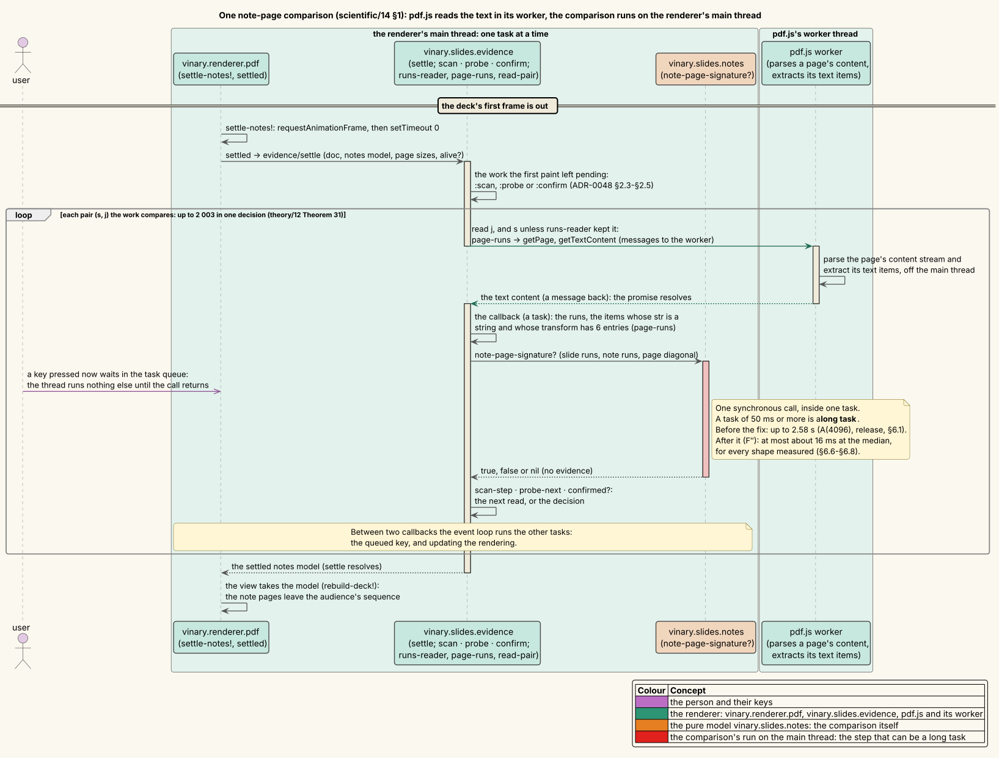
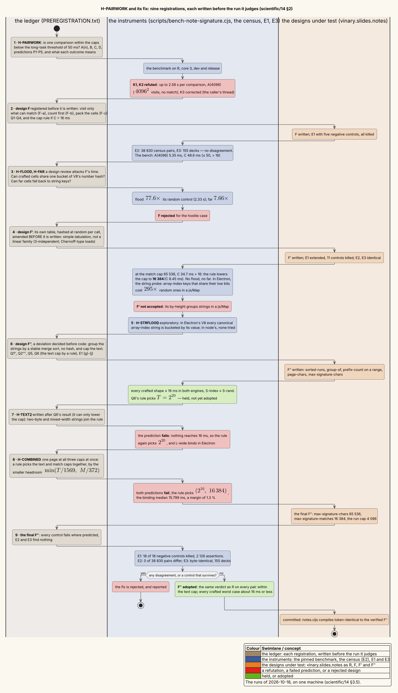
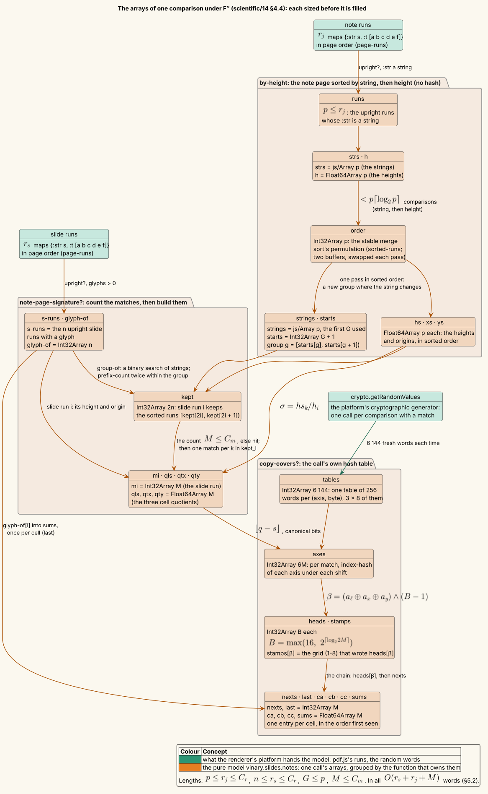

# 14 — The cost of one note-page comparison

**Status: complete.** This page records the pre-registered experiment *H-PAIRWORK* and the fix it led to,
*H-PAIRWORK-FIX*, run on 2026-10-18. Every hypothesis, prediction and decision rule was written into an append-only
ledger before the run it judges ([`data/14/PREREGISTRATION.txt`](data/14/PREREGISTRATION.txt)). The fix went through
three designs, F, F′ and F″. F″ shipped.

- **The defect.** Under the caps as they were, one comparison of two pages could hold the thread that calls it for
  **2.58 s**. In the GUI that thread is the renderer's. The worst case is two pages of 4 096 runs of one string, timed
  in the release build. That is 51 times the 50 ms threshold of a *long task* [LONGTASKS], and a decision makes up to
  2 003 comparisons (theory/12 Theorem 31). The claim that the caps "keep a hostile PDF from making the background
  comparison slow" was false (§6.1).
- **Two hash floods were found on the way, and both were measured.** Design F keyed its cells by numbers. V8 hashes
  numbers without a seed, so a page with crafted cells cost F 2.33 s, 77.6 times its random control (§6.3). Electron's
  V8 buckets *array-index strings* (`"0"`, `"2048"`, …) by their numeric value. That defeated design F′, which grouped
  the note page's strings in a `js/Map`: the crafted page cost 17.25 times its control in Electron (§6.5, §6.6).
- **The fix, F″.** F″ uses no hash whose collisions the PDF's author can predict. It groups the note page's runs by
  sorting them with a merge sort, and finds a slide run's group by binary search. Its cells sit in a table of its own,
  hashed by simple tabulation with tables drawn at random on every call, after the pages are fixed [CW79; PT12].
  Every crafted worst case of the benchmark now has a median of at most 16 ms, in
  both node's engine and Electron's, in the release build (§6.6–§6.8). A page that loads all three caps at once costs
  about 16 ms at the median, a margin of 1.3 % that is at the noise floor (§6.8, §10).
- **The verdicts are exactly the same.** §5 proves that F″ returns what the old code returns on every pair whose
  pages are within the new text cap. Three checks agree with the proof (§7):
  - E1, a property test with 2 126 assertions: 0 disagreements, and 18 of 18 negative controls killed;
  - E2, 38 830 pairs of real and synthetic pages: 0 disagreements;
  - E3, the CLI's decision for 155 decks: byte-identical output.
- **What changed in behaviour.** Two caps changed. `max-signature-matches` fell from 65 536 to 16 384, and a new
  `max-signature-chars` caps a page's text at 65 536 UTF-16 code units. A pair over either cap now gives no evidence,
  `nil`. No measured page comes within a factor of 41 of either cap: the largest counts are 372 matches and 1 569 code
  units (§3.2).
- **Refuted predictions are kept.** Three of them failed:
  - H-TEXT2's prediction of which shape binds, and of the cap it would pick;
  - H-COMBINED's two predictions (§6.7, §6.8).

The experiment tests
[ADR-0048 §2.2 — The note-page signature](../design-decisions/0048-speaker-notes-and-linked-presenter-windows.md) and
answers findings F10 and F11 of [theory/12](../theory/12-speaker-notes-detection.md) §7.3. It follows
[07 — Measurement methodology](07-measurement-methodology.md), and its registrations are pre-registration in the sense
of [PREREG]:

1. predict before measuring;
2. write the prediction down;
3. record the raw data ([`data/14/`](data/14/README.md));
4. keep whatever is refuted.

---

## 1 · The question and the terms

A Beamer deck typeset with `\setbeameroption{show notes}` carries a page of speaker notes after each slide that has a
`\note`, and the default note template draws a small copy of the slide, a *thumbnail*, at the top of that page. When
the page labels cannot tell which pages are notes, the detector compares a page with the slide before it and asks
whether the page holds a scaled copy of the slide's text. That comparison is $`\textsf{SIG}(s, j)`$,
`vinary.slides.notes/note-page-signature?` (ADR-0048 §2.2; its geometry is proved in theory/12 §3).

The comparison runs **synchronously, on the thread that calls it**. In the GUI that is the renderer's main thread. The
renderer's `settled` (in `vinary.renderer.pdf`) starts `vinary.slides.evidence/settle`, which reads page text through
pdf.js. pdf.js extracts the text in its worker, and the comparison then runs inside the promise callback that receives
it. That callback is one task of the renderer's event loop, and a task runs to completion: while the comparison runs,
the thread handles no input event and does not update the rendering [HTML-EL].



*Who does what when the background compares two pages. pdf.js's worker extracts each page's text, and the comparison
runs on the renderer thread inside the callback that receives it. A comparison of 50 ms or more is a long task. Teal
is the renderer (its main thread and pdf.js's worker), orange the pure model `vinary.slides.notes`, and the red bar
the comparison's run, the step that can become a long task.*

*Diagram source: [`../diagrams/seq-note-signature-thread.puml`](../diagrams/seq-note-signature-thread.puml).*

**The question.**

1. How long can one comparison take within the caps meant to bound it?
2. If it is too long, which design brings the worst case under budget without changing a single verdict?

The terms used throughout follow.

| Term | Meaning |
|---|---|
| run | One text item of a page as `vinary.slides.evidence/page-runs` keeps it: a map `{:str s :t [a b c d e f]}` of pdf.js's string and its transform. The transform's entries are page units (bp, $`1/72`$ inch), with y up. `page-runs` keeps only items whose `str` is a string and whose transform is an array of 6 entries. |
| upright, height $`h`$, origin | A run is **upright** when its transform has no turn or shear beyond rounding (`upright?`). Its **height** is $`h = \mathrm{hypot}(c, d)`$ (`run-height`), which is positive for an upright run, may be $`+\infty`$ and is never NaN. Its **origin** is $`(x, y) = (e, f)`$. |
| glyphs $`g`$ | The characters of a run's string that are not white space (`glyphs`); 0 when `:str` is not a string. |
| slide page $`s`$, note page $`j`$ | The two pages of one comparison: $`s`$ the slide, $`j`$ the candidate note page. |
| $`r_s`$, $`r_j`$ | The number of runs on each page. |
| $`T_s`$, $`T_j`$ | Each page's **text**: the total length of its runs' strings, in UTF-16 code units (`page-chars`). |
| $`\Gamma`$, need | $`\Gamma`$ is the slide's glyphs over its upright runs. A copy must cover at least $`\mathit{need} = \Gamma / 2`$ of them. |
| visit | A pair (slide run, note run) of equal strings, both upright. The old code examined every visit. $`P_{\mathrm{eq}}`$ is their number. |
| scale $`\sigma`$, match | For a visit, $`\sigma = h_{\text{note}} / h_{\text{slide}}`$. A visit with $`0 < \sigma \le 0.4`$ (`max-thumbnail-scale`) is a **match**. $`M`$ is the number of matches of a pair. |
| cell, grid | A match's cell is three integers computed from its scale and offset. The **eight grids** are shifted by half a cell along each axis (theory/12 §3.2). A *copy* is the matches in one cell. |
| the caps | `max-signature-runs` $`C_r`$ (4 096 runs a page), `max-signature-chars` $`C_c`$ (new: 65 536 code units a page) and `max-signature-matches` $`C_m`$ (was 65 536; now 16 384). A pair over a cap gives `nil`, no evidence. |
| long task | A task that occupies the event loop for 50 ms or more [LONGTASKS]. A task runs to completion, so for its duration the thread handles no input event and does not update the rendering [HTML-EL]. |
| the budget | **16 ms** for one comparison, at the median, on the machine of §3.5. A machine three times slower then stays below the long-task threshold: $`3 \times 16 = 48 < 50`$. |
| R | The **reference**: `note-page-signature?` as of commit `2b78f18`, kept verbatim in `vinary.slides.notes-reference` ([`notes_reference.cljs`](../../test/vinary/slides/notes_reference.cljs)). |
| F, F′, F″ | The three designs of the fix (§4). F″ is the one committed. |
| dev, release | The two builds the benchmark times. **dev** is the compiled `test` build, development-mode ClojureScript as the renderer's development build runs it. **release** is the `:simple`-compiled `cli` build, which compiles `vinary.slides.notes` as the shipped bundles do. |
| node, Electron | The two JavaScript engines. **node** is node v26.11.1 (V8 14.6.202.34). **Electron** is Electron 42.5.0 run as node (`ELECTRON_RUN_AS_NODE=1`; V8 14.8.178.33): the V8 of the app's renderer, though not its renderer process (§10). |
| hash flooding | Choosing the keys of a hash table so that they share a bucket, which turns each operation from $`O(1)`$ into $`O(n)`$ [CROSBY]. |

---

## 2 · The hypotheses, as pre-registered

The ledger holds nine registrations in the order they were made. Each states its predictions, and the consequence of
each outcome, before the run it judges. When a result opened a question, the next registration was written before
anything was built on that result. The table quotes the predictions in short; the ledger is verbatim.

| # | Registration | What it predicted | Outcome |
|---|---|---|---|
| 1 | **H-PAIRWORK** (§6.1) | P1: A(4096) takes 0.5–5 s, so the caps' claims K1 and K2 are false. P2: A is quadratic. P3: B < 100 ms. P4: C ≥ 50 ms. P5: D < 1 ms. Release within 0.3–1.5 times dev. | All held. **K1 and K2 refuted**: up to 2.58 s per comparison. K3 corrected. |
| 2 | **H-PAIRWORK-FIX**, design F (§6.2) | Q1: A(4096), B ≤ 10 ms, D ≤ 1 ms. Q2: C ≤ 50 ms, and above 16 ms the match cap is lowered by a rule. Q3: E1, E2 and E3 find no disagreement. Q4: everything green. | Q1 held. Q2 held narrowly (48.6 ms). Q3 held. A design review then raised two attacks on F's time, so the cap rule was not applied. |
| 3 | **H-FLOOD, H-FAR** (§6.3) | F's crafted cells cost at least 10 times its random ones (flood), and its string fallback at least 5 times (far). The reference shows neither. | Both held: 77.6 times and 7.66 times. **F rejected.** |
| 4 | **H-PAIRWORK-FIX′**, design F′, amended before it was written (§6.4) | Q1′ as Q1. Q2′: C, rand, flood and far ≤ 16 ms, or else lower the cap by a rule. Q2″: no flood. Q2‴: no far. Q3′: E1 with negative controls, E2, E3. Electron replicates both. | Q1′ held. Q2′ failed at 65 536, and **the rule set the cap to 16 384**. Q2″, Q2‴, Q3′ and the replication held. The registered contingency then fired (row 5). |
| 5 | **H-STRFLOOD**, exploratory (§6.5) | No prediction: which string keys pile into one bucket of a `js/Map`? | In Electron's V8, every canonical array-index string. In node's, none tried. **F′ not accepted.** |
| 6 | **H-PAIRWORK-FIX″**, design F″ (§6.6) | Q1″ as Q1, in each engine. Q2⁗: at the cap 16 384, C, rand, flood and far ≤ 16 ms with no flood and no far. Q5: no string flood. Q6: a rule sets the text cap, predicted at $`T \ge 2^{17}`$. Q3″, Q4″. | All held. Q6's rule picked $`2^{20}`$, but it was not adopted yet (row 7). |
| 7 | **H-TEXT2**, an amendment to Q6 written after its result (§6.7) | The rule applies to four shapes, including two with two-byte strings. L-mixed binds, and the rule picks $`2^{17}`$. | **The prediction failed on both parts**: nothing reached 16 ms, so the rule picked $`2^{20}`$, and L-wide bound in Electron. |
| 8 | **H-COMBINED** (§6.8) | One page at all three caps. A rule picks the text and match caps together. No point with $`M = 16\,384`$ meets the budget, and the rule picks $`(2^{19}, 8\,192)`$. | **Both predictions failed.** The rule picked $`(2^{16}, 16\,384)`$: `max-signature-chars` 65 536, `max-signature-matches` 16 384. |
| 9 | **F″ final**: controls, unit build, E2, E3 (§7) | Every negative control fails where predicted; E2 and E3 find nothing. | 18 of 18 controls killed; 0 disagreements; E3 byte-identical. |



*How each registration led to the next. Each result either confirmed a design or opened the question that the next
registration answered. Tan steps are entries of the ledger, written before the runs they judge; slate steps are the
instruments' runs; orange steps are the designs under test; green steps are outcomes that held or were adopted; red
steps are refutations and rejections.*

*Diagram source: [`../diagrams/activity-note-signature-cost.puml`](../diagrams/activity-note-signature-cost.puml).*

---

## 3 · The instruments

### 3.1 · The benchmark

[`scripts/bench-note-signature.cjs`](../../scripts/bench-note-signature.cjs) times one call of
`note-page-signature?` on synthetic page pairs. It loads the compiled namespace without running anything else:

- `--bundle=dev` loads `dist/test/test.js` minus its last module, the test runner's main;
- `--bundle=release` loads `dist/cli/vv-cli.js` with the call to the CLI's main replaced by an export of the two
  namespaces it needs.

The pages are vectors of runs built exactly as `page-runs` builds them, on Beamer's page of
$`362.835 \times 272.126`$ bp ($`128 \times 96`$ mm), whose diagonal $`d \approx 453.5`$ bp gives the offset cell width
$`w_t = 0.005\,d \approx 2.27`$ bp. Every case first checks the comparison's result against the expected value, then
makes its warm-up calls, then its timed calls, each timed with `process.hrtime.bigint`. It reports the median, the
95th percentile by nearest rank, the minimum and the maximum, and `VV_BENCH_JSON=<path>` writes every sample. The
cases follow; "runs" are the slide's and the note page's.

| Case | The pages | Result | What it loads |
|---|---|---|---|
| A($`n`$), $`n \in \{512, 1024, 2048, 4096\}`$ | both pages $`n`$ runs `"x"` at height 10 on a grid, so $`\sigma = 1 > 0.4`$ | false | every visit, no match: $`n^2`$ visits (the case of theory/12 F11) |
| B | slide 4 096 runs `"x"` at 10, note 4 096 at 1 ($`\sigma = 0.1`$) | nil | the match cap: every visit matches, and the cap trips |
| C | slide 16 runs `"x"` at 10 at $`(20i, 20i)`$ and one run of 1 000 `"z"`; note $`M/16`$ runs `"x"` at 1 at seeded random positions | false | $`M`$ matches, by default the cap; *need* is 508 characters and at most 16 can be covered, so all eight grid passes run in full |
| D | 60 distinct words and their thumbnail at $`\sigma = 0.25`$, plus 30 words of note text | true | a real-sized pair: the control |
| rand, flood, far | slide 16 runs `"x"` at 10, all at the origin, and the run of 1 000 `"z"`; note $`M/16`$ runs `"x"`, each placed so that its cell is a chosen triple $`(a_k, b_k, c_k)`$ in all eight grids (below) | false | $`M`$ matches in $`M/16`$ cells: **rand** draws the triples at random, **flood** chooses triples whose number keys share one bucket of V8's hash, **far** puts $`b_k`$ beyond $`\pm 65\,535`$ |
| S-index, S-rand | both pages 4 096 runs at height 10, $`\sigma = 1`$; the strings are the decimal numerals of $`2048k`$, $`k = 0, \dots, 4095`$, or of $`2048k + u_k`$ with $`u_k \in [1, 2047]`$ at random | false | the grouping and the look-ups alone; S-index's strings are array indices whose values share their low 11 bits |
| L-prefix, L-equal, L-wide, L-mixed ($`T`$) | both pages 4 096 runs of $`\ell = T / 4096`$ code units at height 10, $`\sigma = 1`$; distinct strings with a common prefix of $`\ell - 2`$ units (one-byte, two-byte, or half of each), or one string repeated | false | the text: every comparison of two strings reads the common prefix |
| X-prefix, X-equal, X-wide, X-mixed ($`T`$, $`M`$) | L's pages at $`T`$ with C's match block put in: 16 slide runs and $`M/16`$ note runs carry a string `Xs` of the kind's prefix and two units no other string has | false | all three caps at once: 4 096 runs and $`T`$ code units a page, exactly $`M`$ matches |

**The shaped cells.** The cases rand, flood and far choose each note run's cell. A note run with cell
$`(a_k, b_k, c_k)`$ is placed at

```math
h_k = 10 \cdot e^{(a_k + 3/4)\, w_\ell}, \qquad (x_k,\ y_k) = \bigl((b_k + \tfrac{3}{4})\, w_t,\ (c_k + \tfrac{3}{4})\, w_t\bigr), \qquad w_\ell = \ln 1.02 .
```

Its scale against a slide run at the origin is $`\sigma_k = h_k / 10`$, and its offset is $`(x_k, y_k)`$ itself. So
each cell quotient is an integer plus $`\tfrac{3}{4}`$, and both shifts floor it to the same integer:
$`\lfloor q \rfloor = \lfloor q - \tfrac{1}{2} \rfloor`$. The scale index ranges over $`a_k \in [-200, -48]`$, so that
$`\sigma_k \le 1.02^{-47.25} \approx 0.392 \le 0.4`$ and every pair is a match. The instrument recomputes every cell as
the comparison does, in both shifts, and refuses to run if one differs or if two note runs share a cell.

**The flood's model of V8.** Design F keyed a cell by one packed double,
$`P = (a + 2^{16})\,2^{34} + (b + 2^{16})\,2^{17} + (c + 2^{16})`$. V8 hashes a number outside the int32 range by its
64 bits, with Thomas Wang's integer mix `ComputeLongHash` [V8-UTILS], [V8-OBJ], with no seed:

```
⟨ComputeLongHash(bits)⟩ ≡                                   V8 14.x, src/utils/utils.h
  h ← ¬bits + (bits << 18)          (all arithmetic modulo 2⁶⁴)
  h ← h ⊕ (h >> 31);  h ← 21·h;  h ← h ⊕ (h >> 11);  h ← h + (h << 6);  h ← h ⊕ (h >> 22)
  return h ∧ (2³⁰ − 1)               ⟨a Smi; a js/Map's bucket is its low bits⟩
```

flood searches random triples for $`M/16`$ whose hashes agree in their low $`\log_2(M/32)`$ bits: at $`M = 65\,536`$,
4 096 cells in one bucket of a 2 048-bucket table, found in 8 253 387 draws (2.4 s, before timing). If the model were
not V8's hash, flood would cost what rand costs. That is part of what H-FLOOD tests (§6.3).

### 3.2 · The census of real pages

[`scripts/exp-note-signature-census.cjs`](../../scripts/exp-note-signature-census.cjs) reads every page of a list of
PDFs with pdf.js, builds the runs as `page-runs` does, and visits **every ordered pair $`(s, j)`$ with $`s < j`$** of
each deck. Every pair the detector can compare (the probe's $`(a - 1, a)`$, the scan's, CONFIRM's) is such a pair, so
the maxima over all of them bound what any real decision asks of the caps. Per pair it counts the runs, the visits and
the matches, without caps. Per page it counts the text $`T`$ and the longest run. With `--differential` it also calls
R and the code under test on every pair, and counts where they differ (E2, §7.2). The list file must lie outside the
repository: the output names groups, never a file, a path or a page's text.

The lists cover three groups. The **local real decks** are the decks that experiment 12's classifier finds among
2 469 local PDFs: 29 decks, 9 of which are this repository's own fixtures and are counted with them. That leaves 20:
12 slide exports and 8 Beamer decks. The **experiment-13 artifacts** are its 146 small Beamer decks of run 1 (§3 of
[13](13-speaker-note-detection.md)). The **fixtures** are the 9 PDFs under `test/fixtures/`.

| Group | Files | Pages | Pairs | Most runs on a page | Most visits in a pair (p99) | Most matches in a pair | Most text on a page, code units (p99) |
|---|---|---|---|---|---|---|---|
| local slide exports | 12 | 656 | 30 679 | 443 | 15 400 (124) | 372 | 1 569 (1 319, all real decks) |
| local Beamer decks | 8 | 271 | 5 303 | 283 | 2 204 (508) | 0 | 1 489 |
| experiment 13 and fixtures | 155 | 959 | 2 848 | 15 | 10 | 7 | 126 |

The longest single run on a real page has 176 code units. No real pair comes within a factor of 9 of the run cap or
of 41 of either new cap: $`4096 / 443 = 9.2`$, $`65\,536 / 1\,569 = 41.8`$, and $`16\,384 / 372 = 44.0`$. No pair of a
local real deck holds a text thumbnail: R's verdict on all 35 982 of them is false.

### 3.3 · E1: the property test

[`notes_signature_equivalence_test.cljs`](../../test/vinary/slides/notes_signature_equivalence_test.cljs) compares the
code with R on generated and crafted pairs. R lives in a test-only namespace,
[`notes_reference.cljs`](../../test/vinary/slides/notes_reference.cljs). It is `2b78f18`'s code verbatim, renamed,
with the helpers the fix did not touch (`run-height`, `upright?`, `glyphs`, `rotated-date?`, the tolerances, the
caps and the eight grids) read from `vinary.slides.notes` itself. So a cap rebound with `set!` in a test applies to
both, and the two differ only in what the fix changed. The generators are seeded (xorshift32), so every run tests the
same pairs. They build thumbnail copies at and around $`\sigma = 0.4`$, offsets on and beside cell boundaries, noise,
many runs of one string, magnitudes that underflow, overflow or are not numbers, and transforms that are not upright.

| Test | What it checks | Pairs | R's verdicts (true / false / nil) |
|---|---|---|---|
| 1 `…-on-generated-pairs` | the code equals R at the real caps | 24 000 (seed 20261018) | 6 172 / 17 737 / 91 |
| 2 `…-around-a-small-match-cap` | the same, with the match cap rebound to every value 0 … 144 | 4 800 (seed 14) | `nil` is reached at every cap above 0 |
| 3 `…-at-a-match-cap-of-65536` | three crafted pairs at the old cap, rebound to 65 536 for the test's duration: 64 slide runs `"x"` against $`C_m/64`$ note runs at $`\sigma = 0.1`$, exactly $`C_m`$ matches placed where a copy covers; the same with one more matched pair, $`C_m + 1`$; and the matches of the first against a slide that also holds 1 000 characters no note run repeats | 3 | true / false / nil, one each |
| (j) `…-at-the-real-match-cap` | the same three, built at the cap in force | 3 | one each |
| (a) `an-index-hash-depends-only-on-the-index-class` | $`-0`$ and $`+0`$ hash alike, and so do three NaN bit patterns (`0x7FF8000000000000`, `0xFFF8000000000000`, `0x7FF0000000000001`); distinct indices (0, $`\pm 1`$, $`\pm 65\,535`$, $`\pm 65\,536`$, $`\pm 2^{53}`$, $`\pm 10^{300}`$, $`\pm\infty`$) hash through all 8 bytes | — | — |
| (b) `the-tables-are-fresh-on-every-call` | 6 144 words a call, and two draws differ | — | — |
| (c) `…-on-general-path-pairs` | cells whose indices are huge, infinite, NaN or $`\pm 0`$ | 6 000 (seed 65536) | 3 638 / 2 339 / 23 |
| (d) `…-when-every-cell-collides` | the hash tables redefined to all zeros, so every cell of a grid shares bucket 0 and the chains carry the whole grouping | 4 000 + 2 000 | 1 013 / 2 971 / 16 and 1 201 / 796 / 3 |
| (e) `prefix-count-is-the-linear-count-on-a-sweep-of-heights` | one string's heights: 2 000 log-spaced values from $`5 \times 10^{-324}`$ to $`10^{300}`$, and $`+\infty`$. Each value of the sweep is also a slide height $`h_s`$, and the doubles next to $`0.4\,h_s`$ are added for it. The binary search must equal a linear count, for the bounds 0 and 0.4, on the whole range; for every 50th slide height (40 of them), also on every range of 9 consecutive heights | — | — |
| (f) `a-nan-index-is-one-cell-whatever-its-bits`, `a-zero-index-is-one-cell-whatever-its-sign` | one crafted pair each, where the grouping decides the verdict: three slide runs whose copies' offsets are NaN with two different bit patterns and $`+\infty`$; three whose copies' offsets are $`+0`$, $`-0`$ and $`0.7\,w_t`$. Each runs 40 times, so 40 fresh draws of the tables | 1 + 1 | true, both |
| (g) `…-on-adversarial-strings` | the numerals of $`2048k`$ (array indices), long common prefixes, prefixes of each other, lone surrogates and units near `0xD800`–`0xDFFF` and `0xFFFF`, `""` and white space, and non-string `:str` values | 6 000 (seed 2048) | 3 327 / 2 661 / 12 |
| (h) `the-text-cap-bounds-each-page` | a page of exactly $`C_c`$ code units is compared, one more on either page gives `nil`, a non-string counts 0, a rotated run counts | — | — |
| (i) `the-merge-sort-is-the-stable-sort` | the merge sort equals `Array.prototype.sort` (stable since ES2019) by the same key | 2 000 inputs | — |

A test is trusted only once it has failed where predicted. Each **negative control** is a one-line mutation of the
code that E1 was predicted to detect, and E1 must fail on it at the named tests (§7.1) [MUTATION].

### 3.4 · E3: the decisions of real decks

`vv --cli --deck-info` prints one line per PDF with the deck's notes decision: the hidden pages, the proof and the
reason. E3 runs it with the `:simple` release CLI of `2b78f18` and with that of each design, over the 155 files of
§3.2's second and third groups, and compares the outputs byte for byte. Those decisions take every path that compares
pages, as the table counts them from the output lines.

| Decision (proof, or reason) | Files | Pages compared? |
|---|---|---|
| notes hidden; proof scan | 34 | yes |
| notes hidden; proof labels, probe | 8 | yes |
| notes hidden; proof labels, probe, confirm | 8 | yes |
| notes hidden; proof labels, confirm | 15 | yes |
| shown as it is; reason `confirm-failed` | 10 | yes |
| shown as it is; reason `probe-undecided` | 4 | yes |
| shown as it is; reason `no-note-pages` | 31 | some: a scan or a probe that found no note page compares pages; the label automaton's `:none` does not |
| notes hidden; proof labels | 24 | no |
| split pages (a second screen) | 7 | no |
| shown as it is; reasons `invalid` 5, `undecidable` 4, `labels-not-integers` 4, `not-beamer` 1 | 14 | no |

### 3.5 · Conditions

All timings were taken on one machine: an AMD Ryzen Threadripper PRO 5975WX (Zen 3, 32 cores, 64 threads, up to
4 561.8 MHz, `amd-pstate-epp`). The benchmark was pinned with `taskset -c 3` to core 3, whose SMT sibling is 35, under
the `performance` governor; no other pinned work used core 3 or 35. Each arm started only when the one-minute load
average was below 12, checked by the runner. The machine was shared with background processes that were not pinned to
core 3; the environment files list the busiest of them for each run. The ledger records the load at the start and end of each arm, and
§8 notes one arm that started above it. Engines: node v26.11.1 (V8 14.6.202.34-node.37), and Electron 42.5.0 as node
(node 24.17.0, V8 14.8.178.33-electron.0). The census, E1's controls and E3 ran on cores 4–7, 12–19 or 24–31, never
alongside a timed arm.

---

## 4 · The designs

Each design is given as literate pseudocode [KNUTH-LP]. A named chunk $`\langle\ldots\rangle \equiv`$ is defined once
and used by its name elsewhere, and the reason for a step stands beside it in angle brackets, often naming the lemma
of §5 that justifies it. §4.5 maps each chunk to the code.

### 4.1 · R, the reference

R is the code before the fix. It groups the note page's upright runs by string in a ClojureScript hash map. Then, for
each slide run, it visits every note run of the same string:

```
⟨SIG_R(slide, note, diag)⟩ ≡                                      vinary.slides.notes-reference
  if r_s > C_r or r_j > C_r then return nil
  S ← the slide's upright runs with a glyph, in page order;  Γ ← Σ gᵢ
  if Γ = 0 then return ⟨the empty-slide rule: ROTATED-DATE, theory/12 §3.8⟩
  by-str ← the note page's upright runs, grouped by string, each group in page order
  w_t ← max(10⁻⁹, 0.005 · diag)
  matches ← []
  for i ← 1 … n, and once more after the last do
    if |matches| > C_m then return nil                          ⟨checked BEFORE the end test⟩
    if i > n then leave the loop
    for each run k of by-str[str(sᵢ)] do                        ⟨every visit: P_eq of them in all⟩
      σ ← h_k / hᵢ
      if 0 < σ ≤ 0.4 then append (i, ln σ, x_k − σ xᵢ, y_k − σ yᵢ)
  return ⟨copy-covers?_R(matches, need = Γ / 2)⟩

⟨copy-covers?_R(matches, need)⟩ ≡
  for each of the eight shift vectors (s_ℓ, s_x, s_y) ∈ {0, ½}³ do
    seen ← an empty js/Map;  sums ← an empty js/Map            ⟨keyed by strings⟩
    for each match (i, ℓ, t_x, t_y), in order do
      key ← str(⌊ℓ/w_ℓ − s_ℓ⌋) "," str(⌊t_x/w_t − s_x⌋) "," str(⌊t_y/w_t − s_y⌋)
      if i ∉ seen[key] then                                     ⟨a slide run counts once per copy⟩
        add i to seen[key];  sums[key] ← sums[key] + gᵢ
        if sums[key] ≥ need then return true
  return false
```

Its time is $`O(r_s + r_j + P_{\mathrm{eq}})`$, where $`P_{\mathrm{eq}} \le r_s r_j`$ is the number of visits. The
match cap counts only the matches, so it does not bound the visits (theory/12 F11). Two pages of 4 096 runs of one
string at one height make $`4096^2 \approx 1.68 \times 10^7`$ visits and no match.

### 4.2 · F: visit only what can match, count before building, pack the cells

Design F made three changes. Each was proved to leave the verdict unchanged.

- **F-a: the kept runs are an index range.** Within one string's group sorted by height, the runs that can match slide
  run $`i`$, those with $`0 < h/h_i \le 0.4`$, form one contiguous range $`[\mathit{lo}, \mathit{hi})`$. Two binary
  searches find it, in $`O(\log r_j)`$ per slide run (Lemma 2 below).
- **F-b: count first.** The total $`\sum (\mathit{hi} - \mathit{lo})`$ decides `nil` before any match is built, because
  R's cap check precedes its end test and the count only grows (Lemma 5). The matches are then built into typed arrays
  of exactly that size.
- **F-c: number keys.** A cell's three indices were packed into one exact double $`P`$ (§3.1) when each lies within
  $`\pm 65\,535`$, and into R's string key otherwise. The per-cell set of slide runs became a "last slide run counted"
  (Lemma 9).

F removed the visits. H-FLOOD and H-FAR then showed that F-c could itself be attacked (§6.3). V8 hashes a number key
without a seed, so crafted cells share one bucket. A cell far off the page falls back to R's string keys and their
cost.

### 4.3 · F′: a table of its own, hashed at random

F′ kept F-a and F-b and replaced F-c. Its cells live in a hash table on typed arrays that belongs to the call. A cell's
bucket comes from **simple tabulation** [CW79], [PT12]: each of the 24 bytes of a cell's three indices (8 bytes each,
in their canonical encoding) selects a random 32-bit word from its own table, and the words are XORed. The 24 tables
of 256 words are drawn from `crypto.getRandomValues` on every call [WEBCRYPTO]. The PDF is fixed before the tables are
drawn, so no PDF can aim at them (§5.3).

F′ still grouped the note page's strings in a `js/Map`, as F and R did. In node's V8, string keys are hashed with a
seed. In Electron's they are not, for array-index strings (§6.5). So F′'s grouping could be flooded in the engine the
GUI runs on (§6.6).

### 4.4 · F″: sort, search, and tabulate

F″, the committed design, keeps F-a, F-b and F′'s table, and changes two things. It **groups the strings by sorting**,
not by hashing. And it **caps the text**, because sorting and searching strings costs time that grows with their
length.

```
⟨SIG(slide, note, diag)⟩ ≡                                                note-page-signature?
  if r_s > C_r or r_j > C_r or T_s > C_c or T_j > C_c then return nil    ⟨the text cap is F″'s⟩
  S ← the slide's upright runs with a glyph, in page order;  Γ ← Σ gᵢ
  if Γ = 0 then return ⟨the empty-slide rule, as R⟩
  ⟨sort the note page's runs by string, then height⟩                     by-height
  w_t ← max(10⁻⁹, 0.005 · diag)
  ⟨count the matches; return nil above the cap⟩
  ⟨build the matches into typed arrays⟩
  return ⟨copy-covers?(…, need = Γ / 2)⟩
```

The runs are sorted, not hashed. Comparing strings costs time that grows with their length, which is why the text cap
exists. No choice of strings can slow a sort by comparisons [KNUTH-3] beyond its comparison count:

```
⟨sort the note page's runs by string, then height⟩ ≡                      by-height, sorted-runs
  U ← the note page's upright runs whose :str is a string, in page order;  p ← |U|
  π ← the indices 0 … p−1, sorted by a bottom-up MERGE SORT on the key
        (str(U_k), h(U_k)): the string in UTF-16 code-unit order, then the height;
        on a tie the left run's element goes first, so the sort is stable  ⟨Lemma 3⟩
  hs, xs, ys ← the heights and origins of U in the order π                 ⟨Float64Arrays⟩
  strings, starts ← one entry per maximal block of equal strings in that order:
        the string, and where its block begins; starts gets one more entry, p
                                                                           ⟨string g's runs are [starts_g, starts_{g+1})⟩
```

Each slide run then finds its group by binary search, and its matches by two more:

```
⟨count the matches; return nil above the cap⟩ ≡
  m ← 0
  for i ← 0 … n−1, and once more after the last do
    if m > C_m then return nil                       ⟨before the end test, as R: nil iff M > C_m (Lemma 5)⟩
    if i = n then leave the loop
    g ← group-of(strings, str(sᵢ))                   ⟨binary search with compare; −1 when absent (Lemma 4)⟩
    if g ≥ 0 then
      lo ← prefix-count(hs, starts_g, starts_{g+1}, hᵢ, 0)
      hi ← prefix-count(hs, starts_g, starts_{g+1}, hᵢ, 0.4)
      kept[i] ← [lo, hi);  m ← m + (hi − lo)         ⟨the runs with 0 < h/hᵢ ≤ 0.4 (Lemma 2)⟩

⟨prefix-count(H, from, to, h, b)⟩ ≡
  ⟨the first index k in [from, to) with ¬(H_k / h ≤ b), or to; the k with H_k / h ≤ b are a prefix (Lemma 2)⟩
  lo ← from;  hi ← to
  while lo < hi do
    mid ← ⌊(lo + hi) / 2⌋
    if H_mid / h ≤ b then lo ← mid + 1 else hi ← mid
  return lo

⟨build the matches into typed arrays⟩ ≡
  mi ← Int32Array(m);  qls, qtx, qty ← Float64Array(m)
  j ← 0
  for i ← 0 … n−1 do
    for k ∈ kept[i] do                                ⟨grouped by slide run, i ascending (Lemma 9)⟩
      σ ← hs_k / hᵢ
      mi_j ← i;  qls_j ← ln σ / w_ℓ;  qtx_j ← (xs_k − σ xᵢ) / w_t;  qty_j ← (ys_k − σ yᵢ) / w_t
      j ← j + 1                                       ⟨the doubles R computes in each pass (Lemma 6)⟩
```

`copy-covers?` keeps R's eight grids, its cell formula and its verdict. Its cells live in the call's own table:

```
⟨copy-covers?(glyph-of, mi, qls, qtx, qty, need)⟩ ≡
  if m = 0 then return false
  tables ← 6 144 random 32-bit words: one table of 256 per (axis, byte)  ⟨crypto.getRandomValues, every call⟩
  for each match k: its six per-axis hashes, axes_k ← ⟨index-hash of ⌊q − s⌋ for each axis q and shift s ∈ {0, ½}⟩
  B ← the least power of two ≥ max(16, 2m)
  heads, stamps ← Int32Array(B);  nexts, last ← Int32Array(m);  ca, cb, cc, sums ← Float64Array(m)
  for grid g ← 0 … 7, with shifts (s_ℓ, s_x, s_y), tag ← g + 1 do      ⟨a stamp marks a bucket written by this grid⟩
    cells ← 0
    for k ← 0 … m−1 do
      (a, b, c) ← (⌊qls_k − s_ℓ⌋, ⌊qtx_k − s_x⌋, ⌊qty_k − s_y⌋);  i ← mi_k
      β ← (axes_k[ℓ, s_ℓ] ⊕ axes_k[x, s_x] ⊕ axes_k[y, s_y]) ∧ (B − 1)
      chain ← heads_β if stamps_β = tag, else −1
      cell ← the first cell on chain with indices SameValueZero to (a, b, c), or −1   ⟨Lemmas 7, 8⟩
      if cell = −1 then
        create cell number `cells`: its indices (a, b, c), nexts ← chain, heads_β ← it, stamps_β ← tag,
          last ← i, sums ← gᵢ;  cells ← cells + 1
        if gᵢ ≥ need then return true
      else if last_cell = i then skip                ⟨i is counted in this cell already (Lemma 9)⟩
      else
        last_cell ← i;  sums_cell ← sums_cell + gᵢ
        if sums_cell ≥ need then return true
  return false

⟨index-hash(tables, axis x, v)⟩ ≡                                         SIMPLE TABULATION
  β ← the 64 bits of v, canonical: −0 as +0, and every NaN as 0x7FF8000000000000
  return ⊕ over the bytes j = 0 … 7 of β: tables[(8x + j)·256 + byte_j(β)]
```

The data F″ builds for one comparison, and how each array is indexed:



*The arrays one comparison builds under F″, from the pages' runs to the cells of one grid. Teal records are what the
renderer's platform hands the model: pdf.js's text runs, through `page-runs`, and the random words of
`crypto.getRandomValues`. Orange records are the arrays of the pure model `vinary.slides.notes`, and the paler orange
packages group them by the function that owns them: `by-height`, `note-page-signature?` and `copy-covers?`. Every
array is sized before it is filled.*

*Diagram source: [`../diagrams/object-note-signature-layout.puml`](../diagrams/object-note-signature-layout.puml).*

### 4.5 · From the design to the code

Every line number below is in [`src/vinary/slides/notes.cljs`](../../src/vinary/slides/notes.cljs).

| Design | Code |
|---|---|
| the caps $`C_r`$, $`C_c`$, $`C_m`$ | `max-signature-runs` (173–178), `max-signature-chars` (180–184), `max-signature-matches` (186–190) |
| $`\sigma \le 0.4`$, the tolerances | `max-thumbnail-scale` (160–163), `scale-tolerance` (165–167), `offset-tolerance` (169–171) |
| upright runs, heights, glyphs | `run-height` (192), `upright?` (194–198), `glyphs` (207–210) |
| the empty-slide rule | `rotated-date?` (214–221) |
| $`w_\ell`$, the shifts, the eight grids | `log-scale-cell` (223–225), `half-cell` (227–229), `grid-shifts` (231–233) |
| simple tabulation | `hash-tables` (235–243), `index-hash` (245–262) |
| cell equality (SameValueZero) | `same-index?` (264–268) |
| the table and the eight passes | `copy-covers?` (270–364) |
| the text $`T`$ | `page-chars` (366–369) |
| the merge sort | `sorted-runs` (371–396) |
| the groups, $`h`$, $`x`$, $`y`$ in sorted order | `by-height` (398–430) |
| a string's group | `group-of` (432–442) |
| the kept range | `prefix-count` (444–453) |
| $`\textsf{SIG}`$: the checks, the count, the build | `note-page-signature?` (455–526) |

---

## 5 · Proofs

§5.1 proves that F″ returns what R returns, §5.2 bounds its cost, and §5.3 bounds the cost of its hash table against
any PDF. Each lemma is proved in full. Facts taken from a standard are cited to their section.

### 5.1 · Equivalence

**Notation.** $`\mathbb{F}`$ is the set of IEEE 754 binary64 values: the finite doubles, $`\pm\infty`$ and NaN.
$`\mathrm{fl}(x \circ y)`$ is the double JavaScript computes for $`x \circ y`$ with $`\circ \in \{+, -, \times, /\}`$.
$`<_{\mathrm{cu}}`$ is the lexicographic order of strings by UTF-16 code units, in which a proper prefix comes first.
$`\mathrm{SVZ}(x, y)`$ is SameValueZero on Numbers: $`x`$ and $`y`$ are equal as numbers (so $`+0`$ equals $`-0`$),
or both are NaN [ECMA-262 §6.1.6.1.15].

**Premises.** The theorems hold under three premises. P3 is needed only in §5.3.

- **P1.** Every entry of a run's transform is a Number, and every `:str` is a primitive string or not a string at
  all. pdf.js's text items satisfy this.
- **P2.** Within one execution, `Math.log` and `Math.hypot` return the same double whenever they are called with the
  same arguments. ECMA-262 leaves these functions implementation-approximated. Their implementations in V8 are
  deterministic functions of their arguments.
- **P3.** `crypto.getRandomValues` fills its array with independent, uniformly distributed 32-bit words
  [WEBCRYPTO].

**Arithmetic.** ECMA-262 defines the result of `+`, `-`, `*` and `/` on finite operands as *the Number value for* the
exact result. That value is the member closest to the exact result of the set
$`S = \{\text{finite doubles}\} \cup \{-2^{1024}, 2^{1024}\}`$. A tie goes to the member with an even significand.
Afterwards $`\pm 2^{1024}`$ is replaced by $`\pm\infty`$, and $`+0`$ by $`-0`$ when the exact result is negative.
"This procedure corresponds exactly to the behaviour of the IEEE 754-2019 roundTiesToEven mode" [ECMA-262 §6.1.6.1],
[IEEE754 §4.3.1]. Write $`\mathrm{rnd}(u)`$ for this rounding of a real $`u`$. Division adds the special cases that
apply here [ECMA-262 §6.1.6.1.5]: $`x / {+\infty} = +0`$ for finite $`x \ge 0`$, $`{+\infty} / y = +\infty`$ for finite
$`y > 0`$, and $`{+\infty} / {+\infty} = \mathrm{NaN}`$.

**Lemma 1 (rounding is monotone).** If $`u \le v`$ are reals, then $`\mathrm{rnd}(u) \le \mathrm{rnd}(v)`$.

*Proof.* Let $`b`$ and $`a`$ be the members of $`S`$ chosen for $`u`$ and $`v`$. Suppose $`a < b`$. Since $`a`$ is
closest to $`v`$, $`\lvert v - a \rvert \le \lvert v - b \rvert`$, so $`v \le (a + b)/2`$. Since $`b`$ is closest to
$`u`$, $`\lvert u - b \rvert \le \lvert u - a \rvert`$, so $`u \ge (a + b)/2`$. Then
$`(a + b)/2 \le u \le v \le (a + b)/2`$, so $`u = v`$. Equal reals are rounded alike, tie-break included, so
$`a = b`$, which contradicts $`a < b`$. So $`b \le a`$. The final replacements preserve this order:
$`\pm 2^{1024} \mapsto \pm\infty`$ keeps the extremes extreme, and $`-0`$ and $`+0`$ are equal as numbers. ∎

**Lemma 2 (a slide run's matches are one range).** Let $`H_{\mathit{from}} \le \dots \le H_{\mathit{to}-1}`$ be heights
in $`(0, +\infty]`$. Let $`h \in (0, +\infty]`$ be a slide run's height and $`b \in \{0, 0.4\}`$ a bound, and write
$`q_k = \mathrm{fl}(H_k / h)`$. Then:

1. the indices $`k`$ with $`q_k \le b`$ form a prefix $`[\mathit{from}, e_b)`$ of $`[\mathit{from}, \mathit{to})`$;
2. `prefix-count(H, from, to, h, b)` returns $`e_b`$;
3. $`\{k \in [\mathit{from}, \mathit{to}) : 0 < q_k \le 0.4\} = [e_0, e_{0.4})`$, and $`e_0 \le e_{0.4}`$.

*Proof.*

1. If $`h`$ is finite, then $`q_k = \mathrm{rnd}(H_k / h)`$ for finite $`H_k`$. The exact quotients do not decrease
   with $`k`$, so by Lemma 1 neither do the $`q_k`$, and an infinite $`H_k`$, which comes last, gives
   $`q_k = +\infty`$. If $`h = +\infty`$, then $`q_k = +0`$ for every finite $`H_k`$ and NaN for $`H_k = +\infty`$.
   The finite heights come first, $`0 \le b`$ holds, and `NaN ≤ b` is false. In both cases, $`q_k \le b`$ and
   $`k' < k`$ imply $`q_{k'} \le b`$.
2. The loop keeps an invariant: every index in $`[\mathit{from}, \mathit{lo})`$ satisfies $`q \le b`$, and every index
   in $`[\mathit{hi}, \mathit{to})`$ does not. The invariant holds at the start, when both ranges are empty. If
   $`q_{\mathit{mid}} \le b`$, item 1 extends the first range to $`\mathit{mid}`$, and the loop sets
   $`\mathit{lo} = \mathit{mid} + 1`$. Otherwise item 1 extends the second range, and the loop sets
   $`\mathit{hi} = \mathit{mid}`$. The interval shrinks at every step. When $`\mathit{lo} = \mathit{hi}`$, that index is
   $`e_b`$.
3. $`q \le 0`$ implies $`q \le 0.4`$, so $`e_0 \le e_{0.4}`$. An index lies in $`[e_0, e_{0.4})`$ exactly when
   $`\neg(q_k \le 0)`$ and $`q_k \le 0.4`$. The second condition excludes NaN, and for a number that is not NaN,
   $`\neg(q \le 0)`$ is $`q > 0`$. ∎

R keeps a visit when `(and (pos? sigma) (<= sigma 0.4))`, that is, when $`q > 0`$ and $`q \le 0.4`$. It computes the
same double $`q`$, because $`h_k`$ is `run-height` of the same transform (P2).

**Lemma 3 (the merge sort is the stable sort).** Let $`K(k) = (\mathit{strs}_k, \mathit{hs}_k)`$, and let $`\prec`$ be
the order of the indices by $`K`$, the string by $`<_{\mathrm{cu}}`$ and then the height by $`\le`$, with ties broken by
the index. `sorted-runs` returns the indices $`0, \dots, p - 1`$ in $`\prec`$ order, and makes fewer than
$`p \lceil \log_2 p \rceil`$ comparisons.

*Proof.* $`<_{\mathrm{cu}}`$ is a strict total order on strings (Lemma 4), and $`\le`$ is total on heights, which are
never NaN. So $`\prec`$ is a strict total order, and it has one sorted order. The invariant at the start of the pass of
width $`w`$ is this: for every $`\mathit{lo}`$ divisible by $`w`$, the buffer's positions
$`[\mathit{lo}, \min(p, \mathit{lo} + w))`$ hold exactly those indices, in $`\prec`$ order. It holds for $`w = 1`$.

A pass merges two adjacent blocks $`[\mathit{lo}, \mathit{mid})`$ and $`[\mathit{mid}, \mathit{hi})`$. Every index of
the left block is smaller than every index of the right one. The merge outputs the left head when the right block is
used up, or when `ahead?` holds, that is, when $`K(\text{left}) \le K(\text{right})`$ in the key order. For a left
index $`a`$ and a right index $`b > a`$, this is exactly $`a \prec b`$:

- a strictly smaller key gives $`a \prec b`$;
- a tie gives $`a \prec b`$ because $`a < b`$;
- a strictly larger key gives $`b \prec a`$.

So each step outputs the $`\prec`$-smaller of the two heads. A merge of two sorted lists that always takes the smaller
head outputs their sorted union, so the invariant holds for $`2w`$. The loop stops when $`w \ge p`$, with one block
in $`\prec`$ order. `ahead?` is called only while both blocks are non-empty, so merging blocks of $`x`$ and $`y`$
elements calls it at most $`x + y - 1`$ times. A pass therefore makes fewer than $`p`$ comparisons, and there are
$`\lceil \log_2 p \rceil`$ passes. ∎

The result is also what `Array.prototype.sort` returns for the same comparator. That sort is stable
[ECMA-262 §23.1.3.30.1], and a stable sort by a total preorder has only one result. Test (i) checks this.

**Lemma 4 (strings: the comparison, the groups, the look-up).**

1. For strings $`x`$ and $`y`$, `cljs.core/compare` returns a negative number, 0 or a positive number exactly when
   $`x <_{\mathrm{cu}} y`$, $`x = y`$ or $`y <_{\mathrm{cu}} x`$. It reads at most
   $`3\,(1 + \min(\lvert x \rvert, \lvert y \rvert))`$ code units.
2. The groups of `by-height` are the maximal blocks of equal strings in $`\prec`$ order, and their strings ascend
   strictly.
3. `group-of` returns the group whose string is $`s`$, or $`-1`$ when there is none.

*Proof.*

1. The compiled `compare` first tests `x === y`, which is true exactly for equal strings. Neither argument is `nil` or
   a number. A string does not satisfy `IComparable`: the build extends that protocol to no native type (checked in
   the compiled `cljs.core`). So `compare` returns `goog.array.defaultCompare(x, y)`, which is
   `x > y ? 1 : x < y ? -1 : 0`. On strings, `<` is IsLessThan, which compares code units from the first until two
   differ, and orders a proper prefix first [ECMA-262 §7.2.12]. Each of `===`, `>` and `<` reads at most
   $`1 + \min(\lvert x \rvert, \lvert y \rvert)`$ units of each string.
2. The string is the first component of $`\prec`$, so equal strings are contiguous in the sorted order. `by-height`
   starts a group at position 0 and wherever the string differs from the one before. It tests this with `not=`,
   which on two strings is `!==`. So each group is one maximal block, and the strings of consecutive groups ascend
   strictly.
3. `group-of` is a binary search over strictly ascending strings with a three-way comparison. Its invariant is that
   if $`s`$ is present, it lies in $`[\mathit{lo}, \mathit{hi})`$. It returns the middle index on equality, and
   $`-1`$ once the interval is empty. ∎

**Lemma 5 (the counts, and `nil`).** For each slide run $`i`$, F″'s count $`\mathit{hi}_i - \mathit{lo}_i`$ is the
number of matches R appends for $`i`$. Let $`M = \sum_i (\mathit{hi}_i - \mathit{lo}_i)`$. Then F″ returns `nil` at its
count exactly when R returns `nil` at its cap check, and that is when $`M > C_m`$.

*Proof.* For run $`i`$, R visits the runs of `by-str[str(sᵢ)]`. These are the note page's upright runs whose `:str` is
that string: a string key equals only that string (P1). R keeps those with $`0 < q \le 0.4`$. F″'s group holds the
same runs, because `by-height` keeps every upright run whose `:str` is a string and Lemma 4 finds the group. By
Lemma 2 its range $`[\mathit{lo}, \mathit{hi})`$ is exactly the runs with $`0 < q \le 0.4`$. A missing group gives 0
in both. Both loops test "count above the cap" *before* the end test, so the test also runs after the last slide run.
The count only grows, so each loop returns `nil` exactly when its final count exceeds $`C_m`$. Both final counts are
$`M`$. ∎

**Lemma 6 (the same doubles).** Take a match of slide run $`i`$ with note run $`k`$, and let
$`\sigma = \mathrm{fl}(h_k / h_i)`$. F″ stores $`\mathit{qls} = \mathrm{fl}(\mathrm{fl}(\ln \sigma) / w_\ell)`$ and
$`\mathit{qtx} = \mathrm{fl}(\mathrm{fl}(x_k - \mathrm{fl}(\sigma x_i)) / w_t)`$, and $`\mathit{qty}`$ likewise. R
computes the same values in every pass. So both compute the same cell indices
$`\lfloor \mathrm{fl}(q - s) \rfloor`$.

*Proof.* R stores $`\ell = \mathrm{fl}(\ln \sigma)`$ and $`t_x = \mathrm{fl}(x_k - \mathrm{fl}(\sigma x_i))`$, and in
each pass it computes $`\mathrm{fl}(\ell / w_\ell)`$ and $`\mathrm{fl}(t_x / w_t)`$. These are the same operations,
in the same order, on the same doubles (P1, P2). $`w_\ell`$ is the same constant, and
$`w_t = \max(10^{-9}, 0.005\, d)`$ is the same expression. An IEEE operation is a function of its operands. ∎

**Lemma 7 (R's cell key names a SameValueZero class).** For doubles,
`str(a) "," str(b) "," str(c)` equals `str(a′) "," str(b′) "," str(c′)` exactly when
$`\mathrm{SVZ}(a, a') \wedge \mathrm{SVZ}(b, b') \wedge \mathrm{SVZ}(c, c')`$. That conjunction is `same-index?`,
component by component.

*Proof.* ClojureScript's `str` of one value is `[x].join("")`, which applies ToString, and for a number that is
Number::toString [ECMA-262 §7.1.19, §6.1.6.1.20]. Its output never holds a comma. It is `"NaN"`, `"Infinity"`,
`"-Infinity"` or `"0"`, or else a decimal numeral: digits, at most one point, an optional exponent `e±…`, and an
optional leading minus. So a key splits uniquely at its two commas, and two keys are equal exactly when their three
parts are. It remains to show that $`\mathrm{toString}(x) = \mathrm{toString}(y)`$ exactly when $`\mathrm{SVZ}(x, y)`$.

- If $`\mathrm{SVZ}(x, y)`$, then either both are NaN and print `"NaN"`, or they are the same double, or they are
  $`\pm 0`$, which both print `"0"`.
- Conversely, `"NaN"`, `"Infinity"`, `"-Infinity"` and `"0"` come only from NaN, $`+\infty`$, $`-\infty`$ and
  $`\pm 0`$. For a finite non-zero $`x`$, Number::toString writes the digits of an integer $`s`$ and the place of
  its point, where $`n`$, $`k`$ and $`s`$ are chosen so that $`\mathbb{F}(s \times 10^{n-k}) = x`$. So the string
  denotes the real number $`\pm s \times 10^{n-k}`$, and $`x`$ is the double that real rounds to. Two finite non-zero
  doubles with the same string are rounded from the same real, so they are equal.

`same-index?` is `(or (== x y) (and (not (== x x)) (not (== y y))))`: equal as numbers, or both NaN. That is
SameValueZero. ∎

**Lemma 8 (the table finds the cell).** In every pass of `copy-covers?`:

1. `index-hash` depends only on an index's SameValueZero class. So matches whose index triples are SameValueZero fall
   into one bucket.
2. During grid $`g`$, for every bucket $`\beta`$ with $`\mathit{stamps}_\beta = g + 1`$, the chain from
   $`\mathit{heads}_\beta`$ through `nexts` lists exactly the cells created so far in grid $`g`$ whose bucket is
   $`\beta`$. A bucket with any other stamp holds no cell of grid $`g`$.
3. A look-up returns the cell whose indices are SameValueZero to $`(a, b, c)`$ if grid $`g`$ has created one, and
   $`-1`$ otherwise. So the cells of a grid correspond one to one to the SameValueZero classes of the index triples its
   matches reach: by Lemma 7, exactly R's keys.

*Proof.*

1. `index-hash` writes $`+0`$ for $`\pm 0`$ and any other index that is not NaN as it is. A Float64Array stores a
   double that is not NaN with its exact bits [ECMA-262 §25.1.3.17]. Every NaN skips the write and takes the one
   pattern `0x7FF8000000000000`. The hash is a function of those bits, and a cell's bucket is the XOR of its three
   axes' hashes, masked.
2. By induction over the matches of grid $`g`$. At the start no bucket carries the stamp $`g + 1`$: stamps start at 0,
   and grid $`g`$ alone writes $`g + 1`$. A new cell $`n`$ takes $`\mathit{nexts}_n`$ = the current chain (the head if
   stamped $`g + 1`$, else $`-1`$) and becomes the head, with the stamp $`g + 1`$. The chain then lists $`n`$, followed
   by the bucket's earlier cells of grid $`g`$. Nothing else writes `heads`, `stamps` or `nexts`. A cell of an earlier
   grid is on no chain of grid $`g`$, because such a chain starts at a head written in grid $`g`$ and follows `nexts`
   written in grid $`g`$. Cell $`n`$'s indices, last run and sum are written when it is created, before anything reads
   them.
3. By item 1, a cell SameValueZero-equal to $`(a, b, c)`$ is in the match's bucket, and by item 2 it is on that
   bucket's chain. The walk stops at the first equal cell. A cell is created only when no equal cell exists, so a
   class has at most one cell. ∎

**Lemma 9 (a slide run counts once per copy).** In every pass, a cell's sum is the *coverage* of its matches: the sum
of $`g_i`$ over the distinct slide runs $`i`$ among them.

*Proof.* The build writes the matches of slide run 0, then those of run 1, and so on, so $`\mathit{mi}`$ never
decreases. Claim: when match $`k`$ of slide run $`i`$ reaches cell $`c`$, run $`i`$ is already counted in $`c`$
exactly when $`\mathit{last}_c = i`$.

- If $`\mathit{last}_c = i`$, then $`i`$ was counted, because `last` is only ever set to a run that was added to the
  cell's sum.
- Conversely, suppose $`i`$ was counted at an earlier match $`k' < k`$. Then every match between $`k'`$ and $`k`$ is
  of run $`i`$, since $`\mathit{mi}`$ never decreases. Each of those that reached $`c`$ left $`\mathit{last}_c = i`$,
  and no other match writes $`\mathit{last}_c`$.

So each distinct slide run is added once. R's per-cell sets give the same coverage. ∎

**Theorem 10 (equivalence).** Let the caps $`C_r`$, $`C_c`$ and $`C_m`$ be in force, with R reading $`C_r`$ and
$`C_m`$ from the same namespace. Under P1 and P2, for every slide page, note page and diagonal:

1. if either page has more than $`C_r`$ runs, F″ and R both return `nil`;
2. otherwise, if either page's text exceeds $`C_c`$ code units, F″ returns `nil`;
3. otherwise, F″ returns exactly what R returns.

*Proof.* Items 1 and 2 are the first checks of each. For item 3, both compute the slide's runs, their glyphs and
$`\Gamma`$ with the same code, and apply the same rule when $`\Gamma = 0`$. Otherwise, by Lemma 5 both return `nil`
exactly when $`M > C_m`$. Suppose $`M \le C_m`$. By Lemmas 5 and 6, F″ builds R's matches: the same multiset of values
$`(i, q_\ell, q_x, q_y)`$. F″ lists each slide run's matches by height, where R lists them in page order, and both
list the slide runs in ascending order. In each grid, both put two matches into one cell exactly when their index
triples are SameValueZero (Lemmas 7 and 8). Both return true as soon as a cell's sum reaches *need*. Sums only grow,
so each returns true exactly when some grid has a cell whose final sum reaches *need*, and false otherwise. A cell's
final sum is its coverage in both (Lemma 9), and the coverage is a function of the set of the cell's slide runs, which
is the same in both. So the verdicts agree. ∎

The behaviour changed against `2b78f18` only through the caps. The cap $`C_m`$ fell from 65 536 to 16 384, so a pair
with $`16\,384 < M \le 65\,536`$ now gives `nil`. And a page beyond $`C_c = 65\,536`$ code units now gives `nil`. No
measured page reaches either (§3.2). E1 tests Theorem 10 with R at the new caps; test 3 rebinds $`C_m`$ to 65 536.

### 5.2 · Cost

**Theorem 11 (the cost of one comparison).** Let $`p \le r_j`$ be the note page's upright runs with a string. Let
$`M' = M`$ when $`M \le C_m`$, and $`M' = 0`$ otherwise. Then one comparison under F″ takes time

```math
O\bigl((r_s + r_j + T_s + T_j)\,\log(2 + r_j)\bigr) \;+\; O(M') \text{ in expectation over the tables, for every input,}
```

and $`O(r_s + r_j + M')`$ words of memory besides the pages themselves.

*Proof.*

1. **The checks.** `page-chars` on both pages: $`O(r_s + r_j)`$. The slide's glyphs, one regular-expression
   replacement per run: $`O(r_s + T_s)`$.
2. **The sort.** By Lemma 3, fewer than $`p \lceil \log_2 p \rceil`$ comparisons. A comparison reads at most
   $`3\,(1 + \min(\lvert x \rvert, \lvert y \rvert))`$ code units (Lemma 4), plus one comparison of heights. In a merge
   pass, each comparison outputs one element, the smaller head, so charge it to that element. Its cost is at most
   $`3\,(1 + \lvert \text{its string} \rvert) + 1`$. Each element is output once per pass, so a pass costs
   $`O(p + T_j)`$, and the sort $`O((p + T_j) \log p)`$.
3. **The groups.** One `not=` per position, each at most $`1 + `$ the length of that position's string:
   $`O(p + T_j)`$.
4. **The look-ups.** Per slide run, `group-of` makes at most $`\lceil \log_2(p + 1) \rceil`$ comparisons of
   $`O(1 + \lvert s_i \rvert)`$ each, and the two `prefix-count`s $`O(\log p)`$ steps each. In all,
   $`O((r_s + T_s) \log p)`$.
5. **The build.** $`O(M')`$.
6. **`copy-covers?`.** Drawing the 6 144 words is constant. The six hashes of each match read 48 table entries:
   $`O(M')`$. Then eight passes of $`M'`$ look-ups, each walking fewer than 1.5 cells in expectation
   (Corollary 13): $`O(M')`$.

Memory: `kept` holds $`2n`$ entries; the sort's two buffers, the strings, `starts`, `hs`, `xs` and `ys` hold $`O(p)`$;
the matches hold $`4M'`$; the per-match hashes hold $`6M'`$; and the table holds fewer than
$`2(4M' + 16) + 6M'`$ words (`heads` and `stamps`, then six arrays of one entry per cell), plus the 6 144 words of the
tables. ∎

At the caps, $`p \le 4096`$, so $`\log_2 p \le 12`$. The sort makes fewer than 49 152 comparisons, which read at most
about $`12 \times 3 \times (4096 + 65\,536) \approx 2.5 \times 10^6`$ code units. The passes walk about
$`8 \times 1.5 \times 16\,384 \approx 2 \times 10^5`$ cells in expectation. §6.8 measures the time.

### 5.3 · The hash table against any PDF

A cell's hash is the XOR of 24 random table words, one per (axis, byte) of its three canonical indices. The PDF is
fixed before the tables are drawn, and the tables never leave the call.

**Proposition 12 (two cells share a bucket with probability exactly $`1/B`$).** Assume P3. Take two cells whose index
triples differ in SameValueZero class on some axis. Over the draw of the tables, the probability that they share a
bucket is exactly $`1/B`$.

*Proof.* Canonicalization maps distinct SameValueZero classes to distinct 64-bit patterns:

- a double that is neither zero nor NaN keeps its bits, and no other double has them;
- $`\pm 0`$ both map to the pattern of $`+0`$, which nothing else has;
- every NaN maps to `0x7FF8000000000000`, which is a NaN pattern and so belongs to no other double.

So the two cells' 24 bytes differ at some position $`(x^*, j^*)`$, with bytes $`u \ne u'`$ there. The XOR of the two
hashes is $`T_{x^*, j^*}[u] \oplus Y`$, where $`Y`$ is $`T_{x^*, j^*}[u']`$ XORed with the entries of the other 23
positions. Those are other words, because $`u' \ne u`$ and the other positions use other tables. So
$`T_{x^*, j^*}[u]`$ is uniform and independent of $`Y`$, and the XOR is uniform over 32-bit words. The two cells share
a bucket exactly when the low $`\log_2 B`$ bits of that XOR are zero, which has probability $`2^{-\log_2 B} = 1/B`$.
$`B`$ divides $`2^{32}`$, since $`B \le 32\,768`$. ∎

**Corollary 13 (the expected walk).** For every input, a look-up walks at most $`1 + (D - 1)/B < 1.5`$ cells in
expectation, where $`D \le m`$ is the number of cells of the grid. So a pass costs $`O(m)`$ in expectation.

*Proof.* `same-index?` decides which matches form which cell, not the tables (Lemma 8). So the $`D`$ cells of a grid
are fixed before the draw. A look-up of cell $`c`$ walks at most $`c`$ itself and the other cells in its bucket, that
is, $`1 + \sum_{c' \ne c} [c' \text{ shares } c\text{'s bucket}]`$. By Proposition 12 and linearity of expectation,
the expected value is at most $`1 + (D - 1)/B`$. Since $`B \ge 2m \ge 2D`$, this is below $`1 + 1/2`$. ∎

**What is not claimed.** Simple tabulation is 3-independent and not 4-independent [PT12 §1, §6.1], citing
[WC81]. Pătraşcu and Thorup prove Chernoff-type concentration of its bucket loads [PT12, Theorem 1], with constants
that depend on the number of characters, here 24. No numeric tail bound is derived here. What any input costs is
measured instead (§6.4–§6.8). The table draw costs 24 KiB of random bytes per call with a match, which is below
getRandomValues's limit of 65 536 bytes per call [WEBCRYPTO].

---

## 6 · Results

Times are in milliseconds, at the median of each case's timed runs unless stated otherwise. Every case returned its
registered value in every arm, and every instrument check passed before any timing.

### 6.1 · H-PAIRWORK: the comparison as it was

Both arms ran on `2b78f18` between 11:18 and 11:21, at a load of about 10. The registered instrument ran unchanged:
[`dev.txt`](data/14/dev.txt), [`release.txt`](data/14/release.txt), their samples in `dev.json` and `release.json`,
and [`environment.txt`](data/14/environment.txt). Medians, with the minimum in parentheses:

| Case | dev | release | Visits | ns per visit (dev / release) |
|---|---|---|---|---|
| A(512) | 47.7 (47.4) | 41.8 (41.0) | 262 144 | 182 / 159 |
| A(1024) | 191.0 (189.5) | 161.3 (160.7) | 1 048 576 | 182 / 154 |
| A(2048) | 754.8 (749.8) | 643.5 (642.1) | 4 194 304 | 180 / 153 |
| A(4096) | **2 991.0** (2 981.9) | **2 576.5** (2 571.8) | 16 777 216 | 178 / 154 |
| B | 35.3 (26.8) | 23.6 (23.3) | 69 632 | — |
| C | 592.9 (542.1) | 525.5 (499.4) | 65 536 matches, 8 full passes | — |
| D | 0.185 (0.157) | 0.152 (0.133) | 60 | — |

- **P1 held.** A(4096) took 2 991 ms in dev, inside the registered $`[0.5, 5]`$ s.
- **P2 held: A is quadratic.** In dev, $`A(4096)/A(2048) = 3.96`$ and $`A(2048)/A(1024) = 3.95`$. In release, 4.00 and
  3.99.
- **P3 held.** B took 35.3 ms, about $`1/85`$ of A(4096): the match cap does bound the counted pairs.
- **P4 held.** C took 592.9 ms: `copy-covers?` at the match cap is itself a long task.
- **P5 held.** D took 0.185 ms.
- **The release arm.** It gave the same ordering, at 0.67 to 0.89 times dev's medians
  ([`arm-ratios.txt`](data/14/arm-ratios.txt)).

**The verdict: K1 and K2 are refuted.** Within the caps, one comparison held the thread for up to 2.58 s in release,
51 times the long-task threshold, and 0.53 s at the match cap (C). Already A(1024), two pages of 1 024 runs of one
string, is a 161 ms task. With up to 2 003 comparisons per decision (theory/12 Theorem 31), a hostile PDF could hold
the renderer for about $`2003 \times 2.58\ \mathrm{s} \approx 86`$ minutes, in tasks of 2.6 s each. K3 was corrected
either way: the comparison runs on the calling thread, not in pdf.js's worker (theory/12 F10).

### 6.2 · Design F

F ran on the same instrument between 12:00:44 and 12:00:50
([`quiet/fixed-release.txt`](data/14/quiet/fixed-release.txt), [`quiet/fixed-dev.txt`](data/14/quiet/fixed-dev.txt)).
The load was 13.00, above the registered 12 (§8).

| Case | release | dev | Before (release / dev) |
|---|---|---|---|
| A(512) | 0.733 | 1.127 | 41.8 / 47.7 |
| A(1024) | 1.440 | 1.412 | 161.3 / 191.0 |
| A(2048) | 2.763 | 2.792 | 643.5 / 754.8 |
| A(4096) | 5.350 | 5.866 | 2 576.5 / 2 991.0 |
| B | 3.627 | 4.195 | 23.6 / 35.3 |
| C | 48.555 | 61.177 | 525.5 / 592.9 |
| D | 0.111 | 0.126 | 0.152 / 0.185 |

- **Q1 held, and A became linear.** A(4096) took 5.35 ms, B 3.63 ms and D 0.111 ms. The ratios
  $`A(4096)/A(2048) = 1.94`$ and $`A(2048)/A(1024) = 1.92`$ show the linear scaling.
- **Q2 held, but narrowly.** C took 48.6 ms against the bound of 50; dev's 61.2 ms would not have held. Because C was
  above 16 ms, the registered rule called for lowering the match cap.

The rule was not applied, because a design review of F had raised two attacks on the time of F-c that this benchmark
cannot see. The review's figures are model output, not measurements. So the attacks were registered as H-FLOOD and
H-FAR and measured before anything was built on F.

### 6.3 · H-FLOOD and H-FAR: design F's cells attacked

Both arms of each build ran between 12:17:41 and 12:33:59, each started below a load of 12
([`flood/summary.txt`](data/14/flood/summary.txt), and one `.txt` and `.json` per arm). The instrument's checks
passed: 4 096 distinct cells in every shape, all 65 536 matches counted ($`\sigma \le 0.3923`$), and C-flood's cells
all in one bucket of the modelled 2 048-bucket table. Medians, with the 95th percentile in parentheses:

| Shape | reference, release | reference, dev | F, release | F, dev |
|---|---|---|---|---|
| C | 615.310 (736.320) | 666.164 (814.671) | 49.382 (71.555) | 60.147 (68.992) |
| C-rand | 487.695 (512.974) | 534.202 (659.770) | 30.041 (36.769) | 42.036 (44.624) |
| C-flood | 473.517 (521.999) | 524.412 (623.831) | **2 330.927** (2 359.181) | **2 271.273** (2 275.331) |
| C-far | 487.622 (545.743) | 506.009 (623.178) | **230.141** (268.599) | 227.807 (231.390) |

- **H-FLOOD held.** F's $`\text{C-flood} / \text{C-rand} = 77.6`$ in release (54.0 in dev), against the predicted
  "at least 10". The reference's ratio was 0.971 (dev 0.982), within the predicted "at most 2". The instrument's model
  of V8's number hash is V8's: cells it puts in one bucket cost F 2.33 s, and cells it spreads cost 30 ms.
- **H-FAR held.** F's $`\text{C-far} / \text{C-rand} = 7.66`$ (dev 5.42), against "at least 5". F's string fallback
  costs what the reference's keys cost. It still saves the visits, so it is faster than the reference, but not by
  much.

**Consequence, as registered: F-c is rejected** for the hostile case, and F′-c replaces it.

The registration also ran a probe as context for F′, with no prediction
([`flood/probe-string-hash.txt`](data/14/flood/probe-string-hash.txt)). It set and got 4 096 keys in a fresh `js/Map`
under node. The numerals of $`2048k`$ took 0.224 ms, random index strings 0.150 ms, and non-index strings 0.134 ms.
Under node, index strings with equal low bits do not pile up, so the registration kept a `js/Map` with string keys for
F′'s grouping.

### 6.4 · Design F′

F′ ran between 13:02:09 and 13:03:31, at loads of 7.10 to 8.21 ([`fprime/bench/`](data/14/fprime/bench/summary.txt)).

| Arm | A(4096) | B | D | C | C-rand | C-flood | C-far |
|---|---|---|---|---|---|---|---|
| node, release, $`M = 65\,536`$ | 5.463 | 3.958 | 0.133 | 34.684 | 28.625 | 28.595 | 29.976 |
| node, dev, $`M = 65\,536`$ | 5.592 | 4.208 | 0.144 | 37.873 | 33.224 | 34.426 | 34.553 |
| node, release, $`M = 32\,768`$ | | | | 17.192 | 12.747 | 12.186 | 12.695 |
| node, release, $`M = 16\,384`$ | | | | 8.446 | 6.700 | 5.795 | 5.813 |
| node, release, $`M = 8\,192`$ | | | | 4.110 | 3.464 | 2.893 | 2.887 |
| Electron, release, F | | | | | 31.316 | **2 695.591** | **175.835** |
| Electron, release, F′ | | | | | 31.569 | 31.281 | 31.104 |

- **Q1′ held.** A(4096) took 5.46 ms, B 3.96 ms and D 0.133 ms.
- **Q2′ failed at the cap 65 536**: all four shapes exceeded 16 ms (C 34.7). The registered fallback lowers the cap to
  the largest power of two $`X \ge 8\,192`$ at which all four medians are at most 16 ms. $`X = 32\,768`$ fails
  (C 17.19), and $`X = 16\,384`$ passes, with C's 8.45 ms the largest of the four. So **`max-signature-matches`
  became 16 384**. The margin over real decks is $`16\,384 / 372 = 44`$.
- **Q2″ held: no flood.** $`\text{C-flood} / \text{C-rand} = 0.999`$ at 65 536, and 0.956, 0.865 and 0.835 at 32 768,
  16 384 and 8 192.
- **Q2‴ held: no far.** $`\text{C-far} / \text{C-rand} = 1.047`$, then 0.996, 0.868 and 0.833.
- **The replication in Electron held.** F's flood ratio was 86.1, at least the predicted 10: V8 14.8 hashes numbers
  as V8 14.6 does. F′'s was 0.991.

Some single runs were far above their medians. With 15 runs, the nearest-rank 95th percentile is the maximum. At
65 536, the maxima reached 2.4 times the medians (C: 74.4 ms). At 16 384, C-rand's maximum was 32.2 ms. These single
runs are unattributed (§10).

### 6.5 · H-STRFLOOD: which strings pile up

The F′ registration had named a contingency. If array-index strings defeated a string-keyed `js/Map`, F′ would group
the strings in a table of its own. The probe, run under Electron's V8 as registered, said they do
([`fprime/bench/probe-string-hash-electron.txt`](data/14/fprime/bench/probe-string-hash-electron.txt)). The 4 096
numerals of $`2048k`$ took 36.626 ms, against 0.124 ms for random index strings and 0.122 ms for non-index strings: 295
times. That is the engine of the GUI's renderer. An exploratory probe without prediction then asked which keys pile up
([`strflood/probe-string-keys.cjs`](data/14/strflood/probe-string-keys.cjs), run as
`strflood/{node,electron}.txt`). Each pattern's 4 096 keys were set and got in a fresh `js/Map`, as fresh string
objects on every run, and the median of 15 runs was taken after 5 warm-ups:

| Keys | node v26.11.1 (V8 14.6) | Electron 42.5.0 (V8 14.8) |
|---|---|---|
| array indices $`2048k`$ (up to 7 digits) | 0.658 | **38.198** |
| array indices $`k`$ (consecutive) | 0.478 | 0.609 |
| array indices $`4096k`$ | 0.482 | **37.954** |
| array indices $`2048k + 2^{24}`$ (8 digits) | 0.573 | **39.355** |
| array indices $`65536k`$ (up to 9 digits) | 0.485 | **55.796** |
| integers $`2048k + 2^{32}`$ (not array indices) | 0.521 | 0.479 |
| `"-"`, `"0"` or `"x"` prefixed, or `".5"` appended | 0.43–0.49 | 0.36–0.56 |

In Electron's V8, every canonical array-index string (a decimal integer of at most $`2^{32} - 2`$, with no sign and no
leading zero) is bucketed by the low bits of its value; nothing else tried is. In node's V8, nothing tried is. The
Node.js project describes the cause [NODE-HASHDOS], [CVE-2026-21717]. V8 hashed an array-index string from its value,
unseeded, as `(length << 24) | value`. The seeded replacement was merged into V8 behind the build flag
`v8_enable_seeded_array_index_hash` and shipped in Node.js v20 to v25 in the March 2026 security release. "For Chrome,
where DoS attacks are not applicable, this will be disabled." Electron builds Chromium's V8. The 8- and 9-digit rows
show that the bucketing reaches beyond 24-bit values; how V8 hashes those was not looked up (§9).

**Consequence: F′ is not accepted** for the hostile case, and the amendment H-PAIRWORK-FIX″ was registered before
anything was written. The census then also counted each page's text in code units (§3.2), which bounds what a cap on
the text would cost real decks ([`strflood/census-text.txt`](data/14/strflood/census-text.txt)).

### 6.6 · Design F″

F″ ran between 13:34:18 and 13:34:41, at loads of 5.73 to 6.31 ([`fsec/bench/`](data/14/fsec/bench/summary.txt)).
Release medians, node / Electron:

| Case | node | Electron | dev (node) |
|---|---|---|---|
| A(4096) | 6.092 | 5.265 | 6.343 |
| B | 4.856 | 4.248 | 4.971 |
| D | 0.166 | 0.167 | 0.171 |
| C, $`M = 16\,384`$ | 8.322 | 8.738 | 8.481 |
| C-rand | 5.828 | 6.797 | 7.221 |
| C-flood | 5.803 | 6.822 | 7.293 |
| C-far | 5.871 | 6.867 | 7.236 |
| S-index | 8.335 | 7.744 | 9.028 |
| S-rand | 8.192 | 7.777 | 9.050 |
| F′'s S-index / S-rand, for comparison | 7.245 / 8.067 | **80.621** / 4.674 | |

| $`T`$ | L-prefix, node | L-equal, node | L-prefix, Electron | L-equal, Electron |
|---|---|---|---|---|
| $`2^{15}`$ | 7.902 | 6.247 | 6.559 | 5.498 |
| $`2^{16}`$ | 8.025 | 6.424 | 7.745 | 5.392 |
| $`2^{17}`$ | 8.031 | 6.244 | 6.975 | 5.453 |
| $`2^{18}`$ | 8.520 | 6.692 | 7.034 | 5.576 |
| $`2^{19}`$ | 8.666 | 6.742 | 7.597 | 5.768 |
| $`2^{20}`$ | 9.254 | 7.014 | 9.093 | 5.981 |

- **Q1″ held in each engine**: A(4096) at most 10 ms, B at most 10 ms, D at most 1 ms.
- **Q2⁗ held in each engine.** All four shapes at the cap 16 384 were at most 16 ms. The flood ratio was 0.996 in
  node and 1.004 in Electron, and the far ratio 1.007 and 1.010; all were at most 1.5.
- **Q5 held: no string flood.** F″'s $`\text{S-index} / \text{S-rand}`$ was 1.017 in node and 0.996 in Electron, and
  both were at most 16 ms. F′'s ratio was 17.25 in Electron, at least the predicted 10; in node it was 0.898, at most
  the predicted 2.
- **Q6 held.** All twelve medians were at most 16 ms at every $`T`$, so the rule picked $`T = 2^{20}`$; the
  prediction was $`T \ge 2^{17}`$.

The cap was not adopted at this point. Every string of Q6's two shapes is one-byte, which led to the amendment of
§6.7. Descriptively, with no prediction, F″ at the old cap 65 536 took 38.032 ms for C in node, and 30.936, 29.488 and
31.709 ms for C-rand, C-flood and C-far.

A CPU profile of F″ on the S shapes (descriptive, [`fsec/prof/S-release-self.txt`](data/14/fsec/prof/S-release-self.txt))
spreads the comparison's time over ClojureScript idioms the reference shares. These are `clojure.string/replace` in
`glyphs` (about 12 %), keyword look-ups (9 %), `nth` and vector destructuring (11 %), and `run-height` (7 %). The new
sort and search take about 30 %: `cljs.core/compare` with its protocol check, `group-of`, and `sorted-runs` with its
comparator.

### 6.7 · H-TEXT2: the text cap against two-byte strings

V8 compares two flat strings of one width with its fastest routine. A one-byte string against a two-byte one it
compares unit by unit. Q6's shapes are all one-byte, so the amendment, written after Q6's result and before its value
was adopted, added two shapes and applied the rule to all four. It could only lower the cap. It ran between 13:37:11
and 13:37:28, at loads of 6.47 to 7.06 ([`fsec/text2/`](data/14/fsec/text2/summary.txt)). Release medians:

| $`T`$ | node prefix | node equal | node wide | node mixed | Electron prefix | Electron equal | Electron wide | Electron mixed | Largest |
|---|---|---|---|---|---|---|---|---|---|
| $`2^{15}`$ | 8.079 | 6.083 | 7.970 | 9.477 | 11.152 | 5.452 | 6.685 | 7.997 | 11.152 |
| $`2^{16}`$ | 8.240 | 6.414 | 8.452 | 9.863 | 6.550 | 5.425 | 7.733 | 7.596 | 9.863 |
| $`2^{17}`$ | 8.129 | 6.407 | 8.844 | 11.110 | 7.156 | 5.769 | 7.835 | 9.138 | 11.110 |
| $`2^{18}`$ | 8.296 | 6.522 | 8.248 | 10.187 | 6.876 | 5.407 | 8.931 | 9.508 | 10.187 |
| $`2^{19}`$ | 8.552 | 6.409 | 10.115 | 12.152 | 7.315 | 5.518 | 11.670 | 11.271 | 12.152 |
| $`2^{20}`$ | 9.109 | 6.992 | 12.194 | 14.536 | 8.887 | 5.790 | **15.840** | 14.889 | 15.840 |

All eight medians were at most 16 ms at every $`T`$, so the rule picked the top of the range, $`2^{20}`$.

**The prediction failed on both parts.** It said that L-mixed would bind and that the rule would pick $`2^{17}`$. No
shape reached 16 ms, so the rule picked $`2^{20}`$, and at $`2^{20}`$ the largest median was L-wide's in Electron,
not L-mixed's. L-mixed had the largest median in node at every $`T`$. In Electron, L-wide overtook it at $`2^{19}`$.
From $`2^{15}`$ to $`2^{20}`$, L-wide grew 1.53 times in node and 2.37 times in Electron, L-mixed 1.53 and 1.86 times,
L-prefix 1.13 and 0.80 times, and L-equal stayed flat. So the H-TEXT2 shapes are the ones whose cost grows with the
text, as the amendment supposed. The mechanism, V8's comparison routines, was not measured. At $`2^{20}`$ the margin
was 1.0 % (15.840 against 16). Some 95th percentiles exceeded 16 ms, up to 44.135 ms (Electron L-prefix at
$`2^{15}`$), unattributed; the rule is on medians. H-TEXT2's rule set `max-signature-chars` to 1 048 576, subject to
H-COMBINED, which could only lower it.

### 6.8 · H-COMBINED: one page at all three caps

Every rule so far had sized one cap against a shape that loads only that cap. The budget, though, is one comparison,
and a hostile page can load all three caps at once: 4 096 runs, $`T`$ code units and $`M`$ matches. So H-COMBINED
measured the shapes X(kind, $`T`$, $`M`$) at 18 points: $`T \in \{2^{15}, \dots, 2^{20}\}`$ and
$`M \in \{4\,096, 8\,192, 16\,384\}`$. Each point ran in both engines, in 36 arms between 13:47:21 and 13:48:28, at
loads of 5.49 to 6.80 ([`fsec/combined/`](data/14/fsec/combined/summary.txt)).

**The rule.** $`P`$ is the set of points at which all eight medians (four kinds in two engines) are at most 16 ms. Of
$`P`$, the rule takes the point that maximizes $`\min(T / 1\,569,\ M / 372)`$, the smaller of the two caps' headrooms
over the largest real page. A cap close to real pages is the one an unseen real deck may reach and lose its evidence
at, so the rule pushes the closer of the two caps as far out as the budget allows.

The largest of each point's eight release medians, and the shape that has it:

| $`T`$ | $`M = 4\,096`$ | $`M = 8\,192`$ | $`M = 16\,384`$ |
|---|---|---|---|
| $`2^{15}`$ | 10.046, node mixed | 12.003, node mixed | 16.164, node mixed, **out** |
| $`2^{16}`$ | 10.110, node mixed | 11.894, node mixed | **15.799, Electron mixed** |
| $`2^{17}`$ | 10.371, node mixed | 14.137, Electron mixed | 16.142, Electron mixed, **out** |
| $`2^{18}`$ | 12.055, node mixed | 13.005, node mixed | 16.903, Electron mixed, **out** |
| $`2^{19}`$ | 12.991, Electron mixed | 14.960, Electron mixed | 19.440, Electron mixed, **out** |
| $`2^{20}`$ | 17.341, Electron wide, **out** | 19.443, Electron wide, **out** | 22.614, Electron mixed, **out** |

The eight medians at $`(2^{16}, 16\,384)`$:

| Engine | X-prefix | X-equal | X-wide | X-mixed |
|---|---|---|---|---|
| node | 15.270 | 12.344 | 13.704 | 15.119 |
| Electron | 14.847 | 13.943 | 15.158 | 15.799 |

$`P`$ holds the 11 points not marked out. The objective $`\min(T/1\,569,\ M/372)`$ over them is 41.77 at
$`(2^{16}, 16\,384)`$, 22.02 at every $`M = 8\,192`$ point from $`2^{16}`$ up, 20.88 at $`(2^{15}, 8\,192)`$, and 11.01
at the $`M = 4\,096`$ points. The rule picks $`(2^{16}, 16\,384)`$, uniquely. **Adopted:** `max-signature-chars` is
65 536, lowered from H-TEXT2's 1 048 576, and `max-signature-matches` stays 16 384. The run cap stays 4 096.

**Both predictions failed.** The registration predicted, from an additive estimate, that no point with
$`M = 16\,384`$ would meet the budget. $`(2^{16}, 16\,384)`$ did, by 0.201 ms. It also predicted that the rule would
pick $`(2^{19}, 8\,192)`$, and it picked $`(2^{16}, 16\,384)`$. The estimate was right in scale and wrong in detail. It
gave 16.3 ms for node X-mixed at $`(2^{15}, 16\,384)`$, which measured 16.164, and 16.7 ms at $`(2^{16}, 16\,384)`$,
which measured 15.119. Its error was about $`\pm 1.5`$ ms.

**Read with care.** X's cost cannot fall as $`T`$ grows: the runs and matches are the same, with more text in each
run. Yet at $`M = 16\,384`$ the binding median goes 16.164 (out), 15.799 (in), 16.142 (out) from $`2^{15}`$ to
$`2^{17}`$. Those differences are within run-to-run noise. At $`M = 16\,384`$ and $`T \le 2^{17}`$, the combined worst
case is 16 ms, give or take about half a millisecond. The adopted point meets the budget with a margin of 1.3 %, which
is at the noise floor of the measurement. It is adopted because the registered rule picks it. The constants'
docstrings and this page therefore state the worst case as "about 16 ms", not as a margin. X-mixed binds at 16 of the
18 points, and X-wide at $`2^{20}`$ with $`M = 4\,096`$ and $`8\,192`$. The largest single run of all 36 arms is
37.860 ms (node X-prefix at $`(2^{19}, 16\,384)`$). It is unattributed, and below the long-task threshold.

---

## 7 · Equivalence, checked three ways

Theorem 10 is a proof about the code as written, under premises. Three independent checks test it against the running
code, and each of the three designs went through all three before its result was used.

### 7.1 · E1 and its negative controls

On the final F″ ([`fsec/unit-e1-final.log`](data/14/fsec/unit-e1-final.log)), E1 alone ran 14 tests with 2 126
assertions and 0 failures. The whole unit build ran 874 tests with 46 501 assertions and 0 failures
([`fsec/unit-all-final.log`](data/14/fsec/unit-all-final.log)).

Each negative control is one mutation of the code, applied by a script that checks it occurs exactly once
([`mutate-fsec.py`](data/14/mutate-fsec.py)). Each mutant was compiled into the test build and run against E1 alone,
and then F″ was restored, compared byte for byte, and E1 was run on it again as the control
([`fsec/mutants/summary.txt`](data/14/fsec/mutants/summary.txt)). A control is **killed** when E1 fails on it at
least where predicted. All 18 were. In the table, 1, 2 and 3 are the first three tests of §3.3; the letters are the
others.

| Mutant | The one-line change | Predicted to fail | Failed |
|---|---|---|---|
| m″1 lookup-first-unit | `group-of` compares only the first code unit of each string | (g), 1 | (g), 1, 2, (c), (d) |
| m″2 sort-string-only | the sort ignores the heights | (g), 1 | (g), (i), 1, 2, (c), (d) |
| m″3 group-end-short | a group ends one run early | (g), 1 | (g), 1, 2, 3, (j), (c), (d), both (f) |
| m″4 text-cap-strict | `<` for `<=` against the text cap | (h) | (h) |
| m″5 text-cap-upright | the text counted over upright runs only | (h) | (h) |
| m″6 text-cap-slide | the note page's text not checked | (h) | (h) |
| m″7 merge-pass-short | the sort stops one pass early | (i), 1 | (i), 1, 2, (c), (d), (g) |
| m′1 nan-equal-dropped | `same-index?` is `(== x y)`, so a NaN index never equals itself | (c), (f) | (f) NaN, (c), (d) |
| m′2 signed-zero-hashed | $`-0`$ hashed by its own bits | (a) | (a), (f) zero, (c) |
| m′3 nan-bits-hashed | a NaN hashed by its own bits | (a) | (a), (f) NaN |
| m′4 chain-cut | a new cell's `next` is $`-1`$, so the bucket's older cells are lost | (d) | (d), 1, 2, (c), (g) |
| m′5 equality-partial | the walk compares two of the three indices | (d) | (d), 1, 2, (c) |
| m′6 dedup-off | no "last slide run is $`i`$" branch | 1 | 1, 2, (c), (d) |
| m′7 tables-once | the tables drawn once per process | (b) | (b) |
| m′8 sweep-strict | `prefix-count` compares with `<`, not `<=` | (e), 1 | (e), 1, 2, (c), (d), (g) |
| mE1 lower-bound-dropped | `lo` is the group's start, so $`\sigma = 0`$ from underflow is kept | 1 | 1, 2, (c), (d) |
| mE2 strict-scale | the upper bound is $`0.4 - 10^{-15}`$ | 1 | 1, 2, (c), (d), (g) |
| mE4 cap-off-by-one | `(>= m cap)` for `(> m cap)` | 2, 3 | 2, 3, (j) |

m′7 shows that only (b) guards the draw on every call. A fixed table changes no verdict. What it would change is the
resistance to a flood, which the benchmark's crafted shapes cannot attack, since they aim at V8's hashes and not at
tables drawn at random. The controls of the earlier designs were run the same way, and all were killed:
mE1–mE5 for F ([`mutants/summary.txt`](data/14/mutants/summary.txt)), and m′1–m′8 with mE1, mE2 and mE4 for F′
([`fprime/mutants/summary.txt`](data/14/fprime/mutants/summary.txt)). A mutation that changes only *where* a cell is
stored, such as the hash's formula or the bucket count, cannot change a verdict; test (d) shows that. So none was used
as a control.

### 7.2 · E2: every census pair

The census of §3.2, with `--differential`, calls R and the code under test on every pair. On all 38 830 pairs, each
of F, F′ and F″ returned R's verdict ([`census-all.txt`](data/14/census-all.txt),
[`fprime/census-fprime.txt`](data/14/fprime/census-fprime.txt), [`fsec/census-fsec.txt`](data/14/fsec/census-fsec.txt)):

| Group | Files | Pages | Pairs | R: true / false / nil | Pairs where F, F′ or F″ differs |
|---|---|---|---|---|---|
| local slide exports | 12 | 656 | 30 679 | 0 / 30 679 / 0 | 0 |
| local Beamer decks | 8 | 271 | 5 303 | 0 / 5 303 / 0 | 0 |
| experiment 13, pdfLaTeX | 23 | 141 | 413 | 35 / 372 / 6 | 0 |
| experiment 13, LuaLaTeX | 27 | 171 | 511 | 47 / 458 / 6 | 0 |
| experiment 13, XeLaTeX | 27 | 171 | 511 | 47 / 458 / 6 | 0 |
| experiment 13, XeLaTeX twice | 69 | 423 | 1 239 | 105 / 1 116 / 18 | 0 |
| fixtures | 9 | 53 | 174 | 12 / 162 / 0 | 0 |
| **all** | **175** | **1 886** | **38 830** | **246 / 38 548 / 36** | **0** |

E2 reaches every verdict, but the real decks reach only false: none of their pairs carries a text thumbnail. The true
verdicts come from the controlled corpus and the fixtures. E1's generators exist to cover the rest.

### 7.3 · E3: the decisions of 155 decks

`vv --cli --deck-info`, built `:simple` from `2b78f18` and from each of the three designs, printed the same 155 lines
byte for byte. All four outputs have the sha256 `15044915f549883725d8b615900add4ab2fa6c41706932448ccfc31756c3324d`,
and none wrote to stderr. The output, with its paths made relative, is
[`e3-deck-info.jsonl`](data/14/e3-deck-info.jsonl). The decisions cover every path that compares pages (§3.4).

### 7.4 · The committed code is the verified one

The code committed with this page is F″ as measured and verified, with its docstrings updated and merged with the
previous commit's. The two test builds' compiled `vinary.slides.notes` were tokenized with acorn, one token per line,
comments dropped and string literals kept whole. Each has 27 426 tokens, and they are identical once the compiler's
generated counters are normalized (`G__1234` and the like). Unnormalized, 1 306 lines differ, and every one is an
identifier with a numeric counter. So the docstring edits changed no code.

---

## 8 · Deviations

Every deviation below is in the ledger, and all but three were written there when they happened. The other three were
found later and appended as dated corrections: items 16 and 18 while this page was written, and the last part of
item 8 while its data were assembled. No entry was ever edited: a correction is a new entry that supersedes the old
one.

1. **Design F's after-fix bench ran above the registered load.** The runner checked the load (below 12) once, before
   another experiment's run. When the bench began 3.7 minutes later the load was 13.00, and 12.84 at its end. This was
   recorded, not repeated: the bench ran on core 3, which nothing else was pinned to.
2. **Q2's cap rule was not applied to F.** The rule called for a lower match cap, because C took more than 16 ms. A
   design review of F had just raised two attacks on F's time, so they were registered and measured first (§6.2). They
   rejected F (§6.3). A rule of the same form, registered again as Q2′, was applied to F′ instead (§6.4).
3. **H-FLOOD's scale range was amended before any run.** The registered $`a \in [-200, -47]`$ admits $`a = -47`$,
   whose $`\sigma = 1.02^{-46.25} \approx 0.40017`$ exceeds 0.4, so those pairs would not be matches. The range became
   $`[-200, -48]`$. The instrument's own check, that every pair is counted, would have refused the case anyway.
4. **F′'s hash family was amended before F′ was written.** The registered family
   $`(\alpha \cdot d + \beta) \bmod p`$ is only pairwise independent. It bounds the expected chain for every input,
   but the tail only by Markov's inequality. And with $`B`$ a power of two, the bucket is $`u`$'s low bits, where the
   structure of crafted cells survives for multipliers whose low bits are zero. Simple tabulation replaced it (§4.3,
   §5.3), and tests (a), (b) and control m′7 were revised with it.
5. **E1's first draft for F changed in two places, both in the test, and gained a test.** First, its own coverage
   floor, "each verdict more than 500 times", failed on `nil` (91 times: `nil` needs a slide without text, or a cap),
   and was lowered to at least 50. Second, its "false" case at the real cap first used scattered note runs, and R
   itself said true, because 64 slide runs on a 5-unit grid put each note run's matches into a few cells. It was
   rebuilt as case C. In neither did the code and R disagree. A test the registration did not name,
   `a-cell-key-names-one-cell`, was added, because the generators never span 65 536 cells: it checked that $`13^3`$
   index triples at and beyond $`\pm 65\,535`$ get distinct keys.
6. **F′'s E1 replaced a test.** F′ has no packed cell key, so `a-cell-key-names-one-cell` was replaced by tests (a)
   and (b). This deviates from the registration's "the four tests".
7. **F″'s remedy deviated from F′'s registered contingency.** F′ had registered "a table of its own, seeded the same
   way over the strings' UTF-16 code units". F″ sorts instead, with no hash at all. This was decided and registered
   before any code, for three reasons. A seeded hash of strings needs modular arithmetic per code unit, redone on
   every call because the seed is drawn per call; the registration estimated it at about 10–25 ns per unit in
   JavaScript doubles, against about 1 ns per unit for a native comparison. Neither figure was measured. Its bound
   per pair, length over $`p`$, also grows with the strings, while a sort's bound holds for every input with no
   probability. And sorted stably, each string's runs come out in the order F′'s groups have, so F″ builds F′'s
   arrays entry for entry, and its proof reduces to F′'s.
8. **F″'s E1 changed in three details as it was written.** Test 3 binds the old cap and was renamed
   `…-at-a-match-cap-of-65536`, and (j) took its old name. Test (e)'s windows are checked for every 50th slide height
   of the sweep, 40 of them. And a first compile failed on a docstring's unescaped quotes. The E1 run chained after
   it therefore ran on the build already in the worktree, F′'s, and tested F′ again
   ([`fsec/unit-e1-1.log`](data/14/fsec/unit-e1-1.log)). The ledger first said that nothing ran on it. No result rests
   on that run: F″'s E1 is the run after the fix.
9. **H-TEXT2 was written after Q6's result.** It amended Q6's rule after the numbers were seen, which the ledger
   states. It could only lower the cap, and its prediction failed (§6.7).
10. **The registered description of mutant mE2 was wrong.** It said "the upper search uses `<` bound, not `<=`". The
    mutation applied changes the bound to $`0.4 - 10^{-15}`$ and keeps `<=`. `prefix-count`'s comparison is shared
    with the lower search, so changing it to `<` would also have changed `lo`. The doubles near 0.4 are about
    $`5.6 \times 10^{-17}`$ apart, so the mutant drops the matches with $`\sigma \in (0.4 - 10^{-15}, 0.4]`$. That is
    the registered kind of non-equivalence, slightly wider. It was killed as predicted.
11. **F's E1 never generated a $`-0`$ coordinate.** ClojureScript's reader runs on the JVM, where the literal `-0` is
    the long 0, so the test list's `-0` compiled to `0`. Tests 1–3 were kept unchanged, as registered, with a comment
    saying so. The later tests build $`-0`$ at run time, as `(/ -1 js/Infinity)`, and test (a) checks that it is
    $`-0`$.
12. **F″'s bench bundle had a text cap of 32 768.** That was the least value Q6 allowed, built in until Q6's runs
    decided the cap. The L and X shapes raise the cap at run time to their own $`T`$, so the value built in does not
    bear on them. The other shapes hold at most 28 130 code units a page (S-rand), within it.
13. **The largest single run of H-COMBINED was first misreported.** The entry said 37.5 ms, at $`(2^{17}, 16\,384)`$,
    from the $`M = 16\,384`$ rows of $`T \le 2^{17}`$ alone. Read from all 36 files, it is 37.860 ms, at
    $`(2^{19}, 16\,384)`$. A correction was appended minutes later.
14. **The functional checks are not results.** Each design's instrument was run briefly, with a few runs on a loaded
    machine, to check that it worked. Those numbers were seen before the registered runs and are written in the ledger
    for that reason. No rule used them.
15. **The census dropped 9 local decks.** Experiment 12's classifier found 29 local decks, and 9 of them are this
    repository's fixtures. They are counted once, in the fixtures group.
16. **One pattern of the exploratory string probe was skipped.** Its 4 096 "random index below $`2^{23}`$" keys,
    drawn from a linear congruential generator, were not all distinct, so the probe skipped the pattern, as it was
    written to ([`strflood/node.txt`](data/14/strflood/node.txt)). H-STRFLOOD's entry omitted it; the correction says
    so. That pattern has no number, and nothing rests on it.
17. **The docstrings state the combined worst case as "about 16 ms".** H-COMBINED registered that the constants'
    docstrings would state the combined page's measured median at the adopted caps. Its result found that median,
    15.799 ms, within the noise of the 16 ms budget (§6.8), and decided to state "about 16 ms" instead, with the
    caveat here, so as not to present a 1.3 % margin as a guarantee.
18. **The ledger's account of E3's decisions was imprecise.** It said that apart from the decisions it listed, "the
    rest" compared no pages. But the 31 decisions with reason `no-note-pages` include scans and probes that compared
    pages and found no note page. §3.4 counts the decisions again from the output. No verdict depends on it: E3's
    outputs are byte-identical either way.

---

## 9 · Observations beyond the hypotheses (not registered)

### 9.1 · Two NaN encodings

In both node's V8 and Electron's, `js/NaN` and $`\sigma \cdot \mathrm{NaN}`$ are `0x7FF8000000000000`, while
$`\infty - \infty`$ is `0xFFF8000000000000`, x86-64's default NaN. This holds in interpreted and optimized code alike
([`fprime/nan-bits.cjs`](data/14/fprime/nan-bits.cjs)). A cell whose offset is NaN can therefore carry either
encoding. R's string keys print both `"NaN"`, so any hash by bits must canonicalize NaN first, as `index-hash` does.
Test (f) and control m′3 exercise this.

### 9.2 · Electron's V8 buckets array indices beyond 24 bits

The Node.js account [NODE-HASHDOS] describes the predictable hash of *array index strings*, "decimal-integer-looking
strings whose numeric value fits in 24 bits": their hash field holds the value itself in bits 2–25 and the string's
length in bits 26–31, with no seed. In Electron's V8 the 8- and 9-digit indices of §6.5, whose values do not fit in
24 bits, pile up too: $`2048k + 2^{24}`$ and $`65536k`$ cost 39.4 and 55.8 ms, against about 0.5 ms for keys that are
not indices. How V8 hashes those values was not looked up. For this design the question is moot, because F″ hashes no
string.

### 9.3 · The reference was floodable too

ClojureScript hashes a string as `m3-hash-int` of a Java-style polynomial, $`h = 31h + c`$ over its code units with
32-bit wrap-around (`hash-string*` in the compiled `cljs.core`). So `"Aa"` and `"BB"` hash alike, and so do the
$`2^n`$ strings made of $`n`$ such blocks. R's `group-by :str` builds a persistent hash map keyed by the note page's
strings, so in principle a PDF could put its strings into one collision node, whose look-ups are linear. This was not
measured, and F″ no longer hashes strings. Whether the app keys any other map by PDF-chosen strings is the subject of a
separate audit proposal: a ClojureScript map, or a `js/Map` in Electron with array-index strings.

### 9.4 · What else was not tested

V8's hash of ordinary strings was not tested for collisions in Electron's engine. The V8 of Node.js 24.0 computes it
with rapidhash, and CVE-2025-27209 reports that an attacker could generate collisions of that hash "even without
knowing the hash-seed" [CVE-2025-27209]. Whether Electron 42's V8 can be made to collide in the same way is unknown
here. It no longer bears on F″, which hashes no string. The maxima of single runs, up to 2.4 times the median under F′
and up to 37.9 ms under F″, were not attributed. Garbage collection of the typed arrays is the suspected cause,
unmeasured.

---

## 10 · Threats to validity

1. **One machine.** Every time was taken on one Zen 3 workstation. The budget of 16 ms assumes that a slower machine
   is at most three times slower; that was not measured.
2. **Not the renderer process.** "Electron" is the app's own V8 run as node. The renderer process runs the same engine
   build, but with other work, other heap limits and possibly other optimization tiers. The comparison was not timed
   inside a live renderer. Likewise, the dev arm is the `test` build, compiled as the renderer's development build is,
   but not that build itself.
3. **The worst measured is not a proven maximum.** The crafted shapes aim at the mechanisms known to cost: the visits,
   the matches, number and string hashing, string comparison and the text. Theorem 11 bounds the cost of any input
   asymptotically, but its constants are measured only on these shapes. An unknown mechanism could cost more.
4. **The margin is at the noise floor.** The adopted point meets the budget by 1.3 %, within the run-to-run noise of
   about half a millisecond (§6.8). The worst case is therefore stated as about 16 ms. The single runs reach 37.9 ms.
   The rules are on medians, not tails.
5. **E1 is finite.** Generated pairs can miss a case. The proof of §5.1 covers what the generators miss, the negative
   controls show that E1 detects the kinds of difference it was built for, and E2 and E3 test real pages.
6. **The premises.** P1 holds for pdf.js's text items. P2 is a property of V8's `Math.log` and `Math.hypot`, which
   ECMA-262 does not promise. P3 models a cryptographic generator as uniform.
7. **The census is one user's PDFs.** The 20 local real decks come from one machine, and denser decks may exist
   elsewhere. Over the densest page measured, the caps leave margins of 9.2 in runs, 41.8 in code units and 44.0 in
   matches (§3.2). A pair beyond a cap gives `nil`, and every step reads `nil` as it reads false: the scan counts the
   page as a slide (`scan-step`), CONFIRM fails unless the page carries the date (`confirmed?`), and the probe moves
   on as for a failed pair (`probe-next`). So a dense real deck would lose evidence, not gain any.
8. **The text cap counts UTF-16 code units, not characters.** A page of characters outside the Basic Multilingual
   Plane holds half as many characters as code units.
9. **The machine was shared.** Each arm was pinned to core 3 and gated on load, but the last-level cache and memory
   bandwidth were shared with unpinned work. One arm started above the registered load (§8).

---

## 11 · Reproduction

Build in a scratch worktree, never in the tree a running vv uses. Pin the benchmark to one core, and `tee` every output
once. In zsh, set `setopt pipefail`, so that `tee` preserves a failing exit status.

```bash
npx shadow-cljs compile test        # the dev arm, E1, the census
npx shadow-cljs release cli         # the release arm, E3

# §6.1, §6.2, §6.4, §6.6: A, B, C, D and the shaped cases, in each build and engine
taskset -c 3 node scripts/bench-note-signature.cjs --only=A,B,C,D,rand,flood,far,S | tee dev.txt
taskset -c 3 node scripts/bench-note-signature.cjs --bundle=release --only=A,B,C,D,rand,flood,far,S | tee release.txt
ELECTRON_RUN_AS_NODE=1 taskset -c 3 node_modules/electron/dist/electron scripts/bench-note-signature.cjs \
  --bundle=release --only=A,B,C,D,rand,flood,far,S | tee release-electron.txt

# §6.3, §6.4: the shaped cases at another match count, or at a cap rebound for the run
taskset -c 3 node scripts/bench-note-signature.cjs --bundle=release --only=C,rand,flood,far --cap=65536 --matches=65536

# §6.6, §6.7: the text shapes at T code units a page; §6.8: all three caps at once
taskset -c 3 node scripts/bench-note-signature.cjs --bundle=release --only=L --chars=1048576
taskset -c 3 node scripts/bench-note-signature.cjs --bundle=release --only=X --chars=65536 --matches=16384

# §7.1: E1
node dist/test/test.js --test=vinary.slides.notes-signature-equivalence-test

# §3.2, §7.2: the census and E2 (the list of "group<TAB>path" lines must lie outside the repository)
node scripts/exp-note-signature-census.cjs --list="$SCRATCH/census.list" --json="$SCRATCH/census.json" --differential

# §7.3: E3, one line per PDF
while IFS= read -r f; do node dist/cli/vv-cli.js --deck-info "$f" < /dev/null; done < "$SCRATCH/e3-files.txt" > e3.jsonl
```

`VV_BENCH_JSON=<path>` writes every sample of a benchmark run. `npm run bench:note-signature -- <options>` runs the
same script. The committed benchmark and census differ from the versions that produced the results in comments only:
tokenized with acorn, comments dropped, they are identical. Every earlier version of the two scripts that produced a
published result can be rebuilt from `data/14/instruments/` and is checked against its sha256 (the data's README).

The negative controls of §7.1 use [`mutate-fsec.py`](data/14/mutate-fsec.py) with the runner
[`mutants-fsec.sh`](data/14/mutants-fsec.sh). The runner first checks that the scratch worktree's `notes.cljs` is
the saved F″. It then writes each mutant of the saved F″ into that file, compiles the test build, and runs E1 alone.
At the end it copies F″ back, checks it byte for byte, recompiles, and runs E1 on it as the control. Every mutation
still applies exactly once to the committed `notes.cljs`. The raw data and the runners' scripts are listed in
[`data/14/README.md`](data/14/README.md).

| Component | Version |
|---|---|
| node | v26.11.1 (V8 14.6.202.34-node.37) |
| Electron | 42.5.0 (node 24.17.0, V8 14.8.178.33-electron.0) |
| ClojureScript build | shadow-cljs, `:test` (development) and `:cli` (`:simple`) |
| pdf.js (`pdfjs-dist`, legacy build, for the census) | 5.4.149 |
| the code measured | F″'s bench bundles: release sha256 `9afaeb05…`, test build `97bd8794…` (§6.6). The final F″, `notes.cljs` sha256 `9e19b3d3…`, verified by E1, E2 and E3 (§7). The committed `notes.cljs`, sha256 `ed1ff22d…`, compiles token-identical to it (§7.4) |

---

## 12 · References

- **[LONGTASKS]** W3C, *Long Tasks API*, Working Draft, 19 March 2026: a long task is any of the listed occurrences
  "whose duration exceeds 50ms"; §4.1 reports nothing for a task of less than 50 ms. <https://www.w3.org/TR/longtasks-1/>
- **[HTML-EL]** WHATWG, *HTML Living Standard*, §8.1.7.3 *Processing model* of event loops: a task runs to completion,
  and rendering happens between tasks. <https://html.spec.whatwg.org/multipage/webappapis.html#event-loop-processing-model>
- **[CROSBY]** S. A. Crosby and D. S. Wallach, "Denial of Service via Algorithmic Complexity Attacks", *Proceedings of
  the 12th USENIX Security Symposium*, 2003. Hash flooding.
  <https://www.usenix.org/legacy/events/sec03/tech/full_papers/crosby/crosby.pdf>
- **[CW79]** J. L. Carter and M. N. Wegman, "Universal classes of hash functions", *Journal of Computer and System
  Sciences* 18(2), 143–154, 1979. [doi:10.1016/0022-0000(79)90044-8](https://doi.org/10.1016/0022-0000(79)90044-8)
- **[WC81]** M. N. Wegman and J. L. Carter, "New hash functions and their use in authentication and set equality",
  *Journal of Computer and System Sciences* 22(3), 265–279, 1981.
  [doi:10.1016/0022-0000(81)90033-7](https://doi.org/10.1016/0022-0000(81)90033-7)
- **[PT12]** M. Pătraşcu and M. Thorup, "The Power of Simple Tabulation Hashing", *Journal of the ACM* 59(3), article
  14, 2012. [doi:10.1145/2220357.2220361](https://doi.org/10.1145/2220357.2220361). The arXiv version
  (1011.5200v2) states in §1 that the scheme is "only 3-independent", in §6.1 that this is due to [WC81], and proves
  in Theorem 1 Chernoff-type bounds for the bucket loads.
- **[KNUTH-3]** D. E. Knuth, *The Art of Computer Programming*, Vol. 3, *Sorting and Searching*, 2nd ed.,
  Addison-Wesley, 1998, §5.2.4 *Sorting by merging*. ISBN 0-201-89685-0.
- **[IEEE754]** *IEEE Standard for Floating-Point Arithmetic*, IEEE Std 754-2019, §4.3.1 (roundTiesToEven).
  [doi:10.1109/IEEESTD.2019.8766229](https://doi.org/10.1109/IEEESTD.2019.8766229)
- **[ECMA-262]** Ecma International, *ECMAScript Language Specification*, the 2027 draft, <https://tc39.es/ecma262/>:
  §6.1.6.1 *The Number Type* (the Number value for $`x`$) and §6.1.6.1.5 `Number::divide`; §6.1.6.1.15
  `Number::sameValueZero`; §6.1.6.1.20 `Number::toString`; §7.1.19 `ToString`; §7.2.12 `IsLessThan`;
  §23.1.3.30.1 `SortIndexedProperties`, the sort of `Array.prototype.sort` (§23.1.3.30): "…; i.e., the sort is
  stable"; §25.1.3.17 `NumericToRawBytes`.
- **[WEBCRYPTO]** W3C, *Web Cryptography API Level 2*, Editor's Draft, 11 August 2026, §10.1.1 `getRandomValues`.
  <https://w3c.github.io/webcrypto/#Crypto-method-getRandomValues>
- **[V8-UTILS]** V8 14.8.178.33, `src/utils/utils.h`: `ComputeUnseededHash` and `ComputeLongHash`.
  <https://github.com/v8/v8/blob/14.8.178.33/src/utils/utils.h>
- **[V8-OBJ]** V8 14.8.178.33, `src/objects/objects-inl.h`: `Object::GetSimpleHash`. It hashes a Smi, or a heap
  number whose value is an integer in the int32 range ($`-0`$ included), with `ComputeUnseededHash`; every NaN to one
  constant; any other number with `ComputeLongHash` of its 64 bits; and a name by its stored hash.
  <https://github.com/v8/v8/blob/14.8.178.33/src/objects/objects-inl.h>
- **[NODE-HASHDOS]** The Node.js project, "Developing a minimally HashDoS resistant, yet quickly reversible integer
  hash for V8", last updated 2026-03-24. <https://nodejs.org/en/blog/vulnerability/march-2026-hashdos>
- **[CVE-2026-21717]** NIST, National Vulnerability Database, CVE-2026-21717, published 2026-03-30: "integer-like
  strings" hashed "to their numeric value, making hash collisions trivially predictable".
  <https://nvd.nist.gov/vuln/detail/CVE-2026-21717>
- **[CVE-2025-27209]** NIST, National Vulnerability Database, CVE-2025-27209, published 2025-07-18: the rapidhash
  string hash of the V8 in Node.js v24.0.0, whose collisions "an attacker can generate … even without knowing the
  hash-seed". <https://nvd.nist.gov/vuln/detail/CVE-2025-27209>
- **[MUTATION]** R. A. DeMillo, R. J. Lipton and F. G. Sayward, "Hints on Test Data Selection: Help for the Practicing
  Programmer", *Computer* 11(4), 34–41, 1978. [doi:10.1109/C-M.1978.218136](https://doi.org/10.1109/C-M.1978.218136)
- **[PREREG]** B. A. Nosek, C. R. Ebersole, A. C. DeHaven and D. T. Mellor, "The preregistration revolution",
  *Proceedings of the National Academy of Sciences* 115(11), 2600–2606, 2018.
  [doi:10.1073/pnas.1708274114](https://doi.org/10.1073/pnas.1708274114)
- **[KNUTH-LP]** D. E. Knuth, "Literate Programming", *The Computer Journal* 27(2), 97–111, 1984. The pseudocode of §4
  follows its style: named chunks, each step beside the reason it is there.
  [doi:10.1093/comjnl/27.2.97](https://doi.org/10.1093/comjnl/27.2.97)
- [ADR-0048 — Speaker notes during a slide show, and two linked windows](../design-decisions/0048-speaker-notes-and-linked-presenter-windows.md)
- [theory/12 — Speaker-notes detection](../theory/12-speaker-notes-detection.md), §3 (the copy test), §4.5 (the
  budget) and §7.3 (findings F10 and F11)
- [13 — Speaker-note detection on real TeX output](13-speaker-note-detection.md)
- [07 — Measurement methodology](07-measurement-methodology.md)
