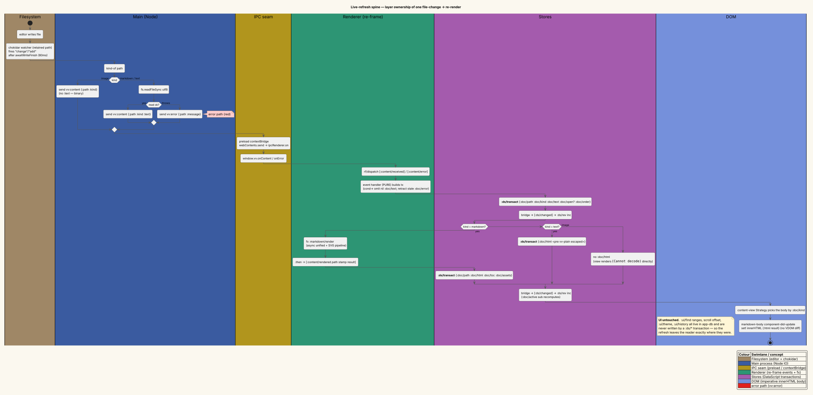

# Theory 03. Live-Refresh Spine

The live-refresh spine is the causal chain from a file save to updated pixels.

---

## 1. Chain

```text
editor save
  -> chokidar change/add
  -> main send-open-content! -> request-content! {:fanout? true}
  -> content-flight: ONE read of the path (a running read is marked dirty instead → one trailing read)
  -> local-payload / remote-payload (the read), numbered seq n
  -> deliver!: vv:content {… :seq n :stamp} to every window retaining the path
  -> renderer bridge
  -> [:content/received]
  -> DataScript content transaction
  -> optional Markdown render
  -> [:content/rendered]
  -> DataScript render transaction
  -> :ds/rev subscriptions
  -> content view repaint
```

For PDFs, the chain ends in the renderer's pdf.js view, which prepares the new
bytes beside the shown document and swaps them in place (ADR-0045 §Live refresh —
the slide, scroll position and DOM survive; bytes that do not open leave the last
good version on screen behind a note). For Markdown, the chain includes render
metadata and asset watcher sync. Every read is numbered (`seq`) and fanned out once
to all retaining windows (ADR-0046): a burst of
saves during one read costs one more read, not one per save per window.

---

## 2. Watcher ownership

A watcher exists for a retained local file path. Retained means reachable from at
least one open tab history entry. This is stronger than "active tab" and more
bounded than "ever opened".

The main process reconciles watchers whenever the renderer sends
`vv:retained-files`.

---

## 3. Atomic saves and partial writes

`chokidar` is configured with `awaitWriteFinish` and listens for both `change` and
`add`.

| Mechanism | Reason |
|-----------|--------|
| `awaitWriteFinish` | Coalesce a multi-syscall save into one event. It does **not** guarantee a finished file: a writer that pauses mid-write for longer than its 80 ms stability window — LaTeX rewriting a PDF in place does, for most of each compile — fires events on a partial file. |
| `change` | In-place saves. |
| `add` | Atomic-save rename patterns. |
| retained reconciliation | Release watchers when paths leave every tab history. |

A PDF is therefore read **verified**: the tail trailer first, then the body, then size and mtime again on the same
handle. A torn file is retried on a backoff until it settles (ADR-0046 §Torn reads, §Settling). Naive reads during
real compile loops were torn 83–90 % of the time; the verified readers delivered none as complete
(docs/scientific/11 §9.7).

---

## 4. Ordering: `seq` for reads, the stamp for renders

Two mechanisms guard against stale data, at two different points.

- **Reads are ordered by `seq`.** Main numbers every read with a process-wide `seq`, and the renderer
  (`content-guard/stale?`) drops a payload whose `seq` is not newer than the one its document applied. An older
  read that lands late — a slow remote read, a retried PDF — can therefore never replace a newer one (ADR-0046).
  The stamp cannot do this job: payloads are stamped by more than one clock, and two reads in one millisecond
  would collide.
- **Renders are matched by stamp.** Markdown rendering is asynchronous. A render commit is accepted only when its
  stamp still matches the cached document, so an older slow render cannot overwrite newer content. Stamps are
  strictly increasing per process (`max(now, last + 1)`).

---

## 5. UI preservation

Live refresh writes content attributes in DataScript. It does not replace the
active tab, reset per-tab history, clear find state, or rewrite settings. Scroll
restore has its own explicit path for navigation; ordinary file refresh does not
consume a navigation restore unless one is pending for the active render.

---

## 6. Diagram


*Diagram source: [`../diagrams/component-content-retention.puml`](../diagrams/component-content-retention.puml).*

## 7. Layer ownership of one file change

The spine crosses four layers. This swimlane view shows which layer owns each step, and where the `:doc/*`-only invariant is enforced.



*Diagram source: [`../diagrams/activity-live-refresh-spine.puml`](../diagrams/activity-live-refresh-spine.puml).*
