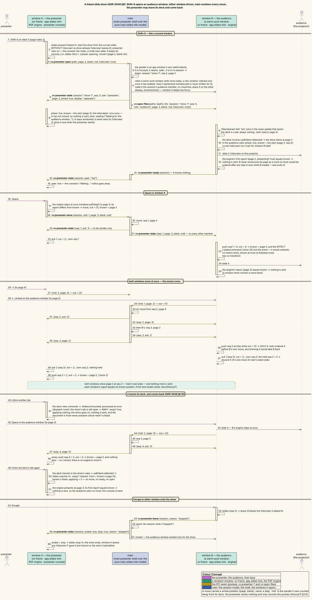
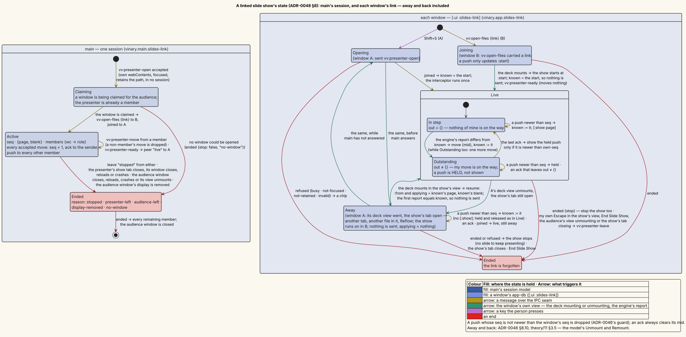
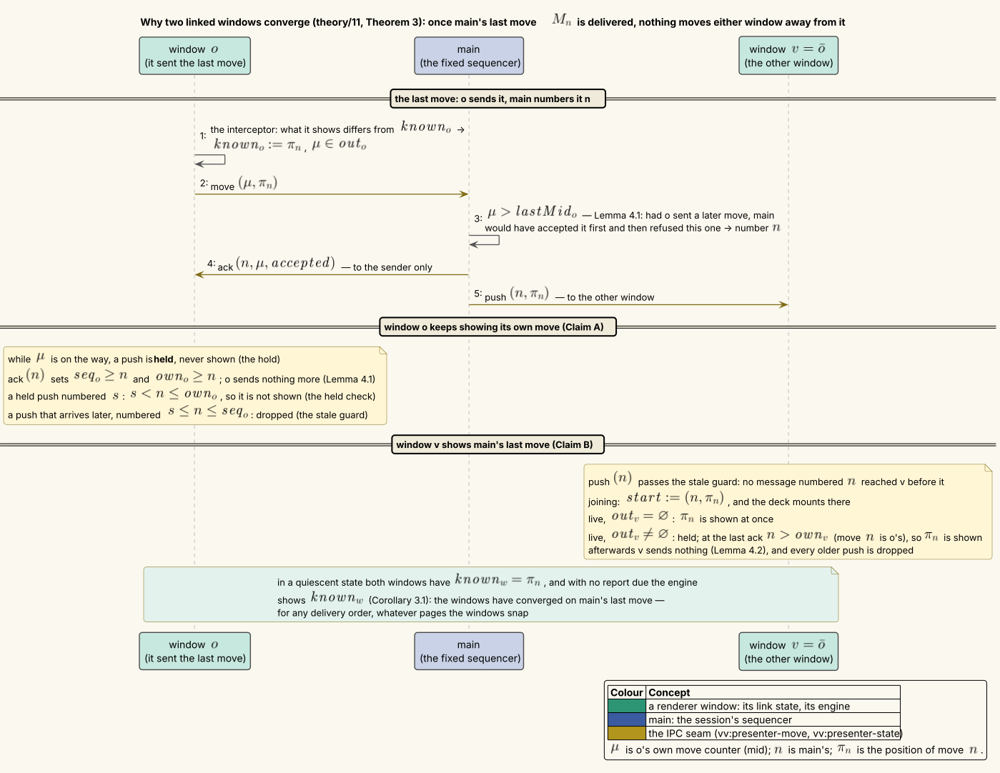

# The linked slide show protocol — two windows, one sequence of moves

**Status: Accepted with [ADR-0048](../design-decisions/0048-speaker-notes-and-linked-presenter-windows.md) §8;
extended on 2026-10-19 with a presenter that leaves its deck and comes back (§3.5). The protocol is proved here and
model-checked with TLC ([`formal/linked-show/`](formal/linked-show/LinkedShow.tla)); the implementation follows it.**

Two windows show one slide deck: the presenter's window shows the presenter view, the audience window shows only the
slide. Either window may move the show — a key, a click, the overview, a typed number, a link, find, blanking — and
the other must follow, at once, without the two ever settling on different slides, without a window sending a move
back to where it came from, and without a move being silently undone. The presenter may also leave its deck for
another tab while the audience window keeps the show, and must pick the show up where it then is when it comes back.
This document defines the protocol that does it, proves its properties for **any delivery order** of the messages,
and checks a model of it with TLC, including nine negative controls that each remove one rule and must break a
property.



*Shift+S links the windows; a move in either window is numbered by main, acknowledged to its sender and pushed to
the other window; crossing moves resolve to main's order; Escape in either ends the show.*

---

## 1 · The problem

Main is the only process both renderers can reach (ADR-0009: every cross-process message goes through main), so main
relays. Three simpler designs fail:

| Design | What goes wrong |
|---|---|
| Main relays every move to the *other* window and nothing else (ADR-0047's rule for settings) | When both windows move at once, each shows the other's move and main's last state is one of them: the windows end on different slides. A window cannot tell whether a move arriving from the other window was made before or after its own. |
| Main sends every move to *every* window, the sender included | A window receives its own move back. If it moved again meanwhile, the echo takes it back — the bug ADR-0047 fixed for settings. |
| First writer wins: a move carries the version it was based on, and main rejects stale ones | The later key press is lost, and every rejection costs a correction round trip. |

The protocol below keeps main's total order (a *fixed sequencer*, in the terminology of the total-order-broadcast
literature [2]), but tells the sender apart from the other members: the sender gets an **acknowledgement** carrying
the number main gave its move, the others get the move itself. A window that knows the numbers of its own moves can
order a foreign move against them.

### 1.1 · What must hold

| # | Property | Informally |
|---|---|---|
| P1 | **Convergence** | Whenever nothing is in flight and nothing is due, each window last exchanged main's position with main, and each window that shows the deck shows it — a presenter away from its deck shows it when it comes back. |
| P2 | **No echo** | A window sends a move only for something a person did there, or to correct a page its own engine snapped. Following the other window never sends anything. |
| P3 | **No undo** | When nothing is in flight, main's position is the last move a person made that main accepted: protocol traffic never undoes a person's move. |
| P4 | **Monotone numbers** | The newest move number a window has seen never decreases. |
| P5 | **Settles** | Once the people stop, the windows stop exchanging messages and stay at rest. |
| P6 | **Bounded corrections** | Snapping pages (a window that hides note pages) causes a bounded number of extra moves. |

P1–P5 are the requirements; P6 is the lemma P5 rests on when windows snap pages.

---

## 2 · Definitions

**Windows.** The two members of a session are the presenter window $`A`$ and the audience window $`B`$; for a window
$`w`$, $`\bar w`$ is the other one.

**Positions.** A *position* is a pair $`\langle p, b \rangle`$ of a physical page index $`p \in \mathit{Pages}`$ and
a blank colour $`b \in \mathit{Blanks}`$ (`nil`, `:black`, `:white` in the code). Positions are compared as pairs: two
positions are equal when both components are.

**Moves, numbers, messages.**

| Symbol | Meaning |
|---|---|
| move $`\langle \mu, \pi \rangle`$ | a message from window $`w`$ to main: "I now show $`\pi`$"; $`\mu`$ is the move's **mid**, $`w`$'s own counter $`1, 2, \dots`$ |
| $`n`$ | main's **seq**: how many moves main has accepted in this session |
| $`M_s`$, $`o_s`$, $`\pi_s`$ | the move main accepted as its $`s`$-th, the window it came from, and its position; $`\pi_0`$ is the session's start position |
| $`\mathrm{ack}(s, \mu, \mathit{acc})`$ | main → the sender: your move $`\mu`$ was accepted as number $`s`$ ($`\mathit{acc}`$ true), or was not accepted ($`\mathit{acc}`$ false, $`s = 0`$) |
| $`\mathrm{push}(s, \pi)`$ | main → the other window: main's $`s`$-th move is $`\pi`$ |
| channel | one per window and direction: $`w \to \mathrm{main}`$ carries moves, $`\mathrm{main} \to w`$ carries acks and pushes |

Main's position is $`\pi_n`$. A **delivery order** is a rule for which message of a channel arrives next: *first in,
first out* (FIFO), or *any* message (reordering). Every result in §5 holds for both.

**A window's parts.** The races live between three parts of a window, so the definitions keep them apart:

| Part | State | In the code |
|---|---|---|
| the **engine** | the page it shows, $`\mathit{engine}_w`$; whether a report is due, $`\mathit{pending}_w`$ | `vinary.renderer.pdf` — a key moves it at once; it reports on the next animation frame (`report!`), and always after a `[:show p]` command |
| **app-db** | the **mirror** of the last report, $`\mathit{mirror}_w`$; the blank colour $`\mathit{blank}_w`$; the link state below | `[:ui :slides]` and `[:ui :slides-link]` |
| the **interceptor** | none of its own | `vinary.app.slides-link/outgoing`, run after a report or a local blank change |

**The link state** of window $`w`$:

| Field | Meaning |
|---|---|
| $`\mathit{known}_w`$ | the position $`w`$ last exchanged with main: the last move it sent, or the last push it showed |
| $`\mathit{seq}_w`$ | the newest move number $`w`$ has seen |
| $`\mathit{own}_w`$ | the newest number of $`w`$'s *own* accepted moves (`own-seq`) |
| $`\mathit{out}_w`$ | the mids $`w`$ has sent that main has not acknowledged |
| $`\mathit{held}_w`$ | a push that arrived while $`\mathit{out}_w \neq \varnothing`$, or nothing |
| $`\mathit{applying}_w`$ | the page of a push being shown, from the moment it is shown until the engine reports it, or nothing |
| $`\mathit{phase}_w`$ | `joining` (the audience window, before its deck has mounted), `live`, or `away` (the presenter, while its deck view is gone: its tab shows another document — §3.5) |
| $`\mathit{start}`$ | the audience's start position and its number, while it joins |

While a window is away its engine does not exist: $`\mathit{engine}_w`$ keeps the page it showed last, which nothing
reads until the window comes back, and no report is due.

**Snapping.** A window that hides pages (the note pages of a `show notes` deck, ADR-0048 §3) shows a hidden page as a
page it does show: its **snap** $`S_w : \mathit{Pages} \to \mathit{Pages}`$ maps every page to a shown page and every
shown page to itself, so $`S_w \circ S_w = S_w`$. A window learns its hidden pages at a moment of its own — when its
deck model is built, when the background scan of a deck without page labels ends, or when a refresh changes the
pages — so for a while the two windows may disagree about which pages exist. A snap is **downward** when
$`S_w(p) \le p`$ for every page $`p`$. ADR-0048 §3 makes every snap downward; §5.6 shows why it must.

**Quiescent, converged.** A state is **quiescent** when both windows have joined (each is live or away), every
channel is empty, both $`\mathit{out}`$ sets are empty and no report is due. It is **converged** when
$`\mathit{known}_w = \pi_n`$ for both windows, and $`\langle \mathit{engine}_w, \mathit{blank}_w \rangle = \pi_n`$
for every live window.

---

## 3 · The protocol, in literate form

The protocol is presented as named sections in the manner of literate programming [3]: each section is introduced by
the reason it exists, and refers to the sections it uses by name, in angle brackets.

### 3.1 · Main

Main keeps, per session, its seq $`n`$, its position $`\pi_n`$ and the members; per member $`w`$, $`\mathit{lastMid}_w`$,
the highest mid it accepted from $`w`$. It accepts a move only if it is newer than every move it already accepted from
that window. Over an ordered channel that is always true; over a reordering one, an older move that arrives late must
not overwrite a newer one, so it is acknowledged — the sender must stop waiting for it — and otherwise ignored.

```
⟨Main receives move (μ, π) from window w⟩ ≡
  if w is not a member of the session, or the move is malformed then drop it          ⟨ADR-0048 §8.4⟩
  else if μ ≤ lastMid[w] then send w: ack(0, μ, accepted: false)                      ⟨the mid guard⟩
  else
    n ← n + 1;  position ← π;  lastMid[w] ← μ
    send w: ack(n, μ, accepted: true)                                                 ⟨to the sender only⟩
    send w̄: push(n, π)                                                                ⟨to every other member⟩
```

### 3.2 · A window: what it sends

A window sends its position whenever the position it shows differs from the one it last exchanged with main. *When*
it looks is the whole of the no-echo rule: only after its engine reports and after a local blank change — never after
an incoming message, because a window that is following must not speak.

```
⟨The interceptor runs in window w⟩ ≡                         ⟨after a report, or after the blank colour changed here⟩
  cur ← ⟨page, blank_w⟩  where page = applying_w if a push is being shown, else the engine's reported page
  if cur ≠ known_w then
    μ ← the next mid;  out_w ← out_w ∪ {μ};  known_w ← cur
    send main: move(μ, cur)
```

*Why `applying`.* Showing a push changes app-db's blank at once, but the engine reports the new page only on the next
frame, so for one frame the mirror still holds the page *before* the push. A blank key pressed in that frame would
send the old page with the new colour — and then the report would send the new page, with nothing having caused it:
an echo. Taking the page being shown closes that window (Lemma 3; control N-applying, §6.3).

### 3.3 · A window: what it receives

```
⟨Window w receives push(s, π)⟩ ≡
  if s ≤ seq_w then drop it                                     ⟨the stale guard — ADR-0046's rule for reads⟩
  seq_w ← s
  if phase_w = joining then start ← (s, π)                      ⟨the deck is not showing yet: start there⟩
  else if out_w = ∅ then ⟨show π⟩
  else held_w ← (s, π)                                           ⟨my move is on the way: hold, do not show⟩

⟨Window w receives ack(s, μ, acc)⟩ ≡
  out_w ← out_w ∖ {μ}
  if acc then own_w ← max(own_w, s);  seq_w ← max(seq_w, s)
  if out_w = ∅ then
    if held_w ≠ nothing and held_w.s > own_w then ⟨show held_w.π⟩
    held_w ← nothing

⟨show π⟩ ≡
  if phase_w = away then known_w ← π                    ⟨no engine to show it on: remember where the show is — §3.5⟩
  else
    known_w ← π;  blank_w ← π.blank;  applying_w ← π.page
    run the effect [:slides/command [:show π.page]]     ⟨the effect, not the event: the event would unblank⟩
```

*Why hold.* A push that arrives while the window's own move is on the way was ordered by main **before** that move
whenever main has not yet seen the move — and if main has seen it, the move's acknowledgement tells the window where
the push stands. Showing the push at once would take the window back to a position main has already superseded, and
nothing would bring it forward again (control N-hold). Holding it until the window's own moves are acknowledged lets
the window compare numbers: the held push is shown only if it is newer than the window's own last accepted move
(control N-heldcheck).

*Why the stale guard.* Over a reordering channel a push can arrive after a newer one, or after the acknowledgement of
a newer move of the window's own (control N-staleguard). Over a FIFO channel it never fires.

### 3.4 · Joining

The audience window opens while the show runs. Main sends it the session's position with `vv:open-files {link}`;
pushes that arrive before its deck mounts only move its start; when its deck mounts it starts the show there:

```
⟨The audience's deck mounts⟩ ≡
  phase ← live;  seq ← max(seq, start.s)
  known ← start.π;  blank ← start.π.blank;  applying ← start.π.page
  run the effect [:slides/command [:show start.π.page]]
  send main: ready                                        ⟨vv:presenter-ready — it moves nothing⟩
```

The window does **not** announce its start page as a move. If it did, main would sequence that announcement after any
move the presenter made while the audience window loaded — and undo it (control N-announce). The `ready` message only
tells the presenter's pane that the audience is showing.

The presenter is in the mirror-image situation when it links the show: it sends `vv:presenter-open` with its position
and sends no moves until main replies `joined`; it then sets $`\mathit{known}_A`$ to the session's start and runs the
interceptor once, so a key pressed while the link was being made is sent like any other person's move.



*Main's session (left) and each window's link (right): a window is in step while nothing of its own is on the way,
and holds a push while something is.*

### 3.5 · Away and back

The presenter may leave its deck while the show goes on: its tab shows another document, or the tab navigates
elsewhere. The audience window keeps the show, and its people may still move it with their keys. The presenter is
then **away**: its deck view and its engine are gone, but its link stays, and it keeps exchanging messages with main.
When its tab shows the deck again, the deck mounts and the show resumes where the show *is*, not where it was.

```
⟨The presenter's deck view unmounts while its link is live⟩ ≡           ⟨its tab shows another document⟩
  phase ← away;  applying ← nothing
  the engine goes, and with it the mirror and a report that was due     ⟨nothing is sent⟩

⟨The presenter's deck mounts again⟩ ≡                                    ⟨its tab shows the deck again⟩
  phase ← live;  blank ← known.blank;  applying ← known.page
  the engine opens the show at known.page                               ⟨[:ui :presentation :from] ← known.page⟩
                                                                        ⟨nothing is sent⟩
```

While away the window receives as in §3.3: the stale guard, the hold and the held check are unchanged, and ⟨show π⟩
only records π as known. It sends nothing. The interceptor runs after a report or a local blank change, and an away
window has no engine to report and no show on screen to blank: the code keeps its slide keys off while the deck is
not in front (§8).

*Why record the position.* A push that arrives while the presenter is away is main's newest position, and the
presenter must open there when it comes back. A window that forgot it would come back to a slide the audience has
left. The exchange being quiet, nothing would ever bring it forward (control N-awaydrop, §6.3).

*Why open at known.* The engine that mounts must show the position the window last exchanged with main, with its
blank colour, and `applying` must hold its page. Then its first report, of that very page, sends nothing: the window
is in the state that `⟨show known⟩` leaves (Lemma 3). An engine that reopened where it was before the window went away
would report that page, and the interceptor would send it: a move that no person made and no snap caused (control
N-staleremount). If the audience moved while the presenter was away, main accepts that move as the newest one and
pushes it, and the audience is taken back to the presenter's old slide.

*Why the unmount is one step.* So that the window is never live without an engine: in such a state a push would be
shown to no engine, and a report it waited for would never come. The code runs the unmount's event synchronously,
inside the view's own unmount (§7).

---

## 4 · The model

[`LinkedShow.tla`](formal/linked-show/LinkedShow.tla) specifies the protocol in TLA+ [4]. Its variables are the
fields of §2, one copy per window, plus main's $`n`$ (`mseq`), $`\pi_n`$ (`mpos`) and $`\mathit{lastMid}`$, and the
four channels (`toMain[w]`, `toWin[w]`), and four **ghost variables** that the protocol never reads — they exist only
to state the properties:

| Ghost | Meaning |
|---|---|
| `pcause[w]` | why window $`w`$'s engine may differ from what it last exchanged: `user` (a person moved it), `snap` (it snapped a page), `none` (it should not differ) |
| `echo` | true once a window has sent a move whose cause was `none` |
| `lastUserPos` | the position of the last person's move main accepted |
| `nonUser` | how many accepted moves no person made |

A move carries a flag `user`, true when its cause was `user`; the flag exists only for the ghosts.

**Actions.** Each step of a behaviour is one of these (the TLA+ names):

| Action | What happens | Enabled when |
|---|---|---|
| `UserPage(w, q)` | a person moves $`w`$'s engine to a page $`q`$ it shows; a report becomes due; cause `user` | $`w`$ live, $`S_w(q) = q \neq \mathit{engine}_w`$ |
| `UserBlank(w, b)` | a person changes the blank colour; the interceptor runs at once with page $`\mathit{applying}_w`$, else $`\mathit{mirror}_w`$ | $`w`$ live, $`b \neq \mathit{blank}_w`$ |
| `Report(w)` | the engine reports: $`\mathit{mirror}_w \leftarrow \mathit{engine}_w`$, $`\mathit{applying}_w \leftarrow`$ nothing; the interceptor runs; cause `none` | $`w`$ live and a report is due |
| `Mount(w)` | §3.4 | $`w`$ joining |
| `Unmount(w)` | §3.5: the presenter leaves its deck: $`w`$ is away; the report that was due, the mirror and $`\mathit{applying}_w`$ are dropped; cause `none`; nothing is sent | $`w = A`$ live, fewer than `MaxAway` departures so far |
| `Remount(w)` | §3.5: the presenter's deck mounts again: $`w`$ is live, $`\mathit{engine}_w \leftarrow S_w(\mathit{known}_w.\mathit{page})`$, $`\mathit{blank}_w \leftarrow \mathit{known}_w.\mathit{blank}`$, $`\mathit{applying}_w \leftarrow \mathit{known}_w.\mathit{page}`$, a report due; cause `snap` if the snap changed the page, `none` otherwise; nothing is sent | $`w`$ away |
| `Rehide(w)` | $`w`$ learns its hidden pages: its engine snaps the page it shows; if that changed it, a report is due, cause `snap` (or still `user` if a person's report was due) | once per window, at any time |
| `MainRecv(w, i)` | §3.1, for the $`i`$-th message of $`w \to \mathrm{main}`$ | $`i`$ deliverable |
| `WinRecv(w, i)` | §3.3, for the $`i`$-th message of $`\mathrm{main} \to w`$ | $`i`$ deliverable |

`⟨show π⟩` is the operator `Show(w, π)`. For an away window it only sets $`\mathit{known}_w \leftarrow \pi`$. For a
live one it is `Apply(w, π)`, which besides §3.3's assignments sets
$`\mathit{engine}_w \leftarrow S_w(\pi.\mathit{page})`$ (with $`S_w`$ the identity until `Rehide(w)`), makes a report
due, and sets the cause to `snap` if the snap changed the page and to `none` otherwise.

**Specification.** `Spec` is `Init`, any sequence of the actions, and **weak fairness** of each window's protocol
actions (`Report`, `Mount`, and the deliveries): a protocol step that stays possible is eventually taken. The people
— including the presenter's departures and returns, `Unmount` and `Remount` — and `Rehide` need not act at all.
`MaxUser` bounds the number of the people's page and blank actions in a behaviour, and `MaxAway` the number of
departures (a variable `aways` counts them); the bounds keep TLC's search finite, and the proofs below do not depend
on their values.

**Switches.** Nine constants each remove one rule; with all of them `FALSE` (and both snaps downward) the model is the
protocol of §3. They are the negative controls of §6.3. The two that §3.5 adds are `StaleRemount` (the engine reopens
at the page it showed when the window went away, not at $`\mathit{known}_w`$) and `AwayDrop` (an away window forgets
a position it is shown).

---

## 5 · Proofs

The proofs are about the model of §4, for both delivery orders and any snaps unless a theorem says otherwise. An
**invariant** is a predicate true in every reachable state; each is proved by induction: it holds in `Init`, and every
step that starts in a state satisfying it (and the invariants proved before it) ends in a state satisfying it. A step
is of one of eighteen kinds, which the proofs enumerate:

| Kind | Step |
|---|---|
| K1 | `UserPage` |
| K2 | `UserBlank` |
| K3 | `Report` |
| K4 | `Mount` |
| K5 | `Rehide` that changes the engine's page; K5′ one that does not (it only marks the window snapped) |
| K6 | `MainRecv` that accepts the move; K6′ one that does not |
| K7 | `WinRecv` of a push that is dropped by the stale guard |
| K8 | `WinRecv` of a push to a joining window |
| K9 | `WinRecv` of a push that is shown; K9′ one that is held; K9ᵃ one that an away window records (`Show` with $`\mathit{out}_w = \varnothing`$) |
| K10 | `WinRecv` of an ack that shows the held push; K10′ one that does not; K10ᵃ one that makes an away window record the held push |
| K11 | `Unmount` |
| K12 | `Remount` |

A step of kind K6/K6′ changes main and the channels only; K7–K10ᵃ change one window and its incoming channel only;
K1–K5′ change one window, and K2/K3 may append to its outgoing channel; K11 and K12 change one window only (and the
bound `aways`), and send nothing.

### 5.1 · Bookkeeping

**Lemma 1 (moves in flight).** For each window $`w`$, in every reachable state:

1. the mids $`w`$ has sent are $`1, \dots, \mathit{nextMid}_w - 1`$, each sent once;
2. $`\mathit{out}_w`$ is exactly the set of mids of the moves in $`w \to \mathrm{main}`$ together with the mids of the
   acks in $`\mathrm{main} \to w`$;
3. $`\mathit{out}_w = \varnothing \Rightarrow \mathit{held}_w = \text{nothing}`$;
4. a joining window has sent nothing, and its incoming channel holds pushes only.

*Proof.* All four hold in `Init` (no mid sent, everything empty, `held` nothing). (1) A mid is sent only by the
interceptor, which sends $`\mathit{nextMid}_w`$ and increments it. (2) The interceptor adds a mid to $`\mathit{out}_w`$
in the step that appends its move to $`w \to \mathrm{main}`$ (K2, K3); K6 and K6′ remove the move and append an ack
with the same mid to $`\mathrm{main} \to w`$ — exactly one ack per move, accepted or not; K10, K10ᵃ and K10′ remove the
ack and remove its mid from $`\mathit{out}_w`$. No other step touches either side: K11 and K12 leave
$`\mathit{out}_w`$ and the channels as they are. (3) `held` is set only by K9′, which requires
$`\mathit{out}_w \neq \varnothing`$ and leaves it unchanged; $`\mathit{out}_w`$ shrinks only in K10, K10ᵃ and K10′,
which set `held` to nothing whenever they leave $`\mathit{out}_w`$ empty; K2/K3 only grow $`\mathit{out}_w`$, and
K11/K12 touch neither. (4) K1–K3 require a live window, and acks are sent only to the sender of a move. ∎

**Lemma 2 (numbers).** In every reachable state:

1. $`n`$ never decreases; main has accepted exactly the moves $`M_1, \dots, M_n`$, and its position is $`\pi_n`$;
2. for each $`s \in 1..n`$ main has sent exactly one message numbered $`s`$ to each window: $`\mathrm{ack}(s, \cdot,
   \mathit{true})`$ to $`o_s`$ and $`\mathrm{push}(s, \pi_s)`$ to $`\bar o_s`$; every other message main sends is an
   $`\mathrm{ack}(0, \cdot, \mathit{false})`$;
3. $`\mathit{seq}_w`$ is $`0`$ or the number of a message delivered to $`w`$ (a push, or an accepted ack);
   $`\mathit{own}_w`$ is $`0`$ or the number of an accepted ack delivered to $`w`$ — so $`o_{\mathit{own}_w} = w`$ when
   $`\mathit{own}_w > 0`$; and both are at most $`n`$;
4. if $`\mathit{held}_w = (s, \pi)`$ then $`s \geq 1`$, $`\pi = \pi_s`$, $`o_s = \bar w`$, and that push was delivered
   to $`w`$; likewise $`\mathit{start}`$ is $`(0, \pi_0)`$ or $`(s, \pi_s)`$ for a push delivered to $`B`$.

*Proof.* (1) and (2) are K6 and K6′ read directly: K6 sets $`n \leftarrow n + 1`$, stores the move's position, sends
one ack to the sender and one push to the other window, both numbered $`n`$; K6′ sends one unnumbered ack. (3) The
only assignments are $`\mathit{seq}_w \leftarrow s`$ for a delivered push (K8, K9, K9ᵃ, K9′),
$`\max(\mathit{seq}_w, s)`$ for a delivered accepted ack (K10, K10ᵃ, K10′), and $`\max(\mathit{seq}_w,
\mathit{start}.s)`$ at `Mount`, where by (4)
$`\mathit{start}.s`$ is $`0`$ or a delivered push's number; similarly for $`\mathit{own}_w`$, assigned only by accepted
acks. Every number main has sent is at most $`n`$ by (1)–(2). (4) `held` and `start` are assigned only from delivered
pushes (K9′, K8), whose contents (2) gives. ∎

### 5.2 · The report discipline, and no echo

**Lemma 3 (report discipline).** For a live window $`w`$, in every reachable state:

1. $`\mathit{applying}_w \neq \text{nothing} \Rightarrow \mathit{pending}_w`$;
2. $`\neg \mathit{pending}_w \Rightarrow \mathit{cause}_w = \texttt{none}`$;
3. $`\mathit{cause}_w = \texttt{none}`$ implies all of
   $`\mathit{known}_w = \langle \mathit{engine}_w, \mathit{blank}_w \rangle`$,
   $`\mathit{applying}_w \neq \text{nothing} \Rightarrow \mathit{applying}_w = \mathit{engine}_w`$, and
   $`\mathit{applying}_w = \text{nothing} \Rightarrow \mathit{mirror}_w = \mathit{engine}_w`$.

*Proof.* In `Init` the presenter is live with nothing due, cause `none`, $`\mathit{known}_A = \pi_0 = \langle 0,
\mathit{blank}_A \rangle`$, $`\mathit{engine}_A = \mathit{mirror}_A = 0`$ and `applying` nothing; the audience is not
live. For a window that becomes live, K4 sets a report due and either cause `snap` (the start page snapped) or cause
`none` with $`\mathit{engine}_B = \mathit{applying}_B = \mathit{start}.\pi.\mathit{page}`$ and $`\mathit{known}_B =
\mathit{start}.\pi`$, $`\mathit{blank}_B = \mathit{start}.\pi.\mathit{blank}`$ — all three parts hold. A window
also becomes live again by **K12**, which sets a report due, $`\mathit{applying}_w = \mathit{known}_w.\mathit{page}`$,
$`\mathit{blank}_w = \mathit{known}_w.\mathit{blank}`$ and $`\mathit{engine}_w = S_w(\mathit{known}_w.\mathit{page})`$,
with cause `none` exactly when $`S_w(\mathit{known}_w.\mathit{page}) = \mathit{known}_w.\mathit{page}`$: then
$`\mathit{known}_w = \langle \mathit{engine}_w, \mathit{blank}_w \rangle`$ and $`\mathit{applying}_w =
\mathit{engine}_w`$, and all three parts hold, whatever the window's state was while it was away. K11 makes the window
away, about which the lemma says nothing; K9ᵃ and K10ᵃ happen only to an away window. For a live window, by kind:

- **K1** sets a report due and cause `user`: (1)–(3) hold, (3) vacuously.
- **K2** changes only $`\mathit{blank}_w`$ and, through the interceptor, $`\mathit{known}_w`$. (1) and (2) are
  untouched. For (3), suppose the cause is `none`. The page the interceptor takes is $`\mathit{applying}_w`$ if it is
  something and $`\mathit{mirror}_w`$ otherwise — by (3) both are $`\mathit{engine}_w`$. The new colour $`b`$ differs
  from $`\mathit{blank}_w = \mathit{known}_w.\mathit{blank}`$, so the interceptor sends and sets
  $`\mathit{known}_w \leftarrow \langle \mathit{engine}_w, b \rangle = \langle \mathit{engine}_w, \mathit{blank}'_w
  \rangle`$.
- **K3** ends with nothing due, cause `none`, $`\mathit{mirror}_w = \mathit{engine}_w`$, `applying` nothing, and
  $`\mathit{known}_w = \langle \mathit{engine}_w, \mathit{blank}_w \rangle`$ — the interceptor either found them equal
  or assigned it.
- **K5** sets a report due and a cause `snap` or `user`; **K5′** changes none of the variables involved.
- **K9 and K10** show a position $`\pi`$: a report becomes due, $`\mathit{applying}_w = \pi.\mathit{page}`$,
  $`\mathit{known}_w = \pi`$, $`\mathit{blank}_w = \pi.\mathit{blank}`$, $`\mathit{engine}_w = S_w(\pi.\mathit{page})`$,
  and the cause is `none` exactly when $`S_w(\pi.\mathit{page}) = \pi.\mathit{page}`$ — then all of (3) holds.
- **K6, K6′, K7, K8, K9′, K10′** change none of the variables involved. ∎

**Corollary 3.1.** For a live window with no report due,
$`\mathit{known}_w = \langle \mathit{engine}_w, \mathit{blank}_w \rangle`$. *(Lemma 3.2, then 3.3, then 3.1 for the
`mirror` conjunct.)*

**Theorem 1 (P2, no echo).** No window ever sends a move whose cause is `none`.

*Proof.* The interceptor is run by K2, with cause `user`, and by K3, with the window's cause; both need a live window,
so an away window sends nothing. In K3 with cause `none`, Lemma 3.3 gives
$`\langle \mathit{engine}_w, \mathit{blank}_w \rangle = \mathit{known}_w`$, which is exactly what the interceptor
compares — so it sends nothing. ∎

*What the theorem means for the code.* A window that shows a push and reports the page it was told to show sends
nothing: following never speaks. It sends a correction only when its engine **snapped** the page (cause `snap`) —
main then orders the correction like any move, and the other window follows it.

### 5.3 · No undo

**Theorem 2 (P3, no undo).** If neither window's snap ever moves a page, then in every reachable state main's
position is the last person's move it accepted ($`\pi_n = \mathit{lastUserPos}`$, or $`\pi_0`$ if there is none).

*Proof.* Without snapping, `Mount`, `Remount` and `Apply` always set cause `none`, `Unmount` sets `none`, and `Rehide`
never changes a page, so every cause is `user` or `none`. By Theorem 1 no move with cause `none` is sent, so every move
sent — hence every move main accepts — is a person's. K6 sets main's position and `lastUserPos` to the same position;
K6′ changes neither; both start at $`\pi_0`$. ∎

The theorem is what the join rule of §3.4 buys. The rejected design, in which the audience announced its start page
as a move when its deck mounted, sends a move no person made: main may sequence it after a move the presenter made
while the audience window loaded, and the presenter's move is undone (control N-announce, §6.3). With snapping, a
correction is a move no person made by design; P3 is then replaced by P1 (both windows follow the correction) and P6
(there are few of them).

### 5.4 · Convergence

The proof considers the last move main accepted, and shows that once it is delivered nothing can take either window
away from it.



*Main numbers the last move $`n`$; the window that sent it holds or drops every older push (Claim A), and the other
window shows it — at once, at its mount, or once its own moves are acknowledged (Claim B).*

**Lemma 4 (nothing follows the last move).** Let $`Q`$ be a quiescent state with $`n \geq 1`$, and let $`M_n =
\langle \mu, \pi_n \rangle`$ come from window $`o = o_n`$. In the behaviour up to $`Q`$:

1. $`M_n`$ is the last move $`o`$ sent;
2. $`\bar o`$ sent no move after $`\mathrm{push}(n, \pi_n)`$ was delivered to it.

*Proof.* Both use one observation. *(★) If a window $`w`$ sent any move before $`Q`$, the move with the largest mid
$`\mu^*`$ it sent is accepted, as soon as main receives it.* In $`Q`$ every channel is empty, so main has received it;
at that moment $`\mathit{lastMid}_w`$ is the largest mid main had accepted from $`w`$ (K6 sets it, K6′ does not), and
that is smaller than $`\mu^*`$, because $`\mu^*`$ had not been accepted and every other mid of $`w`$ is smaller
(Lemma 1.1) — so the mid guard lets it through.

(1) Suppose $`o`$ sent a move with a mid larger than $`\mu`$; by (★) its largest-mid move is accepted, as some
$`M_{s^*}`$ with $`s^* \le n`$; $`s^* \neq n`$ because the two moves differ, so $`s^* < n`$: it was accepted *before*
$`M_n`$. But then, when $`M_n`$ arrived, $`\mathit{lastMid}_o \geq \mu^* > \mu`$, and the mid guard would have
refused $`M_n`$ — a contradiction.

(2) $`\mathrm{push}(n, \pi_n)`$ exists only once main has accepted $`M_n`$, so a move $`\bar o`$ sent after its
delivery reaches main after main accepted $`M_n`$. If $`\bar o`$ sent any such move, its largest-mid move is one of
them (mids grow with time), and by (★) main accepts it — with a number greater than $`n`$, since $`n`$ was already
used. That contradicts $`n`$ being main's seq in $`Q`$. Neither part depends on the windows' phases: K11 and K12
send nothing. ∎

**Theorem 3 (P1, convergence).** Every quiescent state is converged — for either delivery order and any snaps.

*Proof.* Let $`Q`$ be quiescent. By Corollary 3.1 (nothing is due), each live window's
$`\langle \mathit{engine}_w, \mathit{blank}_w \rangle`$ equals its $`\mathit{known}_w`$; so it remains to show
$`\mathit{known}_w = \pi_n`$ for both windows, live or away.

*Case $`n = 0`$.* No move was accepted. If a window had sent a move, by (★) of Lemma 4 its largest-mid move would have
been accepted; so neither window sent a move, and by Lemma 2.2 main sent no push. The presenter's
$`\mathit{known}_A`$ changes only by the interceptor sending (it did not) or by showing or recording a push (there is
none) — K11 and K12 leave it as it is — so it is still $`\pi_0`$. The audience's $`\mathit{start}`$ changes only by a
push, so it is still $`(0, \pi_0)`$, and `Mount` set $`\mathit{known}_B = \pi_0`$, which nothing changed since. Both
equal $`\pi_n = \pi_0`$.

*Case $`n \geq 1`$.* Let $`o`$, $`\mu`$ be as in Lemma 4, and $`v = \bar o`$.

*Claim A: $`\mathit{known}_o = \pi_n`$.* Sending $`M_n`$ set $`\mathit{known}_o = \pi_n`$. Afterwards
$`\mathit{known}_o`$ can change in three ways, and none occurs (K11 and K12 do not change it):

- *the interceptor sends:* $`o`$ sends nothing after $`M_n`$ (Lemma 4.1);
- *`Mount`:* $`o`$ has joined — it sent a move, which a joining window never does (Lemma 1.4);
- *showing or recording a position* (`Show`, in K9, K9ᵃ, K10 or K10ᵃ). Until the ack of $`\mu`$ is delivered,
  $`\mu \in \mathit{out}_o`$, so none of them can happen: K9 and K9ᵃ need $`\mathit{out}_o = \varnothing`$ (*the
  hold*), and K10 and K10ᵃ need the ack to leave $`\mathit{out}_o`$ empty. That ack is
  $`\mathrm{ack}(n, \mu, \mathit{true})`$; delivering it sets $`\mathit{seq}_o \geq n`$ and
  $`\mathit{own}_o \geq n`$, and both only grow (Lemma 2.3). After it:
  - a K9 or K9ᵃ step would deliver a push numbered $`s \le n`$ (main numbers nothing above its seq, which never
    decreases — Lemma 2.1–2.2) while $`\mathit{seq}_o \geq n`$: *the stale guard* drops it instead;
  - a K10 or K10ᵃ step takes $`\mathit{held}_o = (s, \pi_s)`$ only if $`s > \mathit{own}_o \geq n`$ (*the held
    check*); but $`o_s = \bar o`$ (Lemma 2.4) so $`s \neq n`$, and $`s \le n`$ — so it is not taken.

*Claim B: $`\mathit{known}_v = \pi_n`$.* Main sent $`\mathrm{push}(n, \pi_n)`$ to $`v`$ (Lemma 2.2), and in $`Q`$ it
has been delivered. When it arrived, $`\mathit{seq}_v < n`$: by Lemma 2.3 $`\mathit{seq}_v`$ was $`0`$ or the number of
a message already delivered to $`v`$, and the only message numbered $`n`$ to $`v`$ is this push. So it passed the stale
guard and set $`\mathit{seq}_v = n`$. By Lemma 4.2, $`v`$ sends nothing afterwards, so $`\mathit{out}_v`$ never grows
again. Four cases, by $`v`$'s state when the push arrived:

- *$`v`$ was joining* (K8): $`\mathit{start} \leftarrow (n, \pi_n)`$. A later push would have to pass the stale guard
  with a number above $`n`$ — there is none — so `Mount`, which happened before $`Q`$, set
  $`\mathit{known}_v = \pi_n`$.
- *$`v`$ was live with $`\mathit{out}_v = \varnothing`$* (K9): it showed $`\pi_n`$, so $`\mathit{known}_v = \pi_n`$.
- *$`v`$ was away with $`\mathit{out}_v = \varnothing`$* (K9ᵃ): it recorded $`\pi_n`$, so $`\mathit{known}_v =
  \pi_n`$ (*the record*).
- *$`v`$ was live or away with $`\mathit{out}_v \neq \varnothing`$* (K9′): $`\mathit{held}_v \leftarrow (n, \pi_n)`$.
  It cannot be replaced (a replacement must pass the stale guard), and $`\mathit{out}_v`$ only shrinks; in $`Q`$ it is
  empty, so some K10, K10ᵃ or K10′ step emptied it. At that step $`\mathit{own}_v < n`$: by Lemma 2.3 it is $`0`$ or
  the number of an accepted move *of $`v`$'s own*, and move $`n`$ is $`o`$'s. So $`n > \mathit{own}_v`$ and the held
  push was taken (*the hold is released*) — shown (K10) or, by a window that was away by then, recorded (K10ᵃ):
  $`\mathit{known}_v = \pi_n`$.

In each case nothing changes $`\mathit{known}_v`$ afterwards: the interceptor does not send (Lemma 4.2), a push is
dropped by the stale guard (none is numbered above $`n`$), `held` is nothing once $`\mathit{out}_v`$ is empty
(Lemma 1.3), `Mount` happens only to a joining window, and K11 and K12 do not change it.

Claims A and B give $`\mathit{known}_w = \pi_n`$ for both windows, and Corollary 3.1 gives
$`\langle \mathit{engine}_w, \mathit{blank}_w \rangle = \mathit{known}_w = \pi_n`$ for each live one. ∎

*What the theorem means for a presenter that is away.* In a quiescent state its $`\mathit{known}_A`$ is main's
position, so `Remount` opens its engine at $`S_A(\pi_n.\mathit{page})`$ with $`\pi_n`$'s blank colour. The report that
follows sends nothing unless the presenter snapped the page (Lemma 3 after K12, then Theorem 1), and by Theorem 6 the
windows become quiescent — hence converged — again.

*What the proof says about snapping.* Nothing in it depends on the snaps: a window whose engine snapped the last push
would have reported the snapped page — a move after the push, which Lemma 4.2 rules out. So in a quiescent state no
window is mid-correction, whatever the snaps and whenever they changed.

**Theorem 4 (P4).** $`\mathit{seq}_w`$ and $`\mathit{own}_w`$ never decrease. *Proof.* Every assignment to either is
$`\max`$ of the old value and something, or (K8, K9, K9ᵃ, K9′) a push's number that the stale guard has just found
greater. ∎

### 5.5 · Which rule each proof uses

| Rule (§3) | Used by | Removed in control | What TLC finds without it |
|---|---|---|---|
| hold a push while my own move is on the way | Theorem 3, Claim A | N-hold (FIFO) | P1 fails |
| show a held push only if newer than my own last accepted move | Theorem 3, Claim A | N-heldcheck (FIFO) | P1 fails |
| a blank sent while a push is being shown uses `applying` | Lemma 3 (K2) → Theorem 1 | N-applying | P2 fails |
| drop a push not newer than what I have seen | Theorem 3, Claims A and B | N-staleguard (reordering) | P1 fails |
| main's mid guard | Lemma 4 (★, 1) | N-midguard (reordering) | P1 fails |
| the audience starts at the start position and announces itself with `ready` | Theorem 2 | N-announce | P3 fails |
| every snap moves down | Theorem 5 → Theorem 6 | N-upsnap | P6 fails |
| an away window records the position it is shown | Theorem 3, Claim B (*the record*, and K10ᵃ) | N-awaydrop (FIFO) | P1 fails |
| a window coming back opens at known, with known's blank colour and `applying` | Lemma 3 (K12) → Theorem 1 | N-staleremount (FIFO) | P2 fails |

The stale guard and the mid guard never fire over FIFO channels, which is why their controls reorder. The hold and
the held check are needed even over FIFO channels: crossing moves exercise them.

### 5.6 · Bounded corrections

**Theorem 5 (P6).** If both snaps are downward, the number of moves sent with cause `snap` is at most
$`(\mathit{MaxUser} + 3 + \mathit{MaxAway}) \cdot \mathit{MaxPage}`$, where $`\mathit{MaxPage}`$ is the largest page
index; so is the number of accepted moves no person made.

*Proof.* A move with cause `snap` — a **correction** — is sent by a `Report` (K3) whose window's cause is `snap`. Call
the step that last set that window's cause before the report its **trigger**. It is a show with a snap (K9, K10), a
`Mount` with a snap (K4), a `Remount` with a snap (K12), or a `Rehide` that changed the page from a cause other than
`user` (K5): a `UserPage` would have set `user`, an earlier report or an `Unmount` `none`, and a record while away
(K9ᵃ, K10ᵃ) sets no cause. A trigger triggers at most one report — the window's next one, unless an `Unmount` drops
it — and a report sends at most one move.

*Parents.* If a correction's trigger shows a push, the push came from an accepted move of the other window (Lemma
2.2); call that move the correction's **parent**. Each push is shown at most once — at delivery (K9), or as the held
push when the window's moves are acknowledged (K10), after which `held` is nothing — so **every move is the parent of at
most one correction.** A correction whose trigger is a `Mount`, a `Remount` or a `Rehide`, and every person's move, has
no parent: call these moves **roots**. There are at most $`\mathit{MaxUser}`$ person's moves (each of the people's
page and blank actions makes at most one: K2 sends at most once, and a `UserPage` sets cause `user` until the window's
next report), one `Mount`, two `Rehide`s and $`\mathit{MaxAway}`$ `Remount`s (each follows its own `Unmount`): at most
$`\mathit{MaxUser} + 3 + \mathit{MaxAway}`$ roots.

*Pages decrease.* Let a correction $`C`$ have the parent $`P`$, whose page is $`p`$. The trigger set the engine to
$`q = S_w(p)`$, and it set cause `snap`, so $`q \neq p`$; the snap is downward, so $`q < p`$. Until the report, the
engine changes only by a `Rehide`, to $`S_w(\mathit{engine}) \le \mathit{engine}`$ — a `UserPage` or another show
would have been a later cause-setting step, and an `Unmount` would have dropped the report. The report sends the
engine's page, so $`\mathit{page}(C) \le q < p`$. The same holds for a correction triggered by `Mount`, `Remount` or
`Rehide`: its page is below the page the snap was applied to, which is at most $`\mathit{MaxPage}`$.

*Chains.* Following parents from any correction strictly increases the page, so it ends, at a root. Every root
therefore heads a single chain $`R = C_0, C_1, \dots, C_k`$ (each move has at most one child), with
$`0 \le \mathit{page}(C_k) < \dots < \mathit{page}(C_0) \le \mathit{MaxPage}`$. If $`R`$ is a person's move, the chain
holds $`k \le \mathit{page}(R) \le \mathit{MaxPage}`$ corrections; if $`R`$ is itself a correction, its page is at most
$`\mathit{MaxPage} - 1`$ and the chain holds $`k + 1 \le \mathit{MaxPage}`$. Every correction lies on exactly one chain,
so there are at most $`(\mathit{MaxUser} + 3 + \mathit{MaxAway}) \cdot \mathit{MaxPage}`$ of them. The accepted moves
no person made are accepted corrections (Theorem 1 excludes cause `none`, and the protocol's `Mount` announces
nothing), so `nonUser` obeys the same bound. ∎

**Why a snap must move down.** If the presenter shows page 2 for its hidden page 1 while the audience shows page 1 for
its hidden page 2, a push of page 2 makes the audience correct to 1, which makes the presenter correct to 2, and so on
for ever: two windows that disagree about which pages are hidden — one mid-refresh, or one whose background scan has
finished — would flip the projector between two slides. With downward snaps every correction is lower than the move it
corrects, and the chain ends. TLC finds the endless chain in the control N-upsnap (§6.3). One window that snaps and one
that does not cannot loop in either direction (a correction's child would be a correction of the other window); the
rule matters because both windows run the same detection, at different times.

### 5.7 · Settling

**Theorem 6 (P5, settles).** If both snaps are downward, every behaviour of `Spec` is eventually quiescent forever.

*Proof.*

1. *Every behaviour has finitely many non-stuttering steps.* The people's page and blank steps number at most
   $`\mathit{MaxUser}`$, the presenter's departures (K11) and returns (K12) at most $`\mathit{MaxAway}`$ each,
   `Rehide` at most two and `Mount` at most one. Moves sent: at most $`\mathit{MaxUser}`$ person's moves, the
   corrections of Theorem 5, and no moves with cause `none` (Theorem 1) — finitely many. Each move is delivered at most
   once, and each delivery (K6, K6′) makes at most two messages, each delivered at most once. A report needs a report
   due, which only K1, K4, K5, K9, K10 and K12 set — each finitely often by the counts above.
2. *So after some point every step is a stuttering step*, and the state is constant: call it $`\sigma`$.
3. *In $`\sigma`$ no protocol action of either window is enabled.* If $`\mathit{Protocol}(w)`$ were enabled in
   $`\sigma`$, it would be enabled forever, so weak fairness would force a $`\mathit{Protocol}(w)`$ step — and every
   such step changes a variable (a report clears `pending`, `Mount` changes the phase, a delivery shortens a channel),
   contradicting (2).
4. *A state where neither window's protocol actions are enabled is quiescent.* `Mount` disabled means the window has
   joined: it is live or away. For a live window, `Report` disabled means nothing is due; an away window has nothing
   due, because K11 cleared it and only K12 sets it again (K1, K5, K9 and K10 need a live window, K4 a joining one).
   A delivery is enabled whenever its channel is not empty (its first message in FIFO order, every message in any
   order), so the channels are empty; and with both channels of $`w`$ empty, Lemma 1.2 gives
   $`\mathit{out}_w = \varnothing`$.

Hence $`\sigma`$, which lasts forever, is quiescent. ∎

**Corollary 6.1.** Every behaviour reaches a quiescent state after the people stop, and by Theorem 3 every live window
then shows main's last position; a presenter that is away shows it when it comes back.

---

## 6 · Model checking

### 6.1 · Configurations

[`check.sh`](formal/linked-show/check.sh) runs TLC [5] on each configuration and compares the outcome with the one
predicted for it. Every configuration checks `TypeOK` and the properties named in its row; `TypeOK` says every variable
stays within its type. *People's actions* is `MaxUser`, and *departures* is `MaxAway`: how many times the presenter may
leave its deck and come back (§3.5, §4).

| Configuration | Pages | People's actions | Departures | Delivery | Snaps (presenter · audience) | Checked |
|---|---|---|---|---|---|---|
| `fifo` | $`\{0, 1\}`$ | 3 | 0 | FIFO | none · none | P1–P6 |
| `reorder` | $`\{0, 1\}`$ | 3 | 0 | any order | none · none | P1–P6 |
| `snap-fifo` | $`\{0, 1, 2\}`$ | 3 | 0 | FIFO | hides 1 (→ 0) · hides 2 (→ 1) | P1, P2, P4, P5, P6 |
| `snap-reorder` | $`\{0, 1, 2\}`$ | 3 | 0 | any order | hides 1 (→ 0) · hides 2 (→ 1) | P1, P2, P4, P5, P6 |
| `away-fifo` | $`\{0, 1\}`$ | 3 | 2 | FIFO | none · none | P1–P6 |
| `away-reorder` | $`\{0, 1\}`$ | 3 | 2 | any order | none · none | P1–P6 |
| `away-snap-fifo` | $`\{0, 1, 2\}`$ | 3 | 2 | FIFO | hides 1 (→ 0) · hides 2 (→ 1) | P1, P2, P4, P5, P6 |
| `fifo-deep` | $`\{0, 1, 2\}`$ | 5 | 0 | FIFO | none · none | P1–P6 |
| `reorder-deep` | $`\{0, 1, 2\}`$ | 4 | 0 | any order | none · none | P1–P6 |

In the snap configurations the two windows **disagree**: the presenter hides page 1, the audience page 2, and each
learns it at a moment of its own (`Rehide`), so every interleaving of the two discoveries with the show is explored.
P3 is not checked there, because corrections are moves no person made by design (§5.3). Blank colours are
`none` and `black`; a third colour adds no rule.

In the away configurations the presenter may leave its deck and come back twice (`MaxAway = 2`). It may leave at any
moment it is live: while a push is being shown, before its engine has reported a step of its own, or with moves of its
own on the way. It may come back at any later moment, and the people's actions go on in the audience window meanwhile,
so every interleaving of a departure and a return with the rest of the show is explored. Two departures let the
presenter leave again before its first return has settled, with the return's report still to come or a correction on
the way. In `away-snap-fifo` the presenter may also come back to a page it hides: once it has learned that it hides
page 1 (`Rehide`), a return while the show is at page 1 opens its engine at page 0, which it then sends as a correction
(cause `snap`, Theorem 5).

### 6.2 · Results

Every positive configuration finished with no error: TLC explored every reachable state and found no state that
violates an invariant, and no behaviour that violates `SeqMonotone` or `Settles`.

| Configuration | Distinct states | States generated | Depth | Time | Result |
|---|---|---|---|---|---|
| `fifo` | 10,367 | 27,617 | 18 | 1 s | no error |
| `reorder` | 32,823 | 108,990 | 18 | 2 s | no error |
| `snap-fifo` | 381,784 | 1,214,307 | 44 | 18 s | no error |
| `snap-reorder` | 4,441,035 | 19,547,240 | 44 | 3 min 11 s | no error |
| `away-fifo` | 69,489 | 241,918 | 22 | 3 s | no error |
| `away-reorder` | 219,830 | 923,935 | 22 | 9 s | no error |
| `away-snap-fifo` | 2,600,980 | 10,395,805 | 48 | 1 min 26 s | no error |
| `fifo-deep` | 3,772,319 | 12,785,539 | 28 | 2 min 44 s | no error |
| `reorder-deep` | 3,059,250 | 12,915,359 | 23 | 2 min 24 s | no error |

The run: `check.sh --deep 16` on 2026-10-19, TLC 2.19 (rev. `5a47802`), sixteen workers pinned to cores 16–31 of a
32-core machine (`taskset -c 16-31`) with other work running. The times only tell you what to expect; they are not a
performance claim. The *depth* is the largest number of steps any reachable state needs, by its shortest behaviour,
from an initial state. The snap configurations go deepest: each window's discovery of its hidden pages, and the
corrections that follow it, add steps to the longest behaviours.

The six configurations without departures counted exactly the states they counted on 2026-10-17, before the model
had departures, at the same depths; that was predicted before the run. With `MaxAway = 0`, `Unmount` is never
enabled, so no state is away, `Remount` never fires, `aways` stays 0 and `Show` is `Apply`: the reachable states are
the old model's, each with `aways = 0` added. The equal counts check that the extension changed nothing else. The
away configurations reach four steps deeper than the ones they extend (22 against 18, 48 against 44). `aways` is part
of the state, so a state after two departures and two returns is reached only by behaviours that contain those four
steps.

### 6.3 · Negative controls

Each control turns on one switch of §4 — the configuration is otherwise `fifo` (`reorder` where noted, and
`away-fifo` for the two away controls) — and must violate the property its rule protects. A control that passed, or failed on another property, would mean the model
does not test what it claims to.

A control stops at its first violation, and TLC prints the shortest behaviour that reaches it. check.sh runs the
controls with **one worker**, so that search, the number of states it counts and the counterexample it prints are the
same on every run. Two runs on 2026-10-19 printed identical traces, and counted the same states, for all nine
controls; the seven older controls counted the states they counted on 2026-10-17.

| Control | Switch (configuration) | Violated | Distinct states | Counterexample | What the counterexample shows |
|---|---|---|---|---|---|
| N-hold | `NoHold` (`neg-nohold`, FIFO) | P1 `Convergence` | 8,651 | 13 states | The presenter steps to page 1, and main numbers that move 1. The audience window is still loading: its deck mounts at the start, page 0, before push 1 arrives, and its person presses **B**. Main numbers that blank 2, and the presenter shows page 0, blacked out. Then push 1 reaches the audience while its own blank is on the way. Without the hold, the audience shows page 1, unblanked, and the ack of its blank changes nothing. The exchange goes quiet with the presenter on main's position (page 0, black) and the audience on page 1. |
| N-heldcheck | `NoHeldCheck` (`neg-noheldcheck`, FIFO) | P1 `Convergence` | 7,610 | 13 states | The same race. This time push 1 is held, but when the ack of the audience's blank (move 2) arrives, the held push is shown without comparing the numbers. Move 1 is older than move 2, so the audience ends on page 1, unblanked, while main and the presenter are on page 0, black. |
| N-applying | `NoApplying` (`neg-noapplying`, FIFO) | P2 `NoEcho` | 957 | 8 states | The audience steps to page 1, and main pushes the move to the presenter, whose engine starts showing page 1. Before the engine reports it, the presenter's person presses **B**. Without `applying`, the interceptor takes its page from the last report, page 0, and sends (page 0, black). When the report of page 1 comes, it differs from that and is sent too: a move that no person made and no snap caused, an echo of the push. |
| N-staleguard | `NoStaleGuard` (`neg-nostaleguard`, any order) | P1 `Convergence` | 13,055 | 11 states | The presenter blanks and then unblanks. Main numbers the two moves 1 and 2 and pushes both to the audience, which receives them in reverse order. It shows the unblank (2) and then, without the stale guard, the older blank (1). The audience stays black while main and the presenter are unblanked. |
| N-midguard | `NoMidGuard` (`neg-nomidguard`, any order) | P1 `Convergence` | 17,814 | 11 states | The presenter blanks and then unblanks. Main receives the unblank (mid 2) first and accepts it as move 1. Without the mid guard, it then accepts the late blank (mid 1) as move 2 and pushes it, so the audience goes black. The presenter's newer unblank has been overridden, but its acks are both *accepted*, so it stays unblanked. |
| N-announce | `AnnounceOnMount` (`neg-announce`, FIFO) | P3 `NoUndo` | 8,057 | 11 states | The presenter blanks while the audience window loads. When the audience's deck mounts, it announces its start position (page 0, unblanked) as a move. Main orders that move after the blank and pushes it to the presenter, which unblanks. The windows converge, but on a position no person chose: the presenter's blank is undone. |
| N-upsnap | the presenter's snap moves **up**: `SnapPresenter <- SnapHide1Up` (`neg-upsnap`: pages $`\{0, 1, 2\}`$, one person's action, FIFO, the audience hiding page 2, the state constraint `SeqBound`) | P6 `BoundedCorrections` | 1,084 | 42 states | The presenter steps to page 1, which it hides by snapping up to page 2. The audience hides page 2 by snapping down to page 1. From then on, each window's correction makes the other one snap back: 2, 1, 2, 1, … Each round adds two moves that no person made. The ninth such move exceeds the bound $`(\mathit{MaxUser} + 3 + \mathit{MaxAway}) \cdot \mathit{MaxPage} = (1 + 3 + 0) \cdot 2 = 8`$, and the cycle never ends; `SeqBound` only cuts the search off. |
| N-staleremount | `StaleRemount` (`neg-staleremount`, FIFO) | P2 `NoEcho` | 117 | 5 states | The presenter's person steps to page 1, and the presenter leaves its deck before its engine reports the step. The departure drops the report, so the step is never sent and `known` stays at page 0. Under the switch, the presenter comes back with its engine still on page 1, while `known` and `applying` say page 0. The first report clears `applying` and sends page 1: a move that no person made since the return and no snap caused, an echo. Opened at the known page, the engine would report page 0, which equals `known`, and send nothing. The step pressed just before leaving is lost with the departure, as in the code, where the engine that would have reported it is gone; no other window ever saw it. |
| N-awaydrop | `AwayDrop` (`neg-awaydrop`, FIFO) | P1 `Convergence` | 2,736 | 8 states | The presenter leaves its deck at once. The audience window's deck mounts at the start, page 0, its engine reports, and its person presses **B**. Main numbers the blank 1, acknowledges it, and pushes (page 0, black) to the presenter, which is away and, under the switch, forgets the push. The exchange goes quiet with main and the audience at (page 0, black) and the presenter's `known` at (page 0, unblanked). Nothing more is on the way, so a return would show the slide unblanked while the audience is black. |

Each counterexample is the failure that its rule's proof step rules out (the table of §5.5). The hold, the held check,
the stale guard and the mid guard each protect the step of Theorem 3 named there. `applying` protects Lemma 3.
Announcing with `ready` protects Theorem 2, and the downward snap protects Theorem 6. Recording what an away window is
shown protects Claim B of Theorem 3, and opening at the known position on a return protects Lemma 3.

---

## 7 · What the model leaves out, and why that is sound

| Left out | Why the results still apply |
|---|---|
| more than two windows, more than one session | ADR-0048 links exactly two windows, and a window takes part in at most one session (main refuses a second). |
| the session's start and end | The start is the model's `Init`: main has claimed the audience window (`vv:open-files {link}` is on its way) and the presenter knows the start position. When the presenter's `joined` reply arrives it runs the interceptor once (§3.4), which is a `UserPage`'s report in the model. The end (`vv:presenter-leave`, `ended`) stops both windows; nothing is promised afterwards. |
| the `ready` message | It moves nothing: it only tells the presenter's pane that the audience is showing. |
| the departure's two steps in the code | `Unmount` is one step. In the code the view's unmount destroys the engine and then dispatches `:slides/unmounted`, and that event runs synchronously, inside the unmount itself (`commands/dispatch-now!`: Reagent unmounts a view while it renders on an animation frame, outside any event, so `dispatch-now!` takes its synchronous path). So no message, key or report is processed between the engine's destruction and the window going away: there is no state in which a live window has no engine. The return is the start of the next row, made one step the same way. |
| a departure while the link is being opened, and the audience's departures | A presenter that leaves its deck while its link is `:opening` goes live on `joined` and stays away (`slides-link/on-joined`): the state the model reaches by `Init` and then `Unmount`. The audience window's deck view going away ends the session (`vv:presenter-leave "unmounted"`): the presenter keeps presenting alone, or, away from its deck, stops too (`slides-link/on-ended`) — a session's end, left out above. |
| the start's two steps | The model's `Mount` puts the engine at the start position in one step. The code takes two: app-db starts the show (`[:ui :presentation :from]` ← the start page, `[:ui :slides :blank]` ← its blank colour), and the engine applies `:from` later, as it starts presenting (`renderer.pdf/apply-present-from!`), and then reports. Two rules make the pair act as one step. **R-from:** a position shown in between also sets `:from` (`slides-link-state-fx`, while `slides/engine-presenting?` is false), so the engine opens the show at the newest position — the state the model reaches by `Mount` and then `Apply`. Without the rule the engine opened at the old start, and its first presenting report sent that page back: an echo that undid the other window's move. **R-blank:** every report of the show's deck keeps the show's blank colour (`slides/merge-report`), so the engine's first report cannot drop it — the report of a window with no mirror yet, or of the document layout before the engine presents. Without the rule the first presenting report sent the page unblanked, and both windows unblanked. With both rules that report sends nothing unless the engine snapped the page, which is a `Rehide` (§5.6). `vinary.app.slides-linked-test` fails without each rule, and `test/presenter-e2e.js` step 7 checks R-blank across two real windows. |
| main's validation | A move from a non-member or with a malformed payload is dropped before the mid guard (§3.1); in the model only members send, and only well-formed moves. |
| unbounded numbers of the people's actions | The proofs of §5 hold for any finite number; `MaxUser` bounds only TLC's search. |
| the engine's frame coalescing | The model's report reads the engine's page when it runs, as `report!` does on its animation frame; several keys before a report are several `UserPage` steps and one `Report`. |
| a refresh that removes pages | Clamping the page to the new last page is a downward snap: a `Rehide`. Several refreshes are several `Rehide`s; the proofs count each as a root (§5.6), so the bounds grow but stay finite. |
| transitions, the presenter view, the timer, zoom, fullscreen | They render a position; none of them sends or receives one. |
| the delivery guarantees of Electron's IPC | None are assumed: every theorem holds for any delivery order. |

---

## 8 · From the model to the code

| Model | Code |
|---|---|
| main's `mseq`, `mpos`, `lastMid` | `vinary.main.slides-link` (pure), executed by `vinary.main.presenter` |
| a window's link fields | `[:ui :slides-link]`, maintained by the pure `vinary.app.slides-link` |
| `Report` | the engine's `:slides/changed`, then the global interceptor `slides-link-out` |
| `UserBlank` | `:slides/black`, `:slides/white`, `:slides/unblank` (and the unblanking that a slide key does), then the same interceptor |
| `Apply` (`⟨show π⟩`, live) | `:slides/link-state` → the effect `[:slides/command [:show page]]` and the blank colour |
| `Mount` | the audience's `:pdf/deck-detected` while joining → the show starts at `:start`, then `vv:presenter-ready`; the engine applies the start (`:from`) as it starts presenting, made one step by R-from and R-blank (§7) |
| `Unmount` | the presenter's pdf-view unmounting while its link is live (or still opening, §7), on a tab that still exists (`:slides/unmounted`, run synchronously in the unmount) → `slides-link/away`: the link is away, the show keeps running, nothing is sent; the show's tab closing instead ends the session (`close-tab-result`) |
| `Remount` | the presenter's `:pdf/deck-detected` while away, its deck in front on the show's tab → `slides-link/resume`: `[:ui :presentation :from]` ← known's page and the blank colour ← known's, which the engine applies as it starts presenting (R-from and R-blank make it one step, §7); nothing is sent |
| `Show` while away | `slides-link/show` on an away link: `:known` only. The slide keys, blanking and F5 do nothing while the deck is not in front, and the interceptor sends nothing for an away link (`slides-link/outgoing`) |
| `Rehide` | a rebuilt deck model (`:slides/notes` from the background scan, or a refresh) snapping the current page |
| a move · an ack · a push | `vv:presenter-move` · `vv:presenter-state {ack}` · `vv:presenter-state {page, blank}` |
| the stale guard | `seq ≤ seq` in `vinary.app.slides-link`, as in ADR-0046's `vinary.app.content-guard` |
| `pcause`, `echo`, `lastUserPos`, `nonUser` | ghosts: not in the code; the simulation test computes them to assert P1–P3 |

The pure models are tested against this document by a randomized simulation (`vinary.app.slides-link-sim-test`): it
drives both pure models and a pure main through random interleavings, delivery orders and snaps, and asserts P1–P3
and P6 in every quiescent state it reaches.

---

## 9 · References

1. [ADR-0048](../design-decisions/0048-speaker-notes-and-linked-presenter-windows.md) §8 — the design this document
   proves; [ADR-0046](../design-decisions/0046-reload-safe-pipelined-remote-reads.md) — the `seq` guard;
   [ADR-0047](../design-decisions/0047-persisted-state-stores.md) — the echo that skipping the originator fixed.
2. X. Défago, A. Schiper, P. Urbán. *Total order broadcast and multicast algorithms: Taxonomy and survey.* ACM
   Computing Surveys **36**(4), 372–421, 2004. DOI [10.1145/1041680.1041682](https://doi.org/10.1145/1041680.1041682)
   — among its ordering mechanisms, the *fixed sequencer*: one process numbers every message, which is main's role here.
3. D. E. Knuth. *Literate Programming.* The Computer Journal **27**(2), 97–111, 1984.
   DOI [10.1093/comjnl/27.2.97](https://doi.org/10.1093/comjnl/27.2.97) — the named-section presentation of §3.
4. L. Lamport. *The temporal logic of actions.* ACM Transactions on Programming Languages and Systems **16**(3),
   872–923, 1994. DOI [10.1145/177492.177726](https://doi.org/10.1145/177492.177726) — TLA, weak fairness (`WF`).
5. L. Lamport. *Specifying Systems: The TLA+ Language and Tools for Hardware and Software Engineers.*
   Addison-Wesley, 2002. <https://lamport.azurewebsites.net/tla/book.html> — TLA+ and the TLC model checker.
