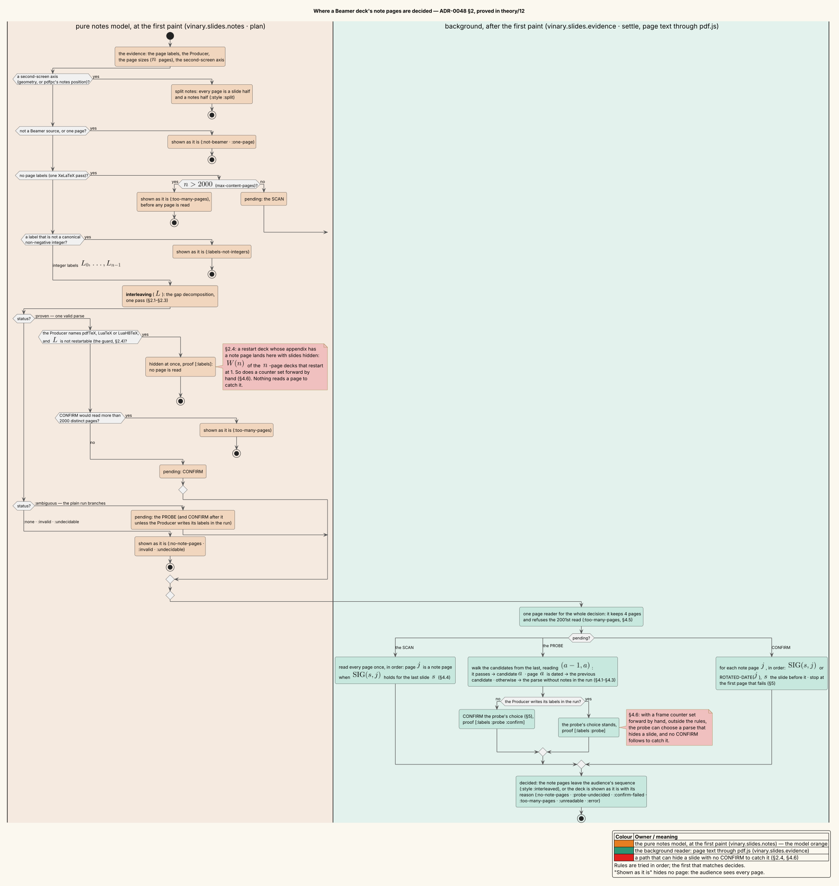
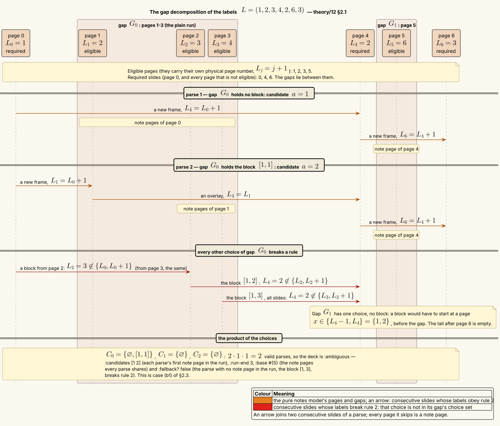
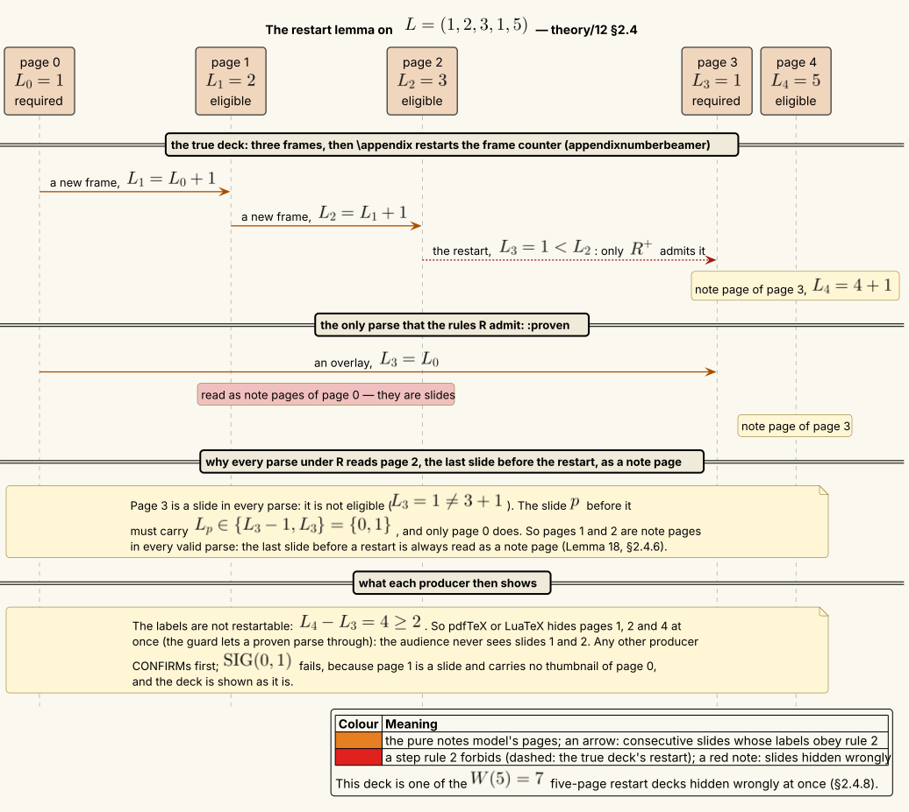
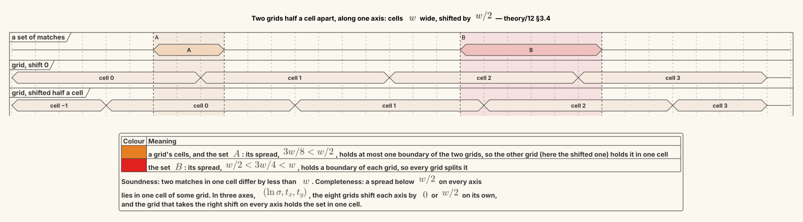

# Speaker-notes detection — the label automaton, the copy test, and the pages they read

**Status: the proofs behind [ADR-0048](../design-decisions/0048-speaker-notes-and-linked-presenter-windows.md)
§1–§5, as implemented in [`vinary.slides.notes`](../../src/vinary/slides/notes.cljs) and
[`vinary.slides.evidence`](../../src/vinary/slides/evidence.cljs). Its finite claims are also checked by machine, in
[`formal/speaker-notes/`](formal/speaker-notes/check.sh) (§7.1): exhaustively over every small deck, by evaluating
the model's own source text, and over pdf.js's own decoder. This document changes no code. Where it finds the ADR or
a docstring wrong, it says so (§7.3) and leaves the decision to the maintainer.**

A Beamer deck compiled with `\setbeameroption{show notes}` puts **note pages** between its slides. A slide show must
hide them from the audience. vinary-viewer decides where they are from the page labels when it can, and from the
pages' text when it must. Both directions of error are possible, and they are not equally bad. Showing a note page
to the audience is an embarrassment. Hiding a slide from it loses content. ADR-0048 §2.5 puts it this way: "Showing a
note page to the audience costs less than hiding a slide from it." So for each mechanism, this document proves when
it is exact, and when it can be wrong and in which direction.

| § | Mechanism | Result in short |
|---|---|---|
| 2.1 | The **label automaton** (`interleaving`) | The valid readings of the labels are a product of independent per-gap choices, found in one pass (Theorem 4). |
| 2.2–2.3 | Its statuses | With a first label of 0 or 1, every ambiguity is the choice of the first note page in the deck's plain run (Theorem 11), and `:undecidable` is unreachable (Theorem 12). |
| 2.4 | The **restart guard** (`restartable?`) | A label that drops does not always invalidate every parse (Proposition 9). `restartable?` holds exactly when the labels also read as all slides once restarts are admitted (Theorem 14). The guard still lets $`W(n)`$ restart decks per page count $`n`$ through, wrongly hidden at once (Theorem 21). No rule on the labels alone can catch them (Proposition 22). |
| 3 | The **copy test** (`note-page-signature?`) | Shifted grids are sound within one cell and complete within half a cell (Theorems 23–24), and they run in time linear in the matches. |
| 4 | The **probe**, the **scan**, the page budget | At most one candidate passes (Theorem 27). Under Beamer's rules the probe never hides a slide (Theorem 28). The 2000-page budget bounds the work (Theorem 31). |
| 5 | **CONFIRM** | A confirmed parse hides no slide, whatever the labels say (Theorem 32). |
| 6 | **$`\textsf{PDFDOC}^{-1}`$** and **REPAIR** | pdf.js's decoding is injective on the escape-free strings that reach its table branch whole, but not on escapes, across its branches, or within its BOM branch (Theorem 34). REPAIR has an exact change condition, which gives its mis-decodings (Theorems 36–38). |
| 7 | Verification and findings | The checks and their results, the model-to-code map, and the findings for the maintainer. |



*The notes decision. At the first paint, the pure model (`plan`) applies its rules in order, and the first rule that
matches decides. After the first paint, one page reader serves the scan, the probe and CONFIRM. The two red notes
mark the paths that can hide a slide with no CONFIRM to catch it (§2.4, §4.6). ADR-0048 §2.6 draws the same decision
for the design, with its reasons; this diagram marks where each result of this document applies.*

*Diagram source:
[`../diagrams/activity-speaker-notes-decision.puml`](../diagrams/activity-speaker-notes-decision.puml).*

---

## 1 · Definitions

### 1.1 · Decks, labels and parses

A **deck** has $`n \ge 1`$ pages, indexed $`0, 1, \dots, n - 1`$ in physical order. The physical page *number* of
page $`i`$ is $`i + 1`$. $`\mathbb{N}`$ is the set of non-negative integers. For integers $`a, b`$, the interval
$`[a, b]`$ is the set of pages $`\{a, a + 1, \dots, b\}`$, which is empty when $`a > b`$. The deck's **labels**
$`L = (L_0, \dots, L_{n-1}) \in \mathbb{N}^n`$ are its `/PageLabels`, read as integers. The automaton runs only when
every label is a canonical decimal integer of at most nine digits (`integer-labels`). Beamer labels a slide page with
its frame number, and hyperref labels a note page with its physical page number (ADR-0048 §2.1).

A **parse** gives every page a role, *slide* or *note*. We write a parse as its set of note pages
$`N \subseteq [1, n - 1]`$, since page 0 is always a slide, and its slides as $`S = [0, n - 1] \setminus N`$. Two
slides $`s < s'`$ of a parse are **consecutive** when no page between them is a slide.

**The rules R** (ADR-0048 §2.1) read the pages in order and keep a *frame number* $`f`$:

- **R1.** Page 0 is a slide, and $`f := L_0`$.
- **R2.** A slide page $`i \ge 1`$ carries $`L_i \in \{f, f + 1\}`$ and sets $`f := L_i`$. The same number is an
  overlay, or a frame marked `noframenumbering`. The next number is a new frame, `\againframe` included.
- **R3.** A note page is a page $`i \ge 1`$ that carries its own physical page number, $`L_i = i + 1`$. It leaves
  $`f`$ unchanged.

A parse is **valid** when it obeys R. $`\mathcal{P}(L)`$ is the set of valid parses of $`L`$.

**The rules R⁺** admit a restarted frame counter. They replace R2 by:

- **R2⁺.** A slide page $`i \ge 1`$ carries any $`L_i \le f + 1`$ and sets $`f := L_i`$.

$`\mathcal{P}^{+}(L)`$ is the set of parses valid under R⁺. R2 implies R2⁺, so
$`\mathcal{P}(L) \subseteq \mathcal{P}^{+}(L)`$.

**Eligible and required pages.** A page $`j \ge 1`$ is **eligible** when $`L_j = j + 1`$, and $`E`$ is the set of
eligible pages. By R3 only eligible pages can be note pages. Every other page, and page 0, is **required**:

```math
Q = \{0\} \cup \bigl([1, n - 1] \setminus E\bigr) = \{r_0 < r_1 < \dots < r_K\}, \qquad r_0 = 0 .
```

A required page is a slide in every valid parse.

**The lead** of a page is $`\lambda(j) = L_j - (j + 1)`$: how far its label runs ahead of its physical page number.
For $`j \ge 1`$, $`\lambda(j) = 0`$ exactly when $`j`$ is eligible.

**The plain run.** When $`L_0 = 1`$, the deck's plain run is its longest prefix $`[0, h]`$ with $`L_j = j + 1`$ for
every $`j \le h`$. Its labels read $`1, 2, \dots, h + 1`$: one page per frame, as far as the labels can tell.

### 1.2 · Gaps and choices

The **gaps** are the runs of eligible pages between consecutive required pages, and after the last one:

```math
G_t = [\,r_t + 1,\ r_{t+1} - 1\,] \quad (0 \le t < K), \qquad G_K = [\,r_K + 1,\ n - 1\,] \quad (\text{the tail}).
```

Every page of a gap is eligible, and every eligible page lies in exactly one gap. $`\mathrm{hi}_t`$ is the last page of
$`G_t`$: $`r_{t+1} - 1`$, or $`n - 1`$ for the tail. A gap may be empty. The **choice** of a parse in $`G_t`$ is
$`S \cap G_t`$, the gap's pages that it reads as slides. A **block** is a non-empty interval $`[x, y] \subseteq G_t`$.
The empty choice $`\varnothing`$ reads the whole gap as note pages.

### 1.3 · The statuses

`interleaving` (`notes.cljs` lines 78–129) returns one of five statuses. §2.3 proves that each means what this
table says:

| Status | Meaning | Extra keys |
|---|---|---|
| `:invalid` | $`\mathcal{P}(L) = \varnothing`$ | — |
| `:none` | $`\mathcal{P}(L) = \{\varnothing\}`$: one valid parse, and it has no note page | — |
| `:proven` | $`\mathcal{P}(L) = \{N\}`$ with $`N \neq \varnothing`$ | `:note-pages` $`N`$ |
| `:ambiguous` | $`\lvert\mathcal{P}(L)\rvert \ge 2`$, $`L_0 = 1`$, and the parses differ only inside the plain run | `:candidates`, `:run-end` $`h`$, `:base`, `:fallback?` |
| `:undecidable` | $`\lvert\mathcal{P}(L)\rvert \ge 2`$ and $`L_0 \ge 2`$ | — |

**Candidate** $`a`$ of an ambiguous deck is the parse whose note pages inside the plain run are $`[a, h]`$, so its
first note page is $`a`$. Its note pages are $`[a, h] \cup \mathit{base}`$ (`candidate-notes`). The **fallback** is
the parse with no note page in the plain run. `:fallback?` says whether the fallback is valid, and its note pages are
then $`\mathit{base}`$ (`fallback-notes`).

### 1.4 · True decks

The labels are evidence about a **true deck**: the roles that the author's source gave the pages. A true deck is
produced page by page. Page 0 is a slide with label $`L_0`$: Beamer numbers the first frame 1, or 0 under
`noframenumbering`, and a counter set by hand can give anything. Each later page $`i`$ is one of the kinds in the
table, where $`f`$ is the current frame number:

| Kind | Role | Label $`L_i`$ | Then |
|---|---|---|---|
| overlay, or a `noframenumbering` frame | slide | $`f`$ | — |
| new frame (`\againframe` included) | slide | $`f + 1`$ | $`f := f + 1`$ |
| note page | note | $`i + 1`$ | — |
| restart: `appendixnumberbeamer`, or the counter set back by hand | slide | $`v < f`$ | $`f := v`$ |
| forward jump: the counter set forward by hand | slide | $`v \ge f + 2`$ | $`f := v`$ |

An **R-deck** uses only the first three kinds and has $`L_0 \le 1`$. Its roles are a valid parse of its own labels,
its **true parse** $`N^\ast`$. A **restart deck** has $`L_0 \le 1`$, uses the first four kinds, and has at least one
restart. `appendixnumberbeamer` sets the frame counter to 0 at `\appendix` [9], so the appendix's first frame is
labelled 1. That is a restart to $`v = 1`$, and it is a change only when $`f \ge 2`$. Two different true decks can
have the same labels: the labels are only evidence.

For a page $`j`$, $`\mathrm{slide}(j)`$ is the last true slide before it. A true note page $`j`$ **annotates**
$`\mathrm{slide}(j)`$, because Beamer puts a note page after the overlay it belongs to.

### 1.5 · Pages as text

The background reads a page's text through pdf.js as **runs** (`evidence/page-runs`). A run is one text item
`{:str s :t [a b c d x y]}`: its string, and its transform in page units with $`y`$ up, whose last two entries are
the run's origin $`(x, y)`$.

- Its **height** is $`h = \sqrt{c^2 + d^2}`$.
- Its **glyph count** $`g`$ is the number of characters of $`s`$ that are not white space.
- It is **upright** when $`h > 0`$, $`a > 0`$, $`d > 0`$, $`\lvert b\rvert \le 10^{-3} h`$ and
  $`\lvert c\rvert \le 10^{-3} h`$: no rotation, mirroring or shear beyond rounding.
- It is a **quarter turn** when $`h > 0`$, $`\lvert a\rvert \le 10^{-3} h`$, $`\lvert d\rvert \le 10^{-3} h`$ and
  $`\lvert b\rvert \ge 0.999\, h`$.

Two page predicates are built on runs:

- $`\textsf{ROTATED-DATE}(j)`$ (`rotated-date?`) holds when page $`j`$ has a quarter-turn run whose trimmed string
  matches `\d{4}-\d{2}-\d{2}`. It also holds when the concatenation of all its quarter-turn runs, with white space
  removed, matches. Beamer's default note template draws the date, as year-month-day, inside
  `\pgftransformrotate{90}` (`beamerouterthemedefault.sty` [9]).
- $`\textsf{SIG}(s, j) \in \{\mathit{true}, \mathit{false}, \mathit{nil}\}`$ (`note-page-signature?`) says whether
  page $`j`$ holds a scaled copy of page $`s`$'s text. §3 defines it. $`\mathit{nil}`$ means *no evidence*.

A deck's **Producer** is **trusted** when it names pdfTeX, LuaTeX or LuaHBTeX (`trusts-labels?`). Those engines
write the labels in the run itself. Other drivers write the labels that the previous run left (ADR-0048 §2.5).

---

## 2 · The label automaton

ADR-0048 §2.1 states the rules R as an automaton over the frame number, and computes its valid parses gap by gap, as
the code does (`interleaving`). §2.1 below proves that this gap decomposition is exact, §2.2 and §2.3 derive the
statuses from it, and §2.4 analyses the restart guard. The procedure, in the manner of literate programming [2],
with each named section introduced where it is proved:

```
⟨interleaving(L)⟩ ≡
  if n < 2 then return :none
  ⟨the required pages and the gaps⟩                                         ⟨§1.2⟩
  for each gap Gt do Ct ← ⟨the locally valid choices of Gt⟩                  ⟨Lemma 3⟩
  if some Ct is empty then return :invalid                                   ⟨Theorem 4⟩
  if every Ct holds exactly one choice then
    return :none or :proven, by whether that one parse has note pages        ⟨Theorem 10⟩
  ⟨the branching gap: :ambiguous or :undecidable⟩                            ⟨Theorems 11 and 12⟩

⟨the required pages and the gaps⟩ ≡
  Q ← 0, then every page j ≥ 1 with L[j] ≠ j + 1, in order
  the gaps are the pages strictly between consecutive members of Q, and the pages after the last

⟨the locally valid choices of Gt⟩ ≡                       ⟨r, r' the required pages around Gt; r' absent at the tail⟩
  blocks ← every [x, y] with x ∈ {L[r] − 1, L[r]} ∩ Gt and
             y ∈ {L[r'] − 2, L[r'] − 1} ∩ [x, hi]  (at the tail: every y ∈ [x, hi])
  add ∅ when r' is absent, or L[r'] ∈ {L[r], L[r] + 1}

⟨the branching gap: :ambiguous or :undecidable⟩ ≡
  g ← the gap with two or more choices; r ← the required page before it    ⟨Proposition 8: there is only one⟩
  first(c) ← r + 1 for c = ∅;  y + 1 for a block [r + 1, y] with y < hi;  "no note" for [r + 1, hi];
             undefined for a block that does not start at r + 1
  if g ≠ G0, or L[0] ≥ 2, or some first(c) is undefined, or two coincide then return :undecidable
  return :ambiguous with :candidates ← the defined first(c), sorted;  :run-end ← hi;
         :fallback? ← whether "no note" occurs;  :base ← the note pages of the other gaps
```

### 2.1 · The gap decomposition

**Lemma 1 (consecutive slides).** A parse $`N`$ is valid if and only if

1. $`N \subseteq E`$, and
2. for every two consecutive slides $`s < s'`$, $`L_{s'} \in \{L_s, L_s + 1\}`$.

*Proof.* Under R the frame number starts at $`L_0`$ (R1) and changes only at slides (R2). So, by induction on
$`i`$, before page $`i`$ it equals $`L_s`$ for the last slide $`s < i`$. R2 at a slide $`s' \ge 1`$ therefore says
$`L_{s'} \in \{L_s, L_s + 1\}`$ for the slide $`s`$ before it, which is condition 2. R3 at every note page is
condition 1. Conversely, if both conditions hold, then R1 holds because $`N \subseteq [1, n - 1]`$, R3 holds by
condition 1, and R2 holds at every slide by condition 2, because the frame number there is $`L_s`$. ∎

**Lemma 2 (adjacency).** If two consecutive slides $`s < s'`$ of a valid parse are both eligible, then
$`s' = s + 1`$. Hence the choice of a valid parse in a gap is $`\varnothing`$ or one block.

*Proof.* By Lemma 1, $`s' + 1 = L_{s'} \in \{L_s, L_s + 1\} = \{s + 1, s + 2\}`$, so $`s' = s + 1`$ because $`s' > s`$.
For the second claim, list the parse's slides in the gap $`G_t`$ in increasing order. Two neighbours in the list are
consecutive slides of the parse: a slide between them would be a page of the interval $`G_t`$, and so would be in the
list. By the first claim neighbours are adjacent pages, so the list is an interval. ∎

**Lemma 3 (independence).** Let $`N \subseteq E`$ be a parse whose choice $`c_t`$ in every gap is $`\varnothing`$
or a block. Its consecutive slide pairs are exactly the following. For each gap $`G_t`$:

- $`(r_t, r_{t+1})`$, when $`c_t = \varnothing`$ and $`t < K`$;
- $`(r_t, x)`$, the pairs $`(j, j + 1)`$ for $`x \le j < y`$, and, when $`t < K`$, $`(y, r_{t+1})`$, when
  $`c_t = [x, y]`$.

Condition 2 of Lemma 1 holds for the pairs of gap $`G_t`$ if and only if $`c_t`$ is **locally valid**:

```math
\begin{aligned}
c_t = \varnothing &: \quad t = K \ \text{ or } \ L_{r_{t+1}} \in \{L_{r_t},\ L_{r_t} + 1\}, \\
c_t = [x, y] &: \quad x \in \{L_{r_t} - 1,\ L_{r_t}\} \ \text{ and } \ \bigl(t = K \ \text{ or } \ y \in \{L_{r_{t+1}} - 2,\ L_{r_{t+1}} - 1\}\bigr).
\end{aligned}
```

Local validity involves only $`c_t`$ and the labels of the two required pages around $`G_t`$. Those pages are slides
in every valid parse, so the gaps constrain one another not at all.

*Proof.* The slides in increasing order are $`r_0, c_0, r_1, c_1, \dots, r_K, c_K`$, each $`c_t`$ in increasing
order, because the required pages are slides and each gap lies between two of them. The consecutive pairs are the
ones listed. For a pair $`(r_t, x)`$, condition 2 reads $`x + 1 \in \{L_{r_t}, L_{r_t} + 1\}`$, that is,
$`x \in \{L_{r_t} - 1, L_{r_t}\}`$. Inside a block, $`L_{j+1} = j + 2 = L_j + 1`$ always holds. For
$`(y, r_{t+1})`$ it reads $`L_{r_{t+1}} \in \{y + 1, y + 2\}`$, that is,
$`y \in \{L_{r_{t+1}} - 2, L_{r_{t+1}} - 1\}`$. For $`(r_t, r_{t+1})`$ it is the first line, as written. ∎

Let $`\mathcal{C}_t`$ be the set of locally valid choices of gap $`G_t`$.

**Theorem 4 (gap decomposition).** The map $`\Phi(N) = (S \cap G_0, \dots, S \cap G_K)`$ is a bijection from
$`\mathcal{P}(L)`$ onto $`\mathcal{C}_0 \times \dots \times \mathcal{C}_K`$. Hence
$`\lvert\mathcal{P}(L)\rvert = \prod_t \lvert\mathcal{C}_t\rvert`$, and $`\mathcal{P}(L) = \varnothing`$ exactly when
some $`\mathcal{C}_t`$ is empty.

*Proof.*

- **Every valid parse decomposes** (the image lies in the product). Let $`N`$ be valid. By Lemma 1,
  $`N \subseteq E`$. By Lemma 2, each choice is $`\varnothing`$ or a block. By Lemmas 1 and 3, each choice is locally
  valid.
- **Every product of locally valid choices is a valid parse** (onto). Let $`(c_0, \dots, c_K)`$ be in the product,
  and let $`N`$ be the parse whose slides are $`Q \cup c_0 \cup \dots \cup c_K`$. Then $`N \subseteq E`$, its choices
  are the $`c_t`$, and by Lemma 3 condition 2 holds for every consecutive pair. By Lemma 1, $`N`$ is valid, and
  $`\Phi(N) = (c_t)`$.
- **One-to-one.** A parse is determined by its slides, which are $`Q`$ together with its choices. ∎

So the valid parses are found without any search. One pass over the labels finds $`Q`$, and each
$`\mathcal{C}_t`$ follows from two labels.



*The deck $`L = (1, 2, 3, 4, 2, 6, 3)`$. Its required pages are 0, 4 and 6, and its gaps are $`G_0 = [1, 3]`$,
$`G_1 = \{5\}`$ and an empty tail. $`\mathcal{C}_0 = \{\varnothing, [1, 1]\}`$, and the other two gaps have one
choice each, so there are $`2 \cdot 1 \cdot 1 = 2`$ valid parses. An arrow joins consecutive slides of a parse. The
red arrows are the choices of $`G_0`$ that break R2.*

*Diagram source: [`../diagrams/seq-notes-gap-decomposition.puml`](../diagrams/seq-notes-gap-decomposition.puml).*

*The code.* `gap-choices` computes $`\mathcal{C}_t`$. Its `xs` is $`\{L_{r_t} - 1, L_{r_t}\} \cap G_t`$. Its `ys` is
$`\{L_{r_{t+1}} - 2, L_{r_{t+1}} - 1\} \cap [x, \mathrm{hi}_t]`$, or all of $`[x, \mathrm{hi}_t]`$ at the tail. It adds
$`\varnothing`$ when `(ok? lr)`. Its filter `:when (ok? (inc y))` asks for $`L_{r_{t+1}} \in \{y + 1, y + 2\}`$. The
choice of `ys` already implies that, so the filter never removes a block (finding F13).

### 2.2 · The lead, and why only the first gap branches

**Lemma 5 (lead).** For consecutive slides $`s < s'`$ of a valid parse,
$`\lambda(s') \le \lambda(s) - (s' - s - 1)`$. The lead never grows from one slide to the next, and it falls by at
least the number of note pages between them.

*Proof.* By Lemma 1, $`L_{s'} \le L_s + 1`$, so
$`\lambda(s') = L_{s'} - s' - 1 \le L_s - s' = \lambda(s) - (s' - s - 1)`$. ∎

The proof uses only condition 2 for the pair $`(s, s')`$. So the lemma holds along any sequence of roles that obeys R
between two slides, for instance a true deck between two changes of its counter.

**Corollary 6 (slide labels).** If $`L_0 \le 1`$, every slide $`s`$ of a valid parse has $`L_s \le s + 1`$. It has
$`L_s \le s`$ when some note page lies before $`s`$.

*Proof.* $`\lambda(0) = L_0 - 1 \le 0`$. By Lemma 5, applied along the slides $`0 = s_0 < s_1 < \dots`$, every
$`\lambda(s_k) \le 0`$. Once a note page lies between some $`s_{l-1}`$ and $`s_l`$ with $`l \le k`$, also
$`\lambda(s_k) \le -1`$. ∎

**Corollary 7 (only the first gap branches).** If $`L_0 \le 1`$ and $`\mathcal{P}(L) \neq \varnothing`$, then
$`\lvert\mathcal{C}_t\rvert \le 1`$ for every $`t \ge 1`$.

*Proof.* Take $`N \in \mathcal{P}(L)`$ and $`t \ge 1`$. The required page $`r_t \ge 1`$ is a slide of $`N`$, so
$`L_{r_t} \le r_t + 1`$ by Corollary 6. It is not eligible, so $`L_{r_t} \le r_t`$. A block of $`G_t`$ would start
at some $`x \ge r_t + 1`$ with $`x \le L_{r_t}`$, which is impossible. So $`\mathcal{C}_t \subseteq \{\varnothing\}`$. ∎

**Proposition 8 (one branching gap, for every $`L_0`$).** If every $`\mathcal{C}_t`$ is non-empty, at most one gap
has $`\lvert\mathcal{C}_t\rvert \ge 2`$.

*Proof.* Suppose that $`\lvert\mathcal{C}_t\rvert \ge 2`$ and $`\lvert\mathcal{C}_u\rvert \ge 2`$ with $`t < u`$. Each
set holds at most one $`\varnothing`$, so each holds a block.

1. A block $`[x', y'] \in \mathcal{C}_u`$ has $`r_u + 1 \le x' \le L_{r_u}`$, so $`\lambda(r_u) \ge 0`$. Page
   $`r_u \ge 1`$ is not eligible, so $`\lambda(r_u) \neq 0`$. Hence $`\lambda(r_u) \ge 1`$.
2. Choose a block $`[x, y] \in \mathcal{C}_t`$. By Theorem 4 there is a valid parse $`N`$ that chooses it, because
   every other $`\mathcal{C}`$ is non-empty. In $`N`$ the slide before $`r_{t+1}`$ is $`y`$, and $`\lambda(y) = 0`$,
   so $`\lambda(r_{t+1}) \le 0`$ by Lemma 5. Page $`r_{t+1}`$ is not eligible, so $`\lambda(r_{t+1}) \le -1`$.
   Lemma 5, applied along the slides of $`N`$ from $`r_{t+1}`$ to $`r_u`$, gives $`\lambda(r_u) \le -1`$. That
   contradicts item 1. ∎

The code's first `:undecidable` condition, `(> (count multi) 1)`, can therefore never hold (finding F12).

**Proposition 9 (a drop).** Suppose $`L_0 \le 1`$ and $`L_i < L_{i-1}`$ for some $`i \ge 1`$. Then every valid parse
reads $`i - 1`$ as a note page and $`i`$ as a slide. So a valid parse exists only if $`i \ge 2`$ and
$`L_{i-1} = i`$.

*Proof.* Let $`N`$ be valid, and suppose $`i - 1`$ were a slide. Page $`i`$ as a slide would need
$`L_i \ge L_{i-1}`$ (Lemma 1). As a note page it would carry $`L_i = i + 1 > i \ge L_{i-1}`$ (Corollary 6). Both
contradict the drop. So $`i - 1 \in N`$. Then $`i - 1 \ge 1`$, and $`L_{i-1} = i`$ by R3. If $`i`$ were a note page,
it would carry $`i + 1 > L_{i-1}`$, so $`i`$ is a slide. ∎

### 2.3 · The statuses, the candidates, and the cost

**Theorem 10 (statuses).** `interleaving` returns:

- `:invalid` if and only if $`\mathcal{P}(L) = \varnothing`$;
- `:none` if and only if $`\mathcal{P}(L) = \{\varnothing\}`$;
- `:proven` with `:note-pages` $`N`$ if and only if $`\mathcal{P}(L) = \{N\}`$ and $`N \neq \varnothing`$;
- `:ambiguous` or `:undecidable` if and only if $`\lvert\mathcal{P}(L)\rvert \ge 2`$.

*Proof.* With $`n < 2`$ the only parse is $`\varnothing`$, and the code returns `:none`. Otherwise it computes every
$`\mathcal{C}_t`$ (§2.1) and branches. If some $`\mathcal{C}_t`$ is empty, it returns `:invalid`, which is right by
Theorem 4. If every $`\mathcal{C}_t`$ is a singleton, there is exactly one parse, and the code returns `:none` or
`:proven` by whether that parse has note pages. Otherwise the product has at least two elements. ∎

**Theorem 11 (the first gap, and the candidates).** Let $`L_0 = 1`$, let $`[0, h]`$ be the deck's plain run, and let
$`v = L_{h+1}`$ when $`h < n - 1`$. Then $`G_0 = [1, h]`$, every block of $`\mathcal{C}_0`$ starts at page 1, and
exactly one row of this table holds. A choice $`[1, y]`$ with $`y < h`$ is **candidate** $`y + 1`$, the choice
$`\varnothing`$ is candidate 1, and the choice $`[1, h]`$ is the **fallback** (§1.3):

| Case | Condition | $`\mathcal{C}_0`$ | Candidates | Fallback valid | $`\lvert\mathcal{C}_0\rvert`$ |
|---|---|---|---|---|---|
| (a) | $`h = n - 1`$ | $`\varnothing`$, and $`[1, y]`$ for $`1 \le y \le n - 1`$ | $`1, \dots, n - 1`$ | yes | $`n`$ |
| (b1) | $`v = 2`$, $`h \ge 2`$ | $`\varnothing`$, $`[1, 1]`$ | $`1, 2`$ | no | 2 |
| (b2) | $`v = 2`$, $`h = 1`$ | $`\varnothing`$, $`[1, 1]`$ | $`1`$ | yes | 2 |
| (b3) | $`3 \le v \le h`$ | $`[1, v - 2]`$, $`[1, v - 1]`$ | $`v - 1, v`$ | no | 2 |
| (b4) | $`v = h + 1 \ge 3`$ | $`[1, h - 1]`$, $`[1, h]`$ | $`h`$ | yes | 2 |
| (c) | $`v = 1`$ | $`\varnothing`$ | — | — | 1 |
| (d) | $`v = 0`$, or $`v \ge h + 3`$ | none | — | — | 0 |

The value $`v = h + 2`$ cannot occur, because page $`h + 1`$ would then be eligible. Rows (c) and (d) do not branch,
so they name no candidates: in row (c), $`G_0`$ is read as note pages in every valid parse, and in row (d) there is
no valid parse.

Moreover, if $`L_0 \le 1`$ and $`\lvert\mathcal{P}(L)\rvert \ge 2`$, then $`L_0 = 1`$, the deck is in one of the rows
(a)–(b4), and every other gap has exactly one choice. The note pages of those choices, $`\mathit{base}`$, belong to
every valid parse. Candidate $`a`$'s note pages are $`[a, h] \cup \mathit{base}`$, the fallback's are
$`\mathit{base}`$, and $`\lvert\mathcal{P}(L)\rvert = \lvert\mathcal{C}_0\rvert`$.

*Proof.*

- **The first gap.** With $`L_0 = 1`$, pages $`1, \dots, h`$ are eligible. Page $`h + 1`$, if there is one, is not,
  because the run ends at $`h`$. So $`G_0 = [1, h]`$, and $`r_1 = h + 1`$ when $`h < n - 1`$. If $`v`$ were $`h + 2`$,
  page $`h + 1`$ would be eligible. A block of $`\mathcal{C}_0`$ starts at some
  $`x \in \{L_0 - 1, L_0\} \cap [1, h] = \{0, 1\} \cap [1, h]`$, that is, at $`x = 1`$.
- **Case (a), $`h = n - 1`$.** $`G_0`$ is the tail, and $`h \ge 1`$ because $`n \ge 2`$. By Lemma 3, $`\varnothing`$
  and every $`[1, y]`$ with $`1 \le y \le h`$ are locally valid: $`n`$ choices. They are candidate 1, the candidates
  $`2, \dots, n - 1`$, and the fallback $`[1, n - 1]`$.
- **Case $`h < n - 1`$.** By Lemma 3, $`\varnothing \in \mathcal{C}_0`$ if and only if $`v \in \{1, 2\}`$, and
  $`[1, y] \in \mathcal{C}_0`$ if and only if $`y \in \{v - 2, v - 1\} \cap [1, h]`$. Every value of $`v`$ other than
  $`h + 2`$ falls in exactly one of the following:
  - $`v = 0`$: $`\varnothing`$ is not valid, and $`y \in \{-2, -1\}`$ is not a page. Row (d).
  - $`v = 1`$: $`\varnothing`$ only, since $`y \in \{-1, 0\}`$. Row (c).
  - $`v = 2`$: then $`h \ge 1`$, since $`h = 0`$ would make $`v = h + 2`$. $`\varnothing`$ is valid, and
    $`y \in \{0, 1\} \cap [1, h] = \{1\}`$. The block $`[1, 1]`$ is candidate 2 when $`h \ge 2`$, row (b1), and the
    fallback when $`h = 1`$, row (b2).
  - $`3 \le v \le h`$: $`\varnothing`$ is not valid, and $`y \in \{v - 2, v - 1\} \subseteq [1, h - 1]`$ gives the
    candidates $`v - 1`$ and $`v`$. Row (b3).
  - $`v = h + 1 \ge 3`$: $`\varnothing`$ is not valid, and $`y \in \{h - 1, h\}`$ gives candidate $`h`$ and the
    fallback. Row (b4). (A value $`v = h + 1 \le 2`$ is $`v = 1`$ with $`h = 0`$, row (c), or $`v = 2`$ with $`h = 1`$,
    row (b2).)
  - $`v \ge h + 3`$: $`\varnothing`$ is not valid, since $`v \ge 3`$, and $`v - 2 > h`$ leaves no block. Row (d).
- **Moreover.** By Corollary 7 only $`G_0`$ can branch, and by Theorem 4 some gap must. So $`\mathcal{C}_0`$ has two
  choices, at most one of them $`\varnothing`$, and it holds a block. That block starts at some
  $`x \in \{L_0 - 1, L_0\}`$ with $`x \ge 1`$, so $`L_0 \ge 1`$, and with $`L_0 \le 1`$, $`L_0 = 1`$. The table then
  applies, and $`\lvert\mathcal{C}_0\rvert \ge 2`$ puts the deck in one of the rows (a)–(b4). Every other gap's choice
  set is non-empty by Theorem 4, because a valid parse exists, and has at most one element by Corollary 7. So all the
  valid parses make the same choice there, and by Theorem 4 they correspond one to one to the choices of
  $`G_0`$. A parse's note pages are $`\mathit{base}`$ together with the pages of $`G_0`$ outside its choice: $`[a, h]`$
  for candidate $`a`$, and none for the fallback. ∎

**Theorem 12 (with $`L_0 \le 1`$, `:ambiguous` and never `:undecidable`).** If $`L_0 \le 1`$ and
$`\lvert\mathcal{P}(L)\rvert \ge 2`$, `interleaving` returns `:ambiguous`. Its `:candidates` and `:fallback?` are those
of Theorem 11's row, `:run-end` is $`h`$, and `:base` is $`\mathit{base}`$. In particular, `interleaving` never returns
`:undecidable` when $`L_0 \le 1`$.

*Proof.* By Theorem 10 the code reaches its last branch: every $`\mathcal{C}_t`$ is non-empty, and some gap has two
choices. It returns `:undecidable` when one of five conditions holds, and none of them does:

- **c1**, two or more branching gaps, is impossible for every $`L_0`$, by Proposition 8.
- **c2**, a branching gap other than $`G_0`$ (`(not= 0 r)`), is ruled out by Corollary 7.
- **c3**, $`L_0 \ge 2`$, is excluded by the hypothesis.
- **c4**, a block that does not start at $`r + 1 = 1`$: by Theorem 11, every block of $`\mathcal{C}_0`$ starts at
  page 1.
- **c5**, two choices with the same first note page (`(not (apply distinct? firsts))`): the first note pages are 1
  for $`\varnothing`$, $`y + 1`$ for $`[1, y]`$ with $`y < h`$, and none (`::no-note`) for $`[1, h]`$. Distinct blocks
  have distinct $`y`$, and $`y + 1 \ge 2 > 1`$.

So the code returns `:ambiguous`. Its branching gap `g` is $`G_0`$, so `r` is 0 and `hi` is $`h`$. `base` collects
the note pages of the other gaps' only choices. `firsts` maps each choice of $`\mathcal{C}_0`$ to its candidate, or to
`::no-note` for the fallback, exactly as Theorem 11 names them. `:candidates` sorts the candidates, and `:fallback?`
records whether the fallback occurs. ∎

So `:undecidable` arises only when the counter was set by hand before the first frame. The enumeration of §7 shows
which conditions hold for such decks; c1 never does:

| Conditions that hold | Label sequences, $`n \le 5`$ | $`n \le 6`$ |
|---|---|---|
| c2, c3, c4, c5 | 4 | 26 |
| c2, c3, c4 | 22 | 96 |
| c2, c3 | 42 | 164 |
| c3, c4, c5 | 7 | 22 |
| c3, c4 | 15 | 47 |
| c3 alone | 19 | 59 |

In the last row only c3 holds. The parses still differ only by their first note page in $`G_0`$, and those first
pages are distinct, but the code shows such decks as they are instead of probing them. That is a conservative
choice, not an error (finding F17).

**Proposition 13 (one pass, and its cost).** `interleaving` runs in $`O(n \log n)`$ time in the worst case, and in
$`O(n)`$ time outside case (a). It uses $`O(n)`$ space and enumerates no parse.

*Proof.*

- `required` is one pass over the labels: $`O(n)`$.
- For a gap with a right end, `xs` and `ys` each hold at most two values, so the gap costs $`O(1)`$. The tail's `ys`
  is a range: $`O(\lvert G_K\rvert)`$ blocks. In all there are $`O(n)`$ choices.
- Collecting the note pages touches each page of each gap once. That is $`O(n)`$ insertions into persistent hash
  sets, each $`O(\log_{32} n)`$ in Clojure's hash array mapped tries, which is effectively constant.
- The candidates, one per choice of $`G_0`$, are sorted. That costs $`O(h \log h)`$, which reaches
  $`\Theta(n \log n)`$ only in case (a), the only case with more than two candidates. There the candidates are
  exactly $`1, \dots, n - 1`$ and could be emitted in order (finding F14). ∎

The automaton could also be simulated directly, with its set of live frame numbers [3]. Across a plain run, every
page can keep $`f`$ (as a note page) or set it (as a slide), so after page $`i`$ the live set can hold $`i + 1`$
values, and the simulation costs $`O(n^2)`$. It would decide the same statuses, since both methods are exact over R.
The unit test `the-automaton-agrees-with-brute-force` and the enumeration of §7 compare the code with brute force
over every parse.

### 2.4 · The restart guard

`plan` hides a proven parse at once only when the Producer is trusted **and** `(not (restartable? L))`. A proven parse
whose labels are restartable is confirmed from its pages first, whatever the Producer (`notes.cljs` lines 131–139 and
775–805). This section proves what `restartable?` means, and measures what the guard covers and what it does not.

#### 2.4.1 · A label that drops does not invalidate every parse

A drop is outside the rules, but it does not always leave the labels without a valid parse. ADR-0048 §2.1 gives the
example that the guard exists for: the labels $`L = (1, 2, 3, 4, 5, 1, 2)`$ drop at page 5, yet they have exactly one
valid parse:

- the eligible pages are 1–4, and the required pages are 0, 5 and 6;
- $`\mathcal{C}_0 = \{\varnothing\}`$, because $`L_5 = 1 \in \{L_0, L_0 + 1\}`$, and a block $`[1, y]`$ would need
  $`y \in \{L_5 - 2, L_5 - 1\} = \{-1, 0\}`$;
- the gap between pages 5 and 6 is empty and valid, because $`L_6 = 2 = L_5 + 1`$, and the tail is empty.

So the status is `:proven` with note pages $`\{1, 2, 3, 4\}`$. The unit test `a-restarted-frame-counter-is-not-proof`
records exactly this. Proposition 9 says what a drop forces: page $`i - 1`$ is a note page, page $`i`$ is a slide, and
a valid parse survives the drop only when $`L_{i-1} = i`$. The `interleaving` docstring still glosses `:invalid` as "a
label drops, as a restarted frame counter makes it", which suggests that every drop invalidates (finding F4).

These labels have two readings, and nothing in them tells the two apart:

- **an R-deck:** one slide with four note pages, then an overlay of frame 1 and a new frame 2;
- **a restart deck:** five one-page frames, then `\appendix` restarts the counter, then two more frames.

Only the pages can tell them apart. That is what the guard is for.

#### 2.4.2 · Restarts admitted: the rules R⁺

R⁺ (§1.1) admits any slide label up to $`f + 1`$, so a restart deck's true roles are R⁺-valid: a restart carries
$`v < f`$. A forward jump carries $`v \ge f + 2`$, so it is not R⁺-valid.

#### 2.4.3 · `restartable?` is the all-slides reading under R⁺

**Theorem 14.** `(restartable? L)` holds if and only if $`\varnothing \in \mathcal{P}^{+}(L)`$: the labels read as
all slides when restarts are admitted.

*Proof.* In the all-slides parse the frame number before page $`i`$ is $`L_{i-1}`$, and R2⁺ at page $`i`$ reads
$`L_i \le L_{i-1} + 1`$. So $`\varnothing \in \mathcal{P}^{+}(L)`$ if and only if $`L_i \le L_{i-1} + 1`$ for every
$`i \ge 1`$, and that is `restartable?` word for word. ∎

#### 2.4.4 · A jump marks a note page

Call $`i \ge 1`$ a **jump** when $`L_i \ge L_{i-1} + 2`$. The labels are restartable exactly when they have no jump.

**Theorem 15.** At a jump $`i`$, every R⁺-valid parse has a note page at $`i - 1`$ or at $`i`$. If moreover
$`L_0 \le 1`$, every R⁺-valid parse has $`i`$ as a note page and $`i - 1`$ as a slide.

*Proof.* If $`i - 1`$ and $`i`$ were both slides, the frame number before $`i`$ would be $`L_{i-1}`$, and R2⁺ would
require $`L_i \le L_{i-1} + 1`$. That proves the first claim.

For the second, fix an R⁺-valid parse, let $`f_j`$ be the frame number after page $`j`$, and show by induction on
$`j`$ that $`f_j \le j + 1`$. At $`j = 0`$, $`f_0 = L_0 \le 1`$ (R1). For $`j \ge 1`$, assume $`f_{j-1} \le j`$. A
note page keeps the frame number, so $`f_j = f_{j-1} \le j`$. A slide sets $`f_j = L_j \le f_{j-1} + 1 \le j + 1`$, by
R2⁺. The same step shows that every page has $`L_j \le j + 1`$: a slide carries $`L_j \le f_{j-1} + 1 \le j + 1`$, and
a note page carries $`j + 1`$. Now, if $`i - 1`$ were a note page, then $`L_{i-1} = i`$ and $`L_i \ge i + 2`$,
contradicting $`L_i \le i + 1`$. So $`i - 1`$ is a slide, and by the first claim $`i`$ is a note page. ∎

Without $`L_0 \le 1`$ the second claim fails. $`L = (100, 2, 50)`$ has a jump at page 2, but its only R⁺-valid parse
reads page 1 as a note page and page 2 as a slide: page 2 cannot be a note page, since $`50 \neq 3`$, and it cannot
follow a slide labelled 2.

So "not restartable" means that every reading of the labels, restarts admitted, has a note page, and with
$`L_0 \le 1`$ it has one at each jump. "Restartable" means that the labels alone cannot rule out a deck with no note
page at all.

#### 2.4.5 · The guard's cost: which proven parses it sends to CONFIRM

**Proposition 16 (restartable parses).** Let $`L_0 \le 1`$ and let $`N \in \mathcal{P}(L)`$ be non-empty, with
$`a = \min N`$ and $`b = \max N`$. Then `(restartable? L)` holds if and only if $`N = [a, b]`$ and $`L_j = j + 1`$ for
every $`j < a`$: the note pages are one interval, directly after the plain run, and they all annotate its last slide.

*Proof.* ($`\Leftarrow`$) Take any page $`i \ge 1`$.

- If $`i \le a - 1`$, then $`L_i = L_{i-1} + 1`$.
- If $`a \le i \le b`$, then $`L_i = i + 1`$, and $`L_{i-1} = i`$, whether $`i - 1 = a - 1`$ or $`i - 1 \in N`$.
- If $`i = b + 1`$, it is a slide whose previous slide is $`a - 1`$, so
  $`L_i \le L_{a-1} + 1 = a + 1 \le b + 2 = L_b + 1`$.
- If $`i > b + 1`$, then $`i - 1`$ and $`i`$ are consecutive slides, and $`L_i \le L_{i-1} + 1`$.

So the labels are restartable.

($`\Rightarrow`$) Suppose the labels are restartable.

1. **The prefix.** Page $`a`$ carries $`a + 1`$, and restartability gives $`a + 1 \le L_{a-1} + 1`$, so
   $`L_{a-1} \ge a`$. Page $`a - 1`$ is a slide, so $`L_{a-1} \le a`$ by Corollary 6, and therefore $`L_{a-1} = a`$.
   The slides $`0, \dots, a - 1`$ are consecutive. Each label is at most one more than the one before (Lemma 1), and
   they go from $`L_0 \le 1`$ to $`L_{a-1} = a`$ in $`a - 1`$ steps. So every step is $`+1`$ and $`L_0 = 1`$, that is,
   $`L_j = j + 1`$ for $`j < a`$.
2. **One interval.** Otherwise some slide lies strictly between two note pages. Let $`j`$ be the first note page
   after it. Then $`j - 1`$ is a slide with the note page $`a`$ before it, so $`L_{j-1} \le j - 1`$ by Corollary 6.
   But $`L_j = j + 1 \ge L_{j-1} + 2`$ makes $`j`$ a jump, a contradiction. ∎

**Corollary 17 (the guard's cost on R-decks).** An R-deck is `:proven` with restartable labels if and only if:

- $`L_0 = 1`$,
- its note pages are $`[1, m]`$ for some $`m \ge 1`$,
- page $`m + 1`$ exists and is an overlay of frame 1 ($`L_{m+1} = 1`$), and
- every page after it is a slide.

An $`n`$-page deck ($`n \ge 2`$) has $`2^{n-2} - 1`$ such forms. A trusted Producer's deck of one of these forms is
confirmed instead of hidden at once. That costs reading pages, and nothing else: CONFIRM passes on a true parse
(§5).

*Proof.* ($`\Rightarrow`$) The deck's true parse $`N^\ast`$ is valid, and the status is `:proven`, so
$`\mathcal{P}(L) = \{N^\ast\}`$ with $`N^\ast \neq \varnothing`$, and every choice set, $`\mathcal{C}_0`$ included, has
exactly one element (Theorem 4). By Proposition 16, $`N^\ast = [a, b]`$ and $`L_j = j + 1`$ for $`j < a`$. The note
pages carry $`L_j = j + 1`$ too, so $`L_j = j + 1`$ for every $`j \le b`$, and $`L_0 = 1`$. Page $`b + 1`$, if there is
one, is a slide whose previous slide is $`a - 1`$, so $`L_{b+1} \in \{a, a + 1\}`$, and $`a + 1 < b + 2`$ makes it not
eligible. So the plain run is $`[0, b]`$, with $`h = b`$. If $`b = n - 1`$, row (a) of Theorem 11 gives
$`\lvert\mathcal{C}_0\rvert = n \ge 2`$, which is excluded. So $`b < n - 1`$, and $`v = L_{b+1}`$ satisfies
$`1 \le v \le b + 1`$. Of the rows of Theorem 11 that such a $`v`$ can fall in, only row (c), $`v = 1`$, has
$`\lvert\mathcal{C}_0\rvert = 1`$. Since $`v \in \{a, a + 1\}`$ and $`a \ge 1`$, that forces $`a = 1`$, and
$`L_{b+1} = 1 = L_0`$: an overlay of frame 1. No note page follows, because $`N^\ast = [1, b]`$. Take $`m = b`$.

($`\Leftarrow`$) In such a deck, $`L_j = j + 1`$ for $`j \le m`$ and $`L_{m+1} = 1`$, so the plain run is $`[0, m]`$,
$`v = 1`$, and $`\mathcal{C}_0 = \{\varnothing\}`$ (row (c) of Theorem 11). Each later page $`j \ge m + 1`$ is a slide
whose label is at most $`1 + (j - m - 1) < j + 1`$, so it is required. The later gaps are therefore empty, and each has
the one valid choice $`\varnothing`$, because consecutive true slides obey R2. So the status is `:proven`, and by
Proposition 16 the labels are restartable.

**Count.** $`m`$ ranges over $`[1, n - 2]`$, and each of the $`n - m - 2`$ pages after page $`m + 1`$ is an overlay or
a new frame:

```math
\sum_{m=1}^{n-2} 2^{\,n-m-2} = 2^{\,n-2} - 1 . \qquad \blacksquare
```

The `restartable?` docstring says that "a real notes deck almost never reads so". Corollary 17 makes that precise:
these are the only restart-free forms the guard confirms (finding F16).

#### 2.4.6 · The restart lemma

**Lemma 18 (restart lemma).** Let a restart deck have its first restart at page $`i`$, with label $`v`$, and let
$`s = \mathrm{slide}(i)`$. Then every valid parse of its labels reads $`s`$ as a **note page**. So
$`\mathcal{P}(L) = \varnothing`$ unless $`L_s = s + 1`$.

*Proof.* Before page $`i`$ the true deck obeys R with $`L_0 \le 1`$. By Lemma 5 along its true slides,
$`\lambda(s) \le \lambda(0) \le 0`$, so $`L_s \le s + 1`$. The restart has $`v < L_s \le s + 1 \le i`$, so
$`v \neq i + 1`$: page $`i`$ is not eligible, and it is a slide of every valid parse. Let $`N`$ be valid, and suppose
that $`s`$ is a slide of $`N`$. Let $`p \ge s`$ be the slide of $`N`$ just before $`i`$. By Lemma 1,
$`v \in \{L_p, L_p + 1\}`$, so $`L_p \le v`$.

- If $`p = s`$, then $`L_s \le v`$, which contradicts $`v < L_s`$.
- If $`p > s`$, then $`p \in [s + 1, i - 1]`$ is a true note page, because $`s`$ is the last true slide before $`i`$.
  So $`L_p = p + 1 \ge s + 2 > L_s > v`$, a contradiction.

So $`s \in N`$, and then $`s`$ is eligible: $`L_s = s + 1`$. ∎

**Corollary 19 (several restarts).** A restart deck with two or more restarts has $`\mathcal{P}(L) = \varnothing`$.

*Proof.* Let $`i_1 < i_2`$ be the first two restarts, with labels $`v_1`$ and $`v_2`$, and let
$`s_1 = \mathrm{slide}(i_1)`$ and $`s_2 = \mathrm{slide}(i_2) \ge i_1`$.

1. From the proof of Lemma 18, $`v_1 < L_{s_1} \le s_1 + 1`$, so $`v_1 \le s_1 \le i_1 - 1`$, and
   $`\lambda(i_1) = v_1 - i_1 - 1 \le -2`$.
2. Between $`i_1`$ and $`i_2`$ the true deck obeys R, so Lemma 5 along its true slides gives
   $`\lambda(s_2) \le \lambda(i_1) \le -2`$, that is, $`L_{s_2} \le s_2 - 1`$.
3. Hence $`v_2 < L_{s_2} < s_2 + 1`$, so both $`s_2`$ and $`i_2`$ are required, and so slides of every valid parse.
   The pages strictly between them are true note pages, with labels $`p + 1 \ge s_2 + 2`$.
4. In a valid parse, the slide $`p`$ just before $`i_2`$ is $`s_2`$ or one of those pages. Lemma 1 needs
   $`L_p \le v_2`$, but $`L_{s_2} > v_2`$ and $`p + 1 > L_{s_2}`$. So no parse is valid. ∎



*The deck $`L = (1, 2, 3, 1, 5)`$: three frames, then `\appendix` restarts the counter, and the appendix's frame has
a note page. The only parse that R admits reads the slides 1 and 2 as note pages of page 0. The labels are not
restartable ($`L_4 - L_3 = 4`$), so a pdfTeX or LuaTeX deck of this form is hidden at once and loses two slides.*

*Diagram source: [`../diagrams/seq-notes-restart-lemma.puml`](../diagrams/seq-notes-restart-lemma.puml).*

#### 2.4.7 · The classification of restart decks

**Theorem 20.** Let a restart deck have exactly one restart, at page $`i`$, with label $`v`$, and let
$`s = \mathrm{slide}(i)`$.

1. If $`L_s \neq s + 1`$, or $`v = 0`$, the status is `:invalid`.
2. Otherwise $`1 \le v \le s`$. Pages $`0, \dots, s`$ are true slides labelled $`1, \dots, s + 1`$ (one new frame
   each), pages $`s + 1, \dots, i - 1`$ are true note pages of $`s`$, and the status depends on $`v`$:
   - $`v = 1`$: `:proven`, with note pages $`[1, i - 1] \cup (N^\ast \cap [i + 1, n - 1])`$, where $`N^\ast`$ is the
     true deck's set of note pages. This parse hides exactly the true slides $`1, \dots, s`$, and nothing else
     wrongly. Its labels are restartable if and only if the appendix (the pages after $`i`$) has no true note page.
   - $`v \ge 2`$: `:ambiguous`, with candidates $`\{1, 2\}`$ when $`v = 2`$ and $`\{v - 1, v\}`$ when $`v \ge 3`$, all
     at most $`s`$, and no valid fallback. Every valid parse hides the true slide $`s`$.

*Proof.* If $`L_s \neq s + 1`$, the status is `:invalid` by Lemma 18. Suppose from now on that $`L_s = s + 1`$.

**The pages before the restart.** The true slides $`0 = s_0 < s_1 < \dots < s_k = s`$ obey R. Their leads start at
$`\lambda(0) = L_0 - 1 \le 0`$ and end at $`\lambda(s) = 0`$, and by Lemma 5 the lead never grows from one slide to the
next, so it is 0 at every one of them. Lemma 5 also makes it fall by at least the number of note pages between two
consecutive slides, so no note page lies before $`s`$, and $`s_l = l`$ for every $`l`$. Equal leads at the
consecutive pages $`l`$ and $`l + 1`$ give $`L_{l+1} = L_l + 1`$. So pages $`0, \dots, s`$ are new frames labelled
$`1, \dots, s + 1`$, and $`L_0 = 1`$. The pages $`s + 1, \dots, i - 1`$ are true note pages, by the definition of
$`s`$, and carry the labels $`s + 2, \dots, i`$. So $`L_j = j + 1`$ for every $`j < i`$. The restart has
$`v < L_s = s + 1`$, so $`v \le s < i + 1`$, and page $`i`$ is not eligible. Hence the plain run is $`[0, i - 1]`$,
with $`h = i - 1`$, and $`v = L_{h+1} \le s \le h`$.

**The pages after it.** A true note page $`j`$ carries $`j + 1`$, so every page after $`i`$ that is not eligible is a
true slide: the required pages after $`i`$ are true slides. After $`i`$ there is no other change of the counter, so
consecutive true slides there obey R2. By the argument of Lemma 2, the true slides of each later gap are therefore
$`\varnothing`$ or one block, and by Lemma 3 that choice is locally valid. When $`\mathcal{C}_0`$ is not empty,
Theorem 4 combines any of its choices with these into a valid parse, so $`\mathcal{P}(L) \neq \varnothing`$, and
Corollary 7 makes the true choice the only one in each later gap.

**The first gap.** Read Theorem 11's table with $`v \le s \le h`$:

- $`v = 0`$ is row (d): $`\mathcal{C}_0`$ is empty, and the status is `:invalid`. That completes item 1. From here on
  $`v \ge 1`$, and so $`s \ge v \ge 1`$.
- $`v = 1`$ is row (c): $`\mathcal{C}_0 = \{\varnothing\}`$. With the later gaps' single choices, there is exactly one
  valid parse. It reads $`[1, i - 1]`$ as note pages and gives every page after $`i`$ its true role. So the status is
  `:proven` with the stated note pages. They hide the true slides $`1, \dots, s`$, and rightly hide the true note pages
  $`s + 1, \dots, i - 1`$ and those of the appendix.
- $`v = 2`$ is row (b1), because $`h \ge s \ge 2`$ rules out row (b2).
- $`3 \le v \le h`$ is row (b3). Row (b4) needs $`v = h + 1`$, which $`v \le s \le h`$ rules out.

In rows (b1) and (b3) the candidates are at most $`v \le s`$, and the fallback is not valid. By Theorem 12 the status
is `:ambiguous`, and by Lemma 18 every valid parse contains $`s`$.

**Restartability for $`v = 1`$.** If the appendix has no note page, the labels rise by 1 up to page $`i - 1`$, drop to
1, and then rise by 0 or 1 at each page: restartable. If it has one, let $`j > i`$ be the first. Page $`j - 1`$ is a
true slide with label at most $`v + (j - 1 - i) = j - i \le j - 2`$, because $`i \ge 2`$. So
$`L_j = j + 1 \ge L_{j-1} + 3`$ is a jump. ∎

What each Producer then shows, assuming T2 and T4′ of §4.1 (a slide carries no copy of another page and no rotated
date):

| Class | Trusted Producer | Other Producers |
|---|---|---|
| several restarts (Corollary 19), $`L_s \neq s + 1`$, or $`v = 0`$ | shown as it is (`:invalid`) | shown as it is (`:invalid`) |
| $`v = 1`$, a note page in the appendix (counted by $`W(n)`$) | **hidden at once: the slides $`1, \dots, s`$ are lost** | CONFIRM fails at the pair $`(0, 1)`$; shown as it is |
| $`v = 1`$, no note page in the appendix (counted by $`C(n)`$) | restartable, so CONFIRM fails at $`(0, 1)`$; shown as it is | CONFIRM fails; shown as it is |
| $`v \ge 2`$ (counted by $`A(n)`$) | the probe's first pair fails undated, with no fallback: `:probe-undecided`, shown as it is | the same |

CONFIRM fails at $`(0, 1)`$ because page 1 is a true slide ($`s \ge 1`$): T2 makes
$`\textsf{SIG}(0, 1) \neq \mathit{true}`$, and T4′ rules out the date. For the probe, every candidate $`a`$ is at most
$`s`$, so page $`a`$ is a true slide and the first pair it reads fails, undated (§4.3). "Shown as it is" is right
exactly when the deck has no true note page. Otherwise the audience sees the note pages, but loses no slide.

#### 2.4.8 · The counts

The families enumerated in §7 produce **true decks** page by page, with the kinds of §1.4. Two true decks can share
their labels:

| Family | First label | Changes of the counter | Up to $`n =`$ |
|---|---|---|---|
| none | 0 or 1 | none: an R-deck | 9 (and inside the next two) |
| appendix | 0 or 1 | at most one restart, to 1, where $`f \ge 2`$ | 12 |
| drops | 0 or 1 | any number of restarts, each to any label below $`f`$ | 11 |
| drops, $`L_0`$ by hand | 2 or 3 | as for drops | 9 |
| forward | 0 or 1 | any number of forward jumps, each to a label in $`[f + 2, 10]`$ | 9 |

**Theorem 21 (closed forms).** For $`n \ge 2`$, among the $`n`$-page true decks:

- **$`P(n)`$, the proven restart decks of the appendix family:**

  ```math
  P(n) = \sum_{i=2}^{n-1} (i - 1)\, 3^{\,n-1-i} = \frac{3^{\,n-1} - 2n + 1}{4} .
  ```

- **$`C(n)`$, those whose labels are restartable, which even a trusted Producer confirms:**

  ```math
  C(n) = \sum_{i=2}^{n-1} (i - 1)\, 2^{\,n-1-i} = 2^{\,n-1} - n .
  ```

- **$`W(n)`$, those a trusted Producer hides at once, all wrongly:**

  ```math
  W(n) = P(n) - C(n) = \sum_{i=2}^{n-2} (i - 1)\bigl(3^{\,n-1-i} - 2^{\,n-1-i}\bigr) = \frac{3^{\,n-1} - 2^{\,n+1} + 2n + 1}{4} .
  ```

  Of these, $`3^{\,n-3} - 2^{\,n-3}`$ restart at page 2 ($`n \ge 3`$): a title frame, one more frame, and then the
  appendix.
- **$`A(n)`$, the restart decks of the drops family with one restart, to a label $`v \ge 2`$, that have a valid
  parse. All of them are ambiguous:**

  ```math
  A(n) = \sum_{i=3}^{n-1} \binom{i-1}{2}\, 3^{\,n-1-i} .
  ```

  Of these, $`2^{\,n-2} - n + 1`$ have no true note page, so they are the ones that "shown as it is" gets right.
- **The restart-free forms that the guard confirms** number $`2^{\,n-2} - 1`$ (Corollary 17).

*Proof.* By Theorem 20, a deck with one restart has a valid parse exactly when $`L_s = s + 1`$ and $`v \ge 1`$, and it
is then determined by four things:

- its restart page $`i`$;
- the slide $`s \in [1, i - 1]`$, after which pages $`s + 1, \dots, i - 1`$ are its note pages;
- the label $`v \le s`$;
- its appendix, pages $`i + 1, \dots, n - 1`$, each an overlay, a new frame or a note page. That makes
  $`3^{\,n-1-i}`$ appendices, of which $`2^{\,n-1-i}`$ have no note page.

For a restart to 1, $`i`$ ranges over $`[2, n - 1]`$ and $`s`$ takes $`i - 1`$ values. All these decks are proven,
which gives $`P(n)`$. They are restartable exactly when the appendix has no note page, which gives $`C(n)`$. For
$`W(n)`$, the term $`i = n - 1`$ is zero, and the restart at $`i = 2`$ forces $`s = 1`$. For $`v \ge 2`$:
$`v \in [2, s]`$, so the count is $`\sum_{s=1}^{i-1} (s - 1) = \binom{i-1}{2}`$, for $`i \ge 3`$. Decks without a true
note page have $`s = i - 1`$, $`v \in [2, i - 1]`$ and an appendix without notes, which gives
$`\sum_{i=3}^{n-1} (i - 2)\, 2^{\,n-1-i}`$.

The closed forms follow from the identity

```math
F_N(x) = \sum_{k=0}^{N} (N - k)\, x^k = \frac{x^{N+1} - (N + 1)\, x + N}{(x - 1)^2} \qquad (x \neq 1),
```

proved by induction on $`N`$. At $`N = 0`$ both sides are 0. For the step, $`F_{N+1}(x) = F_N(x) + \sum_{k=0}^{N} x^k`$,
so

```math
(x - 1)^2 F_{N+1}(x) = x^{N+1} - (N + 1)\, x + N + (x - 1)\bigl(x^{N+1} - 1\bigr) = x^{N+2} - (N + 2)\, x + (N + 1) .
```

Substituting $`k = n - 1 - i`$ makes $`i - 1 = N - k`$ with $`N = n - 2`$, so $`P(n) = F_{n-2}(3)`$ and
$`C(n) = F_{n-2}(2)`$. Likewise $`\sum_{i=3}^{n-1} (i - 2)\, 2^{\,n-1-i} = F_{n-3}(2) = 2^{\,n-2} - n + 1`$. ∎

The enumeration ran the code's own `interleaving` and `restartable?` on every true deck, and found every count above.
**The appendix family** (one restart, to 1):

| $`n`$ | decks with a restart | `:invalid` | `:proven`, $`P(n)`$ | confirmed, $`C(n)`$ | **hidden at once, wrongly, $`W(n)`$** | of which the restart is at page 2 | distinct labels among them, $`V(n)`$ |
|---|---|---|---|---|---|---|---|
| 4 | 9 | 4 | 5 | 4 | **1** | 1 | 1 |
| 5 | 53 | 35 | 18 | 11 | **7** | 5 | 6 |
| 6 | 257 | 199 | 58 | 26 | **32** | 19 | 25 |
| 7 | 1,113 | 934 | 179 | 57 | **122** | 65 | 90 |
| 8 | 4,477 | 3,934 | 543 | 120 | **423** | 211 | 301 |
| 9 | 17,101 | 15,465 | 1,636 | 247 | **1,389** | 665 | 966 |
| 10 | 62,889 | 57,973 | 4,916 | 502 | **4,414** | 2,059 | 3,025 |
| 11 | 224,705 | 209,948 | 14,757 | 1,013 | **13,744** | 6,305 | 9,330 |
| 12 | 785,045 | 740,764 | 44,281 | 2,036 | **42,245** | 19,171 | 28,501 |

Every one of the $`W(n)`$ decks hides at least one slide. An idealized CONFIRM (§7.1) rejects every one of them, so
the same decks from an untrusted Producer are shown as they are. **The restart-free decks**, which every family with
a first label of 0 or 1 contains ($`2 \cdot 3^{\,n-1}`$ of them per $`n`$: two first labels, then three kinds per
page), are never hidden wrongly:

| $`n`$ | decks | `:proven` | hidden at once, all rightly | confirmed by the guard, $`2^{\,n-2} - 1`$ |
|---|---|---|---|---|
| 4 | 54 | 28 | 25 | 3 |
| 6 | 486 | 316 | 301 | 15 |
| 8 | 4,374 | 3,088 | 3,025 | 63 |
| 10 | 39,366 | 28,756 | 28,501 | 255 |
| 12 | 354,294 | 262,648 | 261,625 | 1,023 |

**The drops family** (restarts to any lower label): $`A(n) = 1, 6, 24, 82, 261, 804, 2440, 7356`$ for
$`n = 4, \dots, 11`$, all `:ambiguous`. Under both idealized templates the probe hides nothing in all of them. That is
right in $`2^{\,n-2} - n + 1`$ of them ($`502`$ at $`n = 11`$), the ones without a true note page. Every deck with
two or more restarts is `:invalid`, as Corollary 19 says: 1,671,564 such decks at $`n = 11`$. The decks with one
restart to 1 repeat the appendix counts: $`P(11) = 14{,}757`$ and $`W(11) = 13{,}744`$.

#### 2.4.9 · What the guard does not cover, and why no rule on the labels can

The guard does what Theorem 14 says. It confirms exactly the proven parses whose labels also read as all slides with
restarts. That covers the $`C(n)`$ restart decks whose appendix has no note page, at the price of confirming
$`2^{\,n-2} - 1`$ restart-free forms. It does **not** cover the $`W(n)`$ restart decks whose appendix has a note page.
Their labels jump at the appendix's first note page (the proof of Theorem 20), so they are not restartable, and a
trusted Producer hides their slides $`1, \dots, s`$ at once. The deck of §2.4.6's diagram is one of them: $`W(5) = 7`$
of the 53 five-page decks of the appendix family that restart. The forward jumps of §4.6 are a second gap.

**Proposition 22 (no rule on the labels alone separates them).** Let $`D`$ be a deck counted by $`W(n)`$, with proven
parse $`N`$. The deck $`D'`$ that reads the same labels with the roles $`N`$ is an R-deck, and a trusted Producer
hides it rightly at once. The label sequences of the $`W(n)`$ decks are exactly those of the

```math
V(n) = \frac{3^{\,n-2} - 2^{\,n-1} + 1}{2}
```

R-decks that have $`L_0 = 1`$, note pages $`1, \dots, m`$ of page 0 ($`m \ge 1`$), an overlay of frame 1 at page
$`m + 1`$, and at least one note page after it. Any rule whose inputs are the labels and the Producer treats $`D`$
and $`D'`$ alike.

*Proof.* $`N`$ is a valid parse with $`L_0 = 1`$. Reading each slide of $`N`$ as an overlay or a new frame (Lemma 1,
condition 2) and each page of $`N`$ as a note page (condition 1) gives an R-deck $`D'`$ with labels $`L`$. It has the
same labels as $`D`$, so its status is `:proven` with note pages $`N`$, and its labels are not restartable. So a
trusted Producer hides $`N`$ at once, and $`N`$ is the true parse of $`D'`$.

**The shape.** By Theorem 20, $`D`$'s labels read $`1, \dots, i`$ on pages $`0, \dots, i - 1`$, then 1 on page
$`i`$, then the appendix, which holds a note page. $`D'`$ reads pages $`1, \dots, i - 1`$ as note pages of page 0
(so $`m = i - 1 \ge 1`$), page $`i`$ as an overlay of frame 1, and the appendix the same way: the shape.

**Conversely**, a deck of the shape has the labels of the $`W(n)`$ deck with $`s = m`$. That deck has new frames on
pages $`0, \dots, m`$ and a restart to 1 at page $`m + 1`$, which is a change, since $`f = m + 1 \ge 2`$. It then has
the same continuation, and with it the same labels, because both continuations start from $`f = 1`$.

**Count.** For each $`m \in [1, n - 2]`$, the $`n - m - 2`$ later pages form any continuation with a note page:
$`3^{\,n-m-2} - 2^{\,n-m-2}`$ of them. The sum over $`m`$ is
$`\sum_{k=0}^{n-3} (3^k - 2^k) = \tfrac{3^{\,n-2} - 1}{2} - (2^{\,n-2} - 1) = V(n)`$. ∎

The enumeration confirms both the count and the equality of the label sets, for every $`n \le 12`$ (table above).
So the guard cannot be sharpened on the labels alone to cover $`W(n)`$ without confirming all $`V(n)`$ twins too. The
twins include ADR-0048's "most common pattern", `1 2 1 …`, whenever a later page is a note page. The choice between
that cost and the $`W(n)`$ risk belongs to the maintainer; this document changes no code (finding F1).

---

## 3 · The copy test: shifted grids

A thumbnail carries the slide's own strings at $`\sigma`$ times their height, at positions
$`\sigma \cdot (x, y) + (t_x, t_y)`$, for one scale $`\sigma`$ and one offset $`(t_x, t_y)`$ (ADR-0048 §2.2).
$`\textsf{SIG}(s, j)`$ asks whether page $`j`$ holds such a copy of page $`s`$. Instead of clustering, the code buckets
the evidence in hash grids. This section proves what the grids find and miss, and what they cost.

### 3.1 · Matches and copies

Let the slide $`s`$ have upright runs with at least one glyph, $`1, \dots, k_s`$, with glyph counts $`g_i`$ and
$`\Gamma = \sum_i g_i`$ characters in all. Let $`d`$ be the note page's diagonal, in page units.

- A **match** $`\mu = (i, \ell, t_x, t_y)`$ pairs slide run $`i`$ with an upright run $`k`$ of page $`j`$ that has the
  same string and a scale $`\sigma = h_k / h_i`$ with $`0 < \sigma \le 0.4`$ (`max-thumbnail-scale`). Its values are
  $`\ell = \ln \sigma`$, $`t_x = x_k - \sigma x_i`$ and $`t_y = y_k - \sigma y_i`$. If run $`k`$ is the image of run
  $`i`$ under the copy map, these are the map's parameters.
- The **cell widths** are $`w_\ell = \ln(1.02)`$ (`scale-tolerance`, 2 %) for $`\ell`$, and
  $`w_t = \max(10^{-9},\ 0.005\, d)`$ (`offset-tolerance`, 0.5 % of the diagonal) for each offset.
- A set of matches **agrees within** $`(\delta_\ell, \delta_t)`$ when its spread, the maximum minus the minimum, is
  below $`\delta_\ell`$ in $`\ell`$ and below $`\delta_t`$ in each of $`t_x`$ and $`t_y`$.
- The **coverage** of a set of matches is $`\sum g_i`$ over the *distinct* slide runs $`i`$ that occur in it.

### 3.2 · The eight grids

A shift vector $`\mathbf{s} = (s_\ell, s_x, s_y) \in \{0, \tfrac{1}{2}\}^3`$ defines a grid. A match lies in the cell

```math
\mathrm{cell}_{\mathbf{s}}(\mu) = \Bigl(\Bigl\lfloor \frac{\ell}{w_\ell} - s_\ell \Bigr\rfloor,\ \Bigl\lfloor \frac{t_x}{w_t} - s_x \Bigr\rfloor,\ \Bigl\lfloor \frac{t_y}{w_t} - s_y \Bigr\rfloor\Bigr),
```

which is the code's `cell` string. Along one axis with width $`w`$ and shift $`\sigma_0`$, the cells are the half-open
intervals $`[(q + \sigma_0) w,\ (q + 1 + \sigma_0) w)`$, $`q \in \mathbb{Z}`$.

```
⟨copy-covers?(matches, need)⟩ ≡
  for each of the eight shift vectors, in order do
    for each match (i, ℓ, tx, ty), in order do
      c ← its cell in this grid
      if slide run i is not yet counted in c then                        ⟨§3.5: once per copy⟩
        count it there, and add gᵢ to c's sum
        if c's sum ≥ need then return true                               ⟨need = Γ / 2⟩
  return false
```

### 3.3 · Soundness

**Theorem 23 (soundness).** Two matches in one cell of any of the eight grids differ by less than $`w_\ell`$ in
$`\ell`$, and by less than $`w_t`$ in each of $`t_x`$ and $`t_y`$. So every copy that `copy-covers?` finds agrees
within the tolerances: the ratio of its largest scale to its smallest is below 1.02, and its offsets spread less than
$`w_t`$ on each axis.

*Proof.* On each axis both values lie in one half-open interval of width $`w`$, so they differ by less than $`w`$.
$`\lvert \ln \sigma_1 - \ln \sigma_2 \rvert < \ln 1.02`$ is the same as
$`\max(\sigma_1, \sigma_2) / \min(\sigma_1, \sigma_2) < 1.02`$. ∎

*Floating point.* The code computes $`\ell / w_\ell - s_\ell`$ in IEEE-754 double precision. A value within a few
units in the last place of a cell boundary can land in the neighbouring cell, which moves the bounds by a relative
error of the order of $`2^{-52}`$. The theorems are stated for exact arithmetic.

### 3.4 · Completeness, and why half a cell is the limit

**Theorem 24 (completeness).** A set of matches that agrees within $`(w_\ell / 2,\ w_t / 2)`$ lies in one cell of at
least one of the eight grids.

*Proof.* First take one axis, with width $`w`$ and values in $`[\mathit{lo}, \mathit{hi}]`$, where
$`\mathit{hi} - \mathit{lo} < w / 2`$. Cells are half-open, so a grid splits the set exactly when it has a boundary
$`b`$ with $`\mathit{lo} < b \le \mathit{hi}`$. The boundaries of the two shifts, $`q w`$ and $`(q + \tfrac{1}{2})w`$,
together form a lattice of spacing $`w / 2`$. A half-open interval $`(\mathit{lo}, \mathit{hi}]`$ shorter than
$`w / 2`$ contains at most one lattice point. So at most one of the two shifts has a boundary there, and the other
holds the set in one cell. The eight grids are all combinations of a shift per axis, so the grid that takes the
non-splitting shift on every axis holds the whole set in one cell. ∎

**Proposition 25 (tightness).** For every spread $`\delta > w / 2`$ on one axis, there is a two-point set with that
spread that every one of the eight grids splits.

*Proof.* Take $`\mathit{lo} = q w - \varepsilon`$ with $`0 < \varepsilon \le \delta - w / 2`$, and
$`\mathit{hi} = \mathit{lo} + \delta`$. Then $`\mathit{lo} < q w < (q + \tfrac{1}{2}) w \le \mathit{hi}`$, so both
shifts have a boundary in $`(\mathit{lo}, \mathit{hi}]`$. Each of the eight grids uses one of the two shifts on this
axis, so each splits the set. ∎



*One axis of the eight grids. The set A spreads less than half a cell: it straddles a boundary of the unshifted grid,
and the shifted grid holds it in one cell. The set B spreads more than half a cell and less than a whole one: each
grid has a boundary inside it, so neither holds it in one cell.*

*Diagram source: [`../diagrams/timing-notes-shifted-grids.puml`](../diagrams/timing-notes-shifted-grids.puml).*

So every copy found agrees within $`(w_\ell, w_t)`$. Every copy that agrees within $`(w_\ell / 2, w_t / 2)`$ is found.
Between the two, a copy may or may not be found, depending on where the boundaries fall.

ADR-0048 §2.2 states both guarantees: every copy found "agrees within 2 % in scale and 0.5 % of the diagonal in
offset", and "every set of matches that agrees within half those tolerances falls into one cell of some grid". The
offset bounds hold on each axis separately, a Chebyshev bound rather than a Euclidean one. For the scale, "half" holds
in log scale only: a ratio of $`\sqrt{1.02} \approx 1.00995`$, slightly less than 1 %. A set whose scales agree within
1 % but not within $`\sqrt{1.02}`$ can be split by all eight grids (Proposition 25; finding F9). The margin is ample in
practice: on a real LuaLaTeX deck the thumbnail offsets agree to 0.01 pt (ADR-0048 §2.2). For Beamer's default page of
$`128\,\mathrm{mm} \times 96\,\mathrm{mm}`$, $`d \approx 453.5`$ page units (PostScript points), so
$`w_t / 2 \approx 1.13`$ of them.

The idea of shifting a partition by half a cell, so that every small cluster falls inside one cell of some shift, is
the shifting strategy of Hochbaum and Maass [4]. Bucketing points into cells of the query width is Bentley, Stanat
and Williams's fixed-radius near-neighbour method [5].

### 3.5 · Each slide run counts once per copy

`seen` maps a cell to the set of slide runs already counted in it, and a match whose slide run is already counted
there adds nothing. So a cell's sum is the coverage of the matches in it. A note page that repeats a slide string
cannot add that run's characters twice. That covers a heading drawn twice, or a word that the notes text repeats at
a small size (unit test `a-repeated-string-counts-once`).

The converse is not checked: one note run can be matched by two slide runs with the same string (finding F15). Their
offsets $`x_k - \sigma x_{i_1}`$ and $`x_k - \sigma x_{i_2}`$ fall in one cell only when the two slide runs nearly
coincide, within $`w_t / \sigma`$. That happens when a slide overprints a string, for instance to fake bold. Then one
note run witnesses both slide runs' characters.

### 3.6 · The decision: half of the characters

`note-page-signature?` gives:

- $`\mathit{nil}`$ when either page has more than 4096 runs (`max-signature-runs`);
- when $`\Gamma = 0`$, the empty-slide rule of §3.8;
- $`\mathit{nil}`$ when there are more than 65,536 matches (`max-signature-matches`);
- otherwise, true exactly when `copy-covers?` finds a cell whose coverage reaches $`\Gamma / 2`$.

**Theorem 26.** Suppose the slide has upright text ($`\Gamma > 0`$) and neither cap applies.

1. If $`\textsf{SIG}(s, j) = \mathit{true}`$, page $`j`$ holds a set of matches that agrees within
   $`(w_\ell, w_t)`$, has scales at most 0.4, and covers at least half of the slide's characters.
2. If page $`j`$ holds such a set that agrees within $`(w_\ell / 2, w_t / 2)`$, then
   $`\textsf{SIG}(s, j) = \mathit{true}`$.

*Proof.* A cell's sum only grows as matches are added, and it ends at the coverage of the cell's matches (§3.5).
`copy-covers?` returns true exactly when some cell's sum reaches $`\Gamma / 2`$ during the walk, which happens exactly
when some cell's full coverage reaches $`\Gamma / 2`$. Item 1 is then Theorem 23. For item 2, Theorem 24 puts the set
in one cell of some grid. That cell's coverage is at least the set's, because a superset of matches covers at least as
much. ∎

ADR-0048 §2.2 justifies the two constants. The bound $`\sigma \le 0.4`$ admits both templates' thumbnails
($`\sigma = 0.25`$ and $`0.125`$) and excludes a theme's footline ($`\sigma = 1`$) and the template's own frame title
($`\sigma = 0.69`$). Half the characters leave room for runs that pdf.js splits differently.

### 3.7 · Linear time, and what the caps bound

Building the matches groups the note page's upright runs by string. For each slide run it then visits the note runs that
carry its string, which is $`P_{\mathrm{eq}}`$ pair visits in all, each $`O(1)`$. `copy-covers?` makes eight passes,
each of $`O(\lvert M \rvert)`$ expected hash-map operations, for $`\lvert M \rvert`$ matches. Its cell key is a short
string of three integers. So one comparison takes $`O(r_s + r_j + P_{\mathrm{eq}})`$ expected time, for pages of $`r_s`$
and $`r_j`$ runs, and $`O(r_s + r_j + \lvert M\rvert)`$ space. It is linear in the matches, and it stops at the first
copy that covers enough.

**What the caps bound, and what they do not (finding F11).**

- The run cap bounds $`r_s, r_j \le 4096`$, and with them $`P_{\mathrm{eq}} \le 4096^2 \approx 1.68 \times 10^7`$.
- The match cap is checked once per slide run, so the code holds at most $`65{,}536 + 4{,}096`$ matches.
- The match cap does **not** bound $`P_{\mathrm{eq}}`$. A pair whose scale exceeds 0.4 is visited and not counted. A
  slide and a note page that each hold 4096 runs of one string at one height cost $`1.68 \times 10^7`$ visits and
  produce no match.

With at most 2003 comparisons per decision (§4.5), the work is bounded, but it is not small, and it runs on the
renderer thread. Its time has not been measured.

### 3.8 · The empty slide: ROTATED-DATE

When the slide has no upright run with a glyph ($`\Gamma = 0`$), its thumbnail carries no upright text either, and
only the default template's date can show that page $`j`$ is a note page. So
$`\textsf{SIG}(s, j) = \textsf{ROTATED-DATE}(j)`$ when page $`j`$ has a glyph in any run. When it has none either,
$`\textsf{SIG}(s, j) = \mathit{nil}`$: no evidence either way. The scan treats $`\mathit{nil}`$ like false, so such a
page becomes the slide that later pages are compared with. With the compressed template, a note page of an empty
slide therefore fails $`\textsf{SIG}`$. That is why assumption T1 below carries a proviso.

---

## 4 · Reading pages: the probe, the scan, and the budget

### 4.1 · Assumptions

The page-reading theorems are about real pages, so they rest on assumptions about what Beamer draws. These are
assumptions, not theorems, and §7.3 lists the ways they can fail. $`\tau`$ is the deck's note template (ADR-0048
§2.2):

| Template | The slide, as a thumbnail | The date, rotated by 90° |
|---|---|---|
| `default` | at a quarter of its size | yes |
| `compressed` | at an eighth of its size | no |
| `plain` | no | no |
| `lined` | no | no |

- **A0.** The true deck is an R-deck: no restart, no jump, and $`L_0 \le 1`$. One template $`\tau`$ draws all its note
  pages.
- **T1.** If $`j`$ is a true note page and $`\tau \in \{\texttt{default}, \texttt{compressed}\}`$, then
  $`\textsf{SIG}(\mathrm{slide}(j), j) = \mathit{true}`$, provided that $`\mathrm{slide}(j)`$ has upright text or
  $`\tau = \texttt{default}`$. The thumbnail is a scaled copy (§3, Theorem 26), and the proviso is §3.8.
- **T1′.** If $`\tau \in \{\texttt{plain}, \texttt{lined}\}`$, then $`\textsf{SIG}(s, j) \neq \mathit{true}`$ for every
  true note page $`j`$ and every page $`s`$. These templates draw no thumbnail.
- **T2.** If $`j`$ is a true slide, then $`\textsf{SIG}(s, j) \neq \mathit{true}`$ for every page $`s < j`$. A slide's
  text is at full size. A theme's footline repeats strings at $`\sigma = 1`$, which the 0.4 bound excludes.
- **T3.** If $`j - 1`$ and $`j`$ are true note pages of the same slide, then
  $`\textsf{SIG}(j - 1, j) \neq \mathit{true}`$. They carry the same thumbnail at the same scale, so their common text
  matches at $`\sigma = 1`$.
- **T4.** A true note page $`j`$ has $`\textsf{ROTATED-DATE}(j)`$ if and only if $`\tau = \texttt{default}`$.
- **T4′.** No true slide has $`\textsf{ROTATED-DATE}`$.

### 4.2 · At most one candidate passes

**Theorem 27.** Assume A0, T2 and T3, and let the deck be `:ambiguous`. If some candidate $`a`$ passes, that is,
$`\textsf{SIG}(a - 1, a) = \mathit{true}`$, then the true parse is candidate $`a`$. Hence at most one candidate passes.

*Proof.* Under A0 the true parse is valid, so by Theorem 11 it is some candidate $`a^\ast`$ or the fallback. Take a
candidate $`a`$, and compare it with the truth:

1. **$`a < a^\ast`$, or the truth is the fallback.** In the truth, pages $`0, \dots, a^\ast - 1`$ are slides (in the
   fallback, all of $`[0, h]`$ are), so pages $`a - 1`$ and $`a`$ are true slides, and T2 gives
   $`\textsf{SIG}(a - 1, a) \neq \mathit{true}`$.
2. **$`a > a^\ast`$.** Pages $`a - 1 \ge a^\ast`$ and $`a \le h`$ are both true note pages of the slide $`a^\ast - 1`$,
   and T3 gives $`\textsf{SIG}(a - 1, a) \neq \mathit{true}`$.
3. **$`a = a^\ast`$.** This is the only case that remains.

So a candidate that passes is $`a^\ast`$. ∎

Under T1, the converse holds as well: $`a^\ast`$ passes when $`\tau \in \{\texttt{default}, \texttt{compressed}\}`$
and the proviso holds. ADR-0048 §2.3 states this result with T3 justified as "thumbnails coincide at $`\sigma = 1`$",
which is the justification given for T3 above.

### 4.3 · The walk

Let the candidates be $`a_1 > a_2 > \dots > a_k`$. By Theorem 11 they are consecutive integers. `probe-next` walks
them from the last of the ascending `:candidates`, that is, from the largest:

```
⟨the probe⟩ ≡
  for a ← a₁, a₂, …, aₖ do
    read pages a − 1 and a                                     ⟨after the first pair, one new page: §4.5⟩
    if SIG(a − 1, a) = true then return candidate a's note pages   ⟨Theorem 27: it is the true parse⟩
    else if ROTATED-DATE(a) then continue                       ⟨page a is a note page of an earlier slide⟩
    else return the fallback's note pages, or nothing when it is not valid   ⟨page a is a slide⟩
  return the fallback's note pages, or nothing when it is not valid
```

A signature of $`\mathit{nil}`$ is not true, so the walk treats "no evidence" like a failed pair.

**Theorem 28 (what the probe returns).** Assume A0, T1 (with its proviso), T1′, T2, T3, T4 and T4′, and let the deck
be `:ambiguous`. The note pages that the probe returns are:

1. **$`\tau = \texttt{default}`$:** the true note pages.
2. **$`\tau = \texttt{compressed}`$:** the true note pages when the truth is the fallback, or when the truth is the
   largest candidate $`a_1`$ and T1's proviso holds for page $`a_1`$. Otherwise, `:base` when `:fallback?` holds, and
   nothing (`:probe-undecided`) when it does not. `:base` is a set of true note pages, and it is empty in case (a).
3. **$`\tau \in \{\texttt{plain}, \texttt{lined}\}`$:** `:base` when `:fallback?` holds, which is right exactly when
   the truth is the fallback, and nothing otherwise.

In every case the probe hides no true slide.

*Proof.* By Theorem 11, the truth is a candidate $`a^\ast`$ or the fallback, whose note pages are `:base`; and
`:base` belongs to every valid parse, so it is a set of true note pages.

1. **Default template.** If the truth is $`a^\ast`$, every $`a_i > a^\ast`$ fails (T3) but is dated (T4), so the walk
   goes on. At $`a^\ast`$ the pair passes (T1, which has no proviso for this template), and the walk returns the
   truth. If the truth is the fallback, the first pair holds two true slides, so it fails (T2) and is undated (T4′).
   The walk returns the fallback, which is valid because it is the truth.
2. **Compressed template.** The fallback goes as in item 1. If the truth is $`a_1`$ and T1's proviso holds, the first
   pair passes. In every other case the first pair fails, and it is undated (T4). When the truth is
   $`a^\ast < a_1`$, the pair holds two note pages of one slide (T3). When it is $`a_1`$ but slide $`a_1 - 1`$ has no
   upright text, the empty-slide rule gives $`\mathit{nil}`$ or $`\textsf{ROTATED-DATE}(a_1)`$, which is false here
   (T4). So the walk returns `:base` or nothing. In case (a), `:base` is empty (Theorem 11).
3. **Plain or lined.** Every pair fails, by T1′ when page $`a`$ is a note page and by T2 when it is a slide, and no
   page is dated (T4, T4′). So the first pair already returns `:base` or nothing.

In each case the probe returns the true note pages, `:base`, or nothing. None of these holds a true slide. ∎

**Corollary 29 (cost).** A walk that reads $`t`$ pairs reads $`t + 1`$ pages. The pairs $`(a - 1, a)`$ and
$`(a - 2, a - 1)`$ of consecutive candidates share page $`a - 1`$, which is still in the reader's cache of four pages.
Take a deck whose labels read $`1, 2, \dots, n`$ (case (a)), with $`k \ge 0`$ note pages after its last slide. With
the default template it costs $`\max(2, k + 1)`$ pages: two without notes, one pair; $`k + 1`$ with $`k \ge 1`$, $`k`$
pairs. With the compressed template it always costs 2 pages, one pair.

ADR-0048 §2.3 says the walk costs "one more page for every note page after its last slide", that is, $`2 + k`$. That
is one too many for every $`k \ge 1`$, and the "Alternatives considered" section repeats it (finding F5). The
enumeration checked $`\max(2, k + 1)`$ for every $`n \le 12`$. ADR-0048 is right that, under the compressed template,
"Such a deck with several note pages after its last slide is shown as it is": by item 2, the walk returns the
fallback, whose `:base` is empty in case (a).

### 4.4 · The scan

**Theorem 30 (the scan).** Consider a deck without labels.

1. Under T2 alone, the scan never hides a true slide.
2. Assume also A0, T1 and $`\tau \in \{\texttt{default}, \texttt{compressed}\}`$, with the proviso of T1 met by every
   slide that has note pages. Then the scan returns exactly the true note pages, and it reads each page once, $`n`$
   reads in all.
3. For $`\tau \in \{\texttt{plain}, \texttt{lined}\}`$ it finds no note page (T1′), and the deck is shown as it is.

*Proof.*

1. A page joins the note pages only when $`\textsf{SIG}(\cdot, j) = \mathit{true}`$, which T2 forbids for a true slide.
2. Use induction on $`j`$, with the invariant that before page $`j`$ the scan's slide is $`\mathrm{slide}(j)`$ and its
   note pages are the true note pages below $`j`$. The invariant holds at $`j = 1`$. If $`j`$ is a true note page,
   $`\textsf{SIG}(\mathrm{slide}(j), j) = \mathit{true}`$ (T1): $`j`$ joins the note pages, and the slide is unchanged,
   which is right because $`\mathrm{slide}(j + 1) = \mathrm{slide}(j)`$. If $`j`$ is a true slide,
   $`\textsf{SIG} \neq \mathit{true}`$ (T2): it becomes the slide. `evidence/scan` keeps the slide's runs and reads
   every page once.
3. By T1′, no note page passes. ∎

The scan compares each page with the last slide, not with the previous page. Consecutive note pages are each compared
with their slide, so the scan does not need T3.

### 4.5 · The page budget

`runs-reader` counts the pages it reads. It refuses a read once 2000 have been made (`max-content-pages`), and it keeps
the last four pages it read (`kept-pages`). It evicts the oldest *insertion*: a cache hit does not refresh a page. A
page is inserted when its text arrives, and a pair asks for both of its pages at once (`read-pair`), so the order in
which pdf.js returns the two texts decides which of them is kept longer. One reader serves the whole decision, so a
probe and the CONFIRM after it share it.

**Theorem 31 (the budget).** For one deck the background:

1. makes at most 2000 page-text reads, and work that would need more ends with `:too-many-pages`, the deck shown as
   it is;
2. never starts a scan of more than 2000 pages, or a CONFIRM (after `:proven`) of more than 2000 distinct pages: both
   are refused before any page is read;
3. makes at most 2003 comparisons.

*Proof.*

1. The reader refuses the 2001st read.
2. These are `plan`'s two up-front checks. The probe has no up-front check, and its walk stops when the reader refuses.
3. Call a comparison *free* when it reads no page. The scan's comparison at page $`j`$ reads page $`j`$. Each probe
   pair reads at least one page: the first reads two, and each later pair reads its page $`a - 1`$, which is new
   because the candidates decrease. A CONFIRM pair $`(s, j)`$ is free only when both $`s`$ and $`j`$ are cached as it
   asks for them. Its note page $`j`$ occurs in no other CONFIRM pair, neither as a note page nor as a slide, so $`j`$
   can be cached only if the probe read it before CONFIRM began, and it was then one of the at most four pages in the
   cache. Distinct pairs have distinct note pages, so at most four CONFIRM pairs are free. Suppose four were. Then the
   cache held exactly their four note pages when CONFIRM began, so CONFIRM's first pair finds its slide, which is not
   a note page, uncached, and reads it. That pair is then not free, and if it is one of the four, that is already a
   contradiction. Otherwise the read evicts one of the four note pages before its pair, which must then read it again:
   a contradiction too. So at most three comparisons are free, every other comparison makes at least one of the at
   most 2000 reads of item 1, and the comparisons number at most $`2000 + 3`$. ∎

**What it does not guarantee.** The budget counts reads, not time. A comparison can cost up to
$`1.68 \times 10^7`$ pair visits (§3.7). Also, `plan`'s check for CONFIRM counts *distinct* pages
(`confirm-page-count`). The cache keeps four pages, so CONFIRM reads a slide again when it has five or more note pages
(§5). A CONFIRM that passed the check can therefore still run out of reads, and end `:too-many-pages`. That outcome is
safe, but it is not, as the `max-content-pages` docstring says, "refused before any page is read" (finding F6).

### 4.6 · Outside the rules

The guarantees of §4.2–§4.4 need A0. Three things break it.

- **A counter set forward by hand** (a jump) is outside R. When the jump lands on $`L_i = i + 1`$, the true slide
  $`i`$ is eligible, and a parse may read it as a note page. In the forward family (§2.4.8), at $`n = 9`$:
  - **Proven parses.** All 9,330 proven forward decks are hidden at once by a trusted Producer, and every one of them
    hides a slide. For example, $`(0, 0, 0, 0, 0, 0, 0, 0, 9)`$ is all slides, yet it proves page 8 a note page. By the
    argument of Proposition 22, each of them has the labels of an R-deck that a trusted Producer hides rightly, so no
    rule on the labels alone can catch them either.
  - **The probe.** Of the 7,537 ambiguous forward decks, the probe without CONFIRM hides a slide in 4,340 (default
    template) or 3,867 (compressed). For example, $`(1, 2, 2, 2, 2, 2, 2, 2, 9)`$ is all slides. The probe returns its
    fallback, whose `:base`, $`\{8\}`$, every parse shares.
  - **With CONFIRM,** that is, from an untrusted Producer, no forward deck has a slide hidden (Theorem 32).

  At every $`n`$ from 2 to 8 as well, every proven forward deck hides a slide, and CONFIRM leaves none hidden. These
  are findings F2 and F3.
- **A counter set before the first frame** ($`L_0 \ge 2`$). Such decks come out `:undecidable`, `:invalid` or
  `:none`, apart from a few that are `:proven`. Among the 521,078 nine-page decks of that family, and at every smaller
  $`n`$, no slide is hidden.
- **Restarts** are treated in §2.4.

A page that breaks T2 is outside the rules too: for instance, a "recap" slide that shows a small copy of an earlier
slide's page. If T2 fails at a pair that the probe reads, the probe can choose a parse that hides slides. CONFIRM uses
the same $`\textsf{SIG}`$, so it does not catch that either. T2 is load-bearing everywhere.

---

## 5 · CONFIRM

```
⟨CONFIRM(N)⟩ ≡
  for each page j of N, in increasing order do
    s ← the last page before j that is not in N                ⟨the slide that j annotates, under the parse⟩
    read pages s and j
    if SIG(s, j) ≠ true and not ROTATED-DATE(j) then return false
  return true
```

`plan` runs CONFIRM on a proven parse unless the Producer is trusted and the labels are not restartable. `settle`
runs it on the probe's choice when the Producer is not trusted.

**Theorem 32 (a confirmed parse hides no slide).** Assume T2 and T4′. For any set of pages $`N`$ — from this
version's labels or another's, with or without restarts or jumps — if $`\textsf{CONFIRM}(N)`$ holds, $`N`$ contains
no true slide.

*Proof.* CONFIRM checks every $`j \in N`$. If some $`j \in N`$ were a true slide, then
$`\textsf{SIG}(s, j) \neq \mathit{true}`$ by T2, whichever page $`s < j`$ the parse names, and
$`\textsf{ROTATED-DATE}(j)`$ fails by T4′. So the check of $`j`$ fails, and CONFIRM returns false. ∎

The theorem needs neither A0 nor R. That is what makes CONFIRM the right check for labels that lag a pass.

**What it guarantees about a stale parse.** A stale parse, from the labels of a previous version, either hides no true
slide or hides one. If it hides none, CONFIRM may pass. The deck is then shown with $`N`$ hidden, and any true note
page outside $`N`$ stays visible to the audience: the safe direction. If it hides a true slide $`j`$, CONFIRM fails at
the latest at $`j`$, and the deck is shown as it is.

**What it cannot do.**

- **Tell a stale parse from a fresh one on `plain` or `lined` decks.** Their note pages pass neither check, by T1′ and
  T4, so CONFIRM fails at the first note page and the deck is shown as it is, even when its labels are right. This is
  the trade-off that ADR-0048 §2.5 accepts.
- **Catch a slide that breaks T2 or T4′.** `rotated-date?` accepts any page with a quarter-turn run that reads as a
  date, so a slide that draws a rotated date in its margin passes as a note page (finding F3).
- **Hide the note pages that a parse misses.** It confirms only the pages the parse names.

**Cost.** CONFIRM makes $`\lvert N\rvert`$ comparisons and at most $`2\lvert N\rvert`$ reads, two per note page.
`confirm-page-count` counts its distinct pages, $`\lvert N\rvert`$ plus the number of slides that have notes. The
pairs of one slide come one after another, and with four kept pages, each page is read once when no slide has more
than four note pages. With more, the slide can be read again: with five when its text arrives before its first note
page's (§4.5), and with six or more in either order. The table gives the reads for one slide and its note pages,
measured on the reader's own logic (§7.1), with the two texts of every pair arriving in the stated order:

| Note pages of one slide | Distinct pages | Reads, slide's text first | Reads, note's text first |
|---|---|---|---|
| 1–4 | 2–5 | the same as the distinct pages | the same |
| 5 | 6 | 7 | 6 |
| 6 | 7 | 8 | 8 |
| 8 | 9 | 10 | 10 |
| 9 | 10 | 12 | 11 |
| 12 | 13 | 15 | 15 |

So ADR-0048 §2.5's "Each note page and each slide that has notes is read once" holds only up to four note pages per
slide. Its bound of "at most two pages' text per note page" always holds (finding F6).

---

## 6 · $`\textsf{PDFDOC}^{-1}`$ and REPAIR

pdfTeX writes a `\pdfpcnote`'s UTF-8 bytes into a literal string, and every reader decodes it a byte at a time as
PDFDocEncoding [6], so `café` reads `café` (ADR-0048 §4). REPAIR inverts pdf.js's decoding and re-reads the bytes as
UTF-8 [7, 8]. This section proves when the inverse exists, when it is unique, and exactly when REPAIR changes, and so
when it mis-decodes, a string.

### 6.1 · pdf.js's decoding

$`B = [0, 255]`$ is the set of bytes, and $`U = [0, \mathtt{0xFFFF}]`$ the set of UTF-16 code units. pdf.js holds a
literal string as a JavaScript string of byte-valued code units. $`\Delta(b)`$ is `stringToPDFString(b)` with
`keepEscapeSequence = false`, as the worker calls it on an annotation's `/Contents`. Its source is pdf.js 5.4.149's
`src/shared/util.js`, lines 1030–1089 [10]. It has two branches.

- **The BOM branch.** It is entered when $`b`$ starts with a byte-order mark: `FE FF` (UTF-16BE), `FF FE`
  (UTF-16LE) or `EF BB BF` (UTF-8). The code first tests that the first byte is at least `EF`. A UTF-16 string of odd
  length then loses its last byte. A fatal `TextDecoder` decodes the string, removing the mark, and on success every
  escape span `\x1b[^\x1b]*(?:\x1b|$)` is removed from the result. On a decoding error, control falls through to the
  table branch with the string as it now is, so a UTF-16 string of odd length arrives there without its last byte.
- **The table branch.** Here $`\Delta(b) = \delta^\ast(\mathrm{strip}(b))`$. $`\mathrm{strip}`$ removes each span
  from a byte `1B` up to and including the next `1B`, or to the end of the string. $`\delta^\ast`$ applies, letter by
  letter, the byte map $`\delta(\beta) = \mathcal{T}[\beta]`$ when $`\beta \le \mathtt{A0}`$ and
  $`\mathcal{T}[\beta] \neq 0`$, and $`\delta(\beta) = \beta`$ otherwise. $`\mathcal{T}`$ is
  `PDFStringTranslateTable`, 161 entries for the bytes `00`–`A0`.

$`\mathrm{RM}`$, the set of **remapped bytes**, is the 39 bytes whose table entry is non-zero and reachable:

| Bytes | Characters |
|---|---|
| `18`–`1A` | U+02D8 ˘, U+02C7 ˇ, U+02C6 ˆ |
| `1C`–`1F` | U+02DD ˝, U+02DB ˛, U+02DA ˚, U+02DC ˜ |
| `80`–`8F` | U+2022 •, U+2020 †, U+2021 ‡, U+2026 …, U+2014 —, U+2013 –, U+0192 ƒ, U+2044 ⁄, U+2039 ‹, U+203A ›, U+2212 −, U+2030 ‰, U+201E „, U+201C “, U+201D ”, U+2018 ‘ |
| `90`–`9E` | U+2019 ’, U+201A ‚, U+2122 ™, U+FB01 fi, U+FB02 fl, U+0141 Ł, U+0152 Œ, U+0160 Š, U+0178 Ÿ, U+017D Ž, U+0131 ı, U+0142 ł, U+0153 œ, U+0161 š, U+017E ž |
| `A0` | U+20AC € |

Two other bytes have their own behaviour. The table's entry for `1B` (U+02D9 ˙) is never reached, because `1B` starts
an escape. The entry for `9F` is 0, so the byte `9F` decodes to U+009F. Every other byte decodes to the Latin-1
character of its own number.

Let $`D_T \subseteq B^\ast`$ be the byte strings that reach the table branch **whole**: every string that does not
start with a byte-order mark, and every string that does but fails the fatal decoder, unless it is UTF-16 of odd
length. On $`D_T`$, $`\Delta(b) = \delta^\ast(\mathrm{strip}(b))`$. A UTF-16 string $`b`$ of odd length that fails the
decoder gives $`\Delta(b) = \delta^\ast(\mathrm{strip}(b'))`$ instead, where $`b'`$ is $`b`$ without its last byte. Let
$`D_T^0 \subseteq D_T`$ be the strings of $`D_T`$ with no byte `1B`.

### 6.2 · Injectivity

**Lemma 33 (the byte map).** $`\delta`$ is injective on $`B \setminus \{\mathtt{1B}\}`$, and its image is

```math
\operatorname{Im}\delta = \bigl([0, \mathtt{FF}] \setminus (\mathrm{RM} \cup \{\mathtt{1B}\})\bigr) \;\cup\; \mathcal{T}[\mathrm{RM}] .
```

*Proof.* On $`B \setminus (\mathrm{RM} \cup \{\mathtt{1B}\})`$, $`\delta`$ is the identity, with values at most
`FF`. On $`\mathrm{RM}`$, its 39 values are pairwise distinct and all at least `0x131`, by inspection of the table. So
both parts are injective and their images are disjoint. ∎

**Theorem 34 (injectivity of the decoding).** $`\Delta = \delta^\ast`$ on $`D_T^0`$, and $`\Delta`$ is injective there.
It is not injective on $`D_T`$, nor across its branches, nor within the BOM branch, nor on the strings that lose a
byte:

1. **Escapes.** $`\Delta(\mathtt{1B\,41\,1B}) = \Delta(\varepsilon) = \texttt{""}`$, and
   $`\Delta(\mathtt{41\,1B\,78\,78\,1B\,42}) = \Delta(\mathtt{41\,42}) = \texttt{"AB"}`$. An escape that is not closed
   runs to the end: $`\Delta(\mathtt{41\,1B\,42\,43}) = \texttt{"A"}`$.
2. **Across the branches.**
   $`\Delta(\mathtt{63\,61\,66\,E9}) = \Delta(\mathtt{EF\,BB\,BF\,63\,61\,66\,C3\,A9}) = \texttt{"café"}`$.
3. **Within the BOM branch.** `FE FF 00 41` (UTF-16BE), `FF FE 41 00` (UTF-16LE), and `FE FF 00 41 00` (UTF-16BE
   of odd length, which loses its last byte and then decodes) all decode to `"A"`, as `41` does in the table branch.
4. **A lost byte.** $`\Delta(\mathtt{FE\,FF\,D8\,00\,41}) = \Delta(\mathtt{FE\,FF\,D8\,00})`$, the four characters
   U+00FE U+00FF U+00D8 U+0000. The code unit `D800` is an unpaired surrogate, so both strings fail the decoder, and
   the first reaches the table branch without its last byte.

*Proof.* On $`D_T^0`$, $`\mathrm{strip}`$ is the identity, so $`\Delta = \delta^\ast`$ there. $`\delta^\ast`$ preserves
length and is injective letter by letter (Lemma 33), so $`\Delta`$ is injective on $`D_T^0`$. pdf.js's own
`stringToPDFString` computes the four examples, and §7.1's check confirms the case split of §6.1 on every non-empty
string of up to six bytes over an alphabet that reaches every branch. ∎

ADR-0048 §4 says that "no two bytes decode to the same character, so the inverse is defined exactly when every
character of $`s`$ is one that some byte decodes to". That is true of $`\delta`$ on the bytes other than `1B`, and so
of $`\Delta`$ on $`D_T^0`$. The `pdfdoc-bytes` docstring restricts the same claim to strings without a byte-order mark,
which excludes the BOM branch but not the escapes. Both need the qualification "for a string of $`D_T^0`$": the bytes
that pdf.js turned into a string are unique only there (finding F7).

### 6.3 · The inverse

**Definition.** For a string $`u`$ over $`U`$, $`\textsf{PDFDOC}^{-1}(u)`$ is the byte string
$`b \in (B \setminus \{\mathtt{1B}\})^\ast`$ with $`\delta^\ast(b) = u`$, when one exists.

**Theorem 35.**

1. $`\textsf{PDFDOC}^{-1}(u)`$ exists if and only if every code unit of $`u`$ lies in $`\operatorname{Im}\delta`$, and
   it is then unique.
2. `pdfdoc-bytes` computes it, and returns nil exactly when it does not exist.
3. If $`u = \Delta(b)`$ for some $`b \in D_T`$, then $`\textsf{PDFDOC}^{-1}(u) = \mathrm{strip}(b)`$. In particular
   $`\textsf{PDFDOC}^{-1}(\Delta(b)) = b`$ for $`b \in D_T^0`$.

*Proof.*

1. A preimage is built letter by letter, and it is unique because $`\delta`$ is injective (Lemma 33).
2. `pdfdoc-inverse` maps each code unit of $`\mathcal{T}[\mathrm{RM}]`$ to its byte. It is built by `keep-indexed`
   over the two tables, skipping the zero entries and index 3 of the low table, which is the byte `1B`. A code unit
   of at most `FF` outside `never-decoded`, which is $`\mathrm{RM} \cup \{\mathtt{1B}\}`$, maps to itself. Any other
   code unit gives nil. That is $`\delta^{-1}`$ letter by letter, checked for every code unit `0x0000`–`0xFFFF`.
3. $`\Delta(b) = \delta^\ast(\mathrm{strip}(b))`$, $`\mathrm{strip}(b)`$ is escape-free, and the preimage is unique. ∎

For a string that pdf.js decoded through the BOM branch, $`\textsf{PDFDOC}^{-1}`$ may still exist. It is then *not*
the bytes the string came from. §6.4 shows what that costs.

### 6.4 · REPAIR

```
⟨REPAIR(u, producer)⟩ ≡
  if the producer does not name pdfTeX then return u
  c ← PDFDOC⁻¹(u);  if c does not exist then return u
  if no byte of c is ≥ 0x80 then return u
  decode c as UTF-8 with the WHATWG fatal decoder              ⟨a leading BOM is removed [7]⟩
  if that fails then return u else return the decoded string
```

**Theorem 36 (when REPAIR changes a string).** Let the producer name pdfTeX. Then $`\textsf{REPAIR}(u)`$ differs from
$`u`$ if and only if $`c = \textsf{PDFDOC}^{-1}(u)`$ exists, has a byte of at least `0x80`, and is valid UTF-8.
$`\textsf{REPAIR}(u)`$ is then the UTF-8 decoding of $`c`$.

*Proof.* ($`\Leftarrow`$) The three tests pass, and REPAIR returns the decoding $`r`$ of $`c`$. The string $`u`$ has
$`\lvert c\rvert`$ code units, one per byte. A valid UTF-8 string with a byte of at least `0x80` contains a multi-byte
sequence [8]. A sequence of 2, 3 or 4 bytes decodes to 1, 1 or 2 code units, and a one-byte sequence to one. So
$`\lvert r\rvert < \lvert c\rvert = \lvert u\rvert`$; removing a leading BOM only shortens $`r`$ further. So
$`r \neq u`$. ($`\Rightarrow`$) In every other case REPAIR returns $`u`$. ∎

**Theorem 37 (REPAIR is right on pdfTeX's notes).** Let pdfTeX write a note's text $`t`$ as the bytes
$`b = \mathrm{UTF\text{-}8}(t)`$ in a literal string. Suppose $`t`$ has a character above U+007F, no U+001B, and does
not start with U+FEFF. Then pdf.js takes the table branch, and $`\textsf{REPAIR}(\Delta(b)) = t`$.

*Proof.* The bytes `FE` and `FF` never occur in UTF-8, so $`b`$ does not start with `FE FF` or `FF FE`. It does not
start with `EF BB BF`, because $`t`$ does not start with U+FEFF. So $`b \in D_T`$. UTF-8 encodes U+001B as the single
byte `1B`, and $`t`$ has none, so $`b \in D_T^0`$ and $`\Delta(b) = \delta^\ast(b)`$. By Theorem 35,
$`\textsf{PDFDOC}^{-1}(\Delta(b)) = b`$. That has a byte of at least `0x80` and is valid UTF-8, and decoding it gives
$`t`$: there is no leading BOM to remove. ∎

The excluded cases:

- **All-ASCII text.** REPAIR leaves it alone. pdf.js's ˘ ˇ … stand in for any control character U+0018–U+001F.
- **Text with U+001B.** pdf.js removes the escape spans before REPAIR sees them. REPAIR decodes
  $`\mathrm{strip}(b)`$ when that is valid UTF-8.
- **Text that starts with U+FEFF.** pdf.js decodes $`b`$ correctly as UTF-8, without the BOM, and REPAIR may then
  mis-decode it (Theorem 38, item 2).

**Theorem 38 (exactly when REPAIR mis-decodes).** Let the producer name pdfTeX, and let $`u`$ be a string that pdf.js
decoded correctly, so that $`u`$ is the intended text. REPAIR replaces it by another string exactly when $`u`$ meets the
condition of Theorem 36, and that happens in two situations only:

1. **Genuine PDFDocEncoding text** ($`b \in D_T`$, $`u = \delta^\ast(\mathrm{strip}(b))`$). REPAIR changes it exactly
   when $`\mathrm{strip}(b)`$, which is $`b`$ itself when $`b`$ has no escape, has a byte of at least `0x80` and is
   valid UTF-8. Every byte of $`\mathrm{strip}(b)`$ at or above `0x80` must then belong to a well-formed sequence of
   2–4 bytes [8]. In characters, that applies to every character of $`u`$ that comes from such a byte, which is every
   character above U+007F except ˘ ˇ ˆ ˝ ˛ ˚ ˜, the images of bytes below `0x20`. Examples are `é` (`C3 A9`),
   `éé`, and `é˘` (`C3 A9 18`). ADR-0048's trade-off states the condition on characters ("every character above
   0x7F in that text must also happen to pair into a UTF-8 sequence"), which those seven need not do. Its two-byte case
   adds "with no other character above 0x7F anywhere in the note", which describes a note with one sequence only: a
   note with several, such as `éé`, is mis-decoded too (finding F8).
2. **A string that pdf.js decoded through the BOM branch** (UTF-16BE, UTF-16LE, or UTF-8 with a BOM), whose characters
   all lie in $`\operatorname{Im}\delta`$, and whose bytes under $`\textsf{PDFDOC}^{-1}`$ meet the condition. For
   example, `FE FF 00 C3 00 A9` reads `é`, and REPAIR turns it into `é`. ADR-0048's trade-off omits this case
   (finding F8).

*Proof.* REPAIR changes $`u`$ exactly when the condition holds (Theorem 36). When $`u`$ is the intended text, every
change is a mis-decoding. By §6.1, the bytes $`b`$ behind $`u`$ take one of three paths.

- They reach the table branch whole (item 1). Then $`\textsf{PDFDOC}^{-1}(u) = \mathrm{strip}(b)`$ by Theorem 35.
- The BOM branch decodes them (item 2). Then the condition depends on $`u`$ alone.
- They are UTF-16 of odd length, the decoder rejects them, and they reach the table branch without their last byte.
  Then $`u = \delta^\ast(\mathrm{strip}(b'))`$, where $`b'`$ is $`b`$ without its last byte. $`b`$ has at least three
  bytes, so $`b'`$ still starts with `FE FF` or `FF FE`. Neither byte is `1B`, so $`\mathrm{strip}(b')`$ starts with
  the same two bytes. It is escape-free and $`\delta^\ast`$ maps it to $`u`$, so it is $`\textsf{PDFDOC}^{-1}(u)`$ by
  the uniqueness of Theorem 35, item 1. The bytes `FE` and `FF` never occur in UTF-8 [8], so the condition fails, and
  REPAIR leaves $`u`$ alone, whether or not $`u`$ is the intended text.

So a mis-decoding happens in items 1 and 2 only. ∎

**A census.** Of all 65,023 escape-free two-byte strings of the table branch, REPAIR changes exactly
$`1920 = 30 \times 64`$. Those are a lead byte `C2`–`DF` (Â … ß) followed by a continuation byte `80`–`BF`: the
table's • † ‡ …, U+009F, €, or Latin-1's ¡ … ¿. A lone accented letter is not valid UTF-8 and is left alone. For
example, the `é` of `café` maps back to `E9`.

---

## 7 · Verification, the model and the code, and the findings

### 7.1 · The checks

[`check.sh`](formal/speaker-notes/check.sh) runs four scripts, one of them on five families of decks. Each exits
non-zero on any violation, and `check.sh` exits with the number of runs that failed. The two Clojure scripts evaluate
twelve pure forms of `notes.cljs` **verbatim**. Both load [`notes_extract.clj`](formal/speaker-notes/notes_extract.clj),
which reads the file with the Clojure reader and evaluates the twelve forms, from `gap-choices` to
`confirm-page-count`, as they are written. It refuses to run if one is missing. So those scripts check the code
itself, not a port of it.

The forms that use JavaScript interop are $`\textsf{SIG}`$ (`copy-covers?` and `note-page-signature?`),
`rotated-date?`, `pdfdoc-bytes`, `repair`, and the reader of `evidence.cljs`. The unit tests of
`vinary.slides.notes-test` test them on real and constructed pages. The two JavaScript scripts check them by
transcription. `pdfdoc_check.cjs` runs pdf.js's own decoder and reads the model's tables from `notes.cljs`, but
transcribes the logic of `pdfdoc-bytes` and `repair`. `grid_and_budget_check.cjs` transcribes `copy-covers?`'s cell
formula and the reader's eviction rule. Those transcriptions are the places where the checks do not run the code
itself.

| Script | What it checks | Over |
|---|---|---|
| [`verify_automaton.clj`](formal/speaker-notes/verify_automaton.clj) | Theorem 4, both inclusions and the count, written from its statement; Lemma 5; Corollaries 6 and 7; Propositions 8 and 9; Theorems 10–12 and 14–15; Proposition 16; the code's `interleaving` and `restartable?` against brute force under R and R⁺ | every label sequence of length at most 5 over 0…7: 37,448; at most 6 with `--full`: 299,592 |
| [`restart_guard.clj`](formal/speaker-notes/restart_guard.clj) | Corollary 17; Lemma 18; Corollary 19; Theorem 20; Theorem 21's closed forms; Proposition 22's count and label sets; Theorem 28 and Corollary 29 under idealized templates, and CONFIRM | every true deck of each family of §2.4.8 |
| [`pdfdoc_check.cjs`](formal/speaker-notes/pdfdoc_check.cjs) | §6.1's case split; Lemma 33 and Theorems 34–38, with pdf.js 5.4.149's own `stringToPDFString` and table, and `notes.cljs`'s tables | every escape-free one- and two-byte string (three-byte with `--full`: 16,580,864); every non-empty string of up to five bytes (six with `--full`) over the eleven bytes `00 1B 41 A9 BB BF C3 D8 EF FE FF`, which reach every branch: 177,155 (1,948,716); 200,000 random strings with escapes; every code unit; every 2- and 3-byte UTF-8 sequence in context: 380,158 strings |
| [`grid_and_budget_check.cjs`](formal/speaker-notes/grid_and_budget_check.cjs) | Theorems 23–24 and Proposition 25, with the code's cell formula; the reader under CONFIRM (§4.5, §5) | 200,000 random pairs and 200,000 random sets, a third of them on cell boundaries; tightness corners; slides with 1–12 note pages |

The **idealized templates** model T1–T4′ exactly. $`\textsf{SIG}(s, j)`$ is true exactly when $`j`$ is a true note
page and $`s = \mathrm{slide}(j)`$, and $`\textsf{ROTATED-DATE}(j)`$ is true exactly when $`j`$ is a true note page and
the template is the default. This is one instance of the assumptions, so a theorem proved from them must hold in it.
The probe check is meaningful, because it does fire: outside the rules, in the forward family, it finds the 4,340
decks of §4.6. In the same way, the unit test `a-restarted-frame-counter-is-not-proof` is the negative control for
the guard.

The run of `check.sh --full` recorded here was on 2026-10-18, on the code of commit `7d75f8e`. It was pinned to eight
cores (`taskset -c 2-9`) of an AMD Ryzen Threadripper PRO 5975WX with the `performance` governor. Every script
passed, in 7 minutes 18 seconds, most of it the $`n \le 6`$ enumeration (5 minutes 15 seconds). No process exceeded
1.7 GB of resident memory. The times only tell you what to expect; they are not a performance claim.

| Script | Result |
|---|---|
| `verify_automaton.clj 5 7`, `6 7` | no violation; 87 ambiguous label sequences at $`n \le 6`$ (5 in case (a), 82 in case (b)), all with $`L_0 = 1`$; 414 `:undecidable`, all with $`L_0 \ge 2`$ |
| `restart_guard.clj`, five families | no violation; every closed form of Theorem 21 and every count of §2.4.8 matched |
| `pdfdoc_check.cjs --three` | 42 checks passed; §6.1's case split held on all 1,948,716 strings: 1,915,042 without a BOM, 26,955 decoded by the BOM branch, 6,477 rejected whole, and 242 rejected after losing their last byte |
| `grid_and_budget_check.cjs` | soundness over 196,864 same-cell pairs; completeness over 200,000 sets; tightness; the reader table of §5 |

### 7.2 · From the model to the code

| Model (this document) | Code |
|---|---|
| labels $`L`$, canonical integers | `notes.cljs` `label-int`, `integer-labels` (lines 25–37) |
| gaps and $`\mathcal{C}_t`$ (Lemma 3) | `gap-choices` (57–69), `gap-notes` (71–76) |
| the statuses (Theorems 10–12) | `interleaving` (78–129) |
| candidate $`a`$, the fallback | `candidate-notes` (141–144), `fallback-notes` (146–150) |
| `restartable?` (Theorem 14) | `restartable?` (131–139) |
| the guard, the trusted Producer | `plan` (775–805), `trusted-producer-re` and `trusts-labels?` (348–357) |
| matches, the grids, $`\textsf{SIG}`$ (§3) | `copy-covers?` (216–246), `note-page-signature?` (248–284), the constants (154–175) |
| $`\textsf{ROTATED-DATE}`$ | `rotated-date?` (199–206) |
| the probe (§4.3) | `probe-next` (288–308); `evidence.cljs` `probe` (149–158), `read-pair` (136–147) |
| the scan (§4.4) | `scan-step` (310–317); `evidence.cljs` `scan` (174–192) |
| CONFIRM (§5) | `confirm-pairs` (319–328), `confirmed?` (330–333); `evidence.cljs` `confirm` (160–172) |
| the budget (§4.5) | `max-content-pages` (335–340), `confirm-page-count` (342–346); `evidence.cljs` `kept-pages`, `runs-reader` (107–131) |
| the decision after the first paint | `evidence.cljs` `settle` (194–233) |
| $`\delta`$, $`\textsf{PDFDOC}^{-1}`$ | `pdfdoc-low`, `pdfdoc-high`, `pdfdoc-inverse`, `never-decoded` (696–713), `pdfdoc-bytes` (715–730) |
| REPAIR | `repair` (734–746) |

### 7.3 · Findings

Nothing below has been changed in the code: each finding is reported to the maintainer. They are ordered by
consequence: first the paths that can hide a slide, then statements that are false or imprecise, then remarks on the
code. ADR-0048 was revised in commit `7d75f8e` while this document was being written. The revision already states, as
proved here, the gap decomposition (§2.1), the exception to drops (§2.4.1), the fallback (§4.3) and the per-axis
tolerances (§3.4). The findings are against the revised text.

**Paths that can hide a slide.**

- **F1. The restart guard misses $`W(n)`$ restart decks** (§2.4.7–§2.4.9). A pdfTeX or LuaTeX deck whose appendix
  restarts the counter (`appendixnumberbeamer`) and holds a note page is hidden at once, and loses the slides
  $`1, \dots, s`$. That is $`W(n) = (3^{\,n-1} - 2^{\,n+1} + 2n + 1)/4`$ true decks per $`n`$, for instance 42,245 at
  $`n = 12`$. ADR-0048 §2.1's rationale for the guard covers only the restart decks whose appendix has no note page:
  the others cannot be read as all slides, so their parse "counts as proven by the labels alone". No rule on the labels
  alone separates them from their $`V(n)`$ restart-free twins (Proposition 22).
- **F2. A counter set forward by hand, landing on $`L_i = i + 1`$, is hidden at once** (§4.6). All 9,330 proven
  forward decks at $`n = 9`$ hide a slide, and so does every proven forward deck at each smaller $`n`$.
- **F3. Unconfirmed probes and unchecked assumptions** (§4.6, §5).
  - The probe's choice for a trusted Producer is not confirmed. Outside the rules it hides a slide in 4,340 of 7,537
    ambiguous forward decks at $`n = 9`$, or 3,867 with the compressed template.
  - `rotated-date?` lets a slide that draws a rotated date pass CONFIRM: T4′ is assumed, not checked.
  - A page that breaks T2 defeats the probe, the scan and CONFIRM alike.

**Statements that are false or imprecise.**

- **F4. The `interleaving` docstring says that a drop invalidates.** It glosses `:invalid` as "no parse is valid (a
  label drops, as a restarted frame counter makes it)". A drop leaves a valid parse exactly when Proposition 9's
  condition holds. For instance $`(1, 2, 3, 4, 5, 1, 2)`$ is `:proven` (§2.4.1), as ADR-0048 §2.1 now says itself.
- **F5. The probe's cost is one page too many** in ADR-0048 §2.3 ("one more page for every note page after its last
  slide") and in "Alternatives considered" ("one more per trailing note page"). The cost is $`\max(2, k + 1)`$, not
  $`2 + k`$ (Corollary 29).
- **F6. CONFIRM re-reads.** ADR-0048 §2.5 says "Each note page and each slide that has notes is read once
  (`confirm-page-count`)", which is false with five or more note pages per slide (§5). §2.5 and §8.9 both say that a
  confirmation that would read more than 2 000 pages is refused before it starts, and the `max-content-pages`
  docstring that it is "refused before any page is read". `plan`'s check counts distinct pages, so a CONFIRM that
  passed it can still end `:too-many-pages` part-way (§4.5). The bound of two pages per note page holds.
- **F7. The bytes behind a string are unique only on $`D_T^0`$.** ADR-0048 §4 says "No two bytes decode to the same
  character, so the inverse is defined exactly when every character of $`s`$ is one that some byte decodes to". The
  `pdfdoc-bytes` docstring says the same of "a literal string without a byte-order mark". Both are true of the byte
  map, but the bytes that pdf.js turned into a string are unique only for the escape-free strings that reach its table
  branch whole. pdf.js's decoding is not injective on escapes, across its branches, within the BOM branch, or on the
  UTF-16 strings of odd length that the decoder rejects, which reach the table branch without their last byte
  (Theorem 34). The docstring's restriction excludes all but the escapes.
- **F8. REPAIR's trade-off is imprecise.** ADR-0048 states the condition on characters: "Every character above 0x7F
  in that text must also happen to pair into a UTF-8 sequence". The seven accents ˘ ˇ ˆ ˝ ˛ ˚ ˜ lie above 0x7F but
  come from bytes below `0x20`, so they need not pair: `é˘` is mis-decoded too. Its two-byte case adds "with no
  other character above 0x7F anywhere in the note", which describes a note with a single sequence, while a note with
  several, such as `éé`, is mis-decoded as well. The trade-off also omits the mis-decoding of strings that pdf.js
  decoded through its BOM branch (Theorem 38).
- **F9. Half the scale tolerance is $`\sqrt{1.02}`$, not 1 %.** ADR-0048 §2.2 says that "every set of matches that
  agrees within half those tolerances falls into one cell of some grid". That holds on each offset axis, and for the
  scale in log scale only: a ratio of $`\sqrt{1.02} \approx 1.00995`$. Some sets whose scales agree within 1 % are
  split by all eight grids (§3.4, Proposition 25). The difference is negligible in practice. The `copy-covers?`
  docstring's version of the claim is exact, because it states the scale tolerance as a cell width in $`\ln \sigma`$.
- **F10. The bounds are credited to the wrong thread.** The `max-content-pages` docstring says the page budget "keeps
  a hostile PDF from occupying pdf.js's worker for minutes", and ADR-0048 §8.9 says that, with the run and match caps,
  "a hostile PDF cannot occupy pdf.js's worker for long". The page budget does bound the worker's text extraction. The
  signature, however, runs on the thread that calls it, the renderer's in the GUI, so the caps protect that thread
  rather than the worker, and only partly (F11).

**Remarks on the code** (none changes what is shown).

- **F11.** The match cap does not bound the pair work: up to $`4096^2`$ visits per comparison, unmeasured (§3.7).
  ADR-0048 §2.2 describes the cap as "a pair whose equal strings pair up more than 65 536 times", but only the pairs
  with $`\sigma \le 0.4`$ count toward it.
- **F12.** The first `:undecidable` condition, `(> (count multi) 1)`, is dead code (Proposition 8). ADR-0048 §2.1's
  table lists "more than one gap with a choice" among the undecidable cases, which never occurs.
- **F13.** The filter `:when (ok? (inc y))` in `gap-choices` is implied by `ys` and never removes a block (§2.1).
- **F14.** The candidates are sorted in $`O(n \log n)`$ in case (a), where they are $`1, \dots, n - 1`$ already
  (Proposition 13).
- **F15.** Coverage counts slide runs, and one note run can witness two overprinted slide runs (§3.5).
- **F16.** The "almost never" of the `restartable?` docstring, and of ADR-0048 §2.1's "A real notes deck almost never
  reads so", is precisely the $`2^{\,n-2} - 1`$ forms of Corollary 17.
- **F17.** With $`L_0 \ge 2`$, the code shows as they are even decks where only c3 holds, whose parses differ only by
  distinct first note pages: 59 label sequences at $`n \le 6`$ (§2.3). This is conservative, not wrong.

---

## 8 · References

1. [ADR-0048](../design-decisions/0048-speaker-notes-and-linked-presenter-windows.md) §1–§5: the design this document
   proves. [Experiment 12](../scientific/12-slide-deck-detection-and-flip-latency.md) §5.1 measured the labels that
   lag a pass. [Theory/11](11-linked-slide-show-protocol.md) is the companion proof of the linked show.
2. D. E. Knuth. *Literate Programming.* The Computer Journal **27**(2), 97–111, 1984.
   DOI [10.1093/comjnl/27.2.97](https://doi.org/10.1093/comjnl/27.2.97). The named-section pseudocode of §2–§6.
3. M. O. Rabin, D. Scott. *Finite Automata and Their Decision Problems.* IBM Journal of Research and Development
   **3**(2), 114–125, 1959. DOI [10.1147/rd.32.0114](https://doi.org/10.1147/rd.32.0114). Simulating a
   nondeterministic automaton by its set of live states (§2.3).
4. D. S. Hochbaum, W. Maass. *Approximation schemes for covering and packing problems in image processing and VLSI.*
   Journal of the ACM **32**(1), 130–136, 1985. DOI [10.1145/2455.214106](https://doi.org/10.1145/2455.214106). The
   shifting strategy: shifted partitions, so that every small cluster falls inside one cell of some shift (§3.4).
5. J. L. Bentley, D. F. Stanat, E. H. Williams. *The complexity of finding fixed-radius near neighbors.* Information
   Processing Letters **6**(6), 209–212, 1977.
   DOI [10.1016/0020-0190(77)90070-9](https://doi.org/10.1016/0020-0190(77)90070-9). Bucketing points into cells of
   the query width (§3.4).
6. ISO 32000-1:2008, *Document management — Portable document format — Part 1: PDF 1.7*, §7.9.2.2 (text strings) and
   Annex D (PDFDocEncoding), Adobe's public copy:
   <https://opensource.adobe.com/dc-acrobat-sdk-docs/pdfstandards/PDF32000_2008.pdf>.
7. WHATWG. *Encoding Standard.* <https://encoding.spec.whatwg.org/>. The UTF-8 decoder, its fatal error mode, and the
   removal of a leading byte-order mark (§6.4).
8. F. Yergeau. *UTF-8, a transformation format of ISO 10646.* RFC 3629, 2003.
   DOI [10.17487/RFC3629](https://doi.org/10.17487/RFC3629). The well-formed byte sequences of §6.4.
9. Beamer, <https://ctan.org/pkg/beamer>: `beamerbasenotes.sty`, and the `note page` templates of
   `beamerouterthemedefault.sty` and `beamerbaseauxtemplates.sty`. appendixnumberbeamer,
   <https://ctan.org/pkg/appendixnumberbeamer>: the frame counter restarted at `\appendix` (§1.4, §2.4).
10. Mozilla. pdf.js v5.4.149, `src/shared/util.js`, `PDFStringTranslateTable` and `stringToPDFString`:
    <https://github.com/mozilla/pdf.js/blob/v5.4.149/src/shared/util.js#L1030-L1089>.
